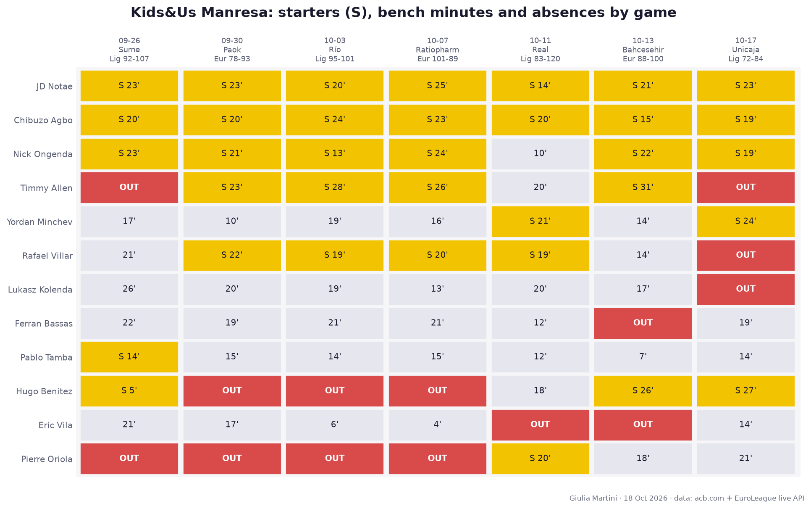
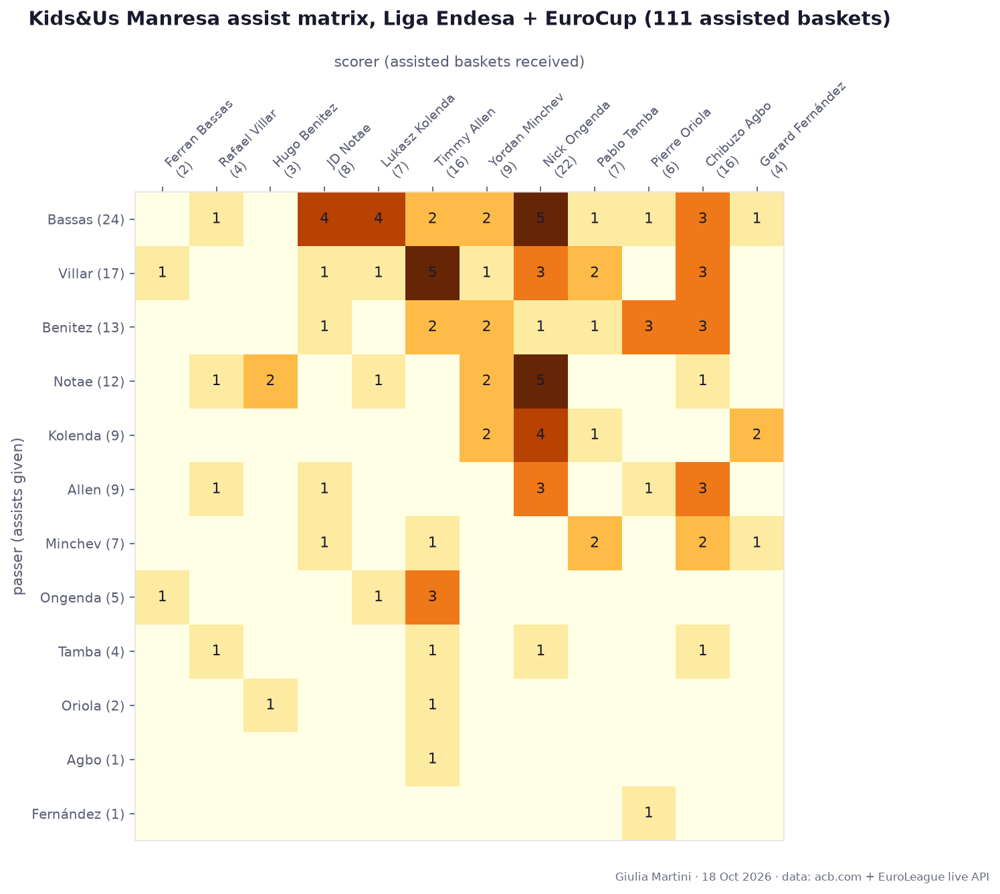
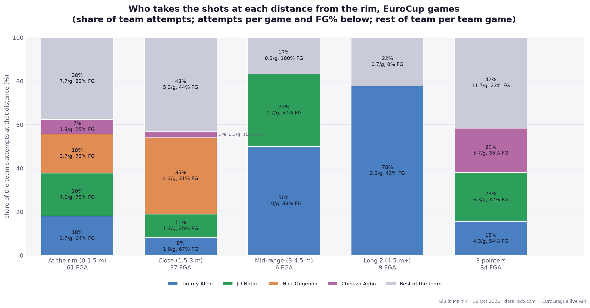
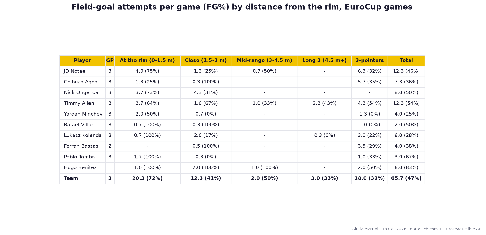
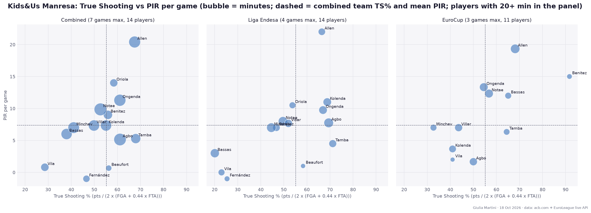
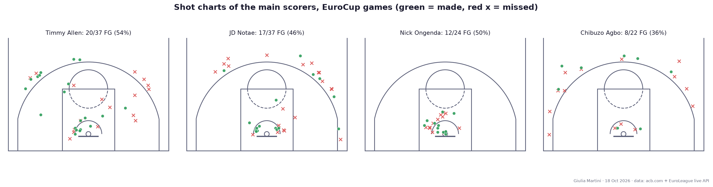

# Kids&Us Manresa scouting report (Liga Endesa + EuroCup)

*Prepared for BC Roma. Data as of 2026-10-18: 7 games (4 Liga Endesa, 3 EuroCup). Sources: acb.com live stats, EuroLeague live API. Small sample, read as tendencies.*

**Availability:** out of the last game (2026-10-17, Liga Endesa vs Unicaja): Timmy Allen, Rafael Villar, Lukasz Kolenda.

## Team snapshot

| | GP | W-L | PPG | Opp PPG |
|---|---|---|---|---|
| EuroCup | 3 | 1-2 | 89.0 | 94.0 |
| Liga Endesa | 4 | 0-4 | 85.5 | 103.0 |
| Total | 7 | 1-6 | 87.0 | 99.1 |

## Results

| Comp | Opponent | H/A | Score |
|---|---|---|---|
| Liga Endesa | Surne Bilbao | A | 92-107 |
| Liga Endesa | Río Breogán | H | 95-101 |
| Liga Endesa | Real Madrid | A | 83-120 |
| Liga Endesa | Unicaja | H | 72-84 |
| EuroCup | Paok Thessaloniki | A | 78-93 |
| EuroCup | Ratiopharm Ulm | H | 101-89 |
| EuroCup | Bahcesehir College Istanbul | A | 88-100 |

## Top 10 by total minutes

Height in cm (EuroLeague roster), position from ACB role / EuroLeague roster. PPG split: Liga Endesa / EuroCup.

- **JD Notae** (SG, 187 cm, 7 GP): 21.2 min, **13.7 pts**, 2.0 reb, 2.4 ast, FG 45% / 3P 29% / FT 71%; PPG 13.0 ACB / 14.7 EC. Volume shooter from 3 (5.0 att, 29%).
- **Chibuzo Agbo** (SF, 200 cm, 7 GP): 20.3 min, **9.0 pts**, 2.1 reb, 0.4 ast, FG 44% / 3P 42% / FT 62%; PPG 10.2 ACB / 7.3 EC. Volume shooter from 3 (5.4 att, 42%).
- **Nick Ongenda** (C, 211 cm, 7 GP): 18.8 min, **10.1 pts**, 3.6 reb, 1.0 ast, FG 58% / 3P - / FT 65%; PPG 10.2 ACB / 10.0 EC. Role player.
- **Timmy Allen** (PF, 198 cm, 5 GP): 25.7 min, **21.4 pts**, 4.2 reb, 2.0 ast, FG 54% / 3P 46% / FT 76%; PPG 20.5 ACB / 22.0 EC. Primary scorer, volume shooter from 3 (4.8 att, 46%), turnover-prone (2.6).
- **Yordan Minchev** (PF, 205 cm, 7 GP): 17.5 min, **5.4 pts**, 5.6 reb, 1.3 ast, FG 37% / 3P 23% / FT 42%; PPG 7.2 ACB / 3.0 EC. Role player.
- **Rafael Villar** (PG, 191 cm, 6 GP): 19.2 min, **4.5 pts**, 1.8 reb, 3.3 ast, FG 46% / 3P 17% / FT 43%; PPG 7.0 ACB / 2.0 EC. Role player.
- **Lukasz Kolenda** (SG, 195 cm, 6 GP): 19.1 min, **8.2 pts**, 2.2 reb, 1.8 ast, FG 41% / 3P 28% / FT 82%; PPG 10.3 ACB / 6.0 EC. Role player.
- **Ferran Bassas** (PG, 181 cm, 6 GP): 19.0 min, **3.7 pts**, 2.0 reb, 4.5 ast, FG 24% / 3P 16% / FT 78%; PPG 1.8 ACB / 7.5 EC. Main creator.
- **Pablo Tamba** (SF, 200 cm, 7 GP): 13.1 min, **4.7 pts**, 2.6 reb, 0.6 ast, FG 68% / 3P 33% / FT 42%; PPG 4.5 ACB / 5.0 EC. Role player.
- **Hugo Benitez** (PG, 192 cm, 4 GP): 19.2 min, **8.2 pts**, 1.5 reb, 4.0 ast, FG 54% / 3P 17% / FT 50%; PPG 7.3 ACB / 11.0 EC. Main creator, weak at the line (50%).

## Lineups

Five-man units rebuilt from substitutions, both competitions combined; best/worst need 3+ minutes together. Net rating = point differential per 40 minutes. 173 different units in 280 minutes.

**Most used**

- Agbo / Notae / Ongenda / Villar / Allen: 19.6 min, +18 (+37 per 40), 5 games
- Agbo / Vila / Notae / Ongenda / Villar: 6.4 min, -10 (-62 per 40), 3 games
- Agbo / Vila / Bassas / Notae / Ongenda: 6.1 min, -7 (-46 per 40), 2 games
- Agbo / Bassas / Notae / Tamba / Minchev: 5.4 min, -2 (-15 per 40), 2 games
- Agbo / Benitez / Notae / Ongenda / Minchev: 5.1 min, +5 (+39 per 40), 1 game

**Most effective**

- Agbo / Bassas / Notae / Ongenda / Allen: 3.4 min, +9 (+105 per 40), 1 game
- Vila / Notae / Kolenda / Villar / Minchev: 5.0 min, +8 (+64 per 40), 1 game
- Agbo / Kolenda / Ongenda / Villar / Allen: 5.0 min, +7 (+57 per 40), 2 games
- Kolenda / Tamba / Villar / Allen / Minchev: 3.3 min, +4 (+48 per 40), 3 games
- Agbo / Benitez / Notae / Ongenda / Minchev: 5.1 min, +5 (+39 per 40), 1 game

**Least effective**

- Agbo / Vila / Bassas / Notae / Ongenda: 6.1 min, -7 (-46 per 40), 2 games
- Agbo / Benitez / Notae / Ongenda / Tamba: 3.5 min, -5 (-57 per 40), 2 games
- Agbo / Vila / Notae / Ongenda / Villar: 6.4 min, -10 (-62 per 40), 3 games
- Agbo / Benitez / Notae / Ongenda / Allen: 3.4 min, -6 (-70 per 40), 1 game
- Agbo / Benitez / Notae / Kolenda / Minchev: 3.2 min, -6 (-74 per 40), 1 game

## Starting fives and absences

Gold = starter (S, minutes), grey = bench minutes, red = rotation player (top 10 by minutes) not on the game sheet (injury, rest or selection: the reason is not in the data).

| Date | Comp | Opponent | H/A | Score | Starters | Out |
|---|---|---|---|---|---|---|
| 2026-09-26 | Liga Endesa | Surne Bilbao | A | 92-107 | Agbo / Benitez / Notae / Ongenda / Tamba | **Timmy Allen** |
| 2026-09-30 | EuroCup | Paok Thessaloniki | A | 78-93 | Agbo / Allen / Notae / Ongenda / Villar | **Hugo Benitez** |
| 2026-10-03 | Liga Endesa | Río Breogán | H | 95-101 | Agbo / Allen / Notae / Ongenda / Villar | **Hugo Benitez** |
| 2026-10-07 | EuroCup | Ratiopharm Ulm | H | 101-89 | Agbo / Allen / Notae / Ongenda / Villar | **Hugo Benitez** |
| 2026-10-11 | Liga Endesa | Real Madrid | A | 83-120 | Agbo / Minchev / Notae / Oriola / Villar | - |
| 2026-10-13 | EuroCup | Bahcesehir College Istanbul | A | 88-100 | Agbo / Allen / Benitez / Notae / Ongenda | **Ferran Bassas** |
| 2026-10-17 | Liga Endesa | Unicaja | H | 72-84 | Agbo / Benitez / Minchev / Notae / Ongenda | **Timmy Allen, Rafael Villar, Lukasz Kolenda** |

5 different starting fives in 7 games; the most used (3 games): Agbo / Allen / Notae / Ongenda / Villar.

## Assist matrix

Passer (rows) to scorer (columns), 111 assisted baskets linked from the play-by-play (about 90% of the box-score assists; the rest could not be matched to a basket). Players with 5+ assists given plus received.

Most frequent combinations:

- Ferran Bassas to Nick Ongenda: 5
- JD Notae to Nick Ongenda: 5
- Rafael Villar to Timmy Allen: 5
- Ferran Bassas to Lukasz Kolenda: 4
- Ferran Bassas to JD Notae: 4

## Shot distribution by distance from the rim

EuroCup games only (3 games, 197 attempts): ACB does not publish shot locations. Main scorers = top 4 by total points. Table: share of each player's own attempts / FG%. The chart shows who takes the team's attempts at each distance.

| Distance | Team | Timmy Allen | JD Notae | Nick Ongenda | Chibuzo Agbo |
|---|---|---|---|---|---|
| At the rim (0-1.5 m) | 31% / 72% | 30% / 64% | 32% / 75% | 46% / 73% | 18% / 25% |
| Close (1.5-3 m) | 19% / 41% | 8% / 67% | 11% / 25% | 54% / 31% | 5% / 100% |
| Mid-range (3-4.5 m) | 3% / 50% | 8% / 33% | 5% / 50% | 0% / - | 0% / - |
| Long 2 (4.5 m+) | 5% / 33% | 19% / 43% | 0% / - | 0% / - | 0% / - |
| 3-pointers | 43% / 32% | 35% / 54% | 51% / 32% | 0% / - | 77% / 35% |

### Attempts per game (FG%) by player

Top 10 by minutes; attempts per EuroCup game played, FG% in brackets.

| Player | GP | At the rim (0-1.5 m) | Close (1.5-3 m) | Mid-range (3-4.5 m) | Long 2 (4.5 m+) | 3-pointers | Total |
|---|---|---|---|---|---|---|---|
| JD Notae | 3 | 4.0 (75%) | 1.3 (25%) | 0.7 (50%) | - | 6.3 (32%) | 12.3 (46%) |
| Chibuzo Agbo | 3 | 1.3 (25%) | 0.3 (100%) | - | - | 5.7 (35%) | 7.3 (36%) |
| Nick Ongenda | 3 | 3.7 (73%) | 4.3 (31%) | - | - | - | 8.0 (50%) |
| Timmy Allen | 3 | 3.7 (64%) | 1.0 (67%) | 1.0 (33%) | 2.3 (43%) | 4.3 (54%) | 12.3 (54%) |
| Yordan Minchev | 3 | 2.0 (50%) | 0.7 (0%) | - | - | 1.3 (0%) | 4.0 (25%) |
| Rafael Villar | 3 | 0.7 (100%) | 0.3 (100%) | - | - | 1.0 (0%) | 2.0 (50%) |
| Lukasz Kolenda | 3 | 0.7 (100%) | 2.0 (17%) | - | 0.3 (0%) | 3.0 (22%) | 6.0 (28%) |
| Ferran Bassas | 2 | - | 0.5 (100%) | - | - | 3.5 (29%) | 4.0 (38%) |
| Pablo Tamba | 3 | 1.7 (100%) | 0.3 (0%) | - | - | 1.0 (33%) | 3.0 (67%) |
| Hugo Benitez | 1 | 1.0 (100%) | 2.0 (100%) | 1.0 (100%) | - | 2.0 (50%) | 6.0 (83%) |
| Team | 3 | 20.3 (72%) | 12.3 (41%) | 2.0 (50%) | 3.0 (33%) | 28.0 (32%) | 65.7 (47%) |

## True Shooting and PIR

All box-score data of both competitions. Liga Endesa has no missing data here: PIR is computed from the box score and matches the rating published by ACB and EuroLeague for every player-game. Only players with 20+ minutes in the panel are shown.

| Player | Panel | GP | Min | TS% | PIR/g |
|---|---|---|---|---|---|
| Timmy Allen | Combined | 5 | 128 | 67.5 | 20.4 |
| Pierre Oriola | Combined | 3 | 59 | 58.4 | 14.0 |
| Nick Ongenda | Combined | 7 | 132 | 61.1 | 11.3 |
| JD Notae | Combined | 7 | 149 | 52.7 | 9.9 |
| Hugo Benitez | Combined | 4 | 77 | 55.9 | 9.0 |
| Lukasz Kolenda | Combined | 6 | 115 | 55.1 | 7.3 |
| Rafael Villar | Combined | 6 | 115 | 49.9 | 7.3 |
| Yordan Minchev | Combined | 7 | 122 | 41.1 | 7.0 |
| Ferran Bassas | Combined | 6 | 114 | 38.0 | 6.0 |
| Pablo Tamba | Combined | 7 | 91 | 68.0 | 5.3 |
| Chibuzo Agbo | Combined | 7 | 142 | 61.1 | 5.1 |
| Eric Vila | Combined | 5 | 61 | 28.6 | 0.8 |
| Lucas Beaufort | Combined | 6 | 33 | 56.2 | 0.7 |
| Gerard Fernández | Combined | 4 | 46 | 46.6 | -1.0 |

## Shot charts of the main scorers

