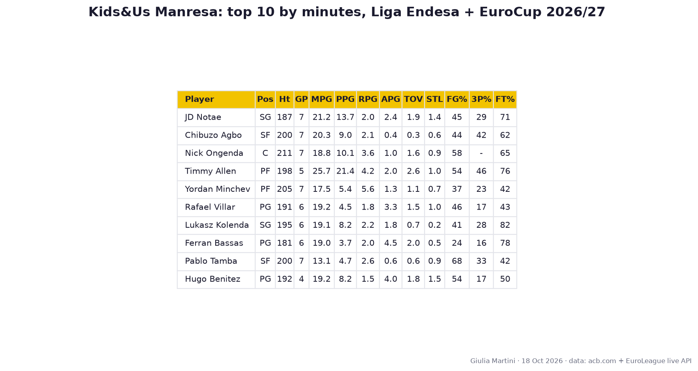
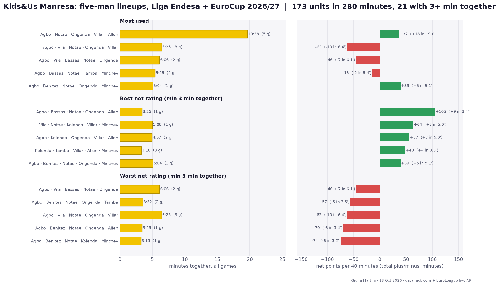

# Kids&Us Manresa scouting report (Liga Endesa + EuroCup)

*Prepared for BC Roma. Data as of 2026-10-18: 7 games (4 Liga Endesa, 3 EuroCup). Sources: acb.com live stats, EuroLeague live API. Small sample, read as tendencies.*

## Team snapshot

| | GP | W-L | PPG | Opp PPG |
|---|---|---|---|---|
| EuroCup | 3 | 1-2 | 89.0 | 94.0 |
| Liga Endesa | 4 | 0-4 | 85.5 | 103.0 |
| Total | 7 | 1-6 | 87.0 | 99.1 |

## Results

| Comp | Opponent | H/A | Score |
|---|---|---|---|
| Liga Endesa | Surne Bilbao | A | 92-107 |
| Liga Endesa | Río Breogán | H | 95-101 |
| Liga Endesa | Real Madrid | A | 83-120 |
| Liga Endesa | Unicaja | H | 72-84 |
| EuroCup | Paok Thessaloniki | A | 78-93 |
| EuroCup | Ratiopharm Ulm | H | 101-89 |
| EuroCup | Bahcesehir College Istanbul | A | 88-100 |

## Top 10 by total minutes

Height in cm (EuroLeague roster), position from ACB role / EuroLeague roster. PPG split: Liga Endesa / EuroCup.

- **JD Notae** (SG, 187 cm, 7 GP): 21.2 min, **13.7 pts**, 2.0 reb, 2.4 ast, FG 45% / 3P 29% / FT 71%; PPG 13.0 ACB / 14.7 EC. Volume shooter from 3 (5.0 att, 29%).
- **Chibuzo Agbo** (SF, 200 cm, 7 GP): 20.3 min, **9.0 pts**, 2.1 reb, 0.4 ast, FG 44% / 3P 42% / FT 62%; PPG 10.2 ACB / 7.3 EC. Volume shooter from 3 (5.4 att, 42%).
- **Nick Ongenda** (C, 211 cm, 7 GP): 18.8 min, **10.1 pts**, 3.6 reb, 1.0 ast, FG 58% / 3P - / FT 65%; PPG 10.2 ACB / 10.0 EC. Role player.
- **Timmy Allen** (PF, 198 cm, 5 GP): 25.7 min, **21.4 pts**, 4.2 reb, 2.0 ast, FG 54% / 3P 46% / FT 76%; PPG 20.5 ACB / 22.0 EC. Primary scorer, volume shooter from 3 (4.8 att, 46%), turnover-prone (2.6).
- **Yordan Minchev** (PF, 205 cm, 7 GP): 17.5 min, **5.4 pts**, 5.6 reb, 1.3 ast, FG 37% / 3P 23% / FT 42%; PPG 7.2 ACB / 3.0 EC. Role player.
- **Rafael Villar** (PG, 191 cm, 6 GP): 19.2 min, **4.5 pts**, 1.8 reb, 3.3 ast, FG 46% / 3P 17% / FT 43%; PPG 7.0 ACB / 2.0 EC. Role player.
- **Lukasz Kolenda** (SG, 195 cm, 6 GP): 19.1 min, **8.2 pts**, 2.2 reb, 1.8 ast, FG 41% / 3P 28% / FT 82%; PPG 10.3 ACB / 6.0 EC. Role player.
- **Ferran Bassas** (PG, 181 cm, 6 GP): 19.0 min, **3.7 pts**, 2.0 reb, 4.5 ast, FG 24% / 3P 16% / FT 78%; PPG 1.8 ACB / 7.5 EC. Main creator.
- **Pablo Tamba** (SF, 200 cm, 7 GP): 13.1 min, **4.7 pts**, 2.6 reb, 0.6 ast, FG 68% / 3P 33% / FT 42%; PPG 4.5 ACB / 5.0 EC. Role player.
- **Hugo Benitez** (PG, 192 cm, 4 GP): 19.2 min, **8.2 pts**, 1.5 reb, 4.0 ast, FG 54% / 3P 17% / FT 50%; PPG 7.3 ACB / 11.0 EC. Main creator, weak at the line (50%).

## Lineups

Five-man units rebuilt from substitutions, both competitions combined; best/worst need 3+ minutes together. Net rating = point differential per 40 minutes. 173 different units in 280 minutes.

**Most used**

- Agbo / Notae / Ongenda / Villar / Allen: 19.6 min, +18 (+37 per 40), 5 games
- Agbo / Vila / Notae / Ongenda / Villar: 6.4 min, -10 (-62 per 40), 3 games
- Agbo / Vila / Bassas / Notae / Ongenda: 6.1 min, -7 (-46 per 40), 2 games
- Agbo / Bassas / Notae / Tamba / Minchev: 5.4 min, -2 (-15 per 40), 2 games
- Agbo / Benitez / Notae / Ongenda / Minchev: 5.1 min, +5 (+39 per 40), 1 game

**Most effective**

- Agbo / Bassas / Notae / Ongenda / Allen: 3.4 min, +9 (+105 per 40), 1 game
- Vila / Notae / Kolenda / Villar / Minchev: 5.0 min, +8 (+64 per 40), 1 game
- Agbo / Kolenda / Ongenda / Villar / Allen: 5.0 min, +7 (+57 per 40), 2 games
- Kolenda / Tamba / Villar / Allen / Minchev: 3.3 min, +4 (+48 per 40), 3 games
- Agbo / Benitez / Notae / Ongenda / Minchev: 5.1 min, +5 (+39 per 40), 1 game

**Least effective**

- Agbo / Vila / Bassas / Notae / Ongenda: 6.1 min, -7 (-46 per 40), 2 games
- Agbo / Benitez / Notae / Ongenda / Tamba: 3.5 min, -5 (-57 per 40), 2 games
- Agbo / Vila / Notae / Ongenda / Villar: 6.4 min, -10 (-62 per 40), 3 games
- Agbo / Benitez / Notae / Ongenda / Allen: 3.4 min, -6 (-70 per 40), 1 game
- Agbo / Benitez / Notae / Kolenda / Minchev: 3.2 min, -6 (-74 per 40), 1 game
