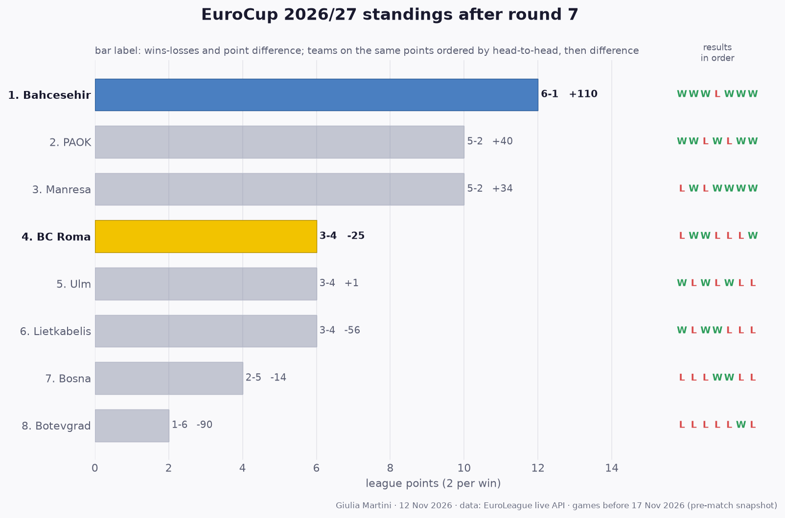

## EuroCup so far: results and standings

All 28 EuroCup games played before this match (rounds 1 to 7); home team first.

- **Round 1**: Lietkabelis 75-72 Bosna · PAOK 93-78 Manresa · Ulm 98-84 Botevgrad · **Bahcesehir 91-78 BC Roma**
- **Round 2**: Bosna 72-75 PAOK · **BC Roma 92-87 Lietkabelis** · **Botevgrad 61-100 Bahcesehir** · Manresa 101-89 Ulm
- **Round 3**: Lietkabelis 95-86 PAOK · **Bahcesehir 100-88 Manresa** · **BC Roma 77-72 Botevgrad** · Ulm 102-93 Bosna
- **Round 4**: Botevgrad 57-64 Lietkabelis · **Manresa 108-88 BC Roma** · **Bosna 86-77 Bahcesehir** · PAOK 87-78 Ulm
- **Round 5**: Lietkabelis 68-86 Ulm · **Bahcesehir 84-81 PAOK** · **BC Roma 80-85 Bosna** · Botevgrad 65-76 Manresa
- **Round 6**: **PAOK 113-111 BC Roma** · **Ulm 82-96 Bahcesehir** · Lietkabelis 66-80 Manresa · Bosna 69-78 Botevgrad
- **Round 7**: Botevgrad 56-79 PAOK · Manresa 86-82 Bosna · **Bahcesehir 99-61 Lietkabelis** · **BC Roma 83-78 Ulm**

**Standings after round 7**

| # | Team | Pts | W-L | Points for-against | Diff | Results |
|---:|---|---:|:---:|:---:|---:|:---:|
| 1 | **Bahcesehir** | 12 | 6-1 | 647-537 | +110 | WWWLWWW |
| 2 | PAOK | 10 | 5-2 | 614-574 | +40 | WWLWLWW |
| 3 | Manresa | 10 | 5-2 | 617-583 | +34 | LWLWWWW |
| 4 | **BC Roma** | 6 | 3-4 | 609-634 | -25 | LWWLLLW |
| 5 | Ulm | 6 | 3-4 | 613-612 | +1 | WLWLWLL |
| 6 | Lietkabelis | 6 | 3-4 | 516-572 | -56 | WLWWLLL |
| 7 | Bosna | 4 | 2-5 | 559-573 | -14 | LLLWWLL |
| 8 | Botevgrad | 2 | 1-6 | 473-563 | -90 | LLLLLWL |

2 points per win. Teams level on points are ordered by the games between them, then by point difference; with so few games played most of them have not met yet, so the order inside a group on the same points is provisional (newspapers sometimes list it differently).
