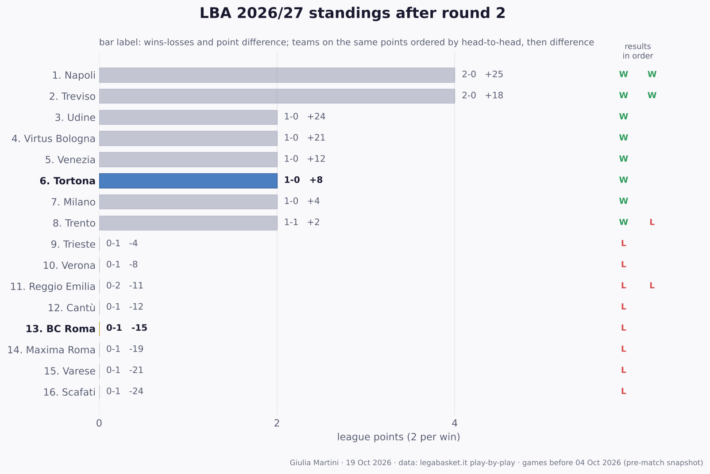

## LBA so far: results and standings

All 10 LBA games played before this match (rounds 1 to 2); home team first.

- **Round 1**: **Treviso 109-94 BC Roma** · Venezia 85-73 Cantù · Reggio Emilia 78-83 Trento · Milano 83-79 Trieste · **Tortona 101-93 Verona** · Udine 87-63 Scafati · Maxima Roma 75-94 Napoli · Varese 69-90 Virtus Bologna
- **Round 2**: Trento 90-93 Treviso · Napoli 99-93 Reggio Emilia

**Standings after round 2**

| # | Team | Pts | W-L | Points for-against | Diff | Results |
|---:|---|---:|:---:|:---:|---:|:---:|
| 1 | Napoli | 4 | 2-0 | 193-168 | +25 | WW |
| 2 | Treviso | 4 | 2-0 | 202-184 | +18 | WW |
| 3 | Udine | 2 | 1-0 | 87-63 | +24 | W |
| 4 | Virtus Bologna | 2 | 1-0 | 90-69 | +21 | W |
| 5 | Venezia | 2 | 1-0 | 85-73 | +12 | W |
| 6 | **Tortona** | 2 | 1-0 | 101-93 | +8 | W |
| 7 | Milano | 2 | 1-0 | 83-79 | +4 | W |
| 8 | Trento | 2 | 1-1 | 173-171 | +2 | WL |
| 9 | Trieste | 0 | 0-1 | 79-83 | -4 | L |
| 10 | Verona | 0 | 0-1 | 93-101 | -8 | L |
| 11 | Reggio Emilia | 0 | 0-2 | 171-182 | -11 | LL |
| 12 | Cantù | 0 | 0-1 | 73-85 | -12 | L |
| 13 | **BC Roma** | 0 | 0-1 | 94-109 | -15 | L |
| 14 | Maxima Roma | 0 | 0-1 | 75-94 | -19 | L |
| 15 | Varese | 0 | 0-1 | 69-90 | -21 | L |
| 16 | Scafati | 0 | 0-1 | 63-87 | -24 | L |

Two points per win. Teams level on points are ordered by the games between them, then by point difference; with so few games played most of them have not met yet, so the order inside a group on the same points is provisional (newspapers sometimes list it differently).
