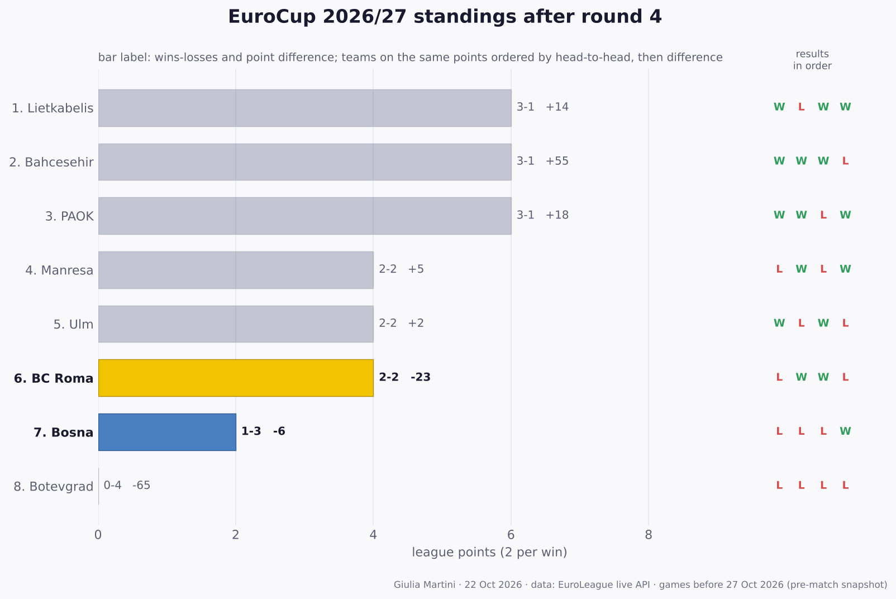

## EuroCup so far: results and standings

All 16 EuroCup games played before this match (rounds 1 to 4); home team first.

- **Round 1**: **Lietkabelis 75-72 Bosna** · PAOK 93-78 Manresa · Ulm 98-84 Botevgrad · **Bahcesehir 91-78 BC Roma**
- **Round 2**: **Bosna 72-75 PAOK** · **BC Roma 92-87 Lietkabelis** · Botevgrad 61-100 Bahcesehir · Manresa 101-89 Ulm
- **Round 3**: Lietkabelis 95-86 PAOK · Bahcesehir 100-88 Manresa · **BC Roma 77-72 Botevgrad** · **Ulm 102-93 Bosna**
- **Round 4**: Botevgrad 57-64 Lietkabelis · **Manresa 108-88 BC Roma** · **Bosna 86-77 Bahcesehir** · PAOK 87-78 Ulm

**Standings after round 4**

| # | Team | Pts | W-L | Points for-against | Diff | Results |
|---:|---|---:|:---:|:---:|---:|:---:|
| 1 | Lietkabelis | 6 | 3-1 | 321-307 | +14 | WLWW |
| 2 | Bahcesehir | 6 | 3-1 | 368-313 | +55 | WWWL |
| 3 | PAOK | 6 | 3-1 | 341-323 | +18 | WWLW |
| 4 | Manresa | 4 | 2-2 | 375-370 | +5 | LWLW |
| 5 | Ulm | 4 | 2-2 | 367-365 | +2 | WLWL |
| 6 | **BC Roma** | 4 | 2-2 | 335-358 | -23 | LWWL |
| 7 | **Bosna** | 2 | 1-3 | 323-329 | -6 | LLLW |
| 8 | Botevgrad | 0 | 0-4 | 274-339 | -65 | LLLL |

Two points per win. Teams level on points are ordered by the games between them, then by point difference; with so few games played most of them have not met yet, so the order inside a group on the same points is provisional (newspapers sometimes list it differently).
