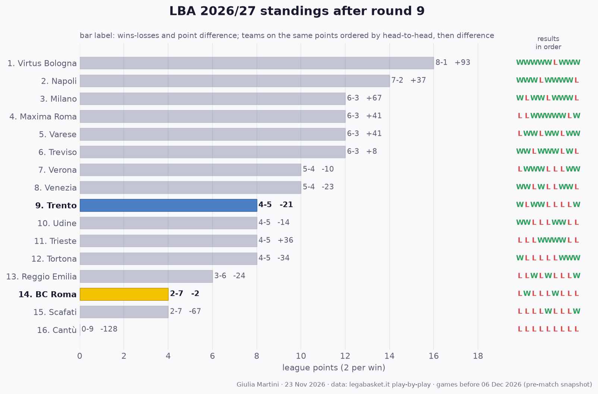

## LBA so far: results and standings

All 72 LBA games played before this match (rounds 1 to 9); home team first.

- **Round 1**: **Treviso 109-94 BC Roma** · Venezia 85-73 Cantù · **Reggio Emilia 78-83 Trento** · Milano 83-79 Trieste · Tortona 101-93 Verona · Udine 87-63 Scafati · Maxima Roma 75-94 Napoli · Varese 69-90 Virtus Bologna
- **Round 2**: **Trento 90-93 Treviso** · Napoli 99-93 Reggio Emilia · **BC Roma 108-70 Tortona** · Scafati 77-85 Varese · Trieste 82-87 Venezia · Virtus Bologna 98-89 Maxima Roma · Cantù 84-85 Udine · Verona 75-72 Milano
- **Round 3**: **Udine 66-74 Trento** · Varese 85-84 Trieste · Milano 106-77 Treviso · Reggio Emilia 93-86 Tortona · Cantù 80-99 Napoli · Scafati 82-89 Verona · **Maxima Roma 96-95 BC Roma** · Venezia 86-93 Virtus Bologna
- **Round 4**: **BC Roma 98-104 Venezia** · Napoli 82-98 Milano · **Trento 87-85 Varese** · Treviso 102-86 Udine · Verona 94-81 Reggio Emilia · Trieste 92-72 Cantù · Virtus Bologna 108-83 Scafati · Tortona 75-89 Maxima Roma
- **Round 5**: **Varese 110-103 BC Roma** · **Scafati 87-81 Trento** · Tortona 90-92 Napoli · Milano 94-98 Virtus Bologna · Maxima Roma 81-75 Udine · Venezia 89-97 Treviso · Trieste 108-99 Verona · Reggio Emilia 81-60 Cantù
- **Round 6**: **BC Roma 103-90 Scafati** · Verona 88-99 Varese · Treviso 81-68 Reggio Emilia · Napoli 99-81 Venezia · **Trento 62-88 Maxima Roma** · Udine 86-77 Tortona · Virtus Bologna 93-100 Trieste · Cantù 82-95 Milano
- **Round 7**: Reggio Emilia 78-83 Venezia · **Trieste 116-100 BC Roma** · Maxima Roma 99-87 Cantù · **Milano 88-86 Trento** · Tortona 87-76 Treviso · Scafati 89-91 Napoli · Varese 81-84 Udine · Virtus Bologna 95-81 Verona
- **Round 8**: Reggio Emilia 84-99 Varese · **BC Roma 88-89 Verona** · Treviso 91-81 Scafati · Napoli 90-89 Trieste · Cantù 92-106 Tortona · Venezia 88-81 Maxima Roma · Udine 70-83 Milano · **Trento 75-88 Virtus Bologna**
- **Round 9**: **Trento 100-86 Napoli** · Trieste 89-94 Reggio Emilia · Tortona 83-80 Milano · Scafati 83-67 Cantù · **Virtus Bologna 117-110 BC Roma** · Maxima Roma 108-91 Treviso · Verona 97-89 Udine · Varese 96-71 Venezia

**Standings after round 9**

| # | Team | Pts | W-L | Points for-against | Diff | Results |
|---:|---|---:|:---:|:---:|---:|:---:|
| 1 | Virtus Bologna | 16 | 8-1 | 880-787 | +93 | WWWWWLWWW |
| 2 | Napoli | 14 | 7-2 | 832-795 | +37 | WWWLWWWWL |
| 3 | Milano | 12 | 6-3 | 799-732 | +67 | WLWWLWWWL |
| 4 | Maxima Roma | 12 | 6-3 | 806-765 | +41 | LLWWWWWLW |
| 5 | Varese | 12 | 6-3 | 809-768 | +41 | LWWLWWLWW |
| 6 | Treviso | 12 | 6-3 | 817-809 | +8 | WWLWWWLWL |
| 7 | Verona | 10 | 5-4 | 805-815 | -10 | LWWWLLLWW |
| 8 | Venezia | 10 | 5-4 | 774-797 | -23 | WWLWLLWWL |
| 9 | **Trento** | 8 | 4-5 | 738-759 | -21 | WLWWLLLLW |
| 10 | Udine | 8 | 4-5 | 728-742 | -14 | WWLLLWWLL |
| 11 | Trieste | 8 | 4-5 | 839-803 | +36 | LLLWWWWLL |
| 12 | Tortona | 8 | 4-5 | 775-809 | -34 | WLLLLLWWW |
| 13 | Reggio Emilia | 6 | 3-6 | 750-774 | -24 | LLWLWLLLW |
| 14 | **BC Roma** | 4 | 2-7 | 899-901 | -2 | LWLLLWLLL |
| 15 | Scafati | 4 | 2-7 | 735-802 | -67 | LLLLWLLLW |
| 16 | Cantù | 0 | 0-9 | 697-825 | -128 | LLLLLLLLL |

2 points per win. Teams level on points are ordered by the games between them, then by point difference; with so few games played most of them have not met yet, so the order inside a group on the same points is provisional (newspapers sometimes list it differently).
