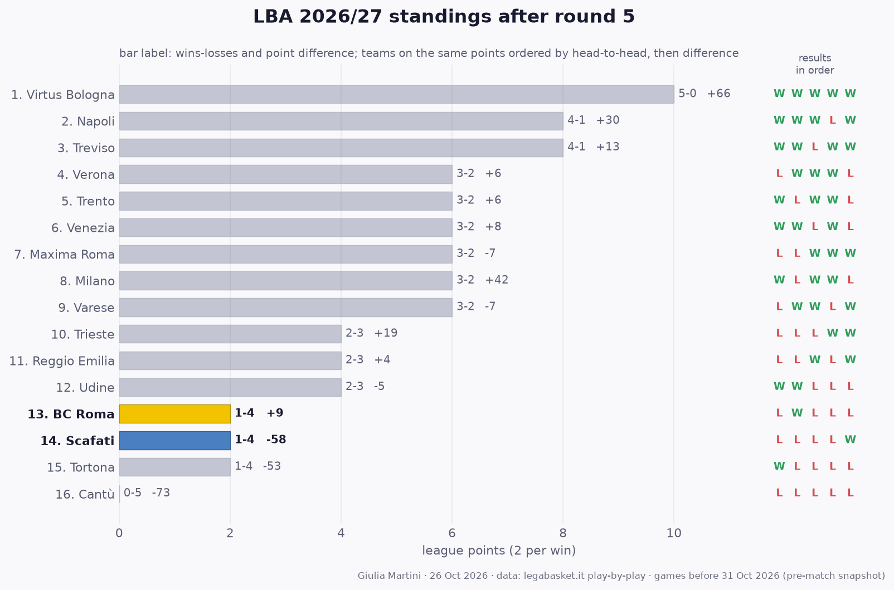

## LBA so far: results and standings

All 40 LBA games played before this match (rounds 1 to 5); home team first.

- **Round 1**: **Treviso 109-94 BC Roma** · Venezia 85-73 Cantù · Reggio Emilia 78-83 Trento · Milano 83-79 Trieste · Tortona 101-93 Verona · **Udine 87-63 Scafati** · Maxima Roma 75-94 Napoli · Varese 69-90 Virtus Bologna
- **Round 2**: Trento 90-93 Treviso · Napoli 99-93 Reggio Emilia · **BC Roma 108-70 Tortona** · **Scafati 77-85 Varese** · Trieste 82-87 Venezia · Virtus Bologna 98-89 Maxima Roma · Cantù 84-85 Udine · Verona 75-72 Milano
- **Round 3**: Udine 66-74 Trento · Varese 85-84 Trieste · Milano 106-77 Treviso · Reggio Emilia 93-86 Tortona · Cantù 80-99 Napoli · **Scafati 82-89 Verona** · **Maxima Roma 96-95 BC Roma** · Venezia 86-93 Virtus Bologna
- **Round 4**: **BC Roma 98-104 Venezia** · Napoli 82-98 Milano · Trento 87-85 Varese · Treviso 102-86 Udine · Verona 94-81 Reggio Emilia · Trieste 92-72 Cantù · **Virtus Bologna 108-83 Scafati** · Tortona 75-89 Maxima Roma
- **Round 5**: **Varese 110-103 BC Roma** · **Scafati 87-81 Trento** · Tortona 90-92 Napoli · Milano 94-98 Virtus Bologna · Maxima Roma 81-75 Udine · Venezia 89-97 Treviso · Trieste 108-99 Verona · Reggio Emilia 81-60 Cantù

**Standings after round 5**

| # | Team | Pts | W-L | Points for-against | Diff | Results |
|---:|---|---:|:---:|:---:|---:|:---:|
| 1 | Virtus Bologna | 10 | 5-0 | 487-421 | +66 | WWWWW |
| 2 | Napoli | 8 | 4-1 | 466-436 | +30 | WWWLW |
| 3 | Treviso | 8 | 4-1 | 478-465 | +13 | WWLWW |
| 4 | Verona | 6 | 3-2 | 450-444 | +6 | LWWWL |
| 5 | Trento | 6 | 3-2 | 415-409 | +6 | WLWWL |
| 6 | Venezia | 6 | 3-2 | 451-443 | +8 | WWLWL |
| 7 | Maxima Roma | 6 | 3-2 | 430-437 | -7 | LLWWW |
| 8 | Milano | 6 | 3-2 | 453-411 | +42 | WLWWL |
| 9 | Varese | 6 | 3-2 | 434-441 | -7 | LWWLW |
| 10 | Trieste | 4 | 2-3 | 445-426 | +19 | LLLWW |
| 11 | Reggio Emilia | 4 | 2-3 | 426-422 | +4 | LLWLW |
| 12 | Udine | 4 | 2-3 | 399-404 | -5 | WWLLL |
| 13 | **BC Roma** | 2 | 1-4 | 498-489 | +9 | LWLLL |
| 14 | **Scafati** | 2 | 1-4 | 392-450 | -58 | LLLLW |
| 15 | Tortona | 2 | 1-4 | 422-475 | -53 | WLLLL |
| 16 | Cantù | 0 | 0-5 | 369-442 | -73 | LLLLL |

2 points per win. Teams level on points are ordered by the games between them, then by point difference; with so few games played most of them have not met yet, so the order inside a group on the same points is provisional (newspapers sometimes list it differently).
