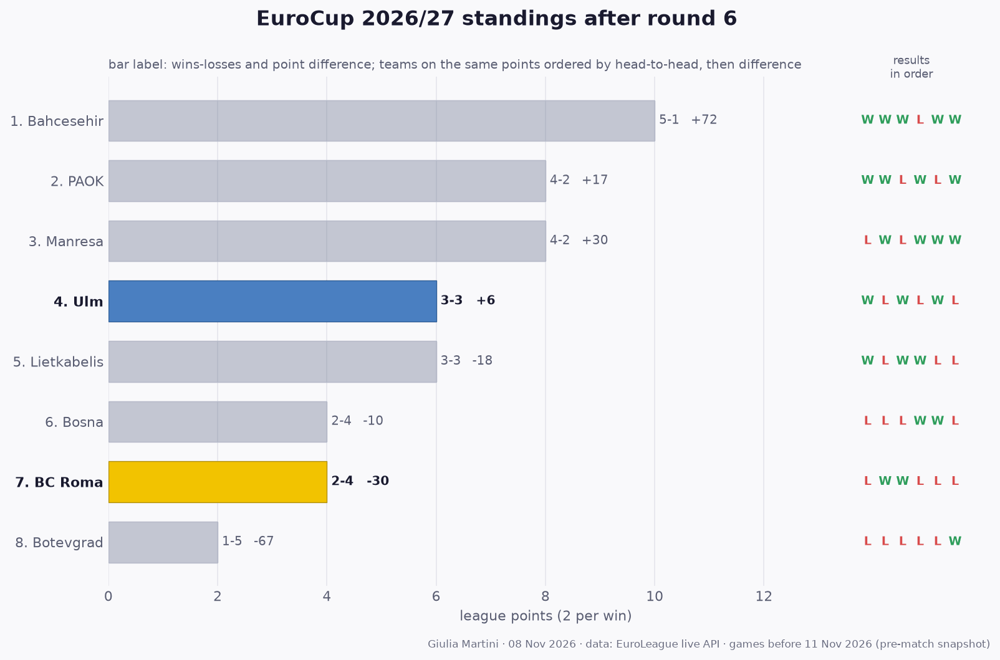

## EuroCup so far: results and standings

All 24 EuroCup games played before this match (rounds 1 to 6); home team first.

- **Round 1**: Lietkabelis 75-72 Bosna · PAOK 93-78 Manresa · **Ulm 98-84 Botevgrad** · **Bahcesehir 91-78 BC Roma**
- **Round 2**: Bosna 72-75 PAOK · **BC Roma 92-87 Lietkabelis** · Botevgrad 61-100 Bahcesehir · **Manresa 101-89 Ulm**
- **Round 3**: Lietkabelis 95-86 PAOK · Bahcesehir 100-88 Manresa · **BC Roma 77-72 Botevgrad** · **Ulm 102-93 Bosna**
- **Round 4**: Botevgrad 57-64 Lietkabelis · **Manresa 108-88 BC Roma** · Bosna 86-77 Bahcesehir · **PAOK 87-78 Ulm**
- **Round 5**: **Lietkabelis 68-86 Ulm** · Bahcesehir 84-81 PAOK · **BC Roma 80-85 Bosna** · Botevgrad 65-76 Manresa
- **Round 6**: **PAOK 113-111 BC Roma** · **Ulm 82-96 Bahcesehir** · Lietkabelis 66-80 Manresa · Bosna 69-78 Botevgrad

**Standings after round 6**

| # | Team | Pts | W-L | Points for-against | Diff | Results |
|---:|---|---:|:---:|:---:|---:|:---:|
| 1 | Bahcesehir | 10 | 5-1 | 548-476 | +72 | WWWLWW |
| 2 | PAOK | 8 | 4-2 | 535-518 | +17 | WWLWLW |
| 3 | Manresa | 8 | 4-2 | 531-501 | +30 | LWLWWW |
| 4 | **Ulm** | 6 | 3-3 | 535-529 | +6 | WLWLWL |
| 5 | Lietkabelis | 6 | 3-3 | 455-473 | -18 | WLWWLL |
| 6 | Bosna | 4 | 2-4 | 477-487 | -10 | LLLWWL |
| 7 | **BC Roma** | 4 | 2-4 | 526-556 | -30 | LWWLLL |
| 8 | Botevgrad | 2 | 1-5 | 417-484 | -67 | LLLLLW |

2 points per win. Teams level on points are ordered by the games between them, then by point difference; with so few games played most of them have not met yet, so the order inside a group on the same points is provisional (newspapers sometimes list it differently).
