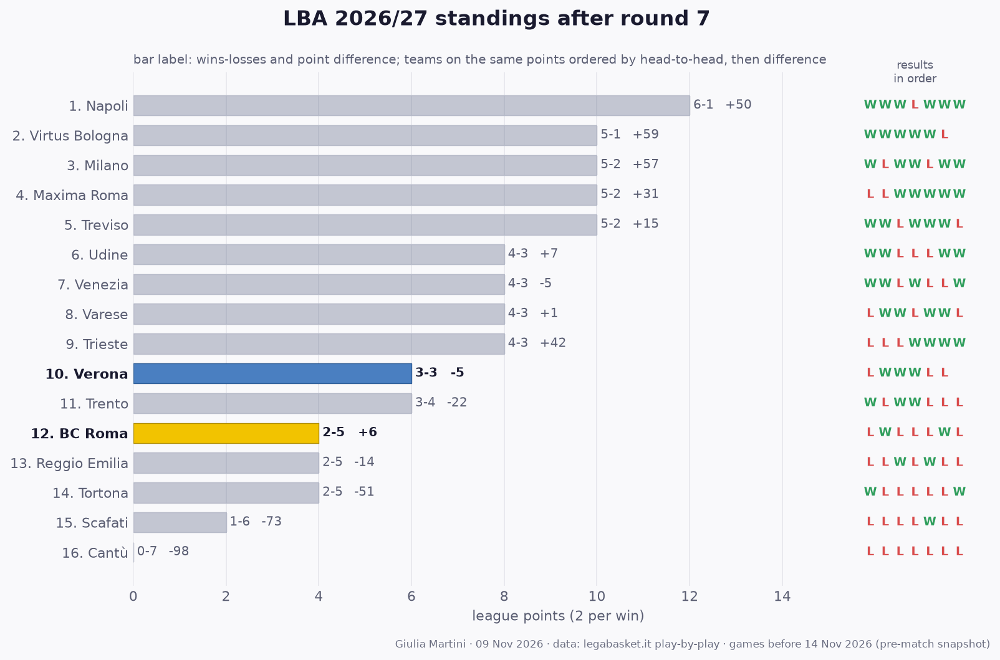

## LBA so far: results and standings

All 55 LBA games played before this match (rounds 1 to 7); home team first.

- **Round 1**: **Treviso 109-94 BC Roma** · Venezia 85-73 Cantù · Reggio Emilia 78-83 Trento · Milano 83-79 Trieste · **Tortona 101-93 Verona** · Udine 87-63 Scafati · Maxima Roma 75-94 Napoli · Varese 69-90 Virtus Bologna
- **Round 2**: Trento 90-93 Treviso · Napoli 99-93 Reggio Emilia · **BC Roma 108-70 Tortona** · Scafati 77-85 Varese · Trieste 82-87 Venezia · Virtus Bologna 98-89 Maxima Roma · Cantù 84-85 Udine · **Verona 75-72 Milano**
- **Round 3**: Udine 66-74 Trento · Varese 85-84 Trieste · Milano 106-77 Treviso · Reggio Emilia 93-86 Tortona · Cantù 80-99 Napoli · **Scafati 82-89 Verona** · **Maxima Roma 96-95 BC Roma** · Venezia 86-93 Virtus Bologna
- **Round 4**: **BC Roma 98-104 Venezia** · Napoli 82-98 Milano · Trento 87-85 Varese · Treviso 102-86 Udine · **Verona 94-81 Reggio Emilia** · Trieste 92-72 Cantù · Virtus Bologna 108-83 Scafati · Tortona 75-89 Maxima Roma
- **Round 5**: **Varese 110-103 BC Roma** · Scafati 87-81 Trento · Tortona 90-92 Napoli · Milano 94-98 Virtus Bologna · Maxima Roma 81-75 Udine · Venezia 89-97 Treviso · **Trieste 108-99 Verona** · Reggio Emilia 81-60 Cantù
- **Round 6**: **BC Roma 103-90 Scafati** · **Verona 88-99 Varese** · Treviso 81-68 Reggio Emilia · Napoli 99-81 Venezia · Trento 62-88 Maxima Roma · Udine 86-77 Tortona · Virtus Bologna 93-100 Trieste · Cantù 82-95 Milano
- **Round 7**: Reggio Emilia 78-83 Venezia · **Trieste 116-100 BC Roma** · Maxima Roma 99-87 Cantù · Milano 88-86 Trento · Tortona 87-76 Treviso · Scafati 89-91 Napoli · Varese 81-84 Udine

**Standings after round 7**

| # | Team | Pts | W-L | Points for-against | Diff | Results |
|---:|---|---:|:---:|:---:|---:|:---:|
| 1 | Napoli | 12 | 6-1 | 656-606 | +50 | WWWLWWW |
| 2 | Virtus Bologna | 10 | 5-1 | 580-521 | +59 | WWWWWL |
| 3 | Milano | 10 | 5-2 | 636-579 | +57 | WLWWLWW |
| 4 | Maxima Roma | 10 | 5-2 | 617-586 | +31 | LLWWWWW |
| 5 | Treviso | 10 | 5-2 | 635-620 | +15 | WWLWWWL |
| 6 | Udine | 8 | 4-3 | 569-562 | +7 | WWLLLWW |
| 7 | Venezia | 8 | 4-3 | 615-620 | -5 | WWLWLLW |
| 8 | Varese | 8 | 4-3 | 614-613 | +1 | LWWLWWL |
| 9 | Trieste | 8 | 4-3 | 661-619 | +42 | LLLWWWW |
| 10 | **Verona** | 6 | 3-3 | 538-543 | -5 | LWWWLL |
| 11 | Trento | 6 | 3-4 | 563-585 | -22 | WLWWLLL |
| 12 | **BC Roma** | 4 | 2-5 | 701-695 | +6 | LWLLLWL |
| 13 | Reggio Emilia | 4 | 2-5 | 572-586 | -14 | LLWLWLL |
| 14 | Tortona | 4 | 2-5 | 586-637 | -51 | WLLLLLW |
| 15 | Scafati | 2 | 1-6 | 571-644 | -73 | LLLLWLL |
| 16 | Cantù | 0 | 0-7 | 538-636 | -98 | LLLLLLL |

2 points per win. Teams level on points are ordered by the games between them, then by point difference; with so few games played most of them have not met yet, so the order inside a group on the same points is provisional (newspapers sometimes list it differently).
