# BC Roma vs Umana Reyer Venezia

LBA 2026/27, Round 4 · Saturday 17 October 2026, 16:00 · Palazzetto dello Sport, Rome

Data: LBA games only (legabasket.it box scores and play-by-play), rounds 1 to 3 for both teams. League references are all 16 teams' LBA games collected so far (42 team-games). Three games per team is a small sample: treat everything below as early tendencies, not established facts. EuroCup games are not included.

This folder is a frozen pre-match snapshot (games before 17 October 2026). Regenerate it with `python notebooks/matchup_report.py --home "BC Roma" --away "Umana Reyer Venezia" --no-eurocup --before 2026-10-17`, `python notebooks/lineups_report.py --team "BC Roma" --team "Umana Reyer Venezia" --before 2026-10-17 --out <this folder>` and `python notebooks/standings.py --team "BC Roma" --team "Umana Reyer Venezia" --before 2026-10-17 --out <this folder>` (results and standings section).

## LBA so far: results and standings

All 24 LBA games played before this match (rounds 1 to 3); home team first.

- **Round 1**: **Treviso 109-94 BC Roma** · **Venezia 85-73 Cantù** · Reggio Emilia 78-83 Trento · Milano 83-79 Trieste · Tortona 101-93 Verona · Udine 87-63 Scafati · Maxima Roma 75-94 Napoli · Varese 69-90 Virtus Bologna
- **Round 2**: Trento 90-93 Treviso · Napoli 99-93 Reggio Emilia · **BC Roma 108-70 Tortona** · Scafati 77-85 Varese · **Trieste 82-87 Venezia** · Virtus Bologna 98-89 Maxima Roma · Cantù 84-85 Udine · Verona 75-72 Milano
- **Round 3**: Udine 66-74 Trento · Varese 85-84 Trieste · Milano 106-77 Treviso · Reggio Emilia 93-86 Tortona · Cantù 80-99 Napoli · Scafati 82-89 Verona · **Maxima Roma 96-95 BC Roma** · **Venezia 86-93 Virtus Bologna**

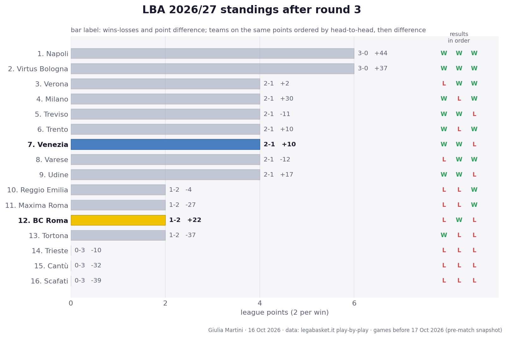

**Standings after round 3**

| # | Team | Pts | W-L | Points for-against | Diff | Results |
|---:|---|---:|:---:|:---:|---:|:---:|
| 1 | Napoli | 6 | 3-0 | 292-248 | +44 | WWW |
| 2 | Virtus Bologna | 6 | 3-0 | 281-244 | +37 | WWW |
| 3 | Verona | 4 | 2-1 | 257-255 | +2 | LWW |
| 4 | Milano | 4 | 2-1 | 261-231 | +30 | WLW |
| 5 | Treviso | 4 | 2-1 | 279-290 | -11 | WWL |
| 6 | Trento | 4 | 2-1 | 247-237 | +10 | WLW |
| 7 | **Venezia** | 4 | 2-1 | 258-248 | +10 | WWL |
| 8 | Varese | 4 | 2-1 | 239-251 | -12 | LWW |
| 9 | Udine | 4 | 2-1 | 238-221 | +17 | WWL |
| 10 | Reggio Emilia | 2 | 1-2 | 264-268 | -4 | LLW |
| 11 | Maxima Roma | 2 | 1-2 | 260-287 | -27 | LLW |
| 12 | **BC Roma** | 2 | 1-2 | 297-275 | +22 | LWL |
| 13 | Tortona | 2 | 1-2 | 257-294 | -37 | WLL |
| 14 | Trieste | 0 | 0-3 | 245-255 | -10 | LLL |
| 15 | Cantù | 0 | 0-3 | 237-269 | -32 | LLL |
| 16 | Scafati | 0 | 0-3 | 222-261 | -39 | LLL |

Two points per win. Teams level on points are ordered by the games between them, then by point difference; with so few games played most of them have not met yet, so the order inside a group on the same points is provisional (newspapers sometimes list it differently).

## Where the two teams are

**BC Roma** is 1-2 and 12th in the standings, level on 2 points with Reggio Emilia, Maxima Roma and Tortona (its +22 point difference is the best of the four, but the derby loss puts it behind Maxima): a 94-109 loss at Treviso, a 108-70 win over Tortona and a 95-96 loss at Maxima Roma in the derby. The team scores 99 per game (128 per 100 possessions against a league 111) and concedes 92, the opponents hitting 53% of their twos, 36% of their threes and getting to the line 26.7 times per game.

**Venezia** is 2-1 and 7th, one of seven teams on 4 points behind the unbeaten Napoli and Virtus Bologna: wins over Cantu (85-73) and at Trieste (87-82), then a 86-93 home loss to Virtus Bologna. It scores 86 and concedes 83 (117 per 100 possessions scored), with the better defence of the two: opponents shoot 51% on twos and 33% on threes and have 21 free throw attempts per game.

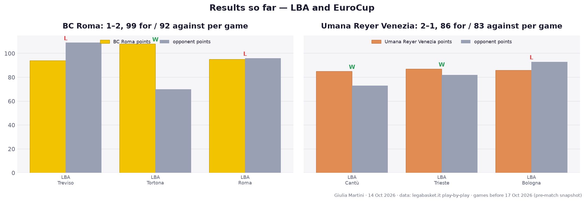

## Starting five and bench

Both teams get most of their scoring from the starters (BC Roma 62 starters and 37 bench per game, Venezia 58 and 28). Venezia has the thinner bench scoring of the two; BC Roma's bench, led by Watson (12.0 points, 78% true shooting) and Davis (11.0), is closer to the league norm.

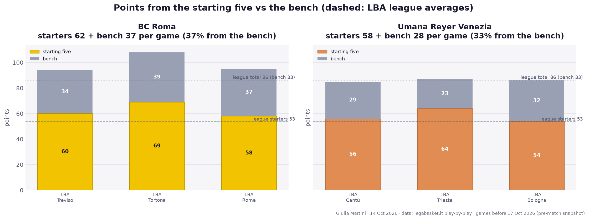

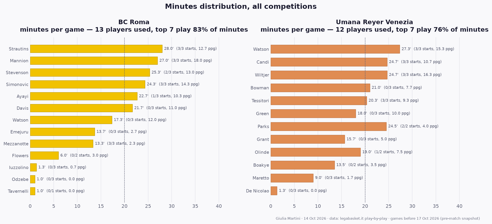

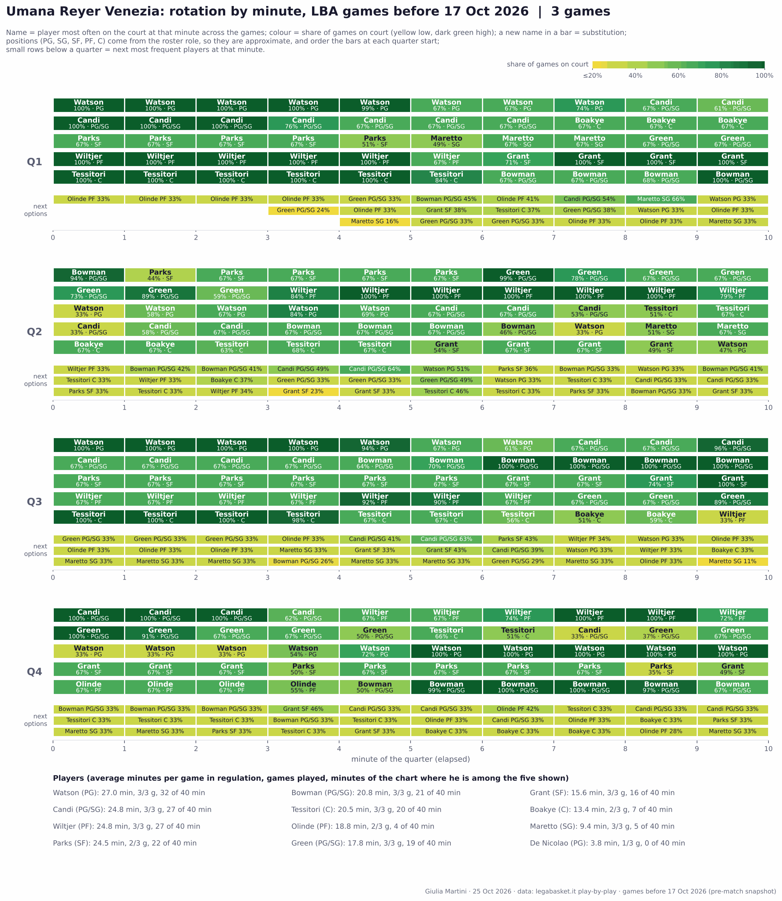

## Scoring sources

BC Roma is paint-first: 33% of its shots come from under the basket and 2P% is 65%, with 45 points per game within 4.5 m of the rim. It still takes 30.7 threes per game (37% made). Venezia is more balanced: 29% of its shots at the rim, 59% on twos, 27 threes per game at 37%. Both are well above the league on shooting efficiency, so the game is likely to be decided by who gets more possessions and free throws rather than who shoots better.

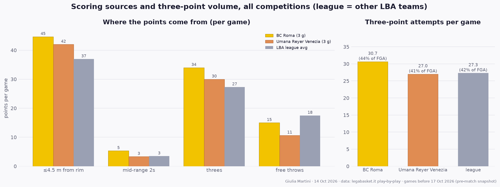

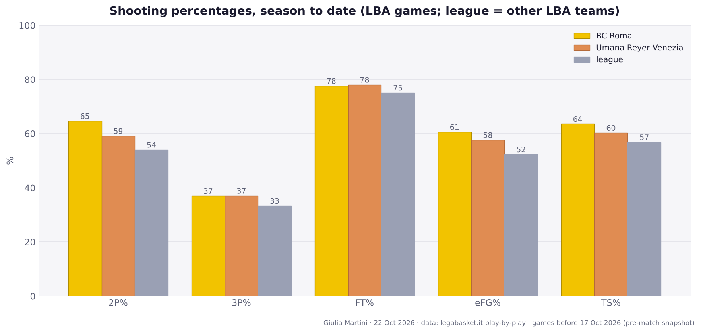

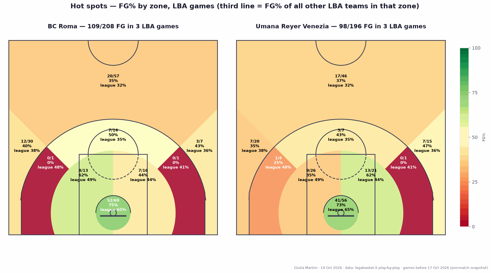

## Pace, turnovers, fouls

BC Roma plays faster (77.2 possessions per game against Venezia's 73.3, league 76.7). Both take care of the ball (11.7 and 11.0 turnovers, league 13.8) and neither forces many (8.7 and 9.3 turnovers by opponents). The difference is at the line: Venezia attempts just 13.7 free throws per game (league 23), BC Roma 19.3, but BC Roma gives up 26.7 per game against Venezia's 21. On the glass BC Roma has the offensive rebounding edge (12.3 per game against 9.0).

## Key players

Niccolo Mannion is the engine of BC Roma: 18.0 points, 8.7 assists, PIR 26.0 and 67% true shooting. Simonovic (14.3 points, 6.7 rebounds, 70% TS) is the inside anchor, Stevenson (9/21 from three, +26) and Strautins (12.7 points, team-best +25) complete the best unit. Ayayi is the only regular with a negative plus/minus (-9).

For Venezia, Watson (15.3 points, 4.0 assists, 10/20 from three) and Wiltjer (16.3 points but 57% TS and 3/13 from three) lead the scoring; Candi is 7/11 from three and Tessitori (+30 over three games) is the stabiliser inside. Bowman (-15) and Grant (-22) are the players the team has been outscored with.

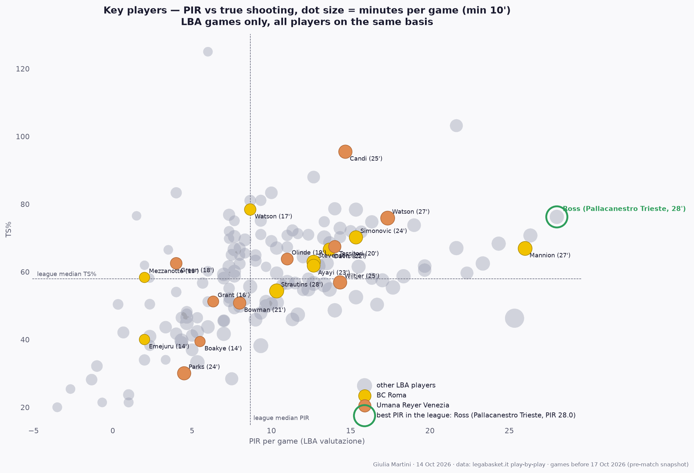

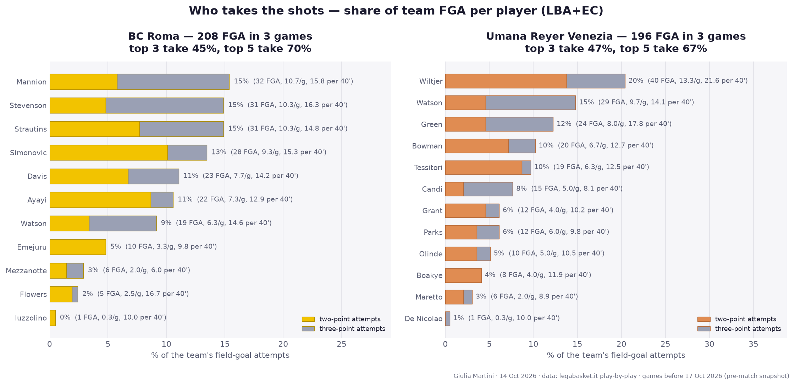

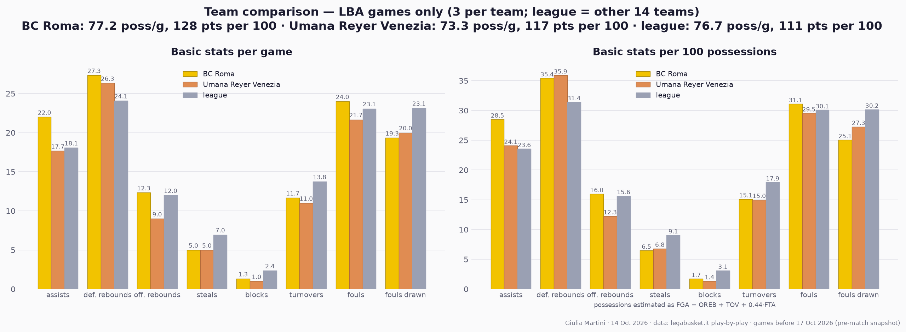

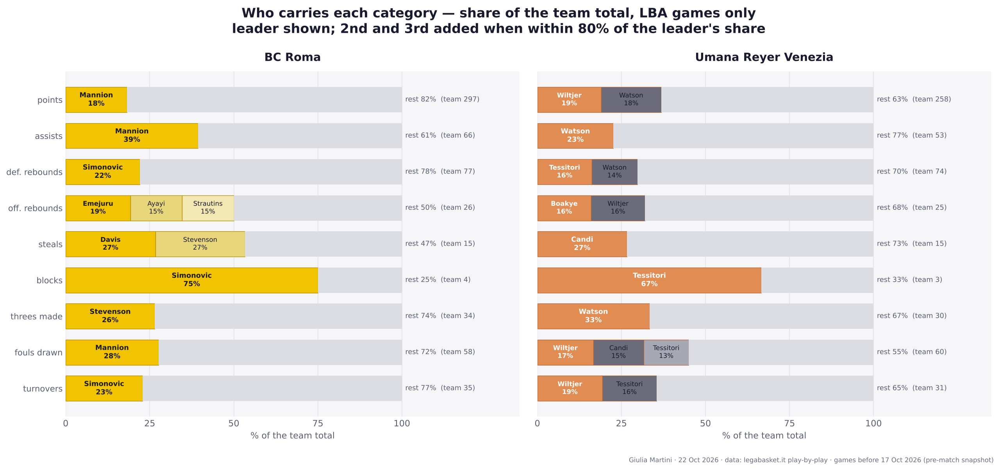

## Lineups

Lineups are rebuilt from the play-by-play substitutions. With 120 minutes per team, only 12 five-man units per team have played three minutes together, so rankings are by net points per 40 minutes among those units and are noisy.

**BC Roma** has one clear default unit: Mannion, Mezzanotte, Simonovic, Stevenson and Strautins played 17:53 together (15% of all minutes, two games) and are +18, +40 per 40 minutes. Swapping Davis for Mezzanotte gives the best rate (+7 in 4:41), while the units built around Ayayi are the weak ones: Ayayi, Mannion, Mezzanotte, Simonovic and Strautins are -9 in 5:36 (the worst), and the second unit of Ayayi, Davis, Emejuru plus two wings is negative every time (-3 in 4:46 with Strautins and Watson, -2 in 3:07 with Flowers). The bench-heavy units are where the game has been given away, and Mezzanotte's presence in the first unit is notable given his 2.3 points per game. Without Olynyk (not registered for the derby, expected to debut in this round), the frontcourt rotation could change this picture.

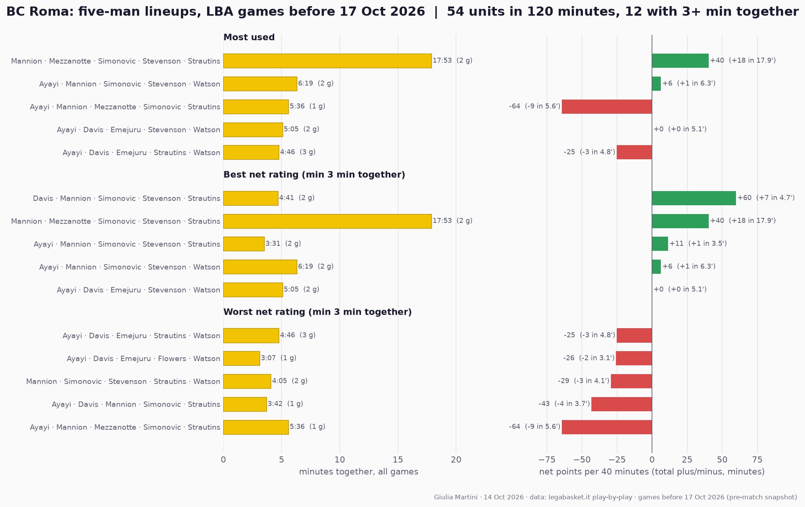

**Venezia** relies even more on a single unit: Candi, Parks, Tessitori, Watson and Wiltjer played 11:53 (10% of the minutes, +15, +51 per 40) and a variant with Green in place of Candi added 7:07 (+5). Best rate of all is Bowman, Candi, Olinde, Tessitori and Watson (+6 in 3:00, one game). The poor units pair Bowman or Grant with Parks and Wiltjer (Bowman, Grant, Parks, Watson, Wiltjer: -3 in 3:36), plus Candi, Green, Olinde, Tessitori, Watson (-4 in 3:30). Venezia's results are best when Watson, Tessitori and Wiltjer share the floor with Candi or Parks.

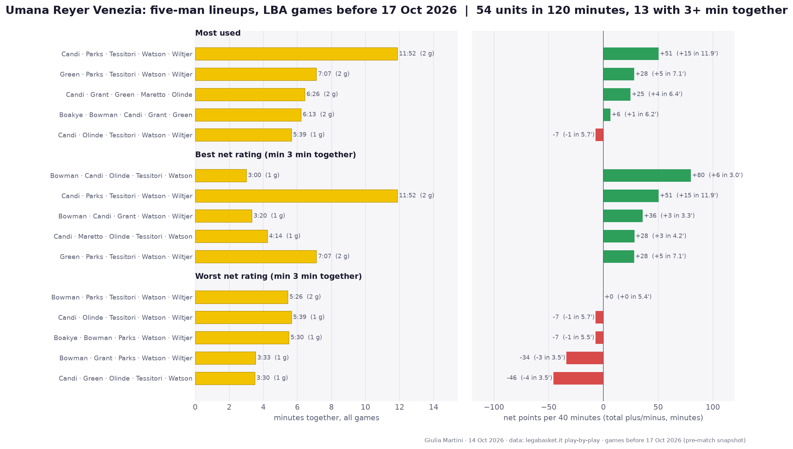

## What to expect

BC Roma at home with the faster, paint-heavy offence against a Venezia defence that has held opponents to 83 points. The tendencies suggest BC Roma controls the glass and the paint, while Venezia's route is a low-turnover, three-point-friendly game and avoiding fouls: it has rarely gone to the line, so BC Roma's 26.7 free throws conceded per game are the cheapest advantage on offer. The lineups say the key minutes are when each coach goes to the bench: BC Roma's Ayayi-Davis-Emejuru groups have been negative, while Venezia's units with Bowman or Grant have been the weakest. Foul trouble for Simonovic or Tessitori (the +30 player) would be the biggest swing. With three games per team, no prediction of the final score is made.

## Sources

- Box scores and play-by-play: legabasket.it (via this repo's collector, `data/`), LBA games only
