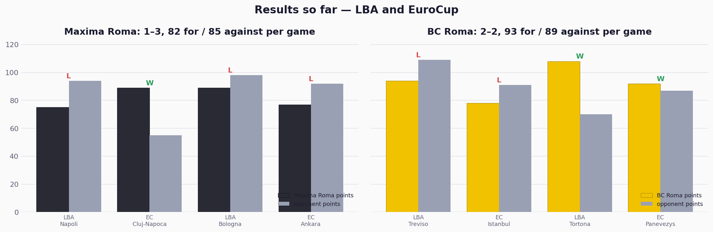
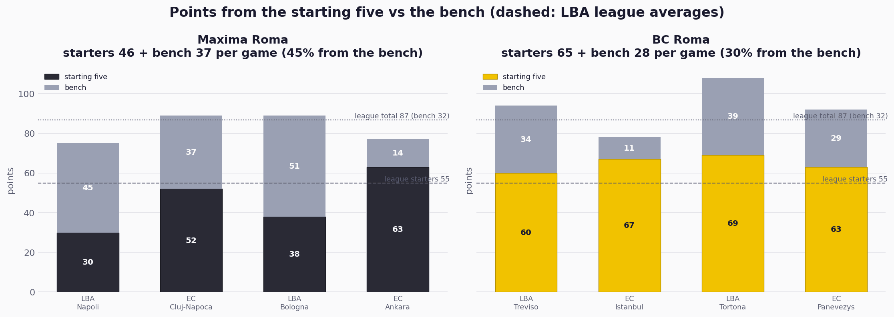
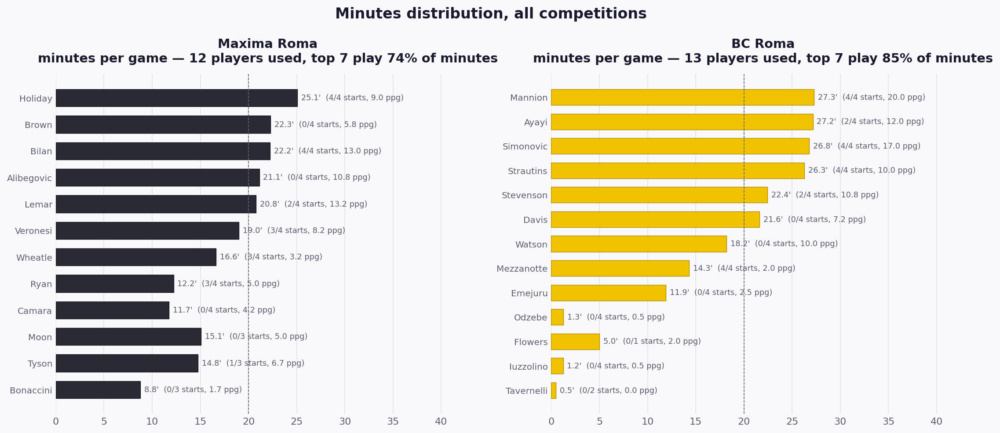
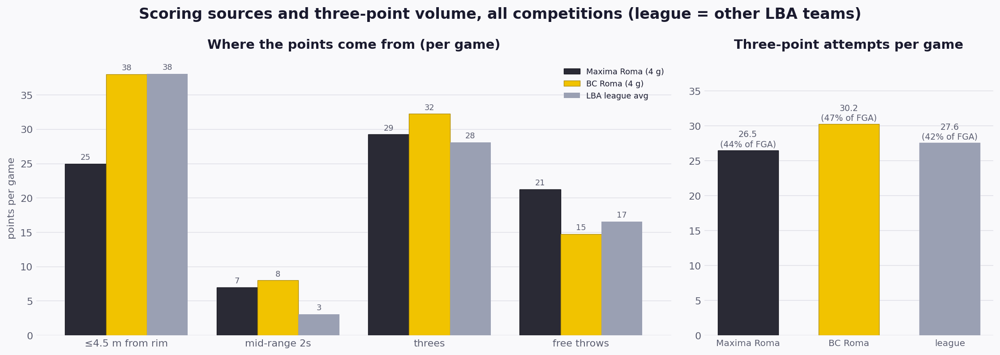
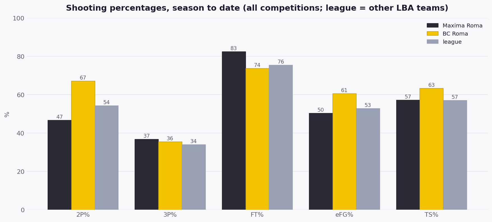
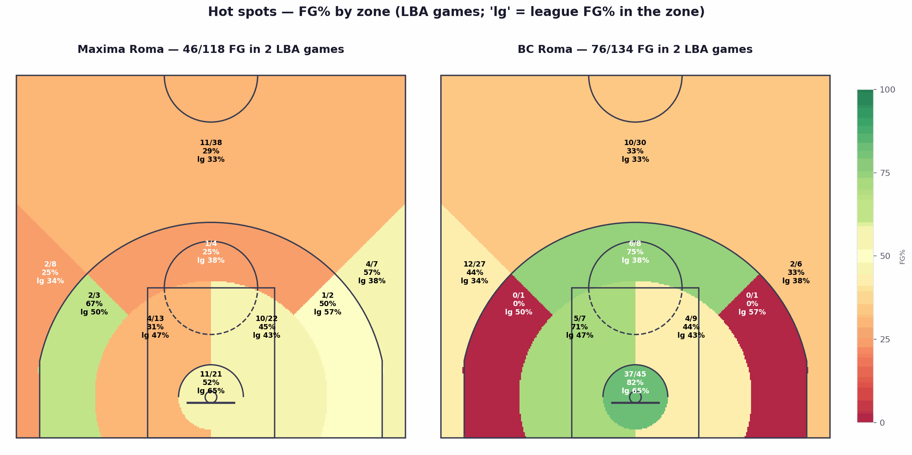
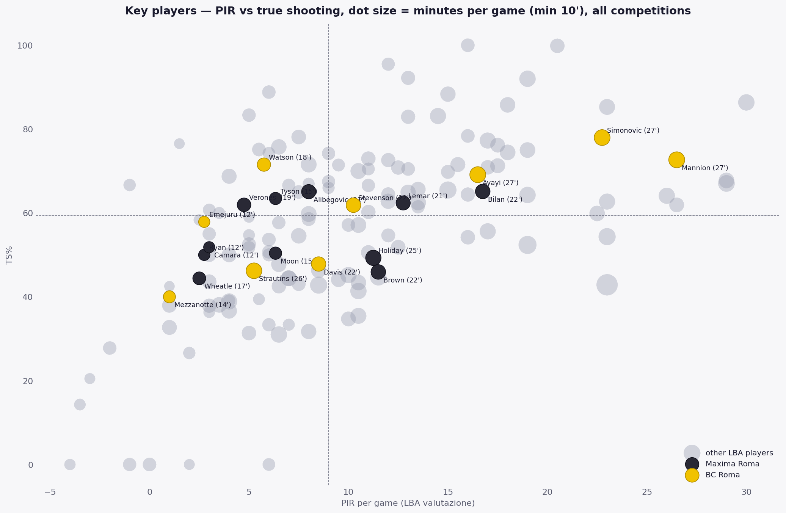
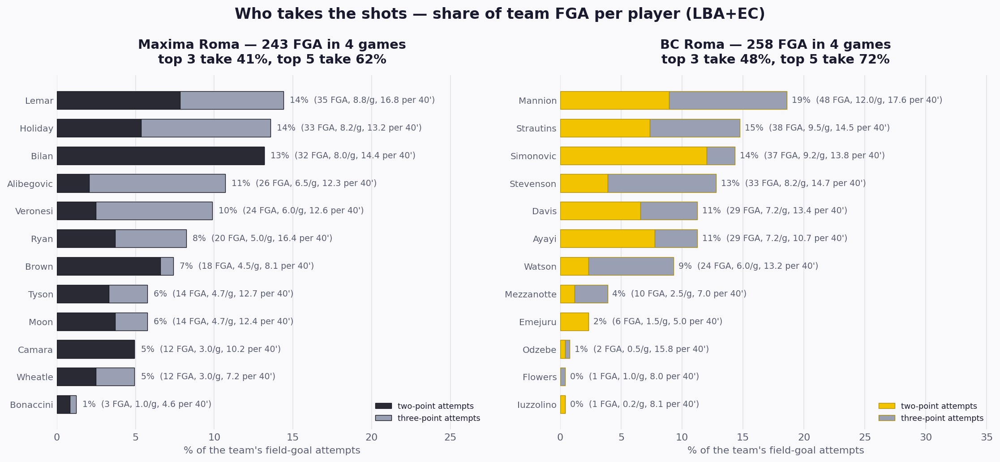

# Derby della Capitale — Maxima Roma vs BC Roma

LBA 2026/27, Round 3 · Sunday 11 October 2026, 18:15 · PalaEur (first two rings sold out, 6,100+ tickets by Thursday)

Data: both teams' LBA games (rounds 1–2, from the legabasket.it play-by-play) and EuroCup rounds 1–2 (EuroLeague API box scores and shot zones). League references are the other 14 LBA teams' games collected so far. Four games per team is a small sample: treat everything below as early tendencies, not established facts.

Regenerate with `python notebooks/matchup_report.py --home "Maxima Roma" --away "BC Roma"`.

## Where the two teams are

**Maxima Roma** is 0–2 in the league and 1–1 in EuroCup. Both LBA losses came after being in the game at half time: level with Napoli at the break (42–45) before a 12–26 third quarter, and ahead of Virtus Bologna after three quarters (68–65) before a 21–33 fourth. The same thing happened in Ankara, where a 65–60 lead became a 77–92 loss on a 12–32 last period. The one win, 89–55 over Cluj-Napoca, was a 34–18 first quarter that settled the game early. The team scores 82 and concedes 85 per game; in the LBA alone it concedes 96 per game, the opponents shooting 40% from three (21/53) and handing out 25.5 assists against them.

**BC Roma** is 1–1 and 1–1. The opener at Treviso was lost on a 22–27 third quarter and never recovered; the response was a 108–70 win over Tortona (first Serie A win in the club's history) and then a 92–87 EuroCup win over Lietkabelis after losing in Istanbul. The team scores 93 and concedes 89, and the defensive numbers in the LBA are the mirror image of Maxima's: opponents shoot 27% from three (13/49) but get to the line a lot (28.5 FTA per game against BC Roma, league average 22).

Kelly Olynyk was signed on 3 October but his Serie A registration did not come through in time: he misses the derby and should debut in Round 4 against Venezia. Flowers, who missed both EuroCup games, is available according to coach Magro. No absences are reported on the Maxima side; Matt Ryan sat out the Ankara game.

## Starting five and bench

The two rosters are built very differently. BC Roma's starters produce 65 points per game and the bench 28 (30% of the scoring), with the top seven players taking 85% of the minutes. Maxima is the deepest rotation in the data set: 12 players used, nobody above 25 minutes per game, the top seven only 74% of the minutes, and the bench accounts for 45% of the points (37 per game, against an LBA average of 32). Maxima's starters, at 46 per game, score nine fewer than a league-average starting five, and in the two LBA games the starting unit managed 30 and 38 points.

## Scoring sources

This is the clearest contrast in the matchup. BC Roma scores 38 points per game within 4.5 m of the rim (exactly the league average) and is converting 67% of its two-point attempts, with 37/45 (82%) in the restricted area in the LBA. In the play-by-play BC Roma has 23 drives to the basket ("da penetrazione") at 18/23 and six dunks; Maxima has 11 drives at 6/11 and one dunk. Maxima's inside scoring is 25 points per game, 13 below the league, with 11/21 in the restricted area (52% against a league 65%) and 4/13 from the left short-range zone. What keeps Maxima's offence afloat is the free-throw line: 26 attempts per game at 82.5%, including 30/30 against Napoli and 27/34 at Bologna. Take away those two numbers and the offence is 75 jump shots at 31%.

Both teams shoot a lot of threes. BC Roma takes 30 per game, 47% of its attempts (league 42%), and makes 35.5%; Maxima takes 26.5 at 36.8%. BC Roma's volume is concentrated on the left wing and the top of the arc (G and H zones, 42% of all its attempts), the right side of the floor is barely used; Maxima's threes come overwhelmingly from the top (zone H, 32% of all attempts) where it is shooting 29%.

## Pace, turnovers, fouls

Both teams play at a middle-of-the-league pace (BC Roma 74.6 possessions per game, Maxima 76.1), and neither runs: one fast-break basket each in two LBA games. Expect a half-court game decided at the rim and at the line.

Maxima turns the ball over 15.8 times per game across competitions (league 13.6), ten of its LBA turnovers being bad passes, and the Lietkabelis game showed BC Roma is not immune (17). BC Roma commits 25.5 fouls per game and sends opponents to the line 28.5 times, which is precisely the thing Maxima is best at exploiting: Maxima draws 29 fouls and 32 free throws per LBA game.

## Key players

Niccolò Mannion is the best player on either side on current form: 20.0 points and 6.2 assists per game, PIR 26.5, 73% true shooting, 9/25 from three, 29 points in Istanbul. Marko Simonovic is the inside anchor at 17.0 points and 7.8 rebounds on 78% true shooting, and the team's best plus/minus over the four games (+30, including +25 against Tortona). Gerald Ayayi (12.0 / 5.0 / 3.8) is the connector; Erik Stevenson (10/23 from three) and Paul Watson (9/18) are the bench shooters, and when they are on, BC Roma's bench scoring doubles. The weak spots: Strautins is shooting 46% true shooting on 26 minutes, Davis is 2/12 from three with a team-worst −16, and Mezzanotte starts but gives 2 points in 14 minutes.

For Maxima, Miro Bilan (13.0 points, 6.5 rebounds, 65% TS in 22 minutes) is the one reliable inside option and the obvious matchup against Simonovic; Brynton Lemar (13.2) and Mirza Alibegovic (10.8, 9/21 from three) are the scorers off the bench. Aaron Holiday runs the team (6.0 assists) but is 6/20 from three and at 49% true shooting; Veronesi is the only Maxima regular with a positive plus/minus (+28), largely from the Cluj game. John Brown's 5.8 rebounds and 2.2 steals per game make him the defensive piece Cotelli will likely use on Mannion.

## What to expect

The game should turn on two matchups. First, whether Maxima can keep BC Roma's drivers (Mannion, Ayayi, Simonovic rolling) out of the restricted area: BC Roma takes a third of its shots there and makes 82%, while Maxima's opponents are shooting 34/45 at the rim. Second, whether BC Roma can defend without fouling: its 28.5 opponent free throws per game run straight into the league's best free-throw team.

The tendencies suggest BC Roma controls the paint and the glass (12.8 offensive rebounds per game against Maxima's 9.5) and Maxima stays in it through free throws and bench threes. Maxima's pattern of losing the third or fourth quarter in three of four games, against a BC Roma that has itself collapsed in a third quarter (Treviso), makes the start of the second half the moment to watch. A reasonable baseline from the numbers is a BC Roma win by a handful of points in a game in the high 80s, with the derby atmosphere and Maxima's depth as the main reasons it could go the other way. Without Olynyk, BC Roma's frontcourt depth behind Simonovic is Emejuru and Mezzanotte, so foul trouble for Simonovic would be the single biggest swing factor.

## Sources

- [BC Roma, ufficiale l'arrivo di Kelly Olynyk](https://www.basketuniverso.it/bc-roma-ufficiale-larrivo-del-veterano-nba-kelly-olynyk/) and [il tesseramento non arriva in tempo: salta il derby](https://www.basketuniverso.it/bc-roma-il-tesseramento-di-kelly-olynyk-non-arriva-in-tempo-salta-il-derby-con-la-maxima/)
- [Magro verso il derby: Olynyk in arrivo, Flowers sarà della partita (Sportando)](https://sportando.basketball/magro-verso-il-derby-olynyk-e-in-arrivo-flowers-sara-della-partita/)
- [Derby, 6.100 biglietti venduti (Eurosport)](https://www.eurosport.it/basket/serie-a/2026-2027/derby-di-roma-gia-6.100-biglietti-venduti-primi-due-anelli-del-palaeur-sold-out-per-maxima-roma-bc-roma_sto23343885/story.shtml)
- [Türk Telekom – Maxima Roma 92–77 (Timeout Channel)](https://www.timeoutchannel.it/eurocup-2a-giornata-turk-telekom-maxima-roma-92-77-non-basta-bilan-bianconeri-sconfitti-in-turchia/), [Maxima Roma – Cluj 89–55 pagelle (Backdoor)](https://backdoorpodcast.com/maxima-roma-straripante-all-esordio-in-eurocup/), [BC Roma – Lietkabelis (NbaPassion)](https://www.nbapassion.com/lega-basket-a/bc-roma-spqr/il-bc-roma-parte-forte-poi-soffre-lietkabelis-ko-al-photofinish-324996/)
- Box scores and play-by-play: legabasket.it (via this repo's collector) and the EuroLeague live API (`data/eurocup_2026_raw.txt`)
