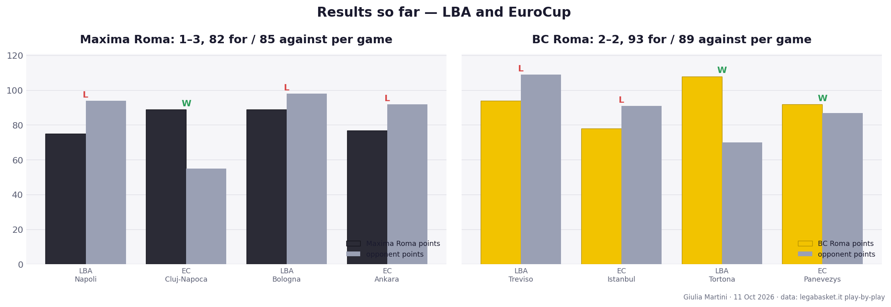
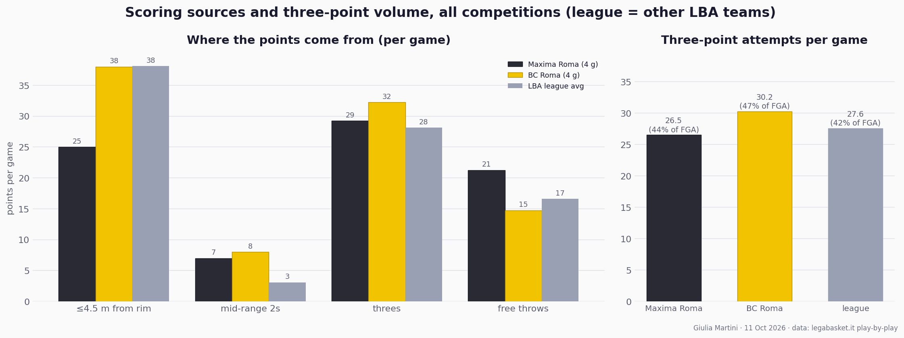
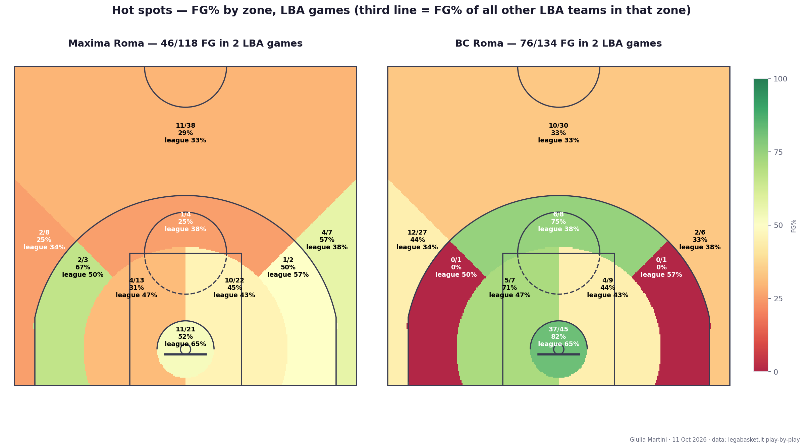
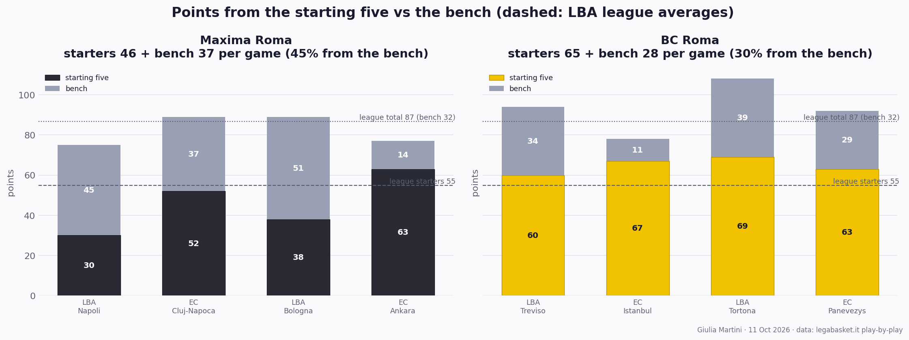
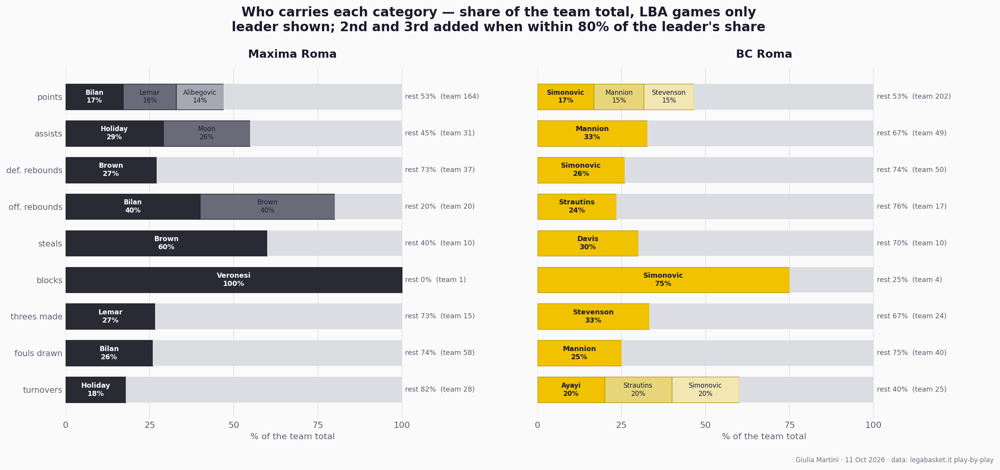
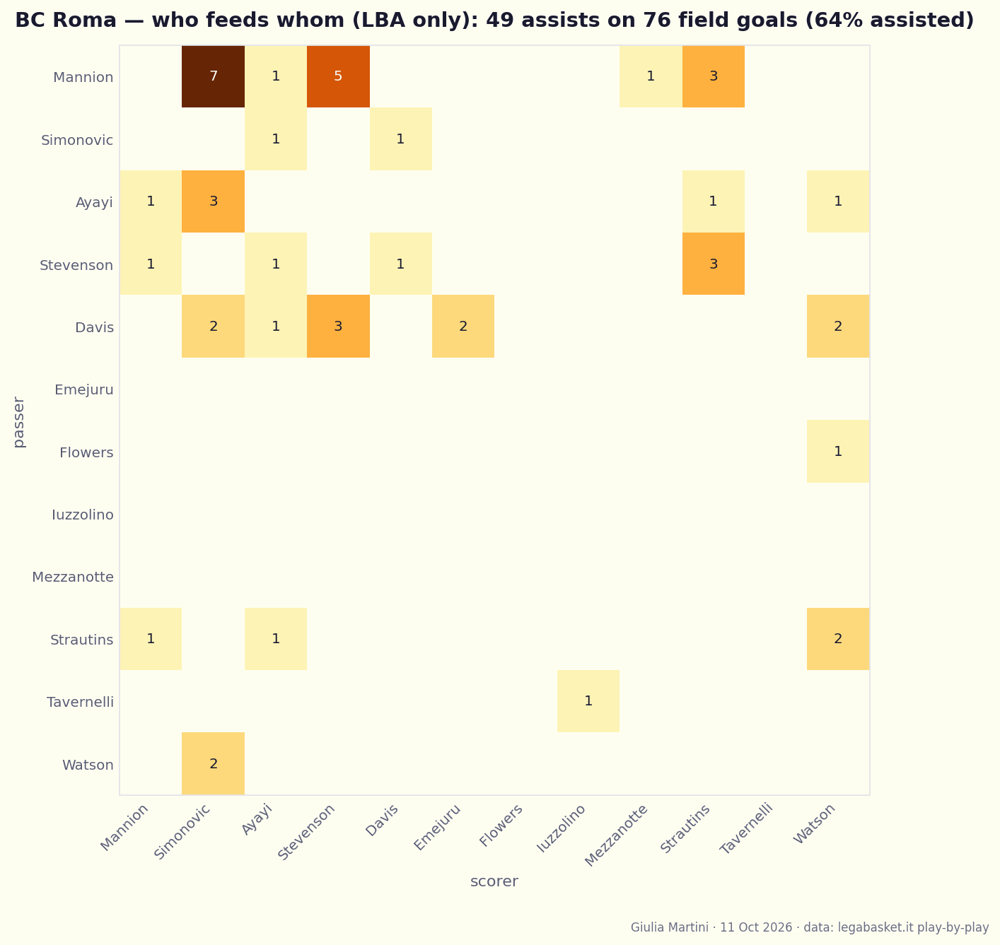
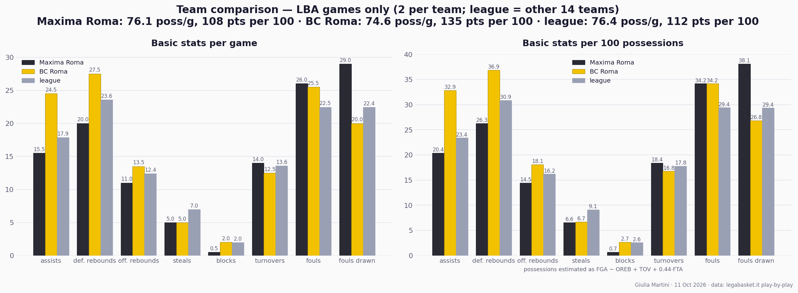
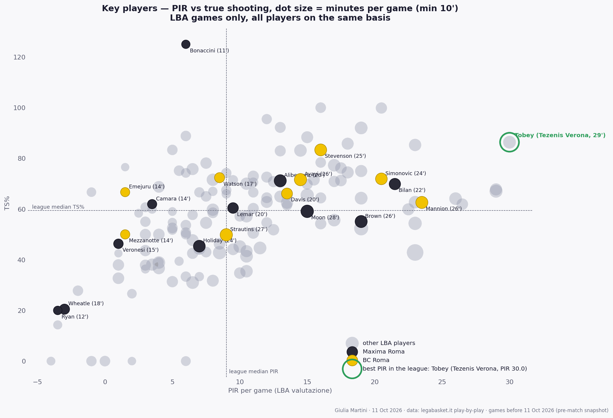

*Published 11 October 2026, a few hours before tip-off. [Versione italiana](/about_me/Derby_Roma_2026_it.html). Numbers are season to date: two LBA games per team plus two EuroCup games each, so read everything as early tendencies rather than established facts. Code and data: [bc-roma-2627-analysis](https://github.com/martinig94/bc-roma-2627-analysis).*

## Why this game

Rome has two Serie A teams again. BC Roma and Maxima Roma arrived this summer by taking over and relocating two existing franchises (Vanoli Cremona and Germani Brescia), and tonight at the PalaEur, with the first two rings sold out, the city gets its first top-flight derby since 1979-80. Both teams also play EuroCup, so four games each are already on record.

Kelly Olynyk, signed by BC Roma on 3 October, is not registered in time and misses the game. Flowers, who sat out both EuroCup games, is available. No absences are reported on the Maxima side.

## The data

Data from both competitions (LBA and EuroCup) is collected and processed programmatically; the league reference is always the other fourteen LBA teams in the same games. For details on the data and the method, feel free to contact me ([email](mailto:martini.giulia94@gmail.com) or [LinkedIn](https://www.linkedin.com/in/giulimartini/)).

One limit should be clear from the start: the analysis is based solely on this data. It shows where shots come from, who takes them, who is on the floor and who passes to whom; it does not show how a possession was built. Nothing in this page is a comment on defensive schemes, pick-and-roll usage or coverages, set plays or spacing, which can only come from the film.

## Where the two teams are

Maxima is 0–2 in the league and 1–1 in EuroCup, and the losses share a shape: level or ahead going into the second half, then one bad quarter (12–26 against Napoli in the third, 21–33 at Bologna in the fourth, 12–32 at Ankara in the fourth after leading 65–60). In the LBA it concedes 96 points a game, with opponents shooting 40% from three against it.

BC Roma is 1–1 and 1–1: a loss at Treviso decided by a 22–27 third quarter, a 108–70 win over Tortona (the club's first in Serie A), a loss in Istanbul and a 92–87 win over Lietkabelis. It scores 93 and concedes 89. Opponents shoot only 27% from three against it but get to the line 28.5 times a game, well above the league's 22.

## Two opposite offences

This is the clearest contrast in the matchup. BC Roma plays inside out: 38 points per game within 4.5 m of the rim (league average), 67% on twos, 37/45 in the restricted area in the LBA, 18/23 on drives. It also takes 30 threes a game, 47% of its attempts, concentrated on the left wing and the top of the arc.

Maxima scores 25 inside, 13 below the league, converts 52% at the rim against a league 65%, and has attempted 11 drives in two LBA games. What keeps the offence afloat is the free-throw line: 26 attempts a game at 82.5%, including a 30/30 night against Napoli. Its threes come overwhelmingly from the top of the arc, where it shoots 29%.

## Shared versus concentrated

Maxima is the deepest rotation in the data: twelve players used, nobody above 25 minutes, the top seven playing 74% of the minutes, and 45% of the points from the bench against an LBA average of 32. Its leadership is shared in almost every category: three scorers within three points of each other (Bilan 17% of the points, Lemar 16%, Alibegovic 14%), two passers (Holiday 29% of the assists, Moon 26%), Bilan and Brown splitting the offensive glass.

BC Roma rides seven players for 85% of the minutes and a starting five that scores 65 a game. On the ball it has one hub: Mannion takes 19% of the team's shots and a third of its assists, and nine of his seventeen assists go to Simonovic, who finishes 93% of his baskets off a pass and shoots 71% of his attempts at the rim. Stevenson is the catch-and-shoot outlet (78% of his attempts from three, 72% of them from one side of the floor).

## Basic stats, same basis

On LBA games only, both teams play at the same pace (76 and 75 possessions a game). BC Roma assists on far more of its baskets (33 assists per 100 possessions against Maxima's 20 and a league 23) and wins both backboards; Maxima is below the league on every rebounding and passing number, has one block in two games, and leads only in fouls drawn, 38 per 100 possessions against a league 29.

## The key players

On the two LBA games alone, where the data is complete, the key players are few and clear. For BC Roma the pair is Mannion and Simonovic: Mannion has the team's best efficiency rating (23.5 PIR per game, sixth in the whole league) with 15 points, 8 assists and one turnover a game, and he is the player who touches the ball most (19% of the team's shots and a third of its assists); Simonovic produces 17 points and 6.5 rebounds in 24 minutes at 72% true shooting, 14/17 on twos, with the team's best on-court balance at +15. Behind them Stevenson is the most efficient of all (83% true shooting, 8/14 from three, +21 on court) and Davis gives 10 assists in 41 minutes off the bench. These four carry so much that when Mannion or Simonovic are off, the numbers show no obvious alternative: after Davis, nobody else is above 9 PIR per game.

For Maxima the numbers point to Bilan and Brown. Bilan has the highest rating (21.5 PIR, 14 points and 6 rebounds in 22.5 minutes) and gets it mostly from the line, 14/16, where he goes thanks to 15 fouls drawn in two games, the highest figure on either team; Brown is the most complete player (10 points, 9 rebounds, 3 steals a game, 19 PIR) and the only big with a near-even on-court balance (−2) across two clear defeats. Alibegovic is the third reference (11.5 points, 14/14 at the line), Lemar the most prolific scorer per minute (26.7 points per 40') but at −34 on court, and Moon, 13 points and 8 assists in his only game, is the most interesting variable because he moved the ball like no other teammate. Maxima's problem in the numbers is not the top of the rotation but its tail: Wheatle, Ryan and Holiday add up to 125 minutes with negative or near-zero ratings and a combined −93 on court.

## What to expect

Two matchups should decide it. First, whether Maxima can keep BC Roma's drivers out of the restricted area, where BC Roma takes a third of its shots and makes 82% and Maxima's opponents are shooting 34/45. Second, whether BC Roma can defend without fouling, because its 28.5 opponent free throws a game run straight into the league's best free-throw team.

The tendencies say BC Roma controls the paint and the glass (12.8 offensive rebounds a game to Maxima's 9.5) and Maxima stays in it through free throws and bench threes. Maxima's habit of losing a third or fourth quarter, against a BC Roma that has itself collapsed in a third quarter, makes the start of the second half the moment to watch. Without Olynyk, foul trouble for Simonovic would be the single biggest swing for BC Roma; the derby atmosphere and Maxima's depth are the factors the numbers cannot weigh.

## Caveats

Four games is a thin sample and some of the player numbers are already noisy (a 1/1 night shows up as 125% true shooting). Shot coordinates are the league scorer's clicks: all threes come out at 6.8–8.0 m from the rim and all twos under 6.5 m, so the scaling is right, but individual positions carry perhaps half a metre of noise, fine for zones, not for exact distances. The EuroCup data carries box scores and shot zones but not shot types or assist links, so the habit charts are LBA only and say so.

---

## What happened

*Added on 12 October 2026, from the play-by-play of the game. The charts are produced by `postgame_report.py`, which compares a game with everything each team and player had done before it.*

**Maxima Roma 96–95 BC Roma** (25–33, 27–24, 25–13, 19–25). BC Roma led for 25 minutes, by up to 14 at the end of the first quarter, and the game turned exactly where the pattern above pointed, but in the opposite direction: Maxima, the team that had lost a third quarter badly in three games out of four, won the third 25–13 with a 10–0 run and led by 9 early in the fourth. BC Roma got back to 94–93 with 17 seconds left on a Mannion drive; two Tyson free throws and a missed Mannion jumper at 0:05 settled it.

**Maxima** had the best offensive game of its season: 96 points, 21 assists against 9 turnovers (it had averaged 16), 15/29 from three (52% against 37% before). The free-throw line, its lifeline until now, mattered less: 23 attempts, 74%, 21 fouls drawn against 25. The points came from the perimeter, not from the players flagged above as its key men: Alibegovic 18 on 6/9 from three (PIR 20 against an average of 8), Holiday 20 points and 8 assists (23 against 11), Brown 18 on 7/10 inside, Moon 9 points, 7 assists, no turnovers and a team-best +18 in 27 minutes. Bilan, its best player by PIR coming in, played 15 minutes, shot 3/10 and finished with 6; Lemar 12 minutes and 2 points. Twelve players used again, 44 bench points.

**BC Roma** lost the two things the page above called its strengths. The restricted area, where it had shot 37/45 in the LBA, was 15/24 (62%), and twos overall fell from 67% to 50%; threes were normal (10/28), free throws perfect (19/19), turnovers low (10), but 17 assists against an average of 20 and 10 offensive rebounds against 13 say the inside game did not produce. Mannion carried it, 24 points, 10 assists, 10/10 at the line, PIR 31 against 26.5, with 4 turnovers; Simonovic, the other half of the hub, had 9 points, 3 turnovers and a PIR of 5 against 22.8; Stevenson 4/13 for 9. Davis (14, PIR 18 against 8.5) and Strautins (14, PIR 13 against 5) were the two who played above their average.

**Against the reading above.** The paint duel went Maxima's way: BC Roma's efficiency at the rim collapsed while Maxima's two-point percentage held at 45%. The fouling duel did not matter, because Maxima drew fewer fouls than usual. The third quarter decided the game as expected, with the roles reversed. And the group that turned it was Maxima's perimeter rotation, which the data had flagged as deep but not as a shooting threat: 29% from the top of the arc before, 11/21 from there in the derby. Olynyk did not play. Same caveat as above: box score and play-by-play only, nothing here is a comment on how possessions were defended or built.
