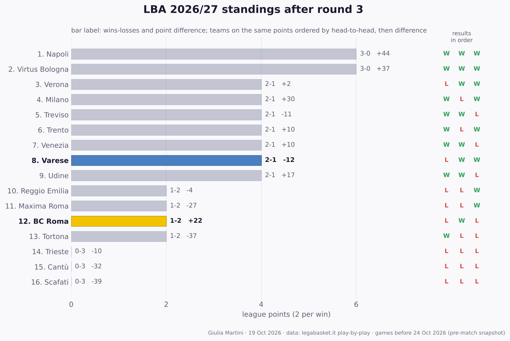

## LBA so far: results and standings

All 24 LBA games played before this match (rounds 1 to 3); home team first.

- **Round 1**: **Treviso 109-94 BC Roma** · Venezia 85-73 Cantù · Reggio Emilia 78-83 Trento · Milano 83-79 Trieste · Tortona 101-93 Verona · Udine 87-63 Scafati · Maxima Roma 75-94 Napoli · **Varese 69-90 Virtus Bologna**
- **Round 2**: Trento 90-93 Treviso · Napoli 99-93 Reggio Emilia · **BC Roma 108-70 Tortona** · **Scafati 77-85 Varese** · Trieste 82-87 Venezia · Virtus Bologna 98-89 Maxima Roma · Cantù 84-85 Udine · Verona 75-72 Milano
- **Round 3**: Udine 66-74 Trento · **Varese 85-84 Trieste** · Milano 106-77 Treviso · Reggio Emilia 93-86 Tortona · Cantù 80-99 Napoli · Scafati 82-89 Verona · **Maxima Roma 96-95 BC Roma** · Venezia 86-93 Virtus Bologna

**Standings after round 3**

| # | Team | Pts | W-L | Points for-against | Diff | Results |
|---:|---|---:|:---:|:---:|---:|:---:|
| 1 | Napoli | 6 | 3-0 | 292-248 | +44 | WWW |
| 2 | Virtus Bologna | 6 | 3-0 | 281-244 | +37 | WWW |
| 3 | Verona | 4 | 2-1 | 257-255 | +2 | LWW |
| 4 | Milano | 4 | 2-1 | 261-231 | +30 | WLW |
| 5 | Treviso | 4 | 2-1 | 279-290 | -11 | WWL |
| 6 | Trento | 4 | 2-1 | 247-237 | +10 | WLW |
| 7 | Venezia | 4 | 2-1 | 258-248 | +10 | WWL |
| 8 | **Varese** | 4 | 2-1 | 239-251 | -12 | LWW |
| 9 | Udine | 4 | 2-1 | 238-221 | +17 | WWL |
| 10 | Reggio Emilia | 2 | 1-2 | 264-268 | -4 | LLW |
| 11 | Maxima Roma | 2 | 1-2 | 260-287 | -27 | LLW |
| 12 | **BC Roma** | 2 | 1-2 | 297-275 | +22 | LWL |
| 13 | Tortona | 2 | 1-2 | 257-294 | -37 | WLL |
| 14 | Trieste | 0 | 0-3 | 245-255 | -10 | LLL |
| 15 | Cantù | 0 | 0-3 | 237-269 | -32 | LLL |
| 16 | Scafati | 0 | 0-3 | 222-261 | -39 | LLL |

Two points per win. Teams level on points are ordered by the games between them, then by point difference; with so few games played most of them have not met yet, so the order inside a group on the same points is provisional (newspapers sometimes list it differently).
