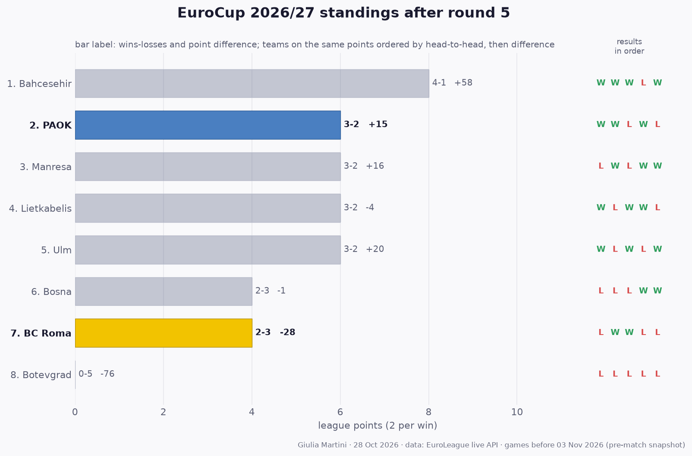

## EuroCup so far: results and standings

All 20 EuroCup games played before this match (rounds 1 to 5); home team first.

- **Round 1**: Lietkabelis 75-72 Bosna · **PAOK 93-78 Manresa** · Ulm 98-84 Botevgrad · **Bahcesehir 91-78 BC Roma**
- **Round 2**: **Bosna 72-75 PAOK** · **BC Roma 92-87 Lietkabelis** · Botevgrad 61-100 Bahcesehir · Manresa 101-89 Ulm
- **Round 3**: **Lietkabelis 95-86 PAOK** · Bahcesehir 100-88 Manresa · **BC Roma 77-72 Botevgrad** · Ulm 102-93 Bosna
- **Round 4**: Botevgrad 57-64 Lietkabelis · **Manresa 108-88 BC Roma** · Bosna 86-77 Bahcesehir · **PAOK 87-78 Ulm**
- **Round 5**: Lietkabelis 68-86 Ulm · **Bahcesehir 84-81 PAOK** · **BC Roma 80-85 Bosna** · Botevgrad 65-76 Manresa

**Standings after round 5**

| # | Team | Pts | W-L | Points for-against | Diff | Results |
|---:|---|---:|:---:|:---:|---:|:---:|
| 1 | Bahcesehir | 8 | 4-1 | 452-394 | +58 | WWWLW |
| 2 | **PAOK** | 6 | 3-2 | 422-407 | +15 | WWLWL |
| 3 | Manresa | 6 | 3-2 | 451-435 | +16 | LWLWW |
| 4 | Lietkabelis | 6 | 3-2 | 389-393 | -4 | WLWWL |
| 5 | Ulm | 6 | 3-2 | 453-433 | +20 | WLWLW |
| 6 | Bosna | 4 | 2-3 | 408-409 | -1 | LLLWW |
| 7 | **BC Roma** | 4 | 2-3 | 415-443 | -28 | LWWLL |
| 8 | Botevgrad | 0 | 0-5 | 339-415 | -76 | LLLLL |

2 points per win. Teams level on points are ordered by the games between them, then by point difference; with so few games played most of them have not met yet, so the order inside a group on the same points is provisional (newspapers sometimes list it differently).
