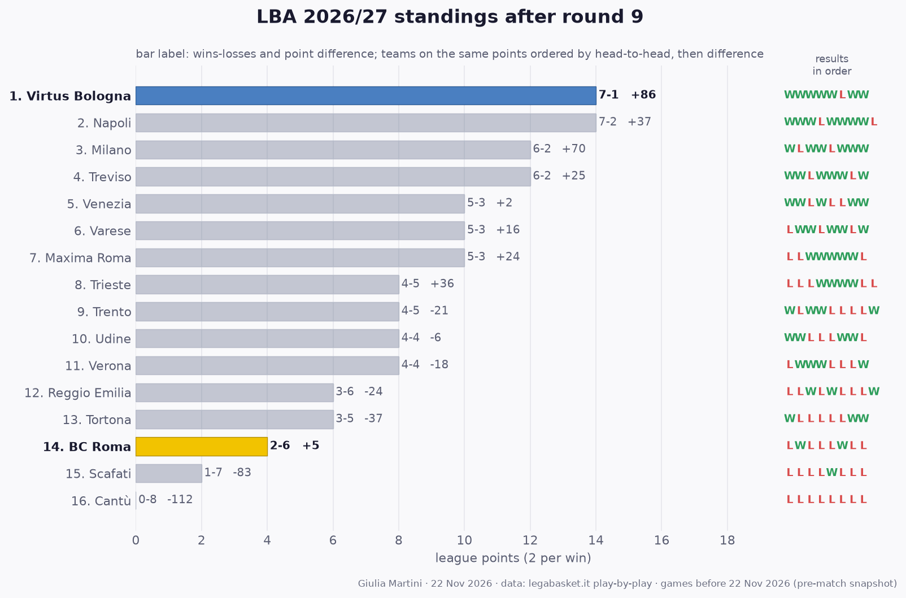

## LBA so far: results and standings

All 66 LBA games played before this match (rounds 1 to 9); home team first.

- **Round 1**: **Treviso 109-94 BC Roma** · Venezia 85-73 Cantù · Reggio Emilia 78-83 Trento · Milano 83-79 Trieste · Tortona 101-93 Verona · Udine 87-63 Scafati · Maxima Roma 75-94 Napoli · **Varese 69-90 Virtus Bologna**
- **Round 2**: Trento 90-93 Treviso · Napoli 99-93 Reggio Emilia · **BC Roma 108-70 Tortona** · Scafati 77-85 Varese · Trieste 82-87 Venezia · **Virtus Bologna 98-89 Maxima Roma** · Cantù 84-85 Udine · Verona 75-72 Milano
- **Round 3**: Udine 66-74 Trento · Varese 85-84 Trieste · Milano 106-77 Treviso · Reggio Emilia 93-86 Tortona · Cantù 80-99 Napoli · Scafati 82-89 Verona · **Maxima Roma 96-95 BC Roma** · **Venezia 86-93 Virtus Bologna**
- **Round 4**: **BC Roma 98-104 Venezia** · Napoli 82-98 Milano · Trento 87-85 Varese · Treviso 102-86 Udine · Verona 94-81 Reggio Emilia · Trieste 92-72 Cantù · **Virtus Bologna 108-83 Scafati** · Tortona 75-89 Maxima Roma
- **Round 5**: **Varese 110-103 BC Roma** · Scafati 87-81 Trento · Tortona 90-92 Napoli · **Milano 94-98 Virtus Bologna** · Maxima Roma 81-75 Udine · Venezia 89-97 Treviso · Trieste 108-99 Verona · Reggio Emilia 81-60 Cantù
- **Round 6**: **BC Roma 103-90 Scafati** · Verona 88-99 Varese · Treviso 81-68 Reggio Emilia · Napoli 99-81 Venezia · Trento 62-88 Maxima Roma · Udine 86-77 Tortona · **Virtus Bologna 93-100 Trieste** · Cantù 82-95 Milano
- **Round 7**: Reggio Emilia 78-83 Venezia · **Trieste 116-100 BC Roma** · Maxima Roma 99-87 Cantù · Milano 88-86 Trento · Tortona 87-76 Treviso · Scafati 89-91 Napoli · Varese 81-84 Udine · **Virtus Bologna 95-81 Verona**
- **Round 8**: Reggio Emilia 84-99 Varese · **BC Roma 88-89 Verona** · Treviso 91-81 Scafati · Napoli 90-89 Trieste · Cantù 92-106 Tortona · Venezia 88-81 Maxima Roma · Udine 70-83 Milano · **Trento 75-88 Virtus Bologna**
- **Round 9**: Trento 100-86 Napoli · Trieste 89-94 Reggio Emilia

**Standings after round 9**

| # | Team | Pts | W-L | Points for-against | Diff | Results |
|---:|---|---:|:---:|:---:|---:|:---:|
| 1 | **Virtus Bologna** | 14 | 7-1 | 763-677 | +86 | WWWWWLWW |
| 2 | Napoli | 14 | 7-2 | 832-795 | +37 | WWWLWWWWL |
| 3 | Milano | 12 | 6-2 | 719-649 | +70 | WLWWLWWW |
| 4 | Treviso | 12 | 6-2 | 726-701 | +25 | WWLWWWLW |
| 5 | Venezia | 10 | 5-3 | 703-701 | +2 | WWLWLLWW |
| 6 | Varese | 10 | 5-3 | 713-697 | +16 | LWWLWWLW |
| 7 | Maxima Roma | 10 | 5-3 | 698-674 | +24 | LLWWWWWL |
| 8 | Trieste | 8 | 4-5 | 839-803 | +36 | LLLWWWWLL |
| 9 | Trento | 8 | 4-5 | 738-759 | -21 | WLWWLLLLW |
| 10 | Udine | 8 | 4-4 | 639-645 | -6 | WWLLLWWL |
| 11 | Verona | 8 | 4-4 | 708-726 | -18 | LWWWLLLW |
| 12 | Reggio Emilia | 6 | 3-6 | 750-774 | -24 | LLWLWLLLW |
| 13 | Tortona | 6 | 3-5 | 692-729 | -37 | WLLLLLWW |
| 14 | **BC Roma** | 4 | 2-6 | 789-784 | +5 | LWLLLWLL |
| 15 | Scafati | 2 | 1-7 | 652-735 | -83 | LLLLWLLL |
| 16 | Cantù | 0 | 0-8 | 630-742 | -112 | LLLLLLLL |

2 points per win. Teams level on points are ordered by the games between them, then by point difference; with so few games played most of them have not met yet, so the order inside a group on the same points is provisional (newspapers sometimes list it differently).
