title: 
reviewed: no
generated: deb1cf3795

<!--
HOW TO EDIT THIS PAGE (this comment is not shown on the site)
- This file is yours: it is never overwritten. Reorder, delete or add sections and text freely.
- The lines like {{ comparison }} or {{ figure: 07_key_players }} are automatic blocks: they are filled in when the site is built
  and keep refreshing when the data changes. Delete a line to remove its block, move it to move the block.
- {{ pending }} is a grey box saying "This section will be filled when the game is reviewed". Replace it with your text (or your
  plots) when you write the section; a section without text and without a box is left out of the page.
- Your own plots and images: put the file in this folder (weekly/games/<date>/) and write .
  The Synergy plots (python notebooks/synergy_scouting_plots.py data/synergy/<folder>) go here by name:
  01b_team_radar_zscore_competition_only, 02_opponent_playtypes, 03_playtype_ppp_ref_vs_opp, 06_players_playtype_mix,
  04_players_volume_efficiency, 05_player_<name>_shot_profile (one per player), 07_lineups_usage_vs_ppp,
  08_lineups_offense_vs_defense, 09_lineups_style_profile.
- Highlight with ==text==. When you are done, set "reviewed: yes" at the top of the file.
Blocks of this page: {{ header }} {{ standings }} {{ comparison }} {{ roster }} {{ assists }} {{ turnovers }} {{ lineups }} {{ pending }} and
{{ figure: name }} for any generated image (01_results_timeline, 02_starters_bench, 03_minutes, 04_scoring_sources, 05_shooting,
06_hot_spots, 07_key_players, 08_shot_distribution, 09_basic_stats, 10_major_factors, 11_starting_fives).
THE STRUCTURE OF THIS PAGE IS THE STANDARD FOR EVERY ANALYSIS (same sections, same order); only the content changes.
-->

# Openjobmetis Varese vs BC Roma

{{ header }}

## Key points

- Varese's offense runs through Hale: 22 possessions and 20.8 points a game, 15/38 from three (9 of the 15 made are unassisted pull-ups); the next four scorers share about 7 possessions each. The bench adds 24 points a game (30%), BC Roma's 40.
- Turnovers are the swing stat: Varese forces a 21.8 TOV% with 8.2 steals a game (2nd in LBA), BC Roma forces 11.6 TOV% with 4.5 steals (14th). Varese, though, loses the ball 16 times a game itself (TOV% 21.7, BC Roma 16.0).
- Second chances: Varese OREB% 36.6 (14 a game, 1.35 PPP on put-backs, Renfro, Kamagate, Roby and Nikolic) against BC Roma's DREB% 69.7.
- BC Roma's best play type, the spot-up (1.15 PPP, 31 3PA a game at 40.8%), is the play type Varese defends most often (25% of its defensive possessions) at 1.05 PPP allowed.
- Same pace (77.8 vs 77.5 possessions): the 18-point gap in PPG (98.8 vs 81.0) is efficiency (eFG% 61.6 vs 50.0), not tempo.

## LBA so far: results and standings

{{ standings }}

### Results timeline

{{ figure: 01_results_timeline }}

## BC Roma and Varese compared

{{ comparison }}
### The two teams at a glance
{{ figure: 09_basic_stats }}

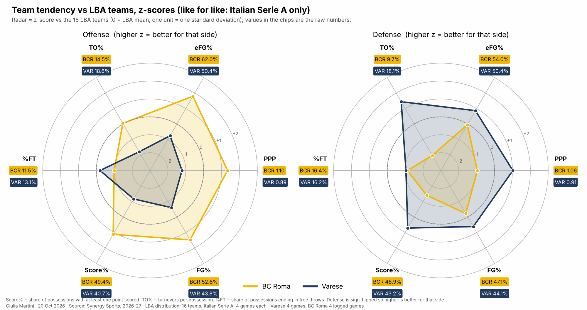

- BC Roma has a more productive and efficient offense than Varese, except for the number of possessions ending with free throws.
- Varese has a more effective defense than BC Roma. When facing them, opposing teams have a higher turnover rate: Varese makes 8.2 steals a game (2nd in LBA, Treviso 8.5) and its opponents lose the ball 15.5 times a game; BC Roma makes 4.5 (14th). Varese also commits 28 fouls a game, 2nd most in the league.

## Varese roster

{{ roster }}

**Out: Della Valle is expected to miss the next game**

## Starting five and bench

- Four fixed starters in all 4 LBA games: Hale, Duke, Nikolic, Alviti. The fifth spot alternates between Renfro (Virtus, Trieste) and Kamagate (Scafati, Trento); whoever does not start still plays 14' to 23'. ==Note: the box score lists Renfro as starter against Trieste, but the play-by-play has Kamagate in for Renfro and Della Valle in for Duke at 10:00 of Q1.==
- Short bench: 24 points a game, 30% of the total, against a league average of 33 and BC Roma's 40 (40%); the starters score 56 (league 54). Bench scoring moves from game to game: Renfro 14 at Scafati, Roby 12 at Trento, Della Valle 11 vs Trieste and Librizzi 10 at Scafati are the only double-figure bench games.
- The first substitution comes between 6:49 and 6:18 of Q1 in three games out of four, and it is always the same pair: Librizzi and Roby in for Duke and Nikolic (Virtus, Trento), Librizzi and Renfro in for Duke and Kamagate (Scafati). The Renfro/Kamagate swap happens within the first four minutes.
- 13 players used, the top 7 play 79% of the minutes; in practice a 10-man rotation: Della Valle out in 3 games of 4 (and expected out again), Ladurner out in the last two, Villa missed Trieste; Ladurner and Kangur under 1' a game.
- Trend over the four games: Roby 14' → 12' → 22' → 30' (12 points at Trento), Ikangi 21' → 16' → 20' → 11', Librizzi 9' vs Trieste then 15'. Hale (33') and Duke (31') had their season-high minutes in the last game.
- Minutes of the lineups discussed below, from the LBA play-by-play: Hale-Duke-Alviti-Nikolic-Kamagate 12.7' (it opens every game Kamagate starts and plays the first 3-4 minutes); Alviti-Hale-Villa-Nikolic-Renfro 8.2'; Alviti-Nikolic-Renfro-Hale-Librizzi 7.1', of which 4.6' in one stretch at Scafati (Q3 1:05 → Q4 6:27); Alviti-Duke-Hale-Nikolic-Renfro 7.1'. Alviti-Librizzi-Duke-Nikolic-Kamagate played 2.8' in three stints, never longer than 1.4'.

{{ figure: 02_starters_bench }}

{{ figure: 03_minutes }}

{{ figure: 11_starting_fives }}
## Scoring sources, tendencies and shooting maps

<!-- Scoring sources, shooting and hot spots. -->

{{ figure: 04_scoring_sources }}

{{ figure: 05_shooting }}

{{ figure: 06_hot_spots }}

- Varese shots below or at league average in each zone.    
- Varese has a higher number of shots in the close mid-range compared to BC Roma.

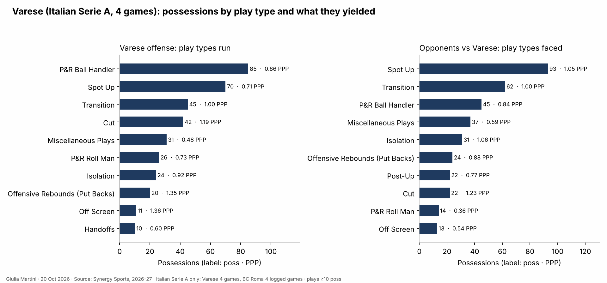
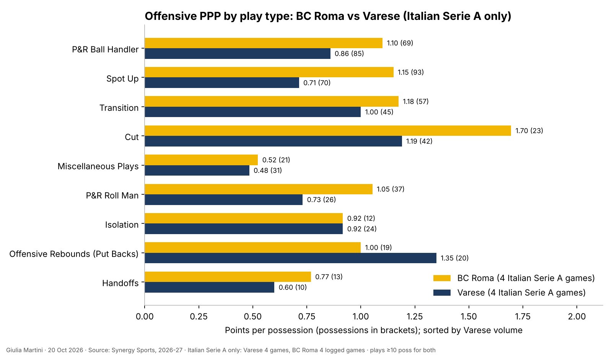

- Compared to BC Roma: Varese plays more P&R where the ball handler ends the action (shot, FD or lost ball) with 0.86 PPP compared to 1.10 of BC Roma.  
- The second more common conclusion for Varese is spot up (PPP 0.7).  
- Varese is efficient on offensive rebounds (PPP 1.35 compared to 1.00 for BC Roma). Main offensive rebounders (LBA, per game): Renfro 2.5, Kamagate 2.0, Roby 2.0, Nikolic 1.8; two of them come off the bench.
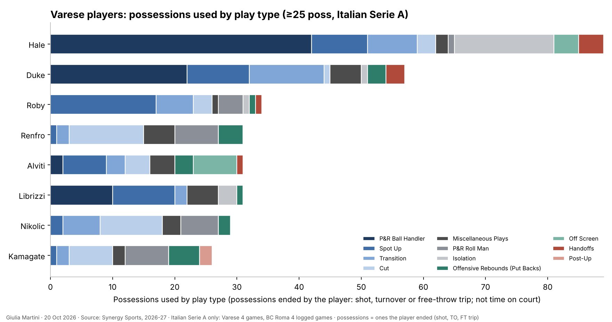
- Isolation situations are mainly played by Hale who is the player with the highest number of possessions of the team.  
- Put backs are mainly distributed among Kamagate, Renfro, Duke. Alviti, Nikolic, Librizi and Roby have a lower share.  

## Key players

### Shooting
<!-- Key players and shot distribution. -->

{{ figure: 07_key_players }}
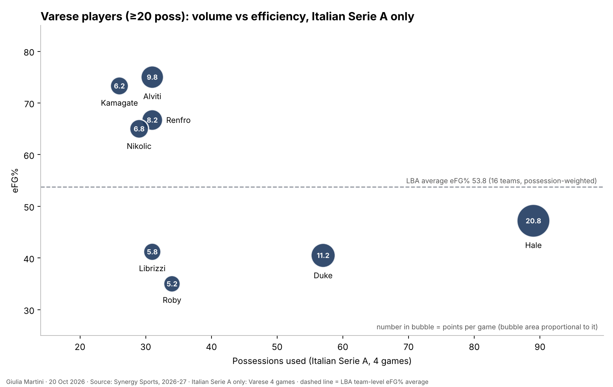
Varese has:  
- Hale with 22.25 possessions per game, 20.8 points per game below 50% eFG%.  
- Duke with 14.25 possessions per game, 11.2 points per game with around 40 eFG%.  
- Nikolic, Renfro, Kamagate an Alviti with similar statistics (PPG between 6.8 and 9.8, around 7 possessions per game, high eFG%).  

{{ figure: 08_shot_distribution }}

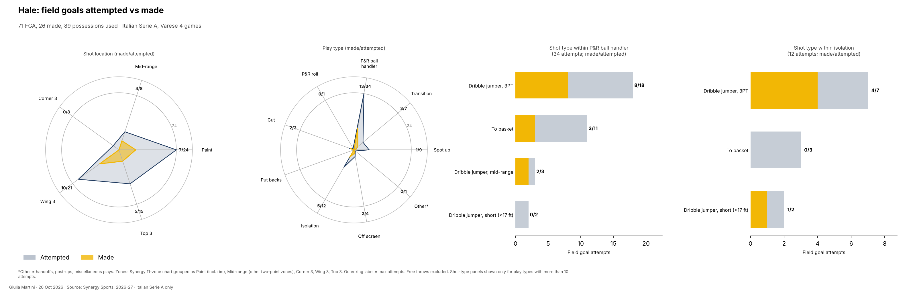
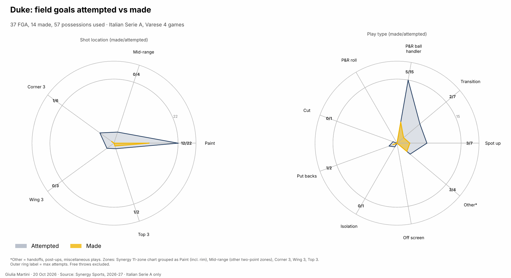
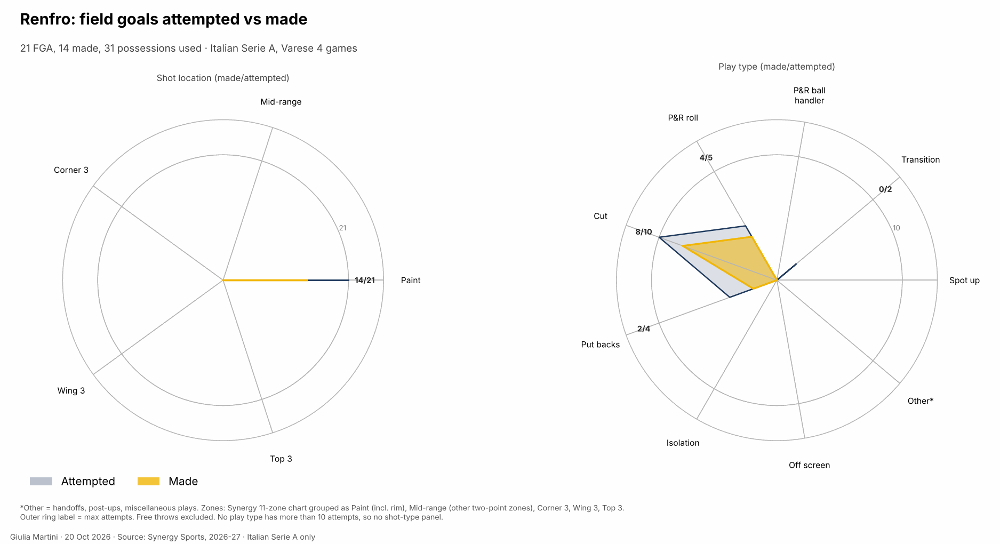
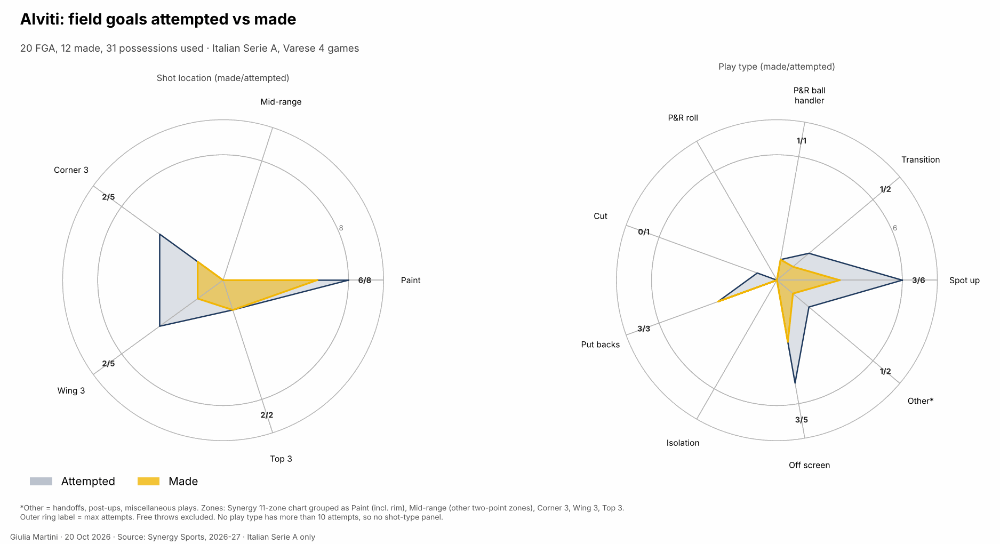
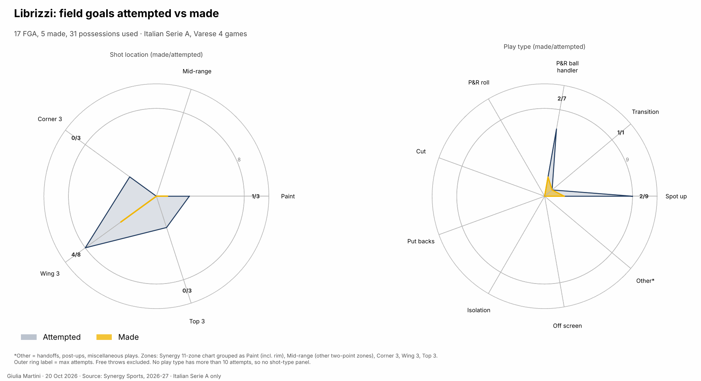
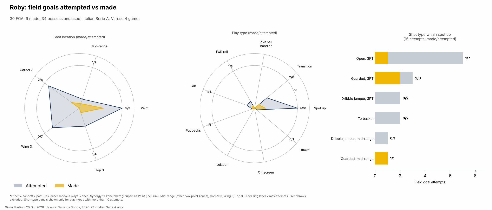
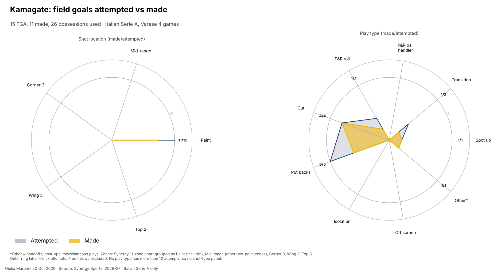
### Other stats

{{ figure: 10_major_factors }}

## Assists

<!-- Assists: ball movement and the main passer-scorer pairs. -->

{{ assists }}

## Turnovers

<!-- Turnovers: who loses the ball and when. -->

{{ turnovers }}

{{ pending }}
## Lineups

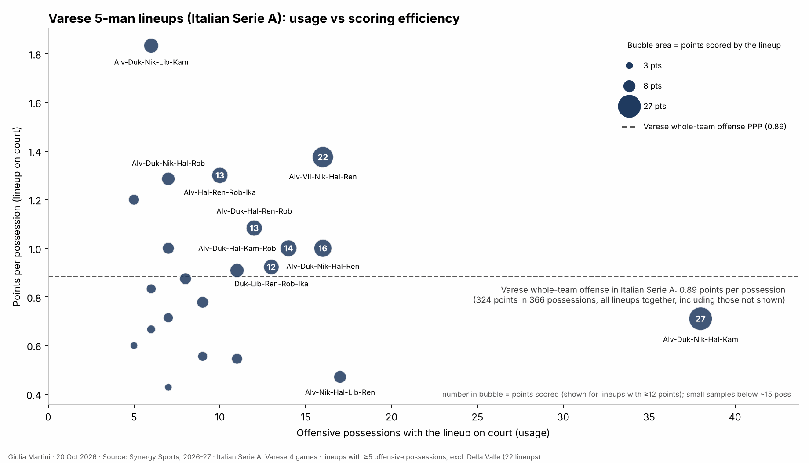

In the first 4 LBA games, Varese used 22 different lineups with at least 5 offensive possessions, excluding the ones with Della Valle.

The most-used lineup is:  
- Hale, Duke, Alviti, Nikolic, Kamagate (1). With 0.7 points per possession scored and 0.64 allowed, it was used more than twice as much as any other lineup.

The most productive lineup is:  
- Alviti, Librizzi, Duke, Nikolic, Kamagate — used for only 5 possessions. This lineup is also the least effective in 
defense (1.60 Points allowed per possession). It played 2.8 minutes in total (three stints of at most 1.4'): not a lineup to count on, in either direction.

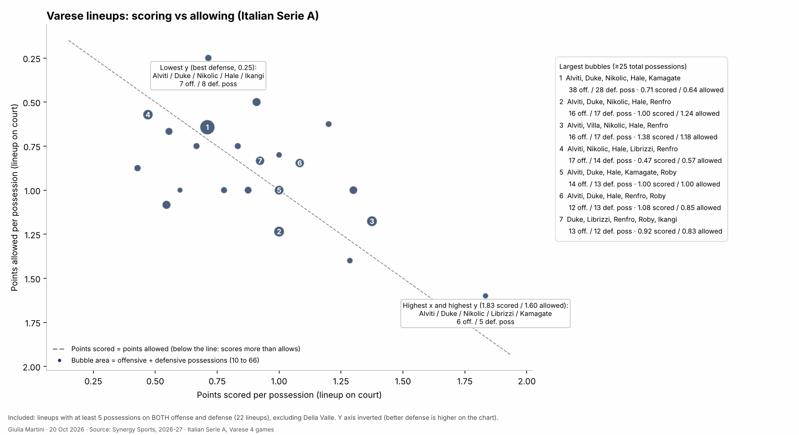
Other lineups to be investigated are:  
- Alviti, Hale, Villa, Nikolic, Renfro (1.38 scored, 1.18 allowed).  
- Alviti, Duke, Hale, Nikolic, Renfro (1.00 scored, 1.24 allowed).  
- Alviti, Nikolic, Renfro, Hale, Librizzi (4) (0.47 scored, 0.57 allowed). - Best defensive lineup with a significant number of possessions.  
The clips of the Alviti, Nikolic, Renfro, Hale, Librizzi stretch at Scafati are listed in the Highlights section.  
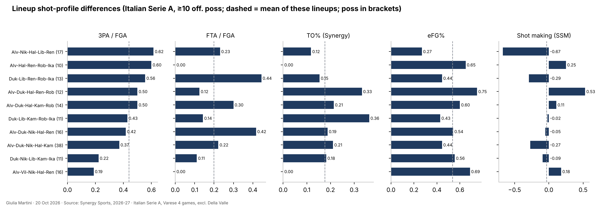
Playing tendencies differ greatly between lineups:  
- 62% FGA of lineup 4 are 3FGA, while is 37% for lineup 1.  
- Alviti, Duke, Hale, Renfro, Roby have the highest eFG% and second TO% (0.33).  
- Duke, Kamagate, Librizzi, Ikangi, Roby have the highest TO% (0.36).  

{{ lineups }}

## What to expect

From the numbers only (4 LBA games each, so tendencies, not predictions):

- **Turnovers.** The biggest gap between the two teams: Varese forces TOV% 21.8 and makes 8.2 steals a game, BC Roma has lost the ball 12.5 times a game (TOV% 16.0) against teams that force far less. On the other side Varese loses it 16 times a game (TOV% 21.7, Duke 12 and Hale 10 in four games) and BC Roma forces only 11.6 TOV%. 
- **Hale's possessions.** 23% of Varese's possessions end with the P&R ball handler at 0.86 PPP, and Hale ends 22 possessions a game: 38 three-point attempts in four games, 15 made, 16 of the attempts pull-ups and 3 step-backs, 9 of the 15 made unassisted. He also plays the most minutes (28.8', 33' in the last game). 
- **Three-point volume.** BC Roma takes 31.2 threes a game at 40.8% and its spot-ups produce 1.15 PPP; spot-ups are 25% of what Varese defends, at 1.05 PPP allowed (opponents 19/57 from three on them). Varese takes 27.8 threes at 30.6%. 
- **Second chances.** Varese OREB% 36.6, 14 offensive rebounds a game and 1.35 PPP on put-backs, from Renfro, Kamagate, Roby and Nikolic; BC Roma DREB% 69.7, 27 defensive rebounds a game. 
- **Free throws.** Varese commits 28 fouls a game (2nd in LBA) and has FT rate 36.2 at 68.1%; BC Roma's FT rate is 29.0 at 75.9%. 
- **Pace.** Both at 77.5-77.8 possessions: the scoring difference (98.8 vs 81.0 PPG) is efficiency, eFG% 61.6 vs 50.0, so the game should be decided by the shot quality numbers above, not by tempo.
- **Rotation.** Della Valle out; Varese plays 10 and the top 7 cover 79% of minutes, with Hale and Duke over 30' in the last game. BC Roma's bench scores 40 a game, Varese's 24.

Not covered here: BC Roma's defense by play type (the Synergy pull has Varese's defense but only BC Roma's offense), so the matchup between Varese's P&R and BC Roma's defense is read from the LBA numbers only.
### Metrics to check during/after the game
- BC Roma turnovers and the points Varese scores within 12 seconds of a steal (15 such possessions in four games so far).*
- Bench points for Varese
- Free-throw attempts for both
- Hale's possessions, eFG% (47.2% so far)

## Clips suggested

Clips to look up (game clock from the LBA play-by-play; the three groups are the tendencies of the sections above):

**Hale pull-up threes** (15/38 in LBA, 9 unassisted): at Trento Q4 6:51 (74-74), Q4 4:25 (77-77), Q4 0:08 (85-85), Q3 8:38 step-back; vs Trieste Q4 9:32 and Q4 8:08; at Scafati Q1 0:45 step-back.

**Steals turned into points within 12 seconds** (15 in four games): at Scafati Q1 7:38 Alviti steal → Hale three (5"); at Trento Q4 4:36 Roby steal → Hale three (11"); at Trento Q4 7:17 Duke steals and scores; vs Virtus Q4 9:01 Hale steal and score; at Scafati Q1 6:58 Kamagate steal → Nikolic.

**Put-backs within 6 seconds of an offensive rebound** (14 in four games): at Scafati Q1 8:56 Librizzi then Kamagate rebound → Kamagate; vs Trieste Q1 3:09 Renfro then Roby rebound → Roby; vs Trieste Q4 5:34 two Nikolic rebounds and score; at Scafati Q3 7:50 Renfro; at Trento Q2 7:38 Roby.

**Lineup stretch**: Alviti, Nikolic, Renfro, Hale, Librizzi at Scafati from Q3 1:05 to Q4 6:27 (4.6', the best defensive lineup by PPP allowed).
