title: Bosna (EuroCup, 27 Oct)
reviewed: no
generated: 1bb9281f06

<!--
HOW TO EDIT THIS PAGE (this comment is not shown on the site)
- This file is yours: it is never overwritten. Reorder, delete or add sections and text freely.
- The lines like {{ comparison }} or {{ figure: 07_key_players }} are automatic blocks: they are filled in when the site is built
  and keep refreshing when the data changes. Delete a line to remove its block, move it to move the block.
- {{ pending }} is a grey box saying "This section will be filled when the game is reviewed". Replace it with your text (or your
  plots) when you write the section; a section without text and without a box is left out of the page.
- Your own plots and images: put the file in this folder (weekly/games/<date>/) and write .
  The Synergy plots (python notebooks/synergy_scouting_plots.py data/synergy/<folder>) go here by name:
  01b_team_radar_zscore_competition_only, 02_opponent_playtypes, 03_playtype_ppp_ref_vs_opp, 06_players_playtype_mix,
  04_players_volume_efficiency, 05_player_<name>_shot_profile (one per player), 07_lineups_usage_vs_ppp,
  08_lineups_offense_vs_defense, 09_lineups_style_profile.
- Highlight with ==text==. When you are done, set "reviewed: yes" at the top of the file.
Blocks of this page: {{ header }} {{ standings }} {{ comparison }} {{ roster }} {{ assists }} {{ turnovers }} {{ lineups }} {{ pending }} and
{{ figure: name }} for any generated image (01_results_timeline, 02_starters_bench, 03_minutes, 04_scoring_sources, 05_shooting,
06_hot_spots, {{ shot_charts }} (06b: one chart per player), 07_key_players, 08_shot_distribution, 09_basic_stats, 10_major_factors, 11_starting_fives).
The three pages that go deeper (individual_tendencies.md, defense_tendencies.md, offense_tendencies.md, same folder) are linked at the end of this page when they exist.
THE STRUCTURE OF THIS PAGE IS THE STANDARD FOR EVERY ANALYSIS (same sections, same order); only the content changes.
-->

# BC Roma vs Bosna Bh Telecom Sarajevo

{{ header }}

<!-- Draft written on 23 Oct 2026 from the data only (EuroLeague API: 4 EuroCup games each; Synergy Sports: Bosna's 4 EuroCup games, BC Roma's 4 EuroCup games, 32 EuroCup teams as reference). No comments on plays or tactics. Small samples: tendencies, not predictions. -->

## Key points

- Last ABA Game (24-10): Popovich out. Starting 5: Gholston, Atic, Talic, Hawkins, Perry. Banks played his second game (9'). Islamovic didn't play.

- Bosna is 1-3 but every game was close: 72-75 at Lietkabelis, 72-75 vs PAOK, 93-102 at Ulm, 86-77 vs Bahcesehir (the group leader) last week. Point difference -6 in four games, BC Roma -23.  
- Two scorers at 14.2 points a game: ==Perry== (64 possessions used in 4 games, 8.0 rebounds of which 3.5 offensive, 5 fouls drawn a game, 0.89 PPP) and ==Pipes== (48 possessions, 1.19 PPP, 19/20 from the line, 3 turnovers in 94 minutes). Gholston adds 10.0 (1.00 PPP, 5/6 at the rim in transition), Domask 8.8 in 16 minutes off the bench (1.13 PPP, eFG% 61).  
- Turnovers on both sides: Bosna loses the ball on 20.1% of its possessions, second-highest of the 32 EuroCup teams (17 a game; Browne 11 in 46 minutes), BC Roma 19.0% (third-highest). Neither forces many: 14.5% and 15.5% forced.  
- Bosna shoots inside: 115 of 235 field-goal attempts in the paint (49%) at 62%, only 21 threes a game at 29.4%. Its threes come from the corners (11/21) much more than from the top (3/21, 14%) or the wings (12/43).
- Bench: 36 points a game (44%), BC Roma 27 (32%). Bosna's bench scored 43 at Ulm and 34 vs Bahcesehir.
- What Bosna's defense gives up: spot-ups (79 possessions, the most, 1.06 PPP, opponents 20/51 from three on them) and transition (51 possessions at 1.22 PPP, 23/27 on twos). What it takes away: the P&R ball handler (0.80 PPP allowed on 69 possessions) and isolations (0.73).

## EuroCup so far: results and standings

{{ standings }}

### Results timeline

{{ figure: 01_results_timeline }}

## BC Roma and Bosna compared

{{ comparison }}

### The two teams at a glance

{{ figure: 09_basic_stats }}

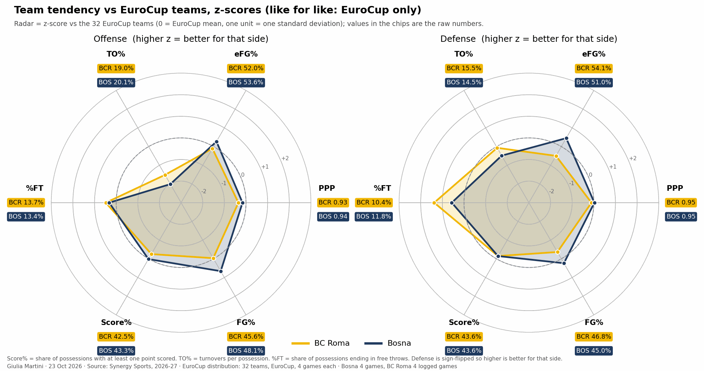

- In the EuroCup both offenses are around the league mean (0.93 and 0.94 PPP against 0.95), both with a turnover problem: Bosna 20.1%, BC Roma 19.0%. Bosna shoots slightly better percentages (FG% 48.1 vs 45.6, eFG% 53.6 vs 52.0), BC Roma takes 6 more threes a game (27 vs 21) at the same 29.4%.
- Bosna's defense is around the mean (0.95 PPP allowed): better than the league on opponents' eFG% (51.0 against 52.5) and free throws conceded, worse on turnovers forced (14.5%); BC Roma's is below on eFG% allowed (54.1) and above only on free throws conceded (10.4% of opponents' possessions, among the lowest in the competition).
- Same pace: 75.6 possessions per 40' for Bosna, 78.7 for BC Roma.

## Bosna roster

{{ roster }}

12 players used. Popovic (211 cm, 8.0 points and 5.0 rebounds in 18' when he played) started the first two games and missed the last two (shoulder injury);   
Banks (208 cm) appeared only in the last game (16', 6 points, 3/3); Islamovic (208) 15' at Ulm and 0' vs Bahcesehir.  
Which of the three bigs is available behind Perry is the thing to check before the game.

## Starting five and bench

- Three fixed starters in all four games: Talic, Gholston, Hawkins. Pipes started the first three and came off the bench vs Bahcesehir (23', 20 points); Perry started the last two games (Popovic the first two); Atic started vs Bahcesehir.
- Minutes are spread: nine players between 11' and 25' a game (Talic 25.0, Perry 23.9, Pipes 23.5, Gholston 22.7, Vrabac 21.7, Atic 21.3, Hawkins 17.5, Domask 16.0, Browne 11.6). Nobody has played 30' in a game except Talic (30') vs Bahcesehir.
- Bench scoring 36 a game (44% of the total, league 35), starters 45 (league 48). The bench scored 43 at Ulm (Domask 26', Vrabac 26') and 34 vs Bahcesehir (Pipes 20).
- First substitution in Q1 (game clock): 2:59 at Lietkabelis (three at once: Domask, Perry, Atic for Pipes, Popovic, Gholston), 4:49 vs PAOK (Atic and Vrabac for Gholston and Hawkins), 5:42 at Ulm (Browne for Talic, then Domask and Atic at 3:16), 5:31 vs Bahcesehir (Pipes for Gholston, then Banks at 3:37 and Domask at 1:53). Atic and Domask are among the first substitutes in three games out of four.
- Fouls: 20 committed a game (80 in 4); Perry 11, Vrabac 13 (3.2 a game in 22'), Talic 10.

{{ figure: 11_starting_fives }}

{{ figure: 13_rotation_by_minute }}

{{ figure: 02_starters_bench }}

{{ figure: 03_minutes }}

## Scoring sources, tendencies and shooting maps

- Points come from inside: 87 two-point makes against 26 threes; 17/20 at the rim and 64/121 in the rest of the paint. Perry alone takes 28 of his 44 shots in the paint (15 made).
- From three Bosna takes 21 a game and makes 29.4%: corners 11/21 (Pipes 3/4, Domask 2/4, Browne 2/2, Hawkins 2/2), wings 12/43 (Hawkins 1/8, Talic 0/6, Pipes 2/10), top of the arc 3/21 (Gholston 0/5).
- Second chances: 10.2 offensive rebounds a game, OREB% 32.3 (BC Roma 34.5; DREB% 68.9 vs 63.6). Put-backs produce 1.12 PPP on 26 possessions, 10 of them Perry's (11 points).
- Free throws: FT rate 38.1 (BC Roma 36.4) at 80%; Perry 19 attempts, Pipes 20 (19 made), Talic 12 (11), Gholston 12 (10).

{{ figure: 04_scoring_sources }}

{{ figure: 05_shooting }}

{{ figure: 06_hot_spots }}

### Shot charts by player

{{ shot_charts }}

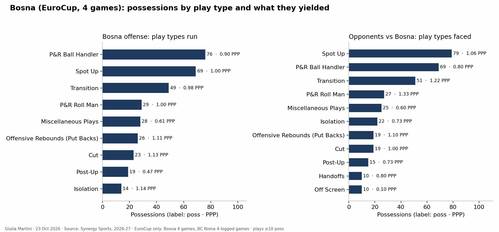
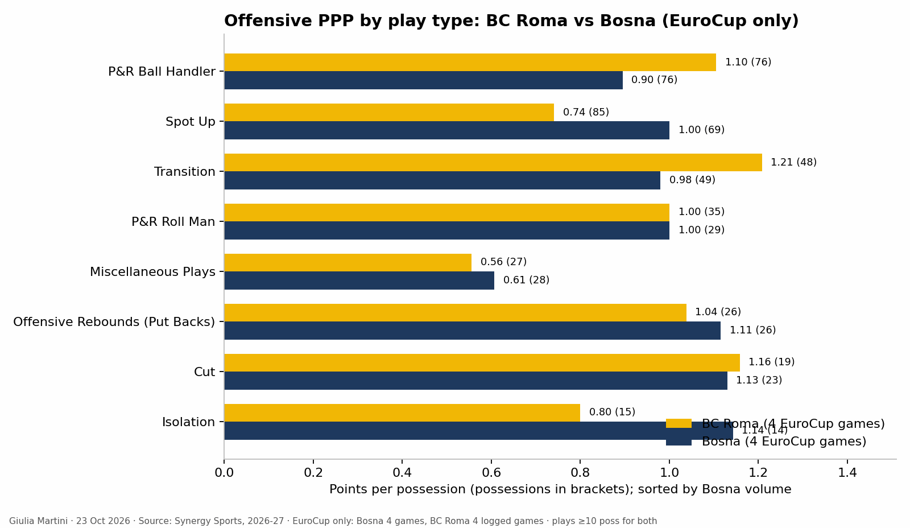

- Bosna's offense (344 possessions in 4 EuroCup games): P&R ball handler 76 possessions (22%, 0.90 PPP), spot-up 69 (20%, 1.00 PPP, 48 of the 61 shots are threes), transition 49 (14%, 0.98 PPP but 20% turnovers).
- Compared to BC Roma's EuroCup offense: BC Roma is far better on the P&R ball handler (1.11 vs 0.90 PPP), transition (1.21 vs 0.98) and cuts (1.16 vs 1.13), far worse on spot-ups (0.74 PPP on 85 possessions, 13/45 from three, against Bosna's 1.00). Put-backs and roll man are similar (1.04 vs 1.12, 1.00 vs 1.00).
- P&R ball handler shots (45 in 4 games): 24 to the basket (12 made), 9 pull-up threes (4 made: Pipes, Gholston, Talic and Atic one each), 6 mid-range pull-ups (4 made), 4 short pull-ups (0 made).
- Bosna's defense faces mostly spot-ups (79 possessions, 1.06 PPP allowed, 20/51 from three) and P&R ball handlers (69, 0.80 allowed, 6/24 from three); opponents' transition yields 1.22 PPP (23/27 on twos) and the roll man 1.33 (24 shots, 14 made, 3/7 from three).

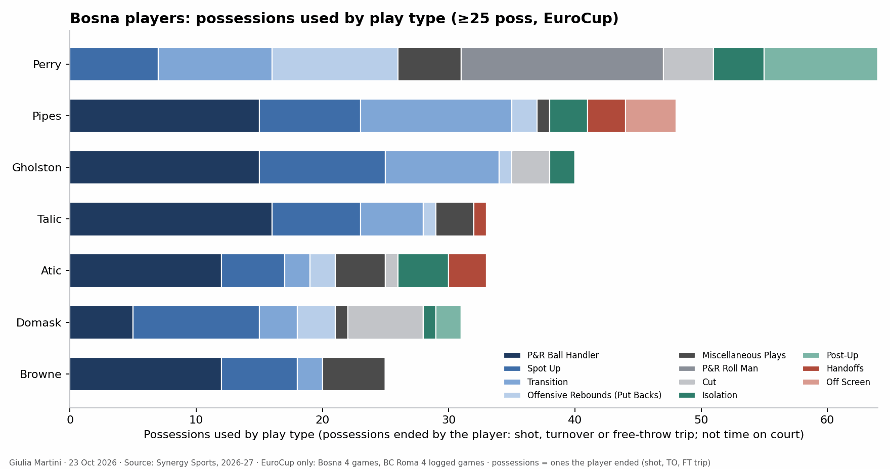

- The P&R ball handler possessions are shared: Talic 16, Pipes 15, Gholston 15, Atic 12, Browne 12 (0.58 PPP), Domask 5. Pipes is the most productive of them (19 points on 15 possessions, 1.27 PPP), Gholston 0.73, Browne 0.58.
- Perry is the roll man (16 of the 29 roll-man possessions, 0.94 PPP; 9 shots to the basket, 6 made, and 4 pick-and-pop threes, 0 made) and the put-back man (10 of 26); Popovic had 7 roll-man possessions in two games.
- Transition is Pipes (12 possessions) and Gholston (9, 13 points, 1.44 PPP); Perry runs too (9 possessions, 7 points).
- Spot-ups: Domask 10 possessions, 14 points (1.40 PPP), Gholston 10 (0.80), Hawkins 9 (1.00, 3/9 from three), Pipes 8, Talic 7, Perry 7 (1.29), Browne 6 (1.50), Atic 5 (0 points, 0/5).

## Key players

### Shooting

{{ figure: 07_key_players }}
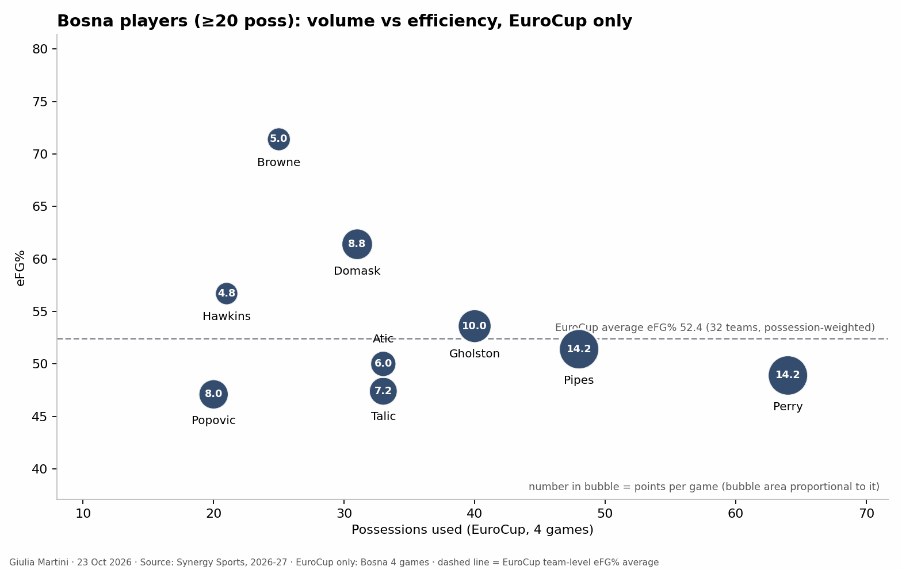

{{ figure: 08_shot_distribution }}

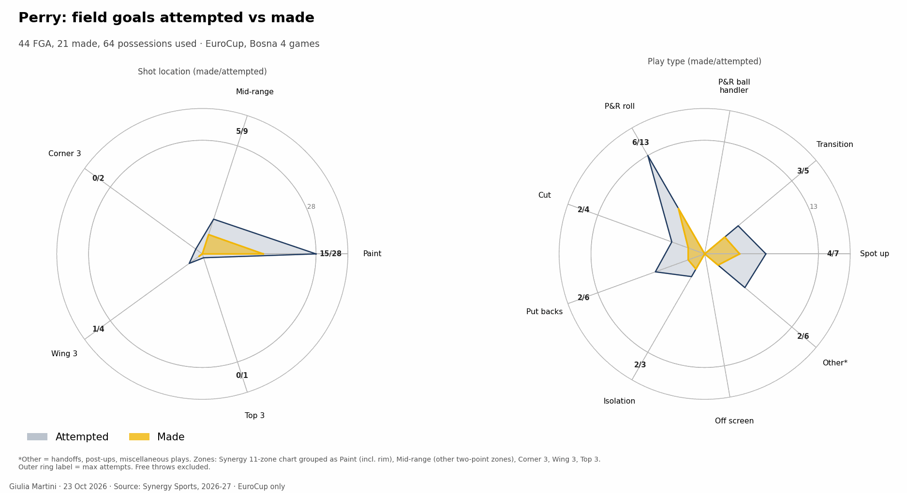
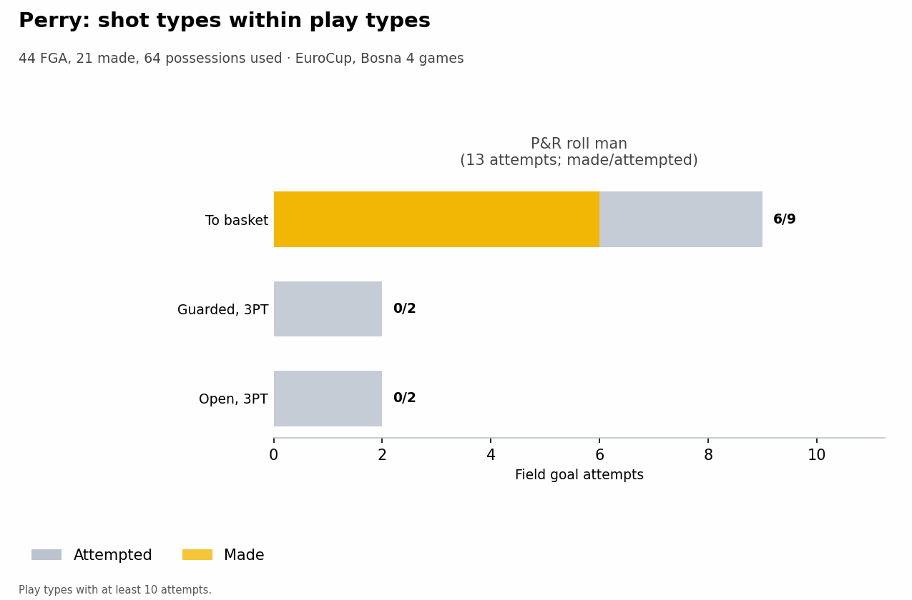
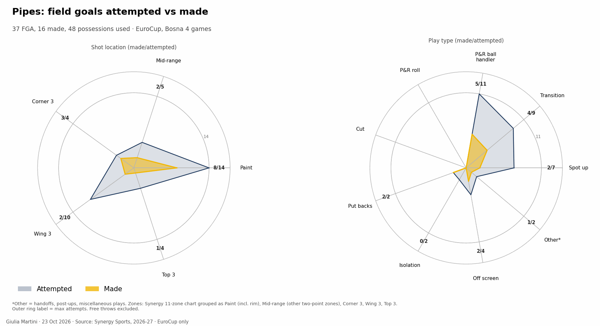
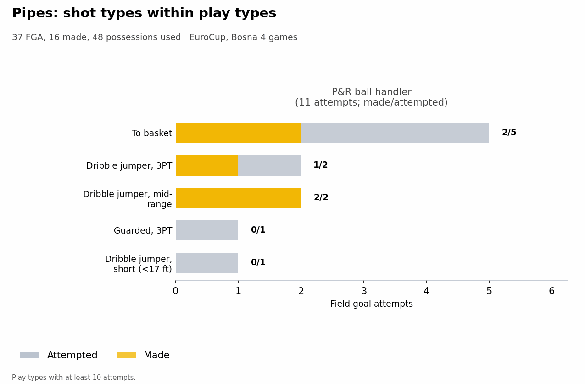
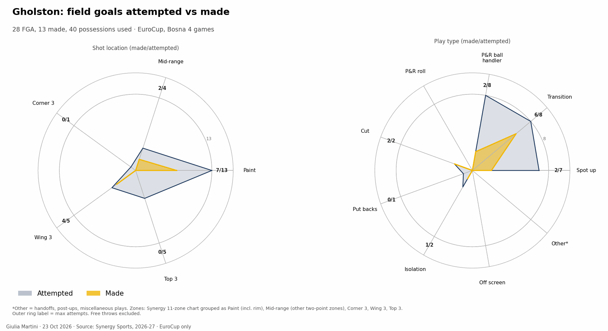
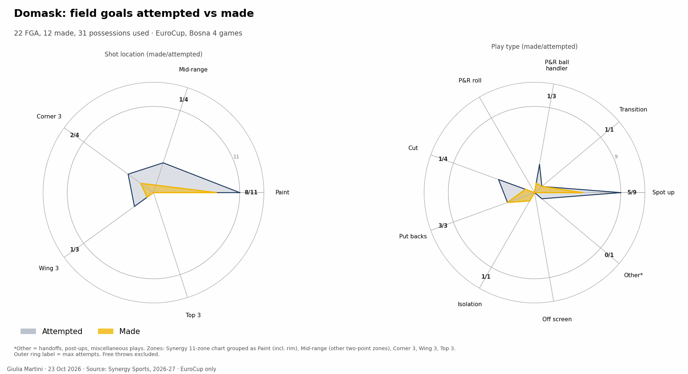
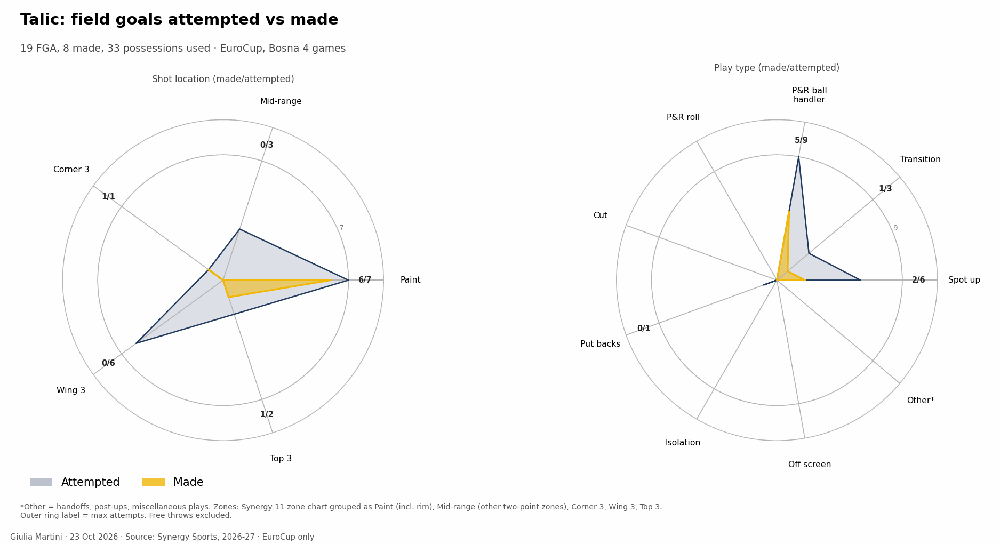
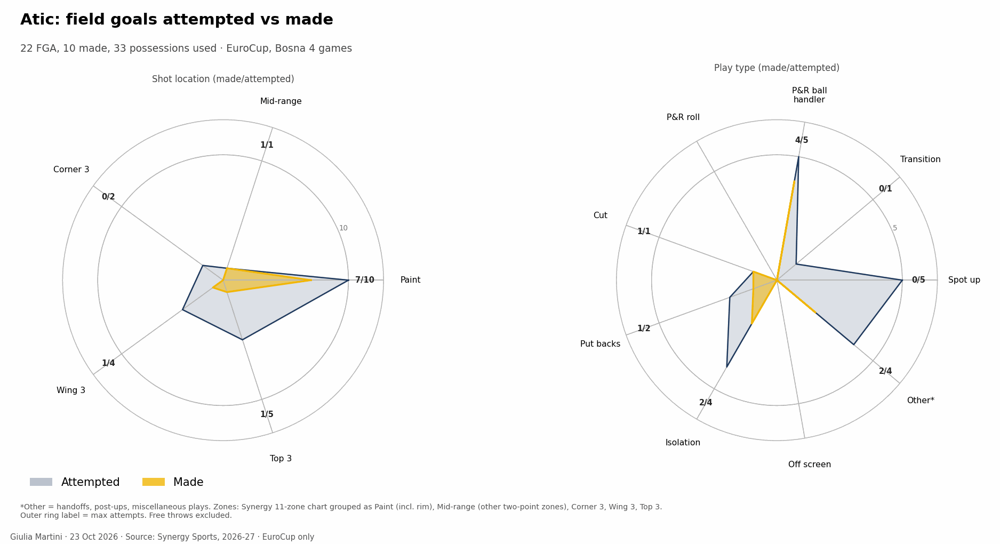
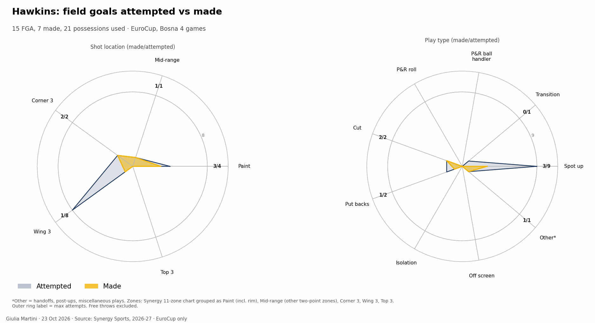
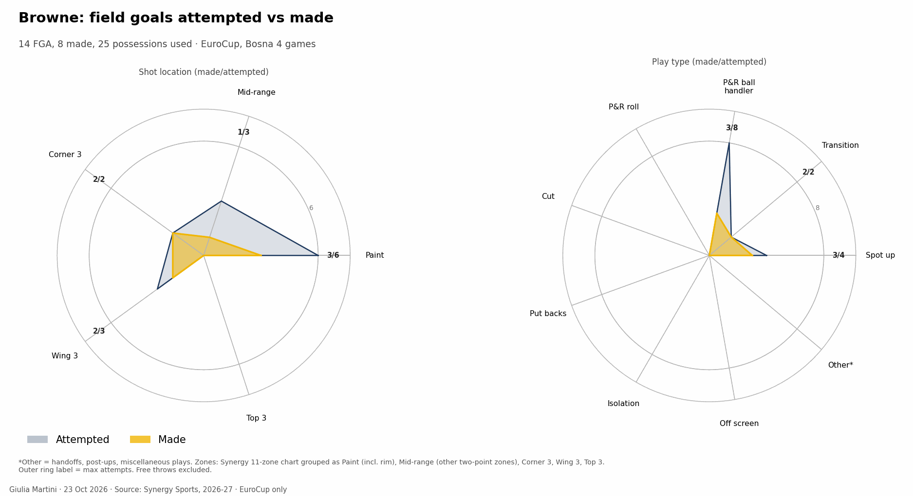
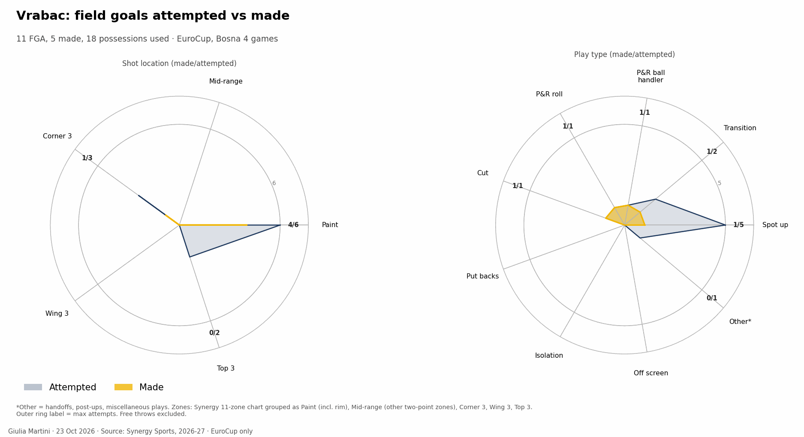
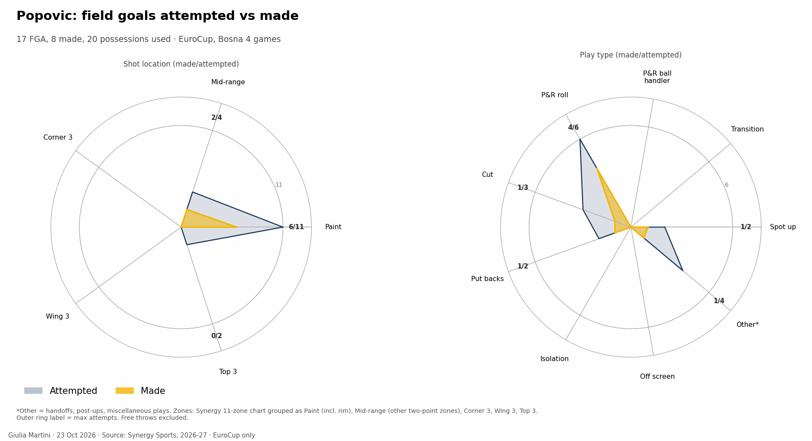

### Other stats

{{ figure: 10_major_factors }}

## Ball movement

### Assists

- 15.8 assists a game; the main pairs are Atic to Perry (5), Atic to Domask (3), Domask to Perry (3), Talic to Perry (3), Pipes to Popovic (3).   
- Perry is the finisher of 11 of the top-pair assists.

{{ assists }}

### Turnovers

- 69 turnovers in 4 games (17.2 a game, 20.1% of possessions): Browne 11 (5 at Lietkabelis), Perry 10 (4 at Ulm), Talic 8, Gholston 8, Atic 8.  
- BC Roma forced 15.5% turnovers in the EuroCup (league 15.7%). Bosna turned 6 of its 22 steals into points within 12 seconds.

{{ turnovers }}

## Lineups

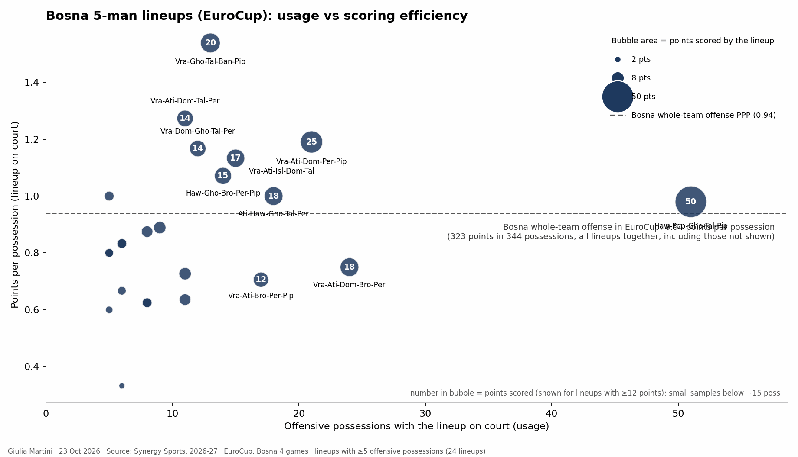

In the four EuroCup games Bosna used 44 different five-man lineups on offense; 24 had at least 5 possessions.

- The most-used lineup, Talic, Pipes, Gholston, Hawkins, Popovic (51 offensive and 45 defensive possessions, 0.98 scored, 0.96 allowed), is the starting five of the first two games and ==cannot be used while Popovic is out==.
- The current starting five, Talic, Gholston, Atic, Hawkins, Perry (18 off. / 19 def. possessions, 1.00 scored, 0.74 allowed), has the best defensive numbers among lineups with 15+ possessions on both sides.
- The second unit, Vrabac, Atic, Domask, Browne, Perry (24 / 22 possessions): 0.75 scored, 1.14 allowed, 29% turnovers. With Pipes instead of Browne (21 / 20 possessions) it scored 1.19 and allowed 0.75.
- Vrabac, Gholston, Talic, Banks, Pipes (13 / 15 possessions, only vs Bahcesehir): 1.54 scored, 0.73 allowed, 4/6 from three.

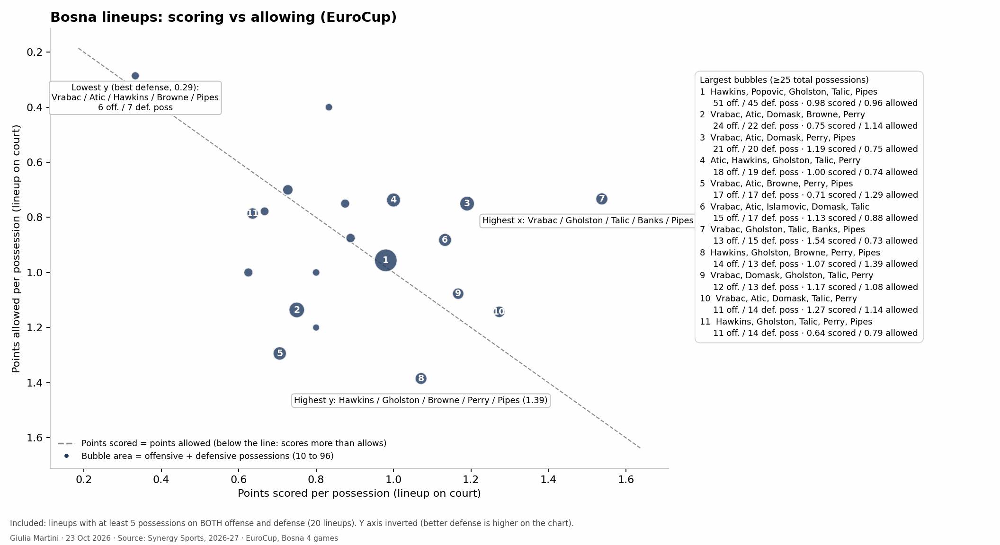
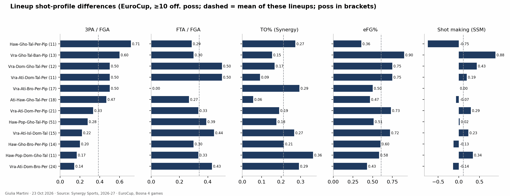

- Lineups with Browne lose the ball most (29% with Vrabac/Atic/Domask/Perry, 29% with Vrabac/Atic/Perry/Pipes); the current starters 6%.  
- Three-point rate is highest with Hawkins, Gholston, Talic, Perry, Pipes (0.71, 1/5 made) and lowest with the two Vrabac/Atic/Perry units (0.14 and 0.33).

## What to expect

From the numbers only (4 EuroCup games each, so tendencies, not predictions):

- **Turnovers.** The largest gap between the two teams is in what they give away, not in what they force: Bosna 17 turnovers a game (20.1%), BC Roma 19.0%, against defenses that force below the league average (14.5% and 15.5%). Browne (11 in 46'), Perry (10) and the three ball handlers Talic, Gholston, Atic (8 each) lose most of them.  
- **Perry inside, Pipes outside.** Perry ends 16 possessions a game, 28 of 44 shots in the paint, 3.5 offensive rebounds and 5 fouls drawn a game; BC Roma's DREB% in the EuroCup is 63.6 (Bosna's 68.9) and it concedes the fewest free throws in the competition (10.4% of possessions). Pipes ends 12 possessions a game at 1.19 PPP with almost no turnovers and 95% from the line; *12 of his 18 threes are catch-and-shoot*.  
- **Spot-ups.** The play type Bosna's defense faces most (79 possessions) and defends worst (1.06 PPP, 20/51 from three) is the one BC Roma has run worst in the EuroCup: 85 possessions at 0.74 PPP, 13/45 from three. BC Roma's best play types, P&R ball handler (1.11) and transition (1.21), meet a Bosna defense that allows 0.80 on the ball handler and 1.22 in transition.  
- **Three-point volume and location.** Bosna takes 21 threes a game at 29.4% and makes them from the corners (11/21); from the top of the arc 3/21 and from the wings 12/43 (Hawkins 1/8). BC Roma takes 27 at the same 29.4%.  
- **Pace and the bench.** Both teams have similar pace (75.6 and 78.7 possessions per 40'). Bosna's bench scores 36 a game (44%), BC Roma's 27. Domask (8.8 in 16', 1.13 PPP) and Atic (14 assists) are the first two in.  
- **Rotation.** Popovic out for the last two games; Banks played his first game vs Bahcesehir; nobody plays 30'.

Not covered here: BC Roma's defense by play type (the Synergy pull has Bosna's defense but only BC Roma's offense), so the matchup between Bosna's P&R and BC Roma's defense is read from the EuroLeague numbers only.

### Metrics to check during/after the game
- Bosna turnovers (17 a game so far) and BC Roma's own (19.0%)
- Perry: offensive rebounds and free-throw attempts (3.5 and 4.8 a game)
- Pipes: possessions and threes, catch-and-shoot vs off the dribble
- Bench points for Bosna (36 a game)
- BC Roma spot-up threes (13/45 in the EuroCup so far)

## Clips suggested

Clips to look up (game clock from the Synergy shot list, checked against the EuroLeague play-by-play on the Bahcesehir game):

**Pipes** — the P&R finishes, transitions, catch-and-shoot threes.  

**Perry** — the roll to the basket, the put-backs. The post-ups to check for the 0.47 PPP and turnovers.  

**Gholston** — transition to the basket, pull-up threes.  

**Domask** — spot-up threes, drives and isolation.  

**Browne turnovers** (11 in 46'): at Lietkabelis Q2 8:40, 8:30, 7:39 (three in one minute).  

**Lineup stretch**: Talic, Gholston, Atic, Hawkins, Perry vs Bahcesehir (the current starting five: 1.00 scored, 0.74 allowed in 18/19 possessions), from the tip to the first substitution at Q1 5:31.  

## Other suggested checks
- Which big backs up Perry (Popovic's availability; Banks after one game).
- Pipes' shooting hand and preferred direction off the pick (9 of 15 P&R possessions end in a shot, 5 to the basket).
- Shot takers after time-outs and out-of-bounds plays (28 "miscellaneous" possessions with 64% turnovers).
