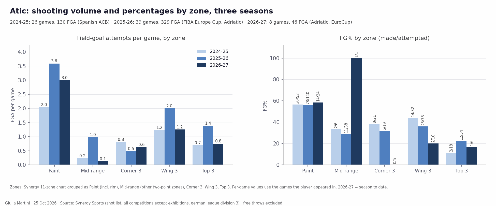
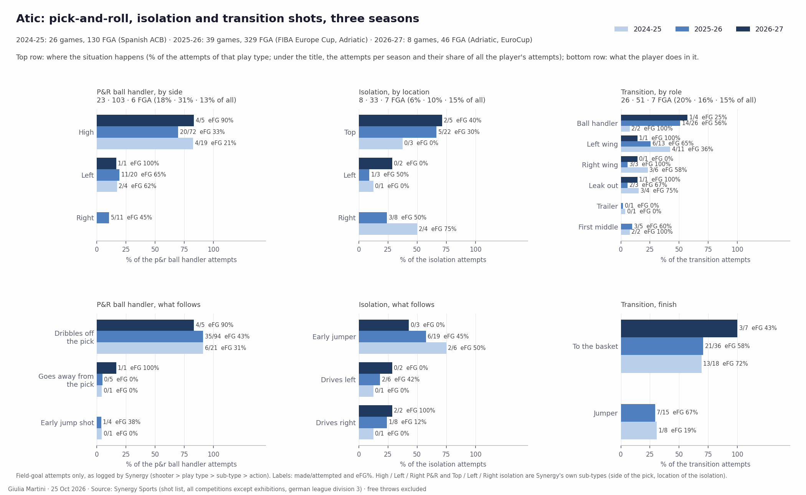
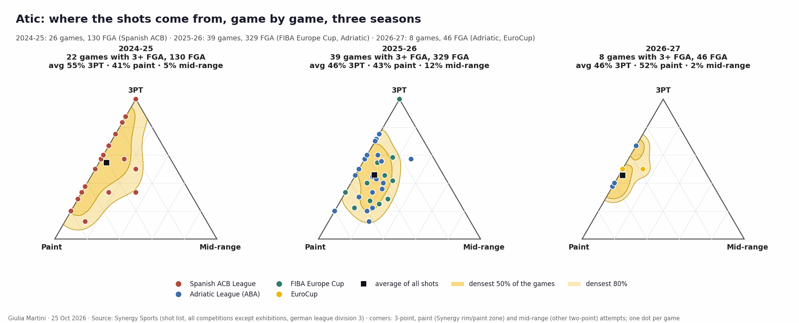
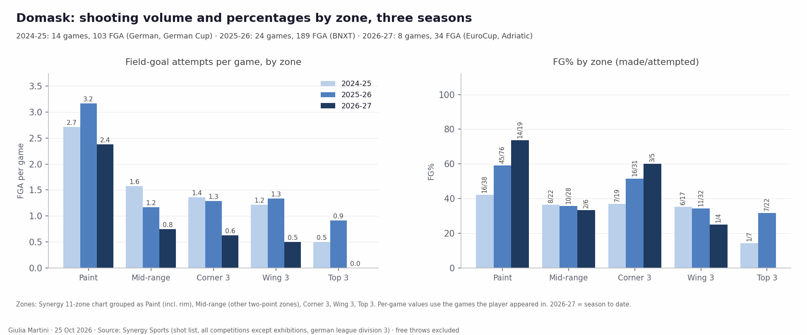
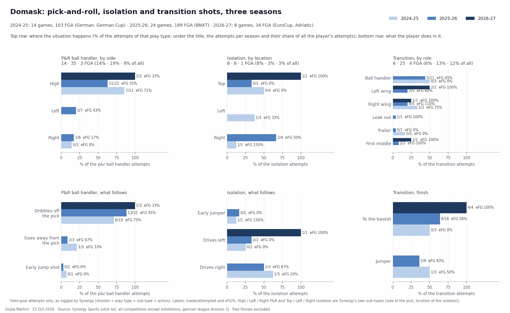
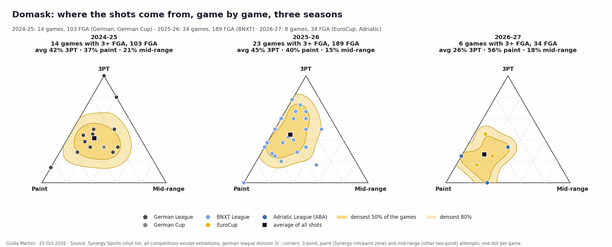

<!--
HOW TO EDIT THIS PAGE (this comment is not shown on the site)
- This file is yours: it is never overwritten. It is linked at the end of the opponent analysis of the same game (analysis.md).
- {{ pending }} is a grey box saying "This section will be filled when the game is reviewed". Replace it with your text.
- Your own plots and images: put the file in this folder (weekly/games/<date>/) and write .
- Highlight with ==text==.
THE STRUCTURE OF THESE THREE PAGES IS THE STANDARD FOR EVERY ANALYSIS; only the content changes.
-->

# Individual tendencies: Bosna

## Key points

{{ pending }}

## Shot attempts: 3PT, paint and mid-range

How the shot attempts of each game split between threes, paint and mid-range: one dot per game (green = won, red = lost), the smoothed areas hold the densest 50% and 80% of the games, the black square is the average.

### Team

{{ figure: 12_triangles_team_attempts }}

### High-volume players

{{ figure: 12_triangles_players_high_attempts }}

### Lower-volume players

{{ figure: 12_triangles_players_low_attempts }}

## Atic and Domask: three seasons of shots
### Atic

==Edin Atic==, 201 cm, guard, "playmaking ball handler" for Synergy. EuroCup so far (4 games): 21.3 minutes, 6.0 points and 4.0 assists a game (14 assists, the most on the team), 1.75 AST/TO. ==Shooting well under his usual percentage from three==: 2/11 in the EuroCup and 3/21 over all competitions this season (14.3%), against 33.8% in the ACB in 2024-25 and 30.5% last season.

Synergy shot list, all competitions (2024-25 Breogan in the ACB, 26 games; 2025-26 Bosna in the ABA and FIBA Europe Cup, 39 games; 2026-27 Bosna in the ABA and EuroCup, 8 games to date), exhibitions excluded. Field-goal attempts only; free throws, turnovers and passes are not in the shot list.

- **Volume up, from the paint.** 5.0 attempts a game in the ACB, 8.4 last season, 5.8 this season. The paint is where the growth is: 2.0 → 3.6 → 3.0 attempts a game, made at the same rate every year (57%, 56%, 58%). Mid-range is marginal (0.2 → 1.0 → 0.1 a game).
- **The three has slipped.** Still about half of his shots (55% → 46% → 46%), but 33.8% in the ACB (24/71), 30.5% last season (46/151) and 3/21 so far this season. The drop is in the corners (8/21, 6/19, 0/5) and on the wings (14/32, 28/78, 2/10); from the top he was 2/18 in Spain and 12/54 last season.
- eFG% by season: 52.3 → 48.0 → 42.4.

- **Pick-and-roll: high and off the dribble.** 18% of his attempts came from the P&R ball handler in the ACB, 31% last season (103 shots), 13% in the 8 games so far. 70% of those shots come out of a ==high P&R== (19, 72, 5) and 91% after dribbling off the pick. The high P&R is his least efficient shot (eFG 21% in Spain, 33% last season, 4/5 so far); the ==left-side P&R== is the productive one (2/4, 11/20 at eFG 65%, 1/1). Right-side P&R: 11 shots in three seasons.
- **Isolation: from the top, early jumper.** 6% → 10% → 15% of his attempts. Mostly from the top (3 of 8, 22 of 33, 5 of 7) and most end in an early jumper (6/8, 19/33, 3/7) made at 50%, 45%, 0% eFG; the drives are split left/right (6 and 8 last season, 2 and 2 so far).
- **Transition: the finisher more than the shooter.** 20% → 16% → 15% of his attempts. In Spain he ran the wings (17 of 26 shots); at Bosna he is the ball handler (26 of 51 last season, 4 of 7 so far). Finishes at the basket: 13/18, 21/36, 3/7; transition jumpers 1/8 and 7/15.

- Game by game the mix moves along the 3PT–paint edge: almost no mid-range in Spain (5% of the attempts) and this season (2%); last season's games spread more (12% mid-range, 43% paint, 46% three). The cluster has shifted from the three-point corner (ACB average 55% threes) towards the paint (52% of this season's attempts).

### Domask

==Marcus Domask==, 197 cm, guard, "playmaking wing" for Synergy. EuroCup so far (4 games): 16.0 minutes off the bench, 8.8 points a game (1.13 PPP), 8/9 from the line (88.9%, 2.2 attempts a game, 0.41 FTA per FGA).

Same source (2024-25 Frankfurt in the German league and cup from February, 14 games; 2025-26 Oostende in the BNXT League, 24 games; 2026-27 Bosna, 8 games to date; two third-division games and the exhibitions excluded; his G League games are not in Synergy).

- **Fewer shots, more of them inside.** 7.4 attempts a game in Germany, 7.9 at Oostende, 4.3 at Bosna. The paint share rises every year (37% → 40% → 56% of the attempts) and so does the finishing: 42% → 59% → 74% (16/19 so far). Mid-range is shrinking (1.6 → 1.2 → 0.8 a game, about 35% every year).
- **The three: corners first.** 42% → 45% → 26% of his attempts, made at 32.6% → 40.0% → 4/9. The corners are his best spot (7/19, 16/31, 3/5), the wings are flat (6/17, 11/32, 1/4), the top of the arc 1/7 and 7/22 and no attempt yet this season.
- eFG% by season: 43.7 → 56.1 → 64.7.

- **Pick-and-roll: high and productive.** 14% → 19% → 9% of his attempts (14, 35, 3 shots). The ==high P&R== is 12 of 14, 22 of 35 and 3 of 3, with eFG 71% and 55% in the two full seasons; the left side (7 shots, 3 made) and the right side (0/2, 1/6) are rare. Almost all of it is a dribble off the pick (10, 18, 3).
- **Isolation is marginal**: 8, 6 and 1 shots (8% → 3% → 3%), mostly ==drives to the right== (5 of 8, 3 of 6).
- **Transition: 6% → 13% → 12%** of his attempts. At Oostende he was the ball handler (11 of 25, 5 made) or on the wings (10, 6 made); at Bosna 3 of 4 come from the wings, all made.

- The games cluster in the middle of the triangle in Germany (mid-range 21%), move towards the 3PT–paint edge at Oostende (15% mid-range) and sit near the paint corner this season (56% paint, 26% three) — 8 games, 34 shots, so the current season is a small sample.

## Rotation by player

When each player is on the court in each quarter, in the last 5 games of the competition: one bar per quarter, the clock runs from 10:00 down to 0:00, dark green = on the court in every game at that moment, white = in none.

{{ figure: 14_player_rotation_Atic }}

{{ figure: 14_player_rotation_Browne }}

{{ figure: 14_player_rotation_Domask }}

{{ figure: 14_player_rotation_Gholston }}

{{ figure: 14_player_rotation_Hawkins }}

{{ figure: 14_player_rotation_Perry }}

{{ figure: 14_player_rotation_Pipes }}

{{ figure: 14_player_rotation_Popovic }}

{{ figure: 14_player_rotation_Talic }}

{{ figure: 14_player_rotation_Vrabac }}

