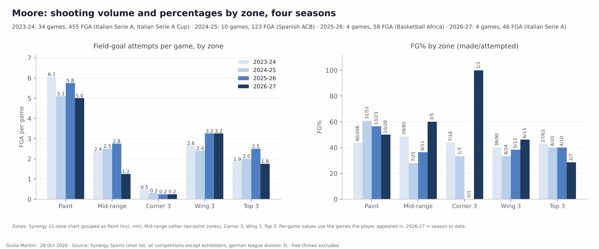
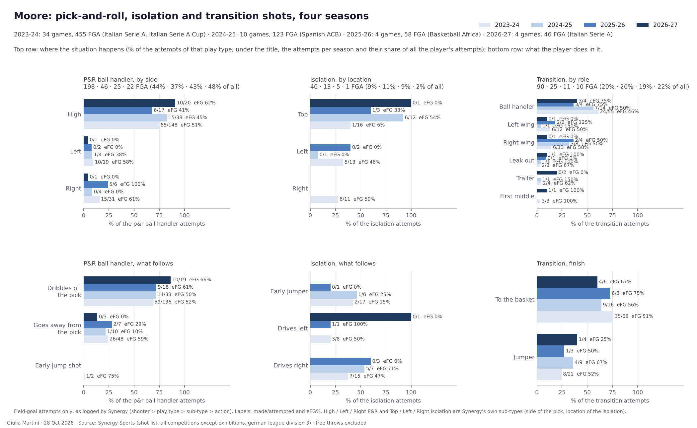
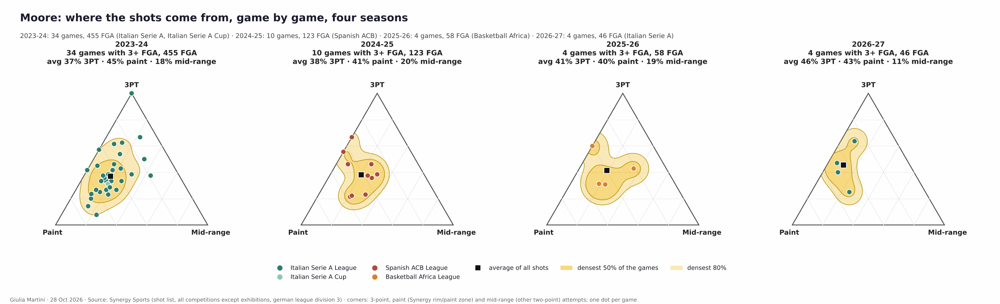
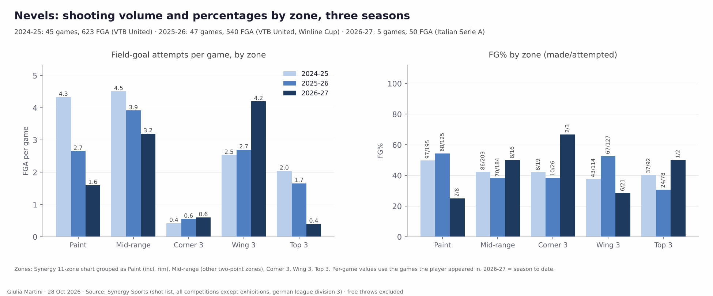
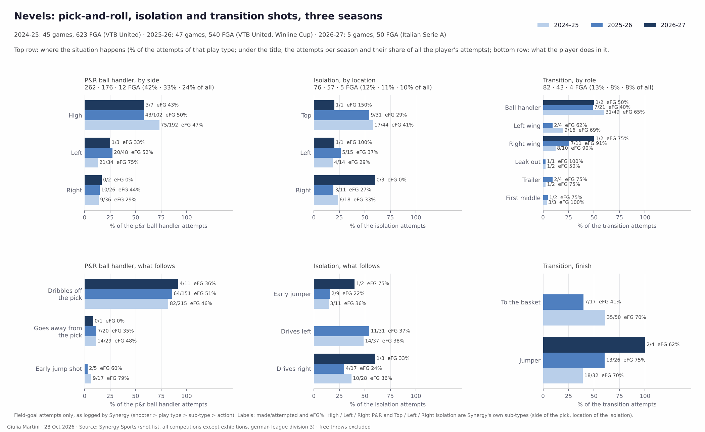
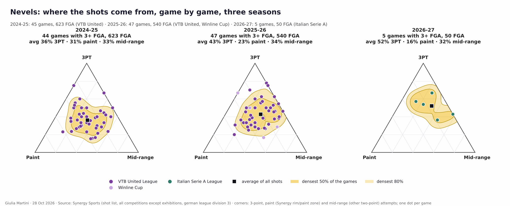

<!--
HOW TO EDIT THIS PAGE (this comment is not shown on the site)
- This file is yours: it is never overwritten. It is linked at the end of the opponent analysis of the same game (analysis.md).
- {{ pending }} is a grey box saying "This section will be filled when the game is reviewed". Replace it with your text.
- Your own plots and images: put the file in this folder (weekly/games/<date>/) and write .
- Highlight with ==text==.
THE STRUCTURE OF THESE THREE PAGES IS THE STANDARD FOR EVERY ANALYSIS; only the content changes.
-->

# Individual tendencies: Scafati

## Key points

{{ pending }}

## Shot attempts: 3PT, paint and mid-range

How the shot attempts of each game split between threes, paint and mid-range: one dot per game (green = won, red = lost), the smoothed areas hold the densest 50% and 80% of the games, the black square is the average.

### Team

{{ figure: 12_triangles_team_attempts }}

### High-volume players

{{ figure: 12_triangles_players_high_attempts }}

## Energy: rim activity and pace

Two scores per player, built from box score and play-by-play only, shown as league percentiles (0.5 = league median; shrunk towards it for players with few minutes). ==Rim activity==: offensive rebounds, blocks, dunks and fouls drawn per 40 minutes. ==High pace==: drive finishes, fast-break shots and assists, fouls drawn, steals per 40 minutes and the share of shots taken within 8 s of the possession start. LBA, 5 games, players sorted by minutes played; the reference is every LBA player with at least 40 minutes.

{{ figure: 15_energy_indices }}

- **Rim activity: Onyema and Offurum.** Onyema is at 1.00 (12 offensive rebounds, 8 blocks, 14 dunks in 139'), Offurum at 0.86 (10 dunks, 5 offensive rebounds in 127'); Iannuzzi (0.73) has only 30'. Both bigs are close to the median on pace (0.56, 0.40).
- **Pace: Moore.** 0.96, the highest of the regulars: 25 fouls drawn in 122' (8.2 per 40') and 7 steals, with 79% of his shots taken within 8 s of the possession start. Rim activity is average (0.45). Johnson (0.67 pace, 3 games, 7 steals) and Spinelli (0.87 in 18') are the other high-pace profiles.
- **Low on both: Nevels** (0.13 rim, 0.05 pace), the player with the most minutes (152'): 6 offensive rebounds, no block, 4 drive finishes in 5 games. Lever (0.29, 0.01) and McGruder (0.22, 0.02) are also well below the median on both.
- **Mascolo is the middle of the league on both** (0.43, 0.43): 20 fouls drawn in 129' (6.2 per 40') but no dunk, no block and 6 offensive rebounds.

## Moore and Nevels: shots over the last seasons

The two Scafati players the match-up leans on most: Moore (highest usage, 4 games so far) and Nevels (most minutes, 5 games). Synergy shot list, all competitions, exhibitions excluded. Field-goal attempts only; free throws, turnovers and passes are not in the shot list. Other leagues, other levels of competition: the figures describe what each player does, not how it would translate.

### Moore

==Charlie Moore==. Four seasons because the two in between are small samples: 2023-24 Pistoia (Italian Serie A and Cup, 34 games, 455 attempts), 2024-25 Breogan (Spanish ACB, 10 games, 123), 2025-26 Al Ahly Benghazi (Basketball Africa League, 4 games, 58; his games with Kuwait SC are not in Synergy), 2026-27 Scafati (4 LBA games, 46).

- **A paint and wing-three scorer whose three is rising.** 37% → 38% → 41% → 46% of the attempts are threes, made at 41.4% (70/169) at Pistoia, 36.2%, 37.5% and 42.9% (9/21) so far. The paint is still the largest block (6.1, 5.1, 5.8, 5.0 attempts a game), made at 43.7% in Italy, 60.8% in Spain and 50% this season (10/20).
- **The wings are his three-point zone.** 3.2 wing-three attempts a game in the last two seasons (made 38% and 46%), against 1.8 from the top (2/7 so far).
- **Mid-range has halved.** 2.4 → 2.5 → 2.8 → 1.2 attempts a game; 49% at Pistoia, 28% in Spain, 3/5 this season.
- eFG% by season: 51.4 → 51.6 → 52.6 → 57.6. The 2026-27 number rests on 46 shots.

- **The P&R ball handler is the base of his game and it is mostly a ==high P&R==.** 44% → 37% → 43% → 48% of the attempts (198, 46, 25, 22 shots); the high P&R is 75%, 83%, 68% and 91% of them, with eFG 51%, 45%, 41% and 62% (10/20). Almost all of it is a dribble off the pick (136, 33, 18, 19 shots; eFG 52%, 50%, 61%, 66%).
- **Going away from the pick has disappeared.** 48 shots at Pistoia (eFG 59%, 24% of his P&R shots), 10, 7 and 3 since (0/3 this season).
- **Isolation shrinks to nothing**: 9% → 11% → 9% → 2% of the attempts (1 shot this season); at Pistoia the early jumper from the top was his weak option (2/17).
- **Transition: a constant fifth of his attempts** (20% → 20% → 19% → 22%) and mostly as the ball handler (55 of 90 at Pistoia; 3/4 so far). Finishes to the basket 35/68 at Pistoia and 4/6 so far; transition jumpers 8/22 and 1/4.

- Game by game the mix has moved from the paint towards the three: average 37% three / 45% paint / 18% mid-range at Pistoia, 46% / 43% / 11% this season. Pistoia's games are spread widely; this season's four sit on the 3PT–paint edge with little mid-range.

### Nevels

==Garrett Nevels==. Three seasons in the VTB United League: 2024-25 Parma Perm (45 games, 623 attempts), 2025-26 Uralmash Ekaterinburg (47 games, 540, VTB United and Winline Cup), 2026-27 Scafati (5 LBA games, 50).

- **From the paint and the mid-range to the wing three.** Paint attempts 4.3 → 2.7 → 1.6 a game (made 49.7% and 54.4%, then 2/8 this season); mid-range 4.5 → 3.9 → 3.2 (42%, 38%, 8/16); wing threes 2.5 → 2.7 → 4.2 (38%, 53%, 6/21).
- **Threes are now half of his shots**: 36% → 43% → 52% of the attempts, made at 39.1%, 43.7% and 34.6% (9/26) so far. Top-of-the-arc threes have almost gone (2.0, 1.7, 0.4 a game).
- **Mid-range stays a third of the attempts every year** (33%, 34%, 32%) while the paint share falls (31% → 23% → 16%).
- eFG% by season: 50.6 → 53.6 → 47.0 (50 shots this season).

- **Fewer P&R shots as ball handler**: 42% → 33% → 24% of his attempts (262, 176, 12). The high P&R is the main one (192, 102 and 7 shots; eFG 47%, 50%, 43%); the ==left-side P&R== was his best (21/34, eFG 75% in 2024-25; 20/48, 52%), the right side his weakest (29%, 44%, 0/2). Dribbling off the pick is 80-90% of those shots (eFG 46%, 51%, 36%).
- **Isolation is about a tenth of his attempts** (12% → 11% → 10%): from the top and by drives left or right at eFG between 24% and 38%; this season 0/3 from the right and 1/1 from the top.
- **Transition: from the ball handler to almost nothing** (13% → 8% → 8%). As ball handler 31/49 (eFG 65%) in 2024-25 and 7/21 (40%) in 2025-26; finishes to the basket 35/50 (70%) and 7/17 (41%).

- The cluster has moved up the 3PT edge: average 36% three / 31% paint / 33% mid-range, then 43 / 23 / 34, and this season 52 / 16 / 32. Five games, 50 shots: this season is a small sample.
- Read next to the energy chart: the low rim-activity score (0.13) goes with a profile that now takes few shots at the rim.

## Rotation by player

When each player is on the court in each quarter, in the last 5 games of the competition: one bar per quarter, the clock runs from 10:00 down to 0:00, dark green = on the court in every game at that moment, white = in none.

{{ figure: 14_player_rotation_Iannuzzi }}

{{ figure: 14_player_rotation_Johnson }}

{{ figure: 14_player_rotation_Lever }}

{{ figure: 14_player_rotation_Mascolo }}

{{ figure: 14_player_rotation_Mcgruder }}

{{ figure: 14_player_rotation_Moore }}

{{ figure: 14_player_rotation_Nevels }}

{{ figure: 14_player_rotation_Offurum }}

{{ figure: 14_player_rotation_Onyema }}

{{ figure: 14_player_rotation_Spinelli }}

## Players to watch

{{ pending }}
