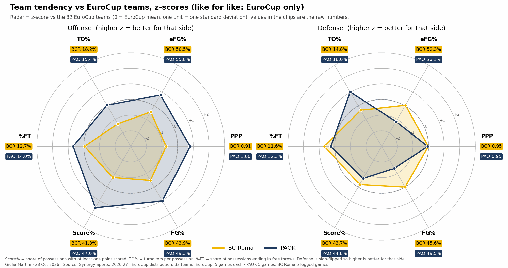
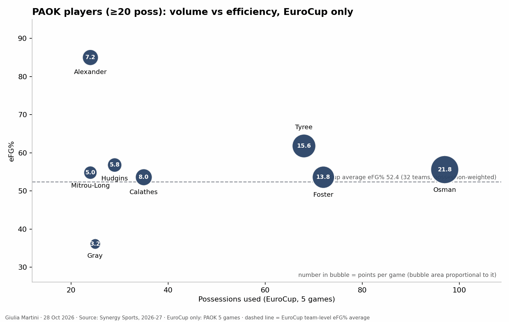

title: 
reviewed: no
generated: afde4b4b4d

<!--
HOW TO EDIT THIS PAGE (this comment is not shown on the site)
- This file is yours: it is never overwritten. Reorder, delete or add sections and text freely.
- The lines like {{ comparison }} or {{ figure: 07_key_players }} are automatic blocks: they are filled in when the site is built
  and keep refreshing when the data changes. Delete a line to remove its block, move it to move the block.
- {{ pending }} is a grey box saying "This section will be filled when the game is reviewed". Replace it with your text (or your
  plots) when you write the section; a section without text and without a box is left out of the page.
- Your own plots and images: put the file in this folder (weekly/games/<date>/) and write .
  The Synergy plots (python notebooks/synergy_scouting_plots.py data/synergy/<folder>) go here by name:
  01b_team_radar_zscore_competition_only, 02_opponent_playtypes, 03_playtype_ppp_ref_vs_opp, 06_players_playtype_mix,
  04_players_volume_efficiency, 05_player_<name>_shot_profile (one per player), 07_lineups_usage_vs_ppp,
  08_lineups_offense_vs_defense, 09_lineups_style_profile.
- Highlight with ==text==. When you are done, set "reviewed: yes" at the top of the file.
Blocks of this page: {{ header }} {{ standings }} {{ comparison }} {{ roster }} {{ assists }} {{ turnovers }} {{ lineups }} {{ pending }} and
{{ figure: name }} for any generated image (01_results_timeline, 02_starters_bench, 03_minutes, 04_scoring_sources, 05_shooting,
06_hot_spots, {{ shot_charts }} (06b: one chart per player), 07_key_players, 08_shot_distribution, 09_basic_stats, 10_major_factors, 11_starting_fives, 13_rotation_by_minute: who is on the court at each minute, with the next options).
The three pages that go deeper (individual_tendencies.md, defense_tendencies.md, offense_tendencies.md, same folder) are linked at the top of this page ({{ more_analysis }}) when they exist: shot charts are on the individual page; play types, assists and turnovers on the offense page; what the team allows on the defense page.
THE STRUCTURE OF THIS PAGE IS THE STANDARD FOR EVERY ANALYSIS (same sections, same order); only the content changes.
-->

# Paok Thessaloniki vs BC Roma

{{ header }}

{{ more_analysis }}

## Key points

Based on the data only (EuroCup, 5 games each; Synergy pull of 28 Oct 2026 and leaderboards of 1 Nov 2026 for play types, shots and lineups; EuroCup box scores for the rest). PAOK's 11 games in all competitions are not in the numbers: only the 5 EuroCup games are.

- PAOK is 3-2 and 2nd of 8 (level on points with Manresa, Lietkabelis and Ulm; Bahcesehir leads at 4-1); BC Roma is 2-3, 7th. PAOK won at home against Manresa (93-78) and Ulm (87-78) and at Bosna (75-72), and lost at Lietkabelis (86-95) and at Bahcesehir (81-84).
- PAOK is better at both ends by the numbers: offensive rating 112.4 against 105.3, defensive rating 107.6 against 111.3, net rating +4.7 against -6.0.
- Synergy, 32 teams: PAOK's offense scores 1.000 PPP (8th) with the 7th-best eFG% (55.8%) and the 2nd-best Score% (47.6%); its defense allows 0.953 PPP (15th) but the 29th-best eFG% (56.1% allowed), offset by 18.0% turnovers forced (5th). BC Roma: 0.905 PPP (26th) on offense, 0.951 allowed (14th), and 18.2% turnovers (4th highest).
- Points come from the paint: 141 of PAOK's 302 attempts (47%) at 70.9%; threes are 43% of the attempts at 30.0%. Osman scores 21.6 a game and takes 10.4 free throws a game (52 in five games, 40 made).
- Efficient play types on offense: spot-ups (22% of possessions, 1.106 PPP, 6th) and transition (15%, 1.333, 8th, 70.5% eFG). The P&R ball handler, also 22% of the possessions, is not (0.785 PPP, 25th, 22.6% turnovers).
- On defense PAOK is best against the roll man (0.591 PPP, 1st) and post-ups (0.516, 2nd) and weakest against isolations (1.231, 32nd), the P&R ball handler (1.033, 30th), spot-ups (1.027, 29th) and handoffs (1.846, 27th).
- No fixed starting five: only Osman and Gray started all five games. The bench scores 38.0 of PAOK's 84.4 points a game; Foster and Tyree, who came off the bench in four games each, score 14.0 and 15.6 a game.

## EuroCup so far: results and standings

{{ standings }}

### Results timeline

{{ figure: 01_results_timeline }}

## BC Roma and PAOK compared

{{ comparison }}

### The two teams at a glance

{{ figure: 09_basic_stats }}

- Offense: PAOK shoots 55.8% eFG (7th of 32) and scores on 47.6% of its possessions (2nd); BC Roma 50.5% (24th) and 41.3% (25th). BC Roma loses the ball on 18.2% of possessions (4th highest), PAOK on 15.4%.
- Defense: BC Roma allows 52.3% eFG (13th), PAOK 56.1% (29th); PAOK forces turnovers on 18.0% of possessions (5th highest), BC Roma on 14.8% (20th highest).
- Pace: PAOK plays slower, 75.4 possessions per 40' against 79.2 for BC Roma (84.4 and 91.0 possessions a game in Synergy's count).
- Rebounds: BC Roma takes more offensive rebounds (34.1% of the available, 12.6 a game; PAOK 29.8%, 9.6) and gets fewer defensive ones (65.5% against 71.7%).
- Free throws: PAOK attempts more (FT rate 38.1 against 33.0) and shoots worse (73.9% against 80.4%).

## PAOK roster

{{ roster }}

## Starting five and bench

- No fixed starting five: Alexander, Calathes, Gray, Hudgins and Osman against Manresa; Alexander, Calathes, Gray, Mitrou Long and Osman against Bosna and Lietkabelis; Foster, Gray, Hudgins, Motiejunas and Osman against Ulm; Alexander, Bazinas, Gray, Osman and Tyree at Bahcesehir. Only Osman and Gray started all five games; Calathes played four of them.
- Starters score 46.4 points a game and the bench 38.0 (39, 43, 40, 41 and 27 in the five games; 27 at Bahcesehir with Tyree starting).
- Minutes: Osman 30.9, Gray 24.7, Foster 23.8, Calathes 22.0, Tyree 19.6, Alexander 18.3, Moore 17.5, Mitrou Long 13.4, Hudgins 12.8, Chougkaz 11.8 (3 games), Bazinas 9.5. Thirteen players have played.
- Foster and Tyree are guards who start occasionally and score off the bench (14.0 and 15.6 PPG in 23.8' and 19.6'); Gray starts every game for 24.7' and scores 3.2 points a game.

{{ figure: 02_starters_bench }}

{{ figure: 03_minutes }}

{{ figure: 11_starting_fives }}

{{ figure: 13_rotation_by_minute }}

## Shot selection

Where the shots come from, shot clock, who takes them.

- PAOK takes 302 field-goal attempts in five games: 141 in the paint (47%, made 70.9%), 130 threes (43%, made 30.0%) and 31 from mid-range (10%, made 32.3%). By zone: corner threes 18 attempts at 33.3%, wing threes 65 at 27.7%, top threes 47 at 31.9%.
- The two-point shooting is the difference: 110 of 172 (64.0%) from two. Alexander is 17/20, Osman 24/33, Foster 22/33, Tyree 15/21.
- Osman is the volume three-point shooter: 7/29 (24.1%), 18 of them from the wings and 9 from the top. Foster is 5/22 (22.7%), Tyree 11/30 (36.7%), Mitrou Long 5/11, Hudgins 5/15.
- PAOK goes to the line on 14.0% of possessions (7th highest): 115 free throw attempts in five games, 86 made (74.8%), 52 of them Osman's.
- By game the three-point share of the attempts is 39% (Manresa), 50% (Bosna), 39% (Lietkabelis), 36% (Ulm) and 49% (Bahcesehir); no link with the results (wins 39%, 50%, 36%; losses 39% and 49%).

{{ figure: 04_scoring_sources }}

{{ figure: 05_shooting }}

{{ figure: 06_hot_spots }}

## Key players

### Shooting

Possessions used and efficiency (Synergy, EuroCup games):

- Osman: 97 possessions (19 a game), 1.124 PPP, 55.6% eFG, 21.6 PPG, 24.6 PIR; 9 assists and 9 turnovers; 52 free throw attempts (40 made); 24 rebounds. Spot-ups 24 possessions (1.375 PPP), P&R ball handler 23 (0.826), transition 21 (1.333).
- Tyree: 68 possessions, 1.147 PPP, 61.8% eFG, 15.6 PPG in 19.6'; 11/30 from three, 15/21 from two, 15/18 from the line. P&R ball handler 17 possessions (0.706), isolations 14 (1.143), transition 13 (1.385).
- Foster: 72 possessions, 0.958 PPP, 53.6% eFG, 14.0 PPG; 22/33 from two but 5/22 from three; 10 turnovers (2.0 a game, 13.9% of possessions). Spot-ups 19 possessions at 0.526 PPP, transition 13 at 1.615.
- Calathes: 35 possessions in 4 games, 0.914 PPP, 25 assists to 6 turnovers (6.2 assists a game); 4/15 from three. His P&R ball-handler possessions: 12 at 0.333 PPP.
- Alexander: 24 possessions, 1.500 PPP, 85.0% from the field (17/20, all twos), 13 offensive rebounds and 4 blocks in 92'; roll man 8 possessions at 1.875 PPP.
- Gray: starts every game for 24.7', 25 possessions at 0.640 PPP, 33.3% from the field, 10 assists, 5 turnovers (20.0% of possessions), 11 rebounds.
- Moore (17.5', 15 possessions, 7/11 from two, 4 turnovers, 16 rebounds) and Hudgins (22 attempts, 5/15 from three) complete the rotation.

{{ figure: 07_key_players }}

{{ figure: 08_shot_distribution }}

### Other stats

{{ figure: 10_major_factors }}

## What to expect

From the numbers only (5 EuroCup games each, so tendencies, not predictions):

- **The P&R ball handler.** BC Roma's best play type in the EuroCup (95 possessions, 1.042 PPP, 3rd of 32, 20.9% of its possessions) meets PAOK's 30th-ranked defense against it (1.033 PPP allowed, 61.5% eFG, though 20.7% turnovers forced). PAOK's own P&R ball handler is its weakest play type (0.785, 25th; 22.6% turnovers), against a BC Roma defense that allows 0.782 (11th).
- **Spot-ups.** PAOK's defense is 29th (1.027 PPP) and 24.6% of BC Roma's possessions are spot-ups, at 0.750 PPP (28th); PAOK scores 1.106 on its own (6th), against BC Roma's 0.863 allowed (6th).
- **Roll man and post-ups.** PAOK's best defenses (0.591 PPP, 1st; 0.516, 2nd) against BC Roma's roll man (40 possessions, 0.975, 21st). PAOK's roll man (Alexander, 8 possessions, 1.875 PPP) is a small sample: 16 possessions in all at 1.313.
- **Isolations and handoffs.** PAOK allows 1.231 PPP on isolations (32nd) and 1.846 on handoffs (13 possessions); BC Roma's isolations score 0.737 (21st) and its handoffs 1.000 (8th).
- **Transition.** PAOK's transition offense (63 possessions, 1.333 PPP, 70.5% eFG) against BC Roma's defense, 3rd in the EuroCup (1.000); BC Roma's transition (1.167, 17th) against PAOK's defense (1.015, 4th). Osman (10), Foster (8) and Tyree (5) have the most made transition shots.
- **Turnovers.** BC Roma loses the ball on 18.2% of possessions and PAOK forces 18.0% (5th highest).
- **Rebounds.** BC Roma's defense allows 1.435 PPP on put-backs (32nd), PAOK scores 1.333 on them (3.0 possessions a game); Alexander has 13 offensive rebounds in 5 games.
- **Free throws.** PAOK attempts 23 a game, Osman 10.4; BC Roma's defense sends opponents to the line on 11.6% of possessions (9th lowest of 32).

### Metrics to check during/after the game

- BC Roma's PPP on P&R ball-handler possessions and PAOK's turnovers there.
- PAOK's transition possessions and points, and who finishes them (Osman, Foster, Tyree).
- Osman's free throw attempts and his three-point attempts (29 in five games).
- Handoff and isolation possessions for PAOK, where its defense has been weakest.
- Put-backs and second-chance points for both teams (Alexander's offensive rebounds).
- Turnovers of Foster, Tyree and Osman (28 of PAOK's 65 in five games) and of BC Roma.
- Bench points for PAOK (38.0 a game so far) and the minutes of Calathes.

### Other checks

- Data caveat: the Synergy pull is hand-extracted from the web app and the samples are small (5 games); read the figures as descriptive. See `data/synergy/paok_2026-11-03/README.md`.
- PAOK's other games (11 in all competitions, 6 outside the EuroCup) are not in the numbers; ranks come from the 1 Nov leaderboards (32 EuroCup teams, 5 games each).
- Calathes played four of the five EuroCup games: check his availability.

## Clips suggested

Game clock from the Synergy shot list (time remaining in the period):

**Osman in transition** (10 made, mostly at the rim; examples): at Bahcesehir Q3 0:10; vs Ulm Q1 3:51 and Q4 5:20; at Lietkabelis Q1 6:38 and Q3 8:32.

**Foster in transition at the rim**: at Bahcesehir Q2 6:58, Q2 2:54, Q3 4:05 and Q4 1:30.

**Tyree transition threes** vs Manresa: Q4 6:19 (guarded) and Q4 0:01 (open); Tyree at the rim vs Ulm Q4 6:36 and Q4 3:38.

**Alexander roll-man finishes** (7 attempts, 7 made): at Bahcesehir Q1 6:38, Q4 4:38 and Q4 3:17; at Bosna Q1 9:59 and Q1 4:35; vs Manresa Q1 3:36 and Q2 8:35.
