<!--
HOW TO EDIT THIS PAGE (this comment is not shown on the site)
- This file is yours: it is never overwritten. It is linked at the top of the opponent analysis of the same game (analysis.md).
- {{ pending }} is a grey box saying "This section will be filled when the game is reviewed". Replace it with your text.
- Your own plots and images: put the file in this folder (weekly/games/<date>/) and write .
- Highlight with ==text==.
THE STRUCTURE OF THESE THREE PAGES IS THE STANDARD FOR EVERY ANALYSIS; only the content changes.
-->

# Individual tendencies: PAOK

## Key points

- **Osman is the engine**: 19 possessions a game, 21.6 PPG, 24.6 PIR in 30.9', 10.4 free throw attempts a game. He is high on both energy scores (0.86 rim activity, 0.99 pace).
- **Tyree and Foster score off the bench**: 15.6 and 14.0 PPG in under 24 minutes, both with high pace scores (0.98) and 0.70 and 0.69 rim activity. Tyree is 11/30 from three, Foster 5/22; both finish in transition (1.385 and 1.615 PPP).
- **Calathes creates**: 25 assists to 6 turnovers in four games (6.2 a game), 4/15 from three and 0.333 PPP on his P&R ball-handler possessions.
- **Alexander is the finisher**: 17/20 from two (85%), 13 offensive rebounds and 4 blocks in 92', 1.875 PPP on the roll man (8 possessions); rim activity 0.96, little pace (0.38).
- **Gray starts every game and scores 3.2 points a game** (0.640 PPP, 33.3% from the field, 20.0% turnovers) but adds 2 assists per game in 24.7 minutes.
- **Shots**: 47% of the attempts are in the paint (70.9%), 43% are threes (30.0%); only Tyree (36.7%) and Mitrou Long (5/11) are above 35% from three.

## Shot attempts: 3PT, paint and mid-range

How the shot attempts of each game split between threes, paint and mid-range: one dot per game (green = won, red = lost), the smoothed areas hold the densest 50% and 80% of the games, the black square is the average.

### Team

{{ figure: 12_triangles_team_attempts }}

### High-volume players

{{ figure: 12_triangles_players_high_attempts }}

### Lower-volume players

{{ figure: 12_triangles_players_low_attempts }}

## Shot charts by player

{{ shot_charts }}

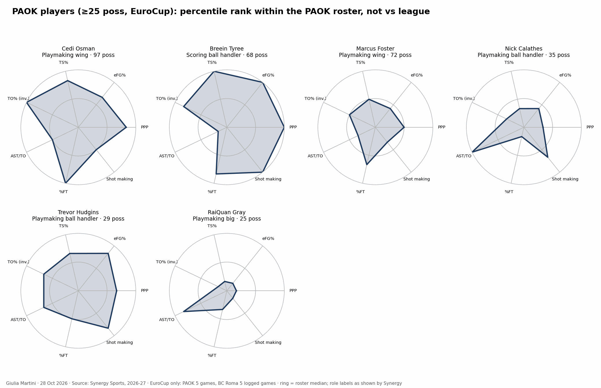
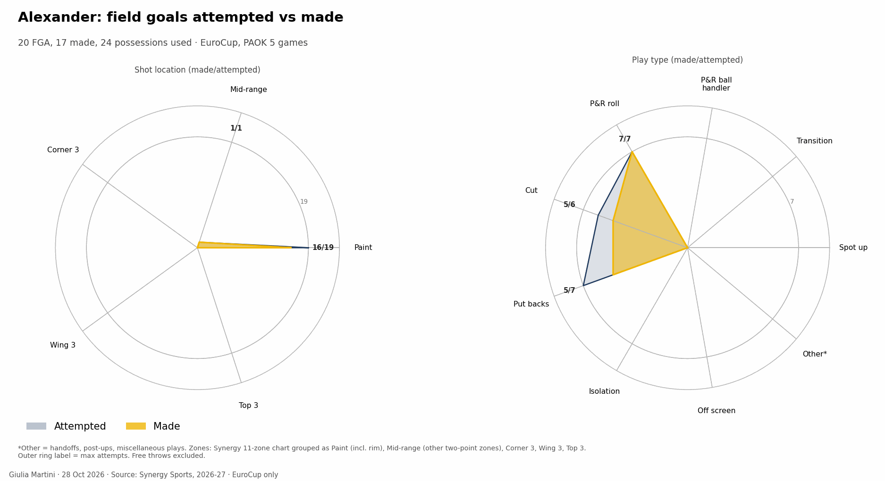
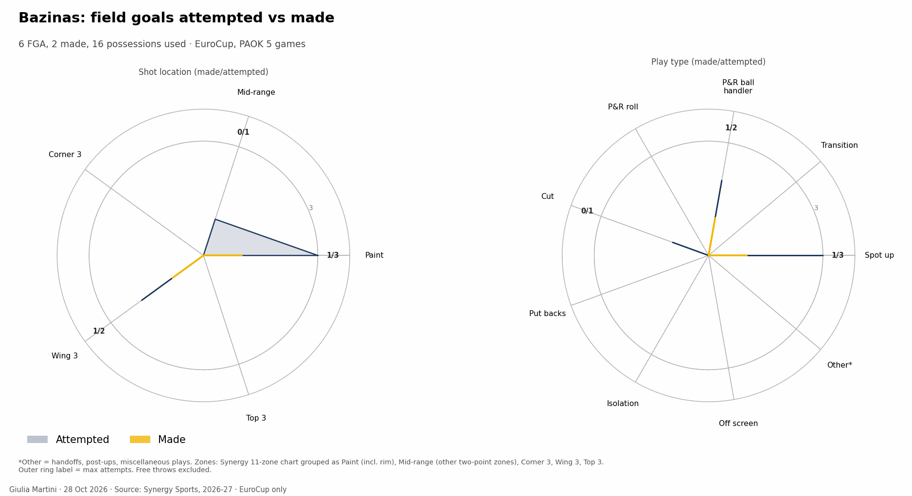
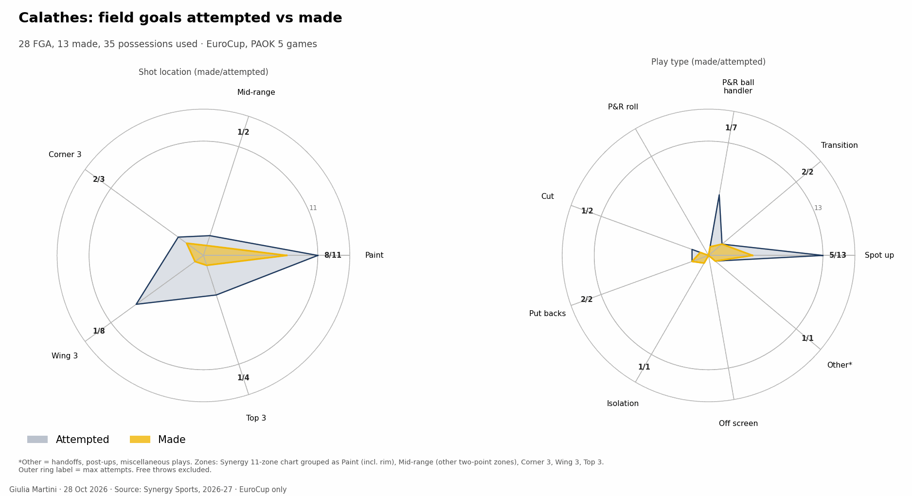
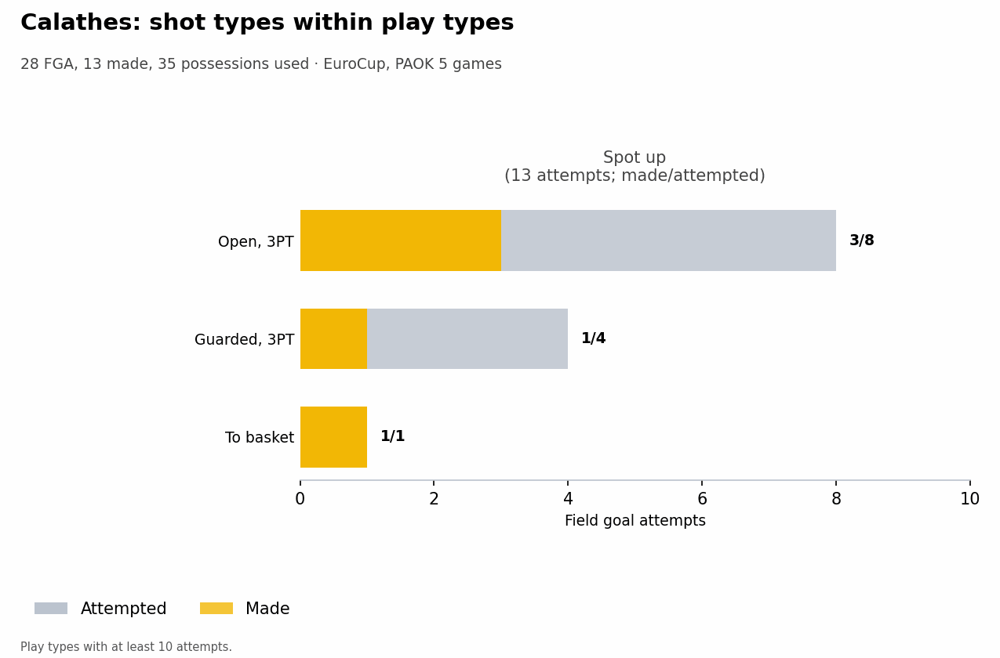
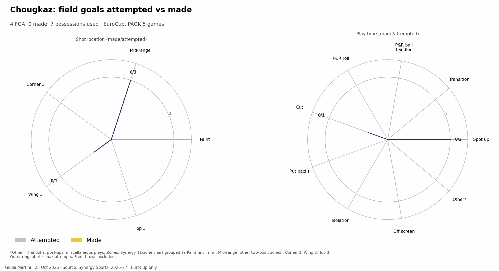
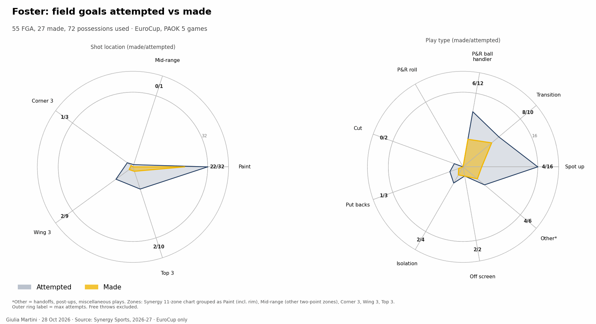
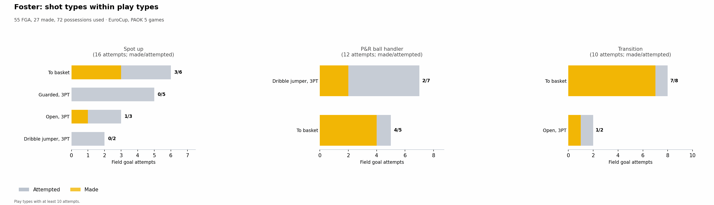
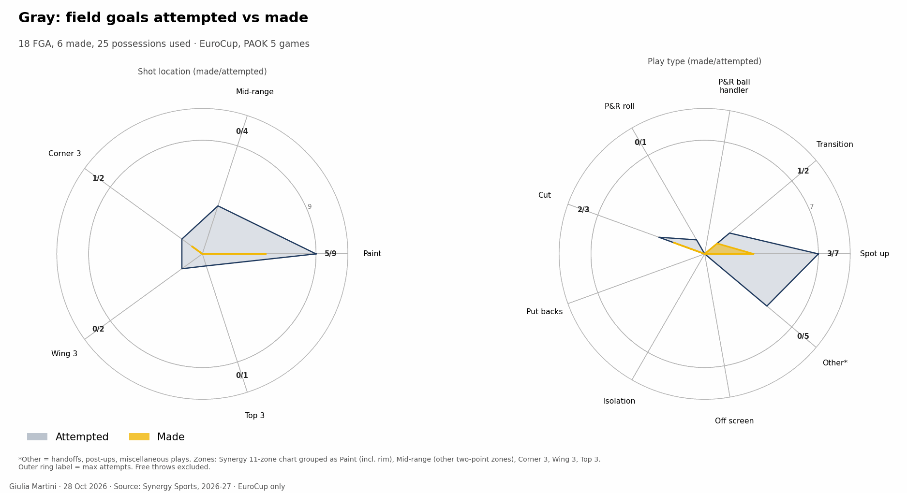
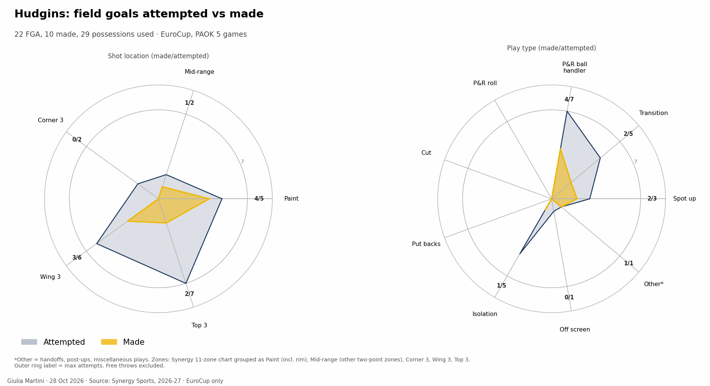
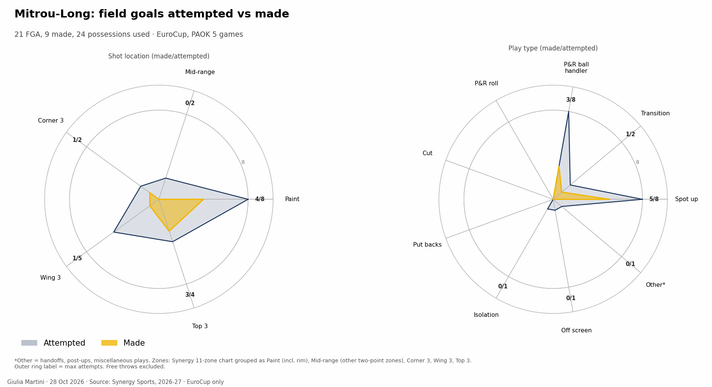
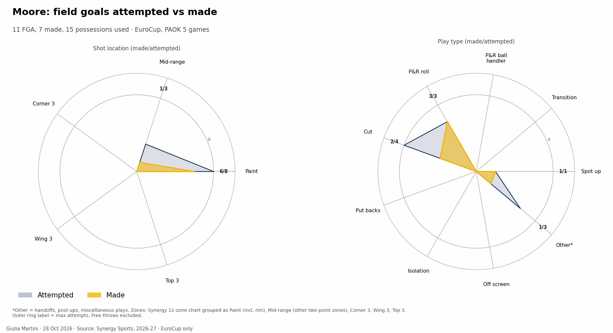
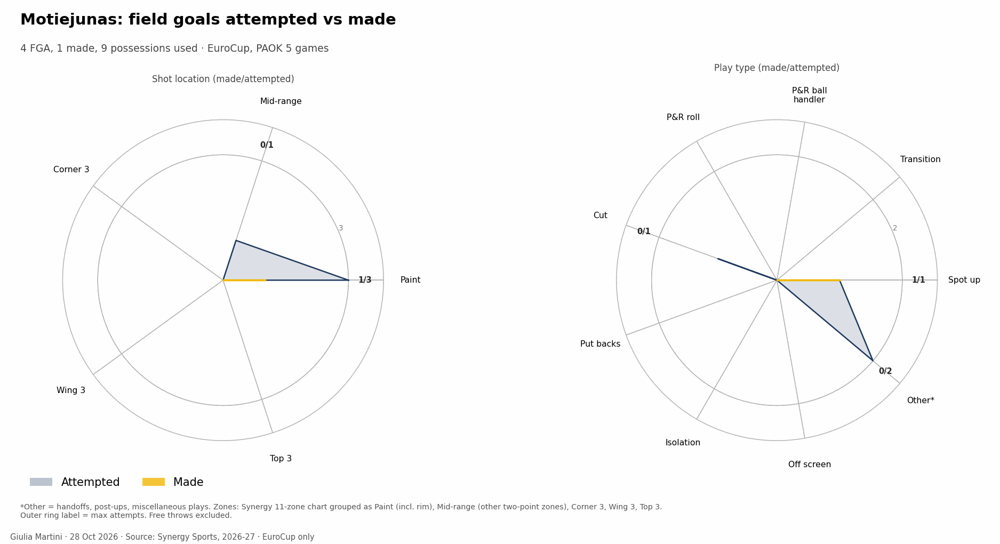
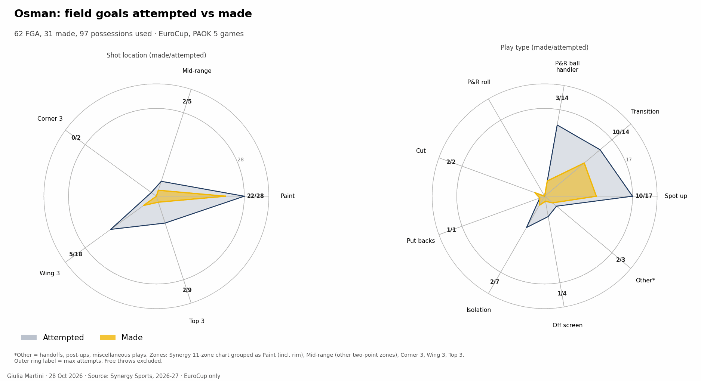
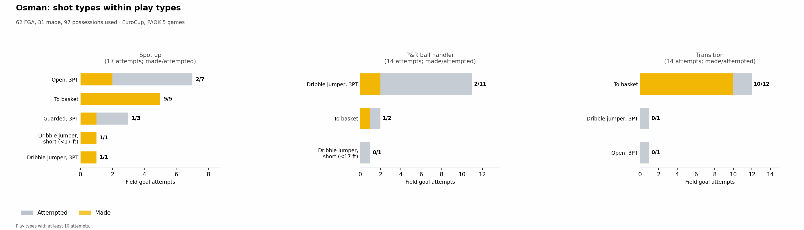
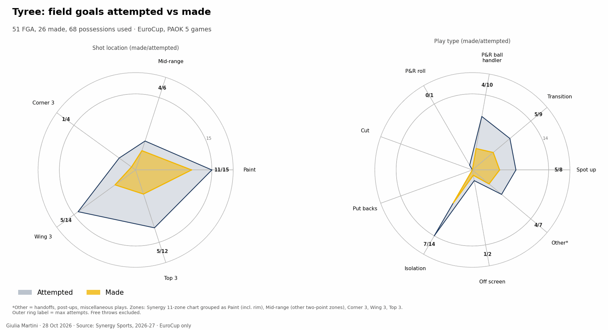
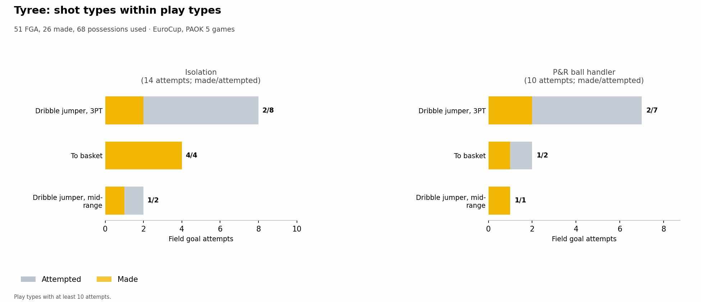

## Energy: rim activity and pace

Two scores per player, built from box score and play-by-play only, shown as league percentiles (0.5 = league median; shrunk towards it for players with few minutes). ==Rim activity==: offensive rebounds, blocks and fouls drawn per 40 minutes (no dunks in the EuroCup feed). ==High pace==: drive finishes, fast-break shots, fouls drawn, steals per 40 minutes and the share of shots taken within 8 s of the possession start. EuroCup, 5 games, players sorted by minutes played; the percentiles are read off the LBA players.

{{ figure: 15_energy_indices }}

- **Both high: Osman** (0.86 rim activity, 0.99 pace), the player with the most minutes (154'): 36 fouls drawn, 8 steals and 25 drive finishes in 5 games.
- **Pace without rim work: Foster and Tyree** (0.98 and 0.98 pace; 0.70 and 0.69 rim activity), Hudgins (0.94 pace, 0.28 rim in 64'). Foster has 25 drive finishes in 119', Tyree 15 in 98'.
- **Rim without pace: Alexander** (0.96 rim activity, 0.38 pace): 13 offensive rebounds and 4 blocks in 92', and no drive or transition shot in the Synergy list.
- **Low rim activity, pace above the median: Calathes and Mitrou Long** (0.18 and 0.13 rim, 0.70 and 0.70 pace).
- **Low on both: Moore** (0.37, 0.31); Gray (0.21 rim, 0.67 pace, only 5 drive finishes in 123') sits in the middle on pace.

## Rotation by player

When each player is on the court in each quarter, in the last 5 games of the competition: one bar per quarter, the clock runs from 10:00 down to 0:00, dark green = on the court in every game at that moment, white = in none.

{{ figure: 14_player_rotation_Alexander }}

{{ figure: 14_player_rotation_Bazinas }}

{{ figure: 14_player_rotation_Calathes }}

{{ figure: 14_player_rotation_Foster }}

{{ figure: 14_player_rotation_Gray }}

{{ figure: 14_player_rotation_Hudgins }}

{{ figure: 14_player_rotation_Mitrou_Long }}

{{ figure: 14_player_rotation_Moore }}

{{ figure: 14_player_rotation_Osman }}

{{ figure: 14_player_rotation_Tyree }}

## Players to watch

- **Osman.** The ball goes through him in three ways: spot-ups (24 possessions, 1.375 PPP), the P&R ball handler (23, 0.826) and transition (21, 1.333). He is 7/29 from three (18 wing, 9 top) and 24/33 from two; 52 free throw attempts in five games.
- **Tyree.** 68 possessions at 1.147 PPP: P&R ball handler 17 (0.706), isolations 14 (1.143), transition 13 (1.385); 11/30 from three, 15/18 from the line.
- **Foster.** 72 possessions at 0.958 PPP: spot-ups 19 at 0.526 PPP, transition 13 at 1.615; 22/33 from two, 5/22 from three, 10 turnovers.
- **Calathes.** 25 assists in 4 games and 6 turnovers; 6 of his assists go to Osman, 4 to Alexander and 4 to Tyree. Played four of the five games.
- **Alexander.** 24 possessions at 1.500 PPP, all two-point shots; 13 offensive rebounds in 92'.
- **Gray.** 24.7' a game as a starter with the lowest efficiency of the regulars (0.640 PPP, 36.1% eFG).
