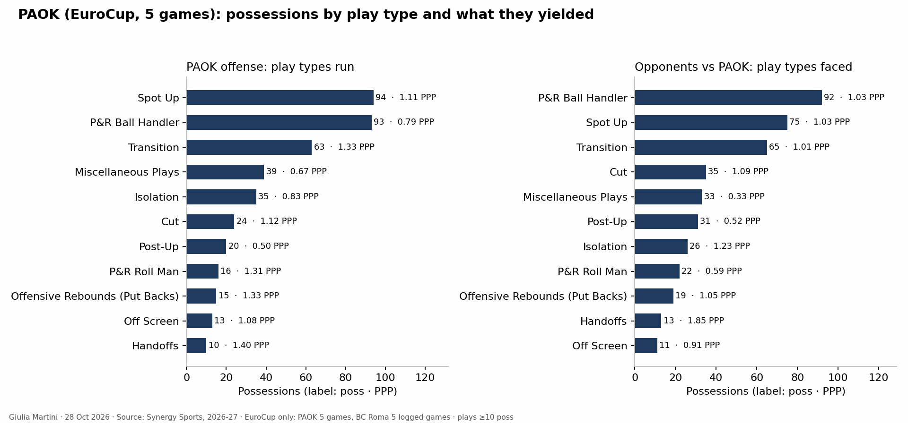
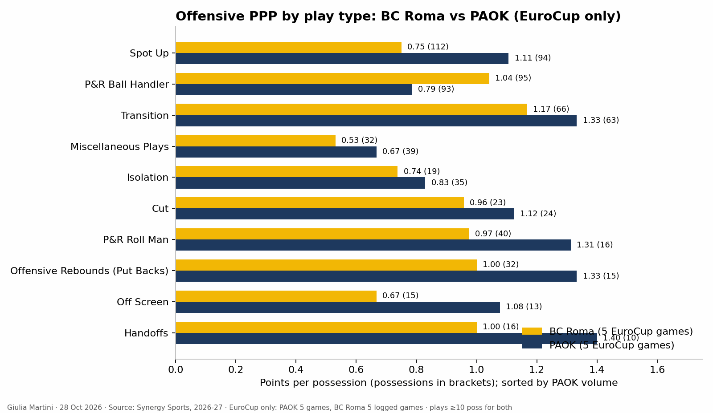
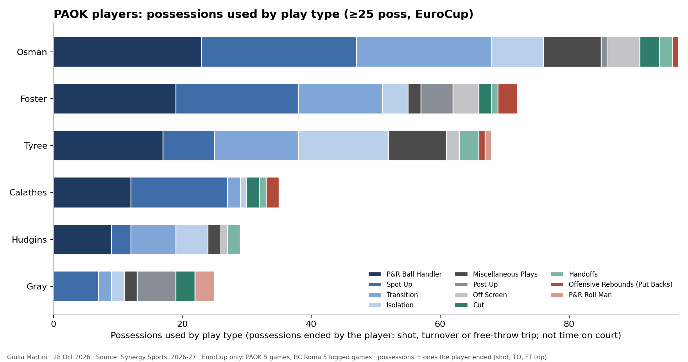

<!--
HOW TO EDIT THIS PAGE (this comment is not shown on the site)
- This file is yours: it is never overwritten. It is linked at the top of the opponent analysis of the same game (analysis.md).
- {{ pending }} is a grey box saying "This section will be filled when the game is reviewed". Replace it with your text.
- Your own plots and images: put the file in this folder (weekly/games/<date>/) and write .
- Highlight with ==text==.
THE STRUCTURE OF THESE THREE PAGES IS THE STANDARD FOR EVERY ANALYSIS; only the content changes.
-->

# Offense tendencies: PAOK

## Key points

{{ pending }}

## Play types and sets

Main play types, pace, first options, sets after timeouts and out-of-bounds plays.

{{ pending }}

## Assists

{{ assists }}

## Turnovers

{{ turnovers }}

## Clips

{{ pending }}
