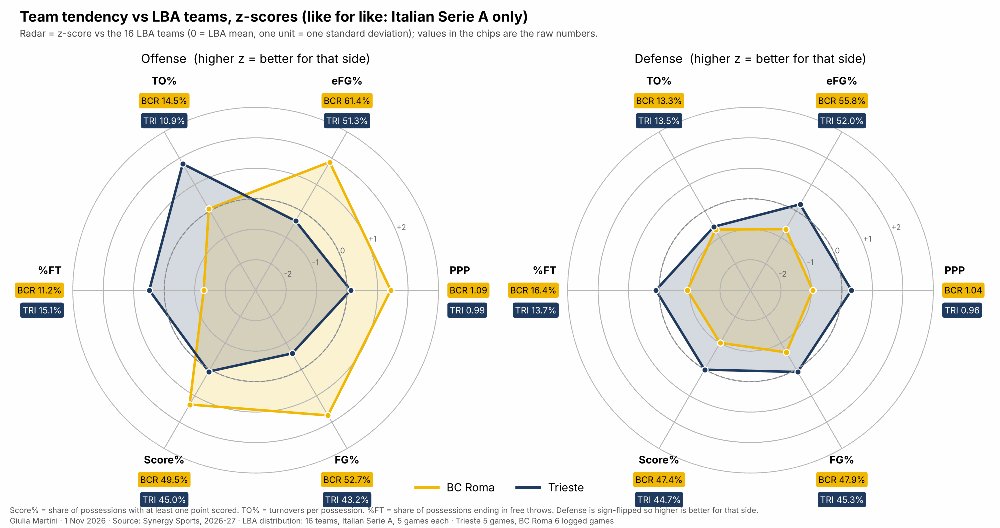
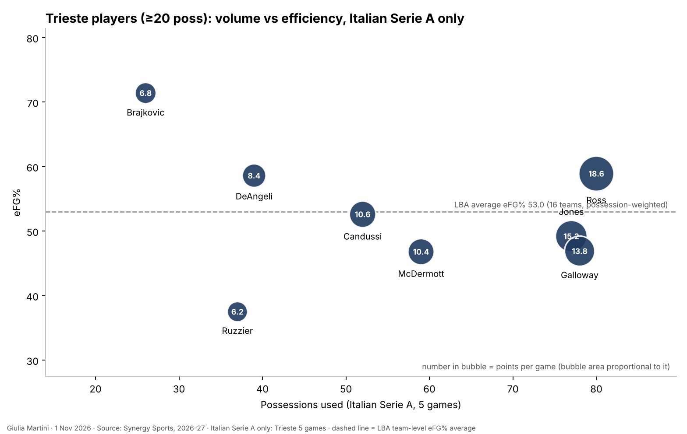

title: 
reviewed: no
generated: 7f113f73d8

<!--
HOW TO EDIT THIS PAGE (this comment is not shown on the site)
- This file is yours: it is never overwritten. Reorder, delete or add sections and text freely.
- The lines like {{ comparison }} or {{ figure: 07_key_players }} are automatic blocks: they are filled in when the site is built
  and keep refreshing when the data changes. Delete a line to remove its block, move it to move the block.
- {{ pending }} is a grey box saying "This section will be filled when the game is reviewed". Replace it with your text (or your
  plots) when you write the section; a section without text and without a box is left out of the page.
- Your own plots and images: put the file in this folder (weekly/games/<date>/) and write .
  The Synergy plots (python notebooks/synergy_scouting_plots.py data/synergy/<folder>) go here by name:
  01b_team_radar_zscore_competition_only, 02_opponent_playtypes, 03_playtype_ppp_ref_vs_opp, 06_players_playtype_mix,
  04_players_volume_efficiency, 05_player_<name>_shot_profile (one per player), 07_lineups_usage_vs_ppp,
  08_lineups_offense_vs_defense, 09_lineups_style_profile.
- Highlight with ==text==. When you are done, set "reviewed: yes" at the top of the file.
Blocks of this page: {{ header }} {{ standings }} {{ comparison }} {{ roster }} {{ assists }} {{ turnovers }} {{ lineups }} {{ pending }} and
{{ figure: name }} for any generated image (01_results_timeline, 02_starters_bench, 03_minutes, 04_scoring_sources, 05_shooting,
06_hot_spots, {{ shot_charts }} (06b: one chart per player), 07_key_players, 08_shot_distribution, 09_basic_stats, 10_major_factors, 11_starting_fives, 13_rotation_by_minute: who is on the court at each minute, with the next options).
The three pages that go deeper (individual_tendencies.md, defense_tendencies.md, offense_tendencies.md, same folder) are linked at the top of this page ({{ more_analysis }}) when they exist: shot charts and lineups are on the individual page; play types, shot selection, assists and turnovers on the offense page; what the team allows on the defense page.
THE STRUCTURE OF THIS PAGE IS THE STANDARD FOR EVERY ANALYSIS (same sections, same order); only the content changes.
-->

# Pallacanestro Trieste vs BC Roma

{{ header }}

{{ more_analysis }}

## Key points

Based on the data only (5 LBA games for Trieste, 6 for BC Roma; Synergy pull of 1 Nov 2026 for play types, shots and lineups; LBA box scores for the rest). Trieste's round 6 game at Virtus Bologna (2 Nov) is not in the numbers.

- Trieste is 2-3 (lost to Milano, Venezia and Varese by 4, 5 and 1 points; beat Cantù by 20 and Verona by 9). It scores 89.0 points a game and allows 85.2, both 7th in the LBA. By PPP it is 10th on offense (0.987) and 9th on defense (0.957 allowed); BC Roma is 1st on offense (1.095) and 13th on defense (1.043).
- Trieste's offense runs through Ross: 42 of its 71 P&R ball-handler possessions (1.14 PPP) and 7.0 assists a game. As a team the P&R ball handler is its best play type (1.183 PPP, 1st in the LBA, 66.3% eFG) and it has the lowest turnover rate in the LBA (10.9% of possessions, league 14.7%).
- Everything else on offense is below average: transition 0.956 PPP (16th, last), P&R roll man 0.778 (14th), isolations 0.815 (12th), post-ups 0.722 (12th). Trieste shoots 51.3% eFG (11th), 33.1% from three (166 attempts of 340).
- The defense is strongest against the roll man (0.684 PPP, 1st in the LBA) and isolations (0.588, 2nd) and weakest against the P&R ball handler (1.060, 16th) and cuts (1.154). It allows few free throws on spot-ups and faces the most spot-ups in the league, level with Trento (29.4% of possessions, 0.916 PPP).
- Short rotation: eight players cover the minutes (Galloway 31', McDermott 31', Jones 28', Ross 26'). The starting five has been the same for four games. The bench scores 23.4 points a game.
- BC Roma's transition defense allows 1.415 PPP (last in the LBA) and Trieste's transition offense is also last (0.956): the one matchup where the weaker side of both teams meets. Jones is the exception (19 possessions, 1.32 PPP); McDermott (12, 0.17) and Galloway (16, 0.63) are not.

## LBA so far: results and standings

{{ standings }}

### Results timeline

{{ figure: 01_results_timeline }}

## BC Roma and Trieste compared

{{ comparison }}

### The two teams at a glance

{{ figure: 09_basic_stats }}

- Offense: BC Roma is 1st in the LBA in PPP (1.095), eFG% (61.4%) and Score% (49.5%); Trieste is 10th, 11th and 9th (0.987, 51.3%, 45.0%). Trieste's strength is ball security: 10.9% turnovers against 14.5% for BC Roma and 14.7% for the league.
- Defense: BC Roma is 13th in PPP allowed (1.043) and eFG% (55.8%); Trieste is 9th (0.957, 52.0%). Both force an average number of turnovers (BC Roma 13.3%, Trieste 13.5%, league 14.6%). BC Roma concedes the second-highest rate of possessions ending in free throws (16.4%); Trieste's offense draws them on 15.1% (6th).
- Pace is similar: 90.2 possessions a game for Trieste, 91.0 for BC Roma (league 89.3).

## Trieste roster

{{ roster }}

## Starting five and bench

- Same five for four games: Ross, McDermott, Galloway, Jones, Brajkovic (since round 2). In round 1 (Milano) Candussi and DeAngeli started in place of Jones and Brajkovic.
- Bench scoring: 23.4 points a game (20, 30, 20, 25, 22); the starters score 65.6. Ruzzier (21', 6.2 PPG, 3.4 assists), DeAngeli (24', 8.4 PPG) and Candussi (21', 10.6 PPG) are the three regulars off the bench; Canka and Paiano play 4-6' a game.
- Minutes: Galloway 31', McDermott 31', Jones 28', Ross 26', DeAngeli 24', Ruzzier 21', Candussi 21', Brajkovic 16.5' (4 games). Two games were decided early (Cantù +20, Verona with 108 points), which lowers the starters' averages.
- Brajkovic (the rim finisher: 10/14 from two, 6.8 PPG) plays the least of the five starters; the lineups with Candussi at the five have the best defensive numbers (see Lineups).

{{ figure: 02_starters_bench }}

{{ figure: 03_minutes }}

{{ figure: 11_starting_fives }}

{{ figure: 13_rotation_by_minute }}

## Key players

### Shooting

Possessions used and efficiency (Synergy, LBA games):

- Ross: 80 possessions (16 a game), 1.163 PPP, 58.9% eFG, 18.6 PPG, 7.0 assists against 2.0 turnovers a game. 29/56 from the field, 8/22 from three (5 of the 15 top threes), 21/34 from two; 27/30 from the line. On the P&R ball handler: 13 pull-up threes, 5 made; 11/17 at the basket.
- Jones: 77 possessions, 0.987 PPP, 49.2% eFG, 15.2 PPG, 8.8 rebounds (9 offensive). 13/34 from three (5/12 in the corner), 12/30 from two; best in transition (19 possessions, 1.316 PPP).
- Galloway: 78 possessions, 0.885 PPP, 46.9% eFG, 13.8 PPG; 13/39 from three (7/15 in the corner), 11/26 from two; 3.0 assists.
- Candussi: 52 possessions, 1.019 PPP, 52.6% eFG, 10.6 PPG; 13/21 from two, 5/18 from three; 18 free-throw attempts.
- McDermott: 59 possessions, 0.881 PPP, 46.8% eFG, 10.4 PPG; 8/31 from three (25.8%) but 10/16 from two. 12 transition possessions at 0.17 PPP.
- DeAngeli: 39 possessions, 1.077 PPP, 58.6% eFG; 6/13 from three.
- Ruzzier: 37 possessions, 0.838 PPP, 37.5% eFG; 17 assists and 5 turnovers.
- Brajkovic: 26 possessions in 4 games, 1.038 PPP, 71.4% eFG (10/14, all two-pointers).

Samples are small: nobody beyond Ross, Jones and Galloway has used more than 60 possessions.

{{ figure: 07_key_players }}

{{ figure: 08_shot_distribution }}

### Other stats

{{ figure: 10_major_factors }}

## What to expect

From the numbers only (5 and 6 LBA games, so tendencies, not predictions):

- **The P&R ball handler, both ways.** Trieste's best offense (1.183 PPP, Ross 42 possessions at 1.14) meets BC Roma's 13th-ranked defense against it (0.954 allowed on 109 possessions); on the other side BC Roma (1.052, 2nd) meets Trieste's 16th. Trieste forces turnovers on 23.9% of those possessions, so the possessions are decided on turnovers as much as on shots.
- **Transition.** BC Roma's defense allows 1.415 PPP in transition (last), Trieste's offense scores 0.956 (last) — Jones (1.316) is the one to watch; McDermott and Galloway are poor in the open court. BC Roma's own transition (94 possessions, 1.202, 8th) meets a defense that allows 1.08 (5th).
- **Roll man.** Trieste's defense is the league's best against the roll man (0.684); BC Roma's roll man scores 1.158 (66 points on 57 possessions).
- **Cuts and put-backs.** BC Roma's cuts (1.657 PPP, 82.8% FG) against 1.154 allowed. On the boards, BC Roma concedes 1.406 PPP on put-backs (last in the LBA) and Trieste's offense scores 1.179 on them (5th); Jones has 9 offensive rebounds in five games.
- **Turnovers.** Trieste turns it over on 10.9% of possessions, BC Roma forces 13.3%; BC Roma loses it on 14.5%, Trieste forces 13.5%.
- **Free throws.** BC Roma's defense sends opponents to the line on 16.4% of possessions (second most); Trieste is 27/30 with Ross and 73.3% as a team (96/131).
- **Rotation.** Eight players, same starting five for four games, a bench scoring 23.4: fatigue and fouls on Ross, Galloway and McDermott (30'+) are the lever.

### Metrics to check during/after the game

- BC Roma's PPP allowed on Trieste's P&R ball-handler possessions (Ross) and the number of turnovers forced there.
- Trieste's transition points and who finishes them (Jones against McDermott/Galloway).
- Trieste's put-backs and second-chance points, and Jones's offensive rebounds.
- Ross's pull-up threes and drives to the basket (13 pull-up threes, 5 made, in five games) and his free throws.
- Free-throw attempts for both teams.
- BC Roma's cuts and roll-man finishes against Trieste's roll-man defense.
- Minutes of Ross, Galloway and McDermott and Trieste's bench points.

### Other checks

- Data caveat: the Synergy pull is hand-extracted from the web app and the samples are small (5 games); read the figures as descriptive. Check the review notes in `data/synergy/trieste_2026-11-08/README.md`.
- Trieste played round 6 at Virtus Bologna on 2 Nov: update the numbers (rotation, Ross's minutes, starters) when the game is in the data.
- BC Roma's EuroCup game at PAOK (3 Nov) comes five days earlier: check minutes and availability in the snapshot before the game.

## Clips suggested

Game clock from the Synergy shot list (time remaining in the period):

**Ross pull-up threes off the P&R** (5/13 made): vs Verona Q1 8:55 (made), Q3 3:31, Q4 3:59, Q4 2:39; vs Cantù Q2 3:14; at Varese Q2 2:23, Q3 2:51; vs Venezia Q3 8:11; at Milano Q1 2:19 (made), Q2 5:19 (made), Q2 4:46, Q3 0:39 (made) and one more in Q3.

**Jones in transition** (9 made field goals): vs Cantù Q1 5:56 (three), Q3 7:36, Q3 9:02 (three); at Varese Q2 2:50, Q4 4:00, Q4 4:16 (three); vs Venezia Q2 5:37, Q4 1:29, Q4 1:04.
