<!--
HOW TO EDIT THIS PAGE (this comment is not shown on the site)
- This file is yours: it is never overwritten. It is linked at the top of the opponent analysis of the same game (analysis.md).
- {{ pending }} is a grey box saying "This section will be filled when the game is reviewed". Replace it with your text.
- Your own plots and images: put the file in this folder (weekly/games/<date>/) and write .
- Highlight with ==text==.
THE STRUCTURE OF THESE THREE PAGES IS THE STANDARD FOR EVERY ANALYSIS; only the content changes.
-->

# Individual tendencies: Trieste

## Key points

Based on the data only (5 LBA games; Synergy pull of 1 Nov 2026 for shots, LBA box scores and play-by-play for the rest). Trieste's round 6 game at Virtus Bologna (2 Nov) is not included.

- **Ross is the offense.** 16 possessions a game (80 in five), 18.6 PPG, 7.0 assists to 2.0 turnovers, 27/30 from the line; 42 of the team's 71 P&R ball-handler possessions are his. He is also the top of the league-percentile chart for pace (1.00) and draws 11.2 fouls per 40' (37 in 132').
- **Jones is the second engine**: 15.2 PPG, 8.8 rebounds (9 offensive), 9 steals and 9 blocks in 139', 19 transition possessions at 1.32 PPP. Rim activity 0.92 and pace 0.91 in the league percentiles.
- **The wings shoot threes**: 66% of McDermott's shots are threes, 60% of Galloway's, 53% of Jones's (Ross 39%). Galloway is best from the corner (7/15), McDermott is 8/31 from three overall (25.8%).
- **The bigs finish near the basket**: Brajkovic 10/14 from two (no three), Candussi 13/21 from two and 5/18 from three. Brajkovic is the highest on rim activity among the bigs (0.87, 3 dunks in 66').
- **Shot mix drifted from threes towards the paint.** The share of threes by game: 55% (Milano), 52% (Venezia), 45% (Varese), 49% (Cantù), 44% (Verona); the three losses average 51%, the two wins 46%. Five games: a tendency, not a rule.

## Shot attempts: 3PT, paint and mid-range

How the shot attempts of each game split between threes, paint and mid-range: one dot per game (green = won, red = lost), the smoothed areas hold the densest 50% and 80% of the games, the black square is the average.

### Team

{{ figure: 12_triangles_team_attempts }}

### High-volume players

{{ figure: 12_triangles_players_high_attempts }}

### Lower-volume players

{{ figure: 12_triangles_players_low_attempts }}

## Shot charts by player

{{ shot_charts }}

Shot profile (made/attempted by location and play type) and, where a player has enough attempts, shot types within each play type.

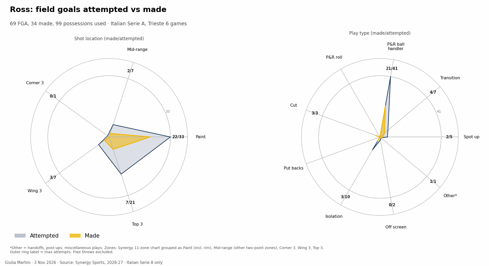
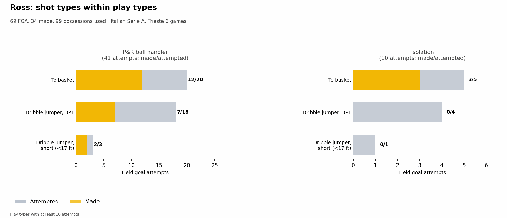
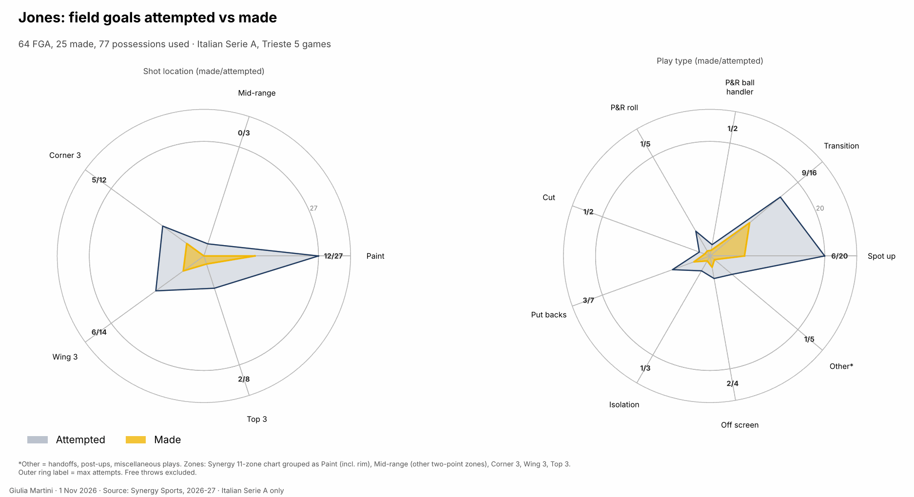
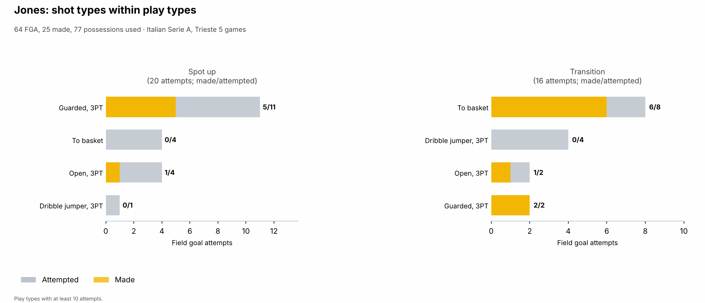
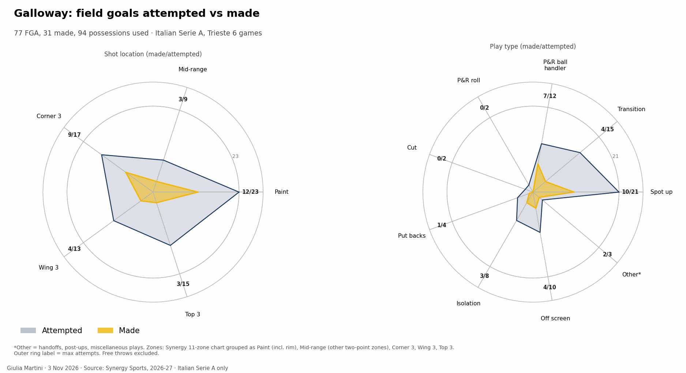
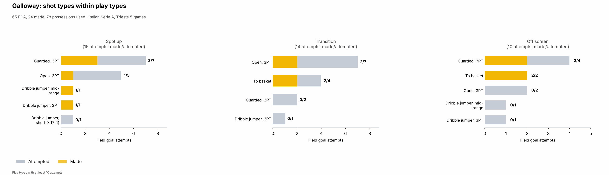
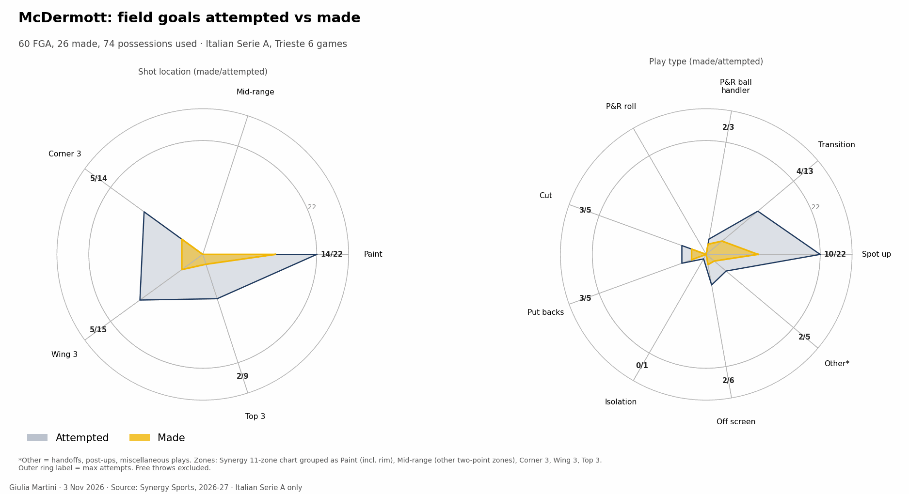
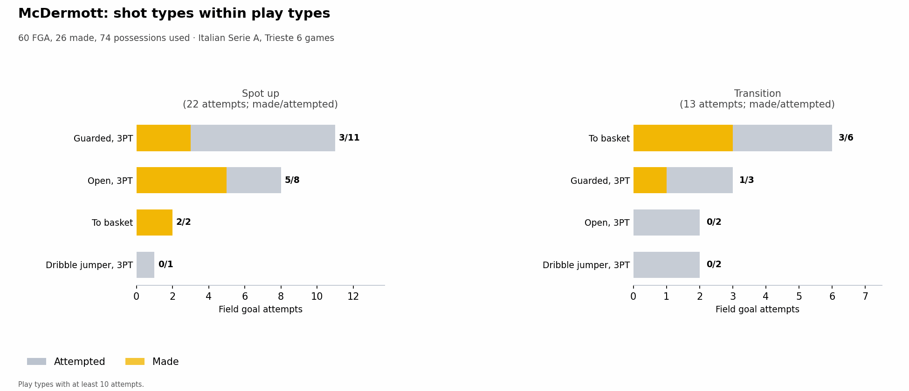
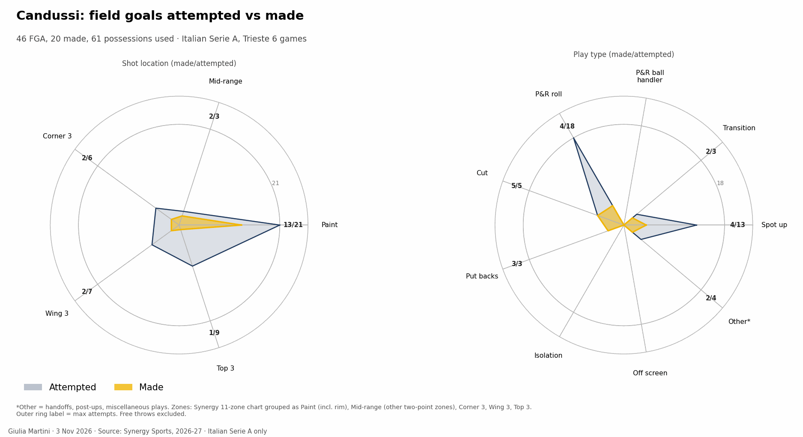
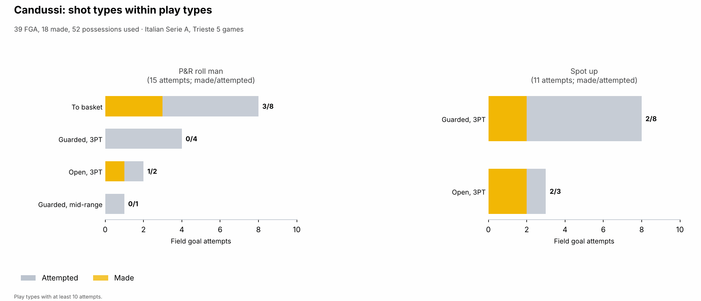
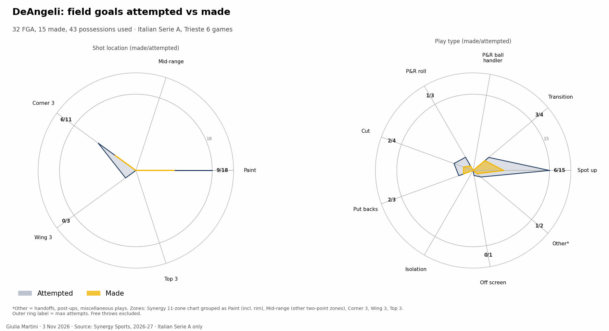
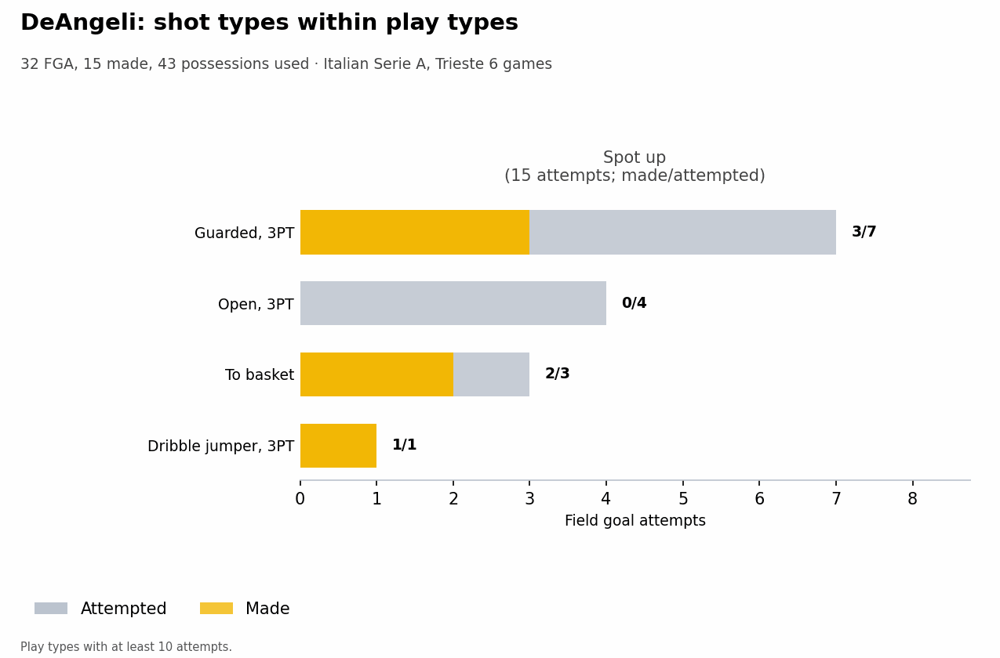
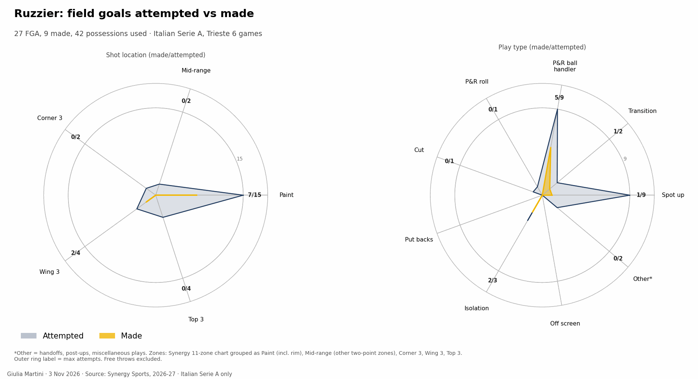
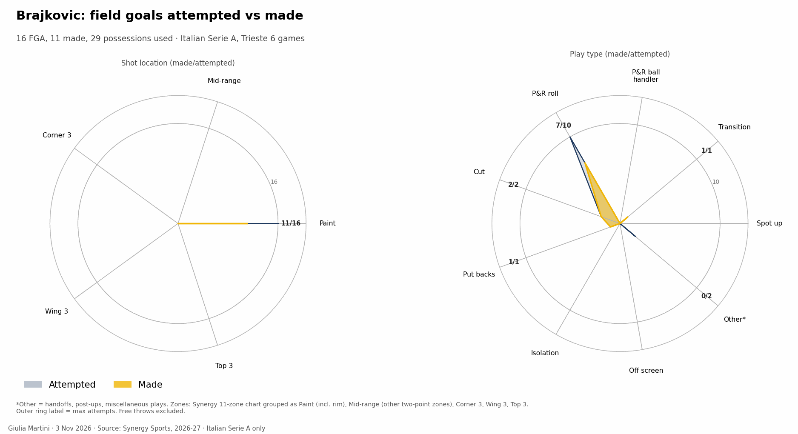
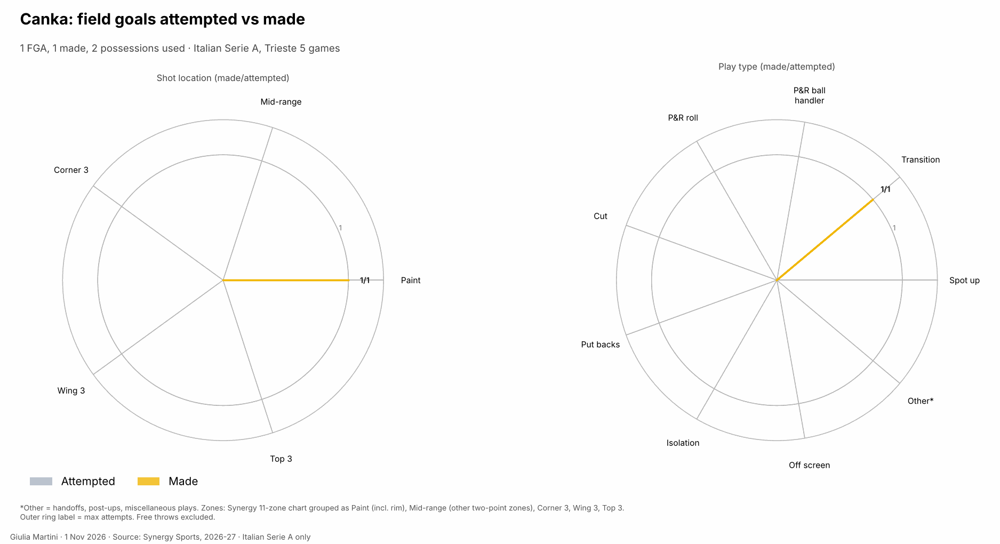
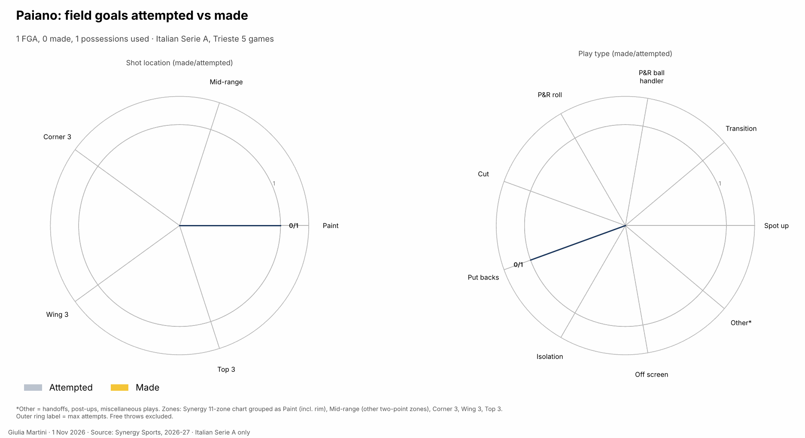

## Energy: rim activity and pace

Two scores per player, built from box score and play-by-play only, shown as league percentiles (0.5 = league median; shrunk towards it for players with few minutes). ==Rim activity==: offensive rebounds, blocks, dunks and fouls drawn per 40 minutes. ==High pace==: drive finishes, fast-break shots and assists, fouls drawn, steals per 40 minutes and the share of shots taken within 8 s of the possession start. LBA, 5 games, players sorted by minutes played; the reference is every LBA player with at least 40 minutes.

{{ figure: 15_energy_indices }}

- **Ross: pace.** 1.00 (the top of the reference), rim activity 0.77: 37 fouls drawn in 132' (11.2 per 40'), 24 drive finishes and 12 fast-break shots plus assists; only 3 offensive rebounds and no block.
- **Jones: high on both** (rim 0.92, pace 0.91): 10 offensive rebounds, 9 blocks, 2 dunks, 9 steals and 11 drive finishes in 139'.
- **Brajkovic: rim activity 0.87** (3 dunks, 6 offensive rebounds, 10 fouls drawn in 66', four games), pace 0.75; **DeAngeli** is the opposite on the other axis (rim 0.63, pace 0.05: 2 drive finishes in 119').
- **McDermott** is mostly a pace player (0.61; 18 fouls drawn in 153') with little rim activity (0.36). **Galloway** is close to the median on both (0.53, 0.41): 14 offensive rebounds but no dunk and 9 drive finishes in 155'.
- **Ruzzier** has the lowest rim activity of the regulars (0.16, no dunk and no block in 107') and an average pace (0.49; 11 drive finishes).
- **Candussi** is average to below (0.49, 0.38): 7 offensive rebounds, 2 drive finishes.

## Rotation by player

When each player is on the court in each quarter, in the last 5 games of the competition: one bar per quarter, the clock runs from 10:00 down to 0:00, dark green = on the court in every game at that moment, white = in none.

{{ figure: 14_player_rotation_Brajkovic }}

{{ figure: 14_player_rotation_Candussi }}

{{ figure: 14_player_rotation_Canka }}

{{ figure: 14_player_rotation_Deangeli }}

{{ figure: 14_player_rotation_Galloway }}

{{ figure: 14_player_rotation_Jones }}

{{ figure: 14_player_rotation_Mcdermott }}

{{ figure: 14_player_rotation_Paiano }}

{{ figure: 14_player_rotation_Ross }}

{{ figure: 14_player_rotation_Ruzzier }}

## Players to watch

- **Ross.** The ball stops with him: P&R ball handler 42 possessions at 1.14 PPP, 13 pull-up threes off the screen (5 made), 11/17 at the basket, fouls drawn at the highest rate of the roster. He takes 15 of his 22 threes from the top of the key.
- **Jones in transition and on the offensive boards.** 19 transition possessions at 1.32 PPP (25 points), against 0.82 PPP for the rest of the roster combined (49 possessions, 40 points); 12 corner-three attempts (5 made) and 9 blocks and 9 steals.
- **Galloway and McDermott.** 39 and 31 three-point attempts at 33.3% and 25.8%; McDermott's transition possessions score 0.17 PPP (12), Galloway's 0.63 (16).
- **Candussi and Brajkovic.** Roll-man and cut finishers (Candussi 18 roll-man possessions at 0.72 PPP, Brajkovic 10 at 1.30). The five of Candussi, DeAngeli, Ross, McDermott and Galloway allowed 0.714 PPP in 35 defensive possessions (small sample).
- **Ruzzier.** Plays 21' off the bench with the lowest efficiency of the regulars (0.838 PPP, 37.5% eFG; 17 assists, 5 turnovers), but is the second ball handler: 12 P&R ball-handler possessions at 1.17 PPP.
- Sample warning: apart from Ross, Jones and Galloway nobody has used more than 60 possessions in five games.
