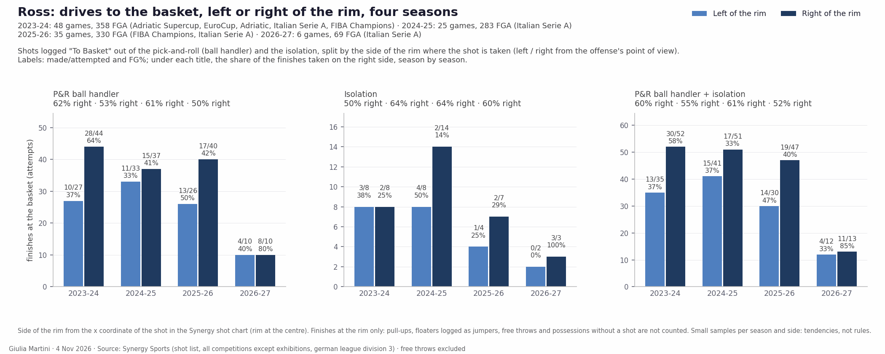

<!--
HOW TO EDIT THIS PAGE (this comment is not shown on the site)
- This file is yours: it is never overwritten. It is linked at the top of the opponent analysis of the same game (analysis.md).
- {{ pending }} is a grey box saying "This section will be filled when the game is reviewed". Replace it with your text.
- Your own plots and images: put the file in this folder (weekly/games/<date>/) and write .
- Highlight with ==text==.
- A section has a short summary ("In short") and, when there is more, a "Details" drop-down: put an HTML comment holding the word more on its own line between the two.
  Each fact lives in one section; elsewhere link to it.
THE STRUCTURE OF THESE THREE PAGES IS THE STANDARD FOR EVERY ANALYSIS; only the content changes. Rules: .claude/skills/opponent-analysis/SKILL.md
-->

# Individual tendencies: Trieste

## Key points

Based on the data only (6 LBA games, round 6 at Virtus Bologna included; Synergy pull of 3 Nov 2026 for shots, LBA box scores and play-by-play for the rest). Minutes, starters and bench are in [roster and rotation](./#roster-starting-five-and-bench); play types and assists in [offense](offense_tendencies.html).

- **Ross is the offense.** 16.5 possessions a game, 18.5 PPG, 6.8 assists, 1.8 turnovers. P&R ball handler: 55 possessions at 1.09 PPP, 18 pull-up threes off the screen (7 made), 12/20 at the basket. He takes 21 of his 29 threes from the top of the key.
- **Ross over four seasons (Trieste since 2024-25): the same player, more of him.** ==The high pick-and-roll has been 38-56% of his possessions every year==, finished by a drive — to the right of the rim more often than not — or a pull-up three; this season the three has moved to the top of the key. Season by season: [Ross: four seasons of shots](#ross-four-seasons-of-shots).
- **Jones is the second engine.** 25 transition possessions at 1.32 PPP (33 points) against 0.95 PPP for the rest of the roster combined (55 possessions, 52 points); 13 offensive rebounds, 9 blocks, 11 steals; 6/13 from the corner.
- **The wings shoot threes**: 63% of McDermott's shots are threes, 58% of Galloway's, 50% of Jones's (Ross 42%). Galloway is best from the corner (9/17), McDermott is 12/38 overall (31.6%). Both are good spot-ups (22 possessions each, 1.32 and 1.27 PPP) and poor in transition (McDermott 15 possessions at 0.60, Galloway 18 at 0.72).
- **The bigs finish near the basket**: Brajkovic 11/16 from two (no three), Candussi 15/24 from two and 5/22 from three. Roll man: Brajkovic 13 possessions at 1.31 PPP, Candussi 22 at 0.59.

<!-- more -->

Synergy, six games (Brajkovic five):

| Player | Min | Poss | PPP | eFG% | PPG | 3P | 2P | FT |
|---|---|---|---|---|---|---|---|---|
| Ross | 26.5 | 99 | 1.121 | 56.5 | 18.5 | 10/29 | 24/40 | 33/38 |
| Jones | 28.7 | 96 | 1.010 | 50.0 | 16.2 | 14/40 | 19/40 | 17/24 |
| Galloway | 31.2 | 94 | 0.989 | 50.6 | 15.5 | 16/45 | 15/32 | 15/17 |
| McDermott | 31.0 | 74 | 1.014 | 53.3 | 12.5 | 12/38 | 14/22 | 11/15 |
| Candussi | 20.0 | 61 | 0.967 | 48.9 | 9.8 | 5/22 | 15/24 | 14/20 |
| DeAngeli | 22.7 | 43 | 1.023 | 56.3 | 7.3 | 6/14 | 9/18 | 8/11 |
| Ruzzier | 20.8 | 42 | 0.786 | 37.0 | 5.5 | 2/10 | 7/17 | 13/16 |
| Brajkovic | 17.4 | 29 | 1.069 | 68.8 | 6.2 | 0/0 | 11/16 | 9/18 |

- **Ruzzier** has the lowest efficiency of the regulars but is the second ball handler: 14 P&R ball-handler possessions at 1.14 PPP, 20 assists and 7 turnovers.
- **DeAngeli** is a spot-up shooter (6 of his 14 threes made, 18 spot-up possessions at 0.89 PPP).
- The five of Candussi, Ross, McDermott, Galloway and Jones allowed 0.833 PPP in 54 defensive possessions (small sample).
- Sample warning: apart from the first five of the table nobody has used more than 60 possessions in six games.

## Shot attempts: 3PT, paint and mid-range

The shot mix drifted from threes towards the paint. The share of threes by game: 55% (Milano), 51% (Venezia), 46% (Varese), 49% (Cantù), 44% (Verona), 47% (Bologna); the three losses average 51%, the three wins 47%. Six games: a tendency, not a rule.

<!-- more -->

How the shot attempts of each game split between threes, paint and mid-range: one dot per game (green = won, red = lost), the smoothed areas hold the densest 50% and 80% of the games, the black square is the average.

### Team

{{ figure: 12_triangles_team_attempts }}

### High-volume players

{{ figure: 12_triangles_players_high_attempts }}

### Lower-volume players

{{ figure: 12_triangles_players_low_attempts }}

## Shot charts by player

Shot profile (made/attempted by location and play type) and, where a player has enough attempts, shot types within each play type. The team zone totals are in [shot selection](./#shot-selection).

<!-- more -->

{{ shot_charts }}

## Ross: four seasons of shots

==Colbey Ross== is in his third season at Trieste: ==2024-25 Trieste (LBA, 25 games in Synergy) and 2025-26 Trieste (LBA plus FIBA Champions League, 35 games)==, after a 2023-24 split between Buducnost (Adriatic League, EuroCup) and Tortona from December (LBA, Champions League). Synergy shot list and possession counts, exhibitions excluded: 358, 283, 330 and 69 attempts (six LBA games this season).

- **One favourite situation, every season: the ==high pick-and-roll==.** The P&R ball handler is 38-56% of his possessions and the high pick 80-85% of those shots. He has scored 0.82-0.86 PPP on it for three years; this season 1.09, with fewer turnovers.
- **Two finishes, half and half: the drive to the basket and the ==pull-up three==.** The pull-up three sits at 33-39% every season; the drive is what moves (37-54% made).
- **Driving direction: ==right==.** More than half of his finishes at the rim are on the right side of the basket, every season, and out of the pick-and-roll that is usually also where he scores. In isolation the right-hand drive has been his weakest shot (2/14 in 2024-25).
- **What is new this season**: the three has moved to the top of the key (3.5 attempts a game, twice his previous rate), the paint share is his highest, spot-ups and transition have shrunk.

<!-- more -->

### Where the shots come from

- The split has not changed: 42-46% threes (made 34-37% every season), 41-48% in the paint, a tenth from mid-range.
- The three has moved from the wing to the top: wing threes 2.5 → 2.0 → 1.2 a game, top-of-the-key threes 1.8 → 1.5 → 3.5 (7/21 so far).
- Paint attempts at a high (5.5 a game, 22/33) and the best two-point shooting of the four seasons (60%, against 43-47%).

### Play types over every possession

Share of his possessions and PPP by season (every possession, turnovers and fouls included):

| Play type | 2023-24 | 2024-25 | 2025-26 | 2026-27 |
|---|---|---|---|---|
| P&R ball handler | 44% · 0.86 | 45% · 0.82 | 38% · 0.84 | 56% · 1.09 |
| Spot-up | 14% · 1.14 | 12% · 1.25 | 16% · 1.19 | 9% · 1.56 |
| Transition | 14% · 1.01 | 9% · 1.03 | 15% · 1.06 | 8% · 1.13 |
| Isolation | 10% · 0.77 | 16% · 0.82 | 9% · 0.63 | 12% · 0.67 |
| Hand-off | 4% · 0.68 | 4% · 0.69 | 8% · 0.68 | 2% |

- The ranking never changes: spot-ups and transition are his most efficient plays, isolations and hand-offs the least. Only the shares move, and this season the pick-and-roll has taken the share of the spot-ups and the transition.
- Turnovers come from the pick-and-roll (14-25% of those possessions in the three previous seasons, 11% this season); spot-ups almost never.

### The pick-and-roll in detail

- Four of five P&R shots come from a high pick and he dribbles off it; going away from the pick is about one in ten. Side picks are rare and split evenly between left and right.
- The finish is a drive (about half of the P&R shots) or a pull-up three (a third to a half); the pull-up two is marginal.
- Pull-up threes come from the top of the key, more than ever this season (19 of 26).

### Driving direction

- **Right, every season.** 50-62% of his P&R finishes and 50-64% of his isolation finishes are on the right side of the rim; over all his rim finishes, 53-63%.
- **Out of the pick-and-roll the right side is usually the productive one**: 64% against 37% in 2023-24, 41% against 33% in 2024-25, 8/10 against 4/10 this season; last season the left side was better (50% against 42%).
- **In isolation it is the opposite**: the right-hand drive is where he misses (2/8, 2/14, 2/7), the left is better but rare. Synergy's own "Drives Left / Drives Right" tags on isolations and spot-ups say the same: he goes right slightly more often and scores more going left.
- This season's pull-ups also lean right: 15 of his 21 P&R pull-ups come from the right side of the floor.

### Isolation, spot-up, transition

- Isolation from the top of the key (55-75% of them), then a drive — right more often than left — or an early three; among his weakest plays by PPP every season.
- Spot-up: a no-dribble three three to four times out of five (made 40-42%); almost gone this season (5 shots in 6 games).
- Transition: the ball handler going to the basket (made 52-79%); a fifth to two fifths of his transition shots are threes.
- Hand-offs peaked last season (29 shots) and are 1 shot this season.

### Game by game

- The average mix is the same every season (about 44% three, 44% paint, 12% mid-range); the Trieste seasons sit on the 3PT–paint edge with few mid-range games.
- This season: 3 to 10 P&R ball-handler shots a game, 11 to 23 possessions.
- Sample warning: 2026-27 is six games; 2023-24 mixes a small role at Buducnost with Tortona; Synergy holds 25 of Trieste's 2024-25 games. Other leagues and levels: the figures describe what he does, not how it translates.

## Energy: rim activity and pace

Two scores per player, as league percentiles (0.5 = league median): ==rim activity== and ==high pace==.

- **Ross: pace 1.00** (the top of the reference), rim activity 0.74: 43 fouls drawn in 159' (10.8 per 40'), 27 drive finishes and 13 fast-break shots plus assists; only 3 offensive rebounds and no block.
- **Jones: high on both** (rim 0.94, pace 0.92): 13 offensive rebounds, 9 blocks, 4 dunks, 11 steals and 11 drive finishes in 172'.
- **DeAngeli has the lowest pace of the roster** (0.02: 3 drive finishes in 136'), rim activity 0.45.

<!-- more -->

Built from box score and play-by-play only, shrunk towards the median for players with few minutes. ==Rim activity==: offensive rebounds, blocks, dunks and fouls drawn per 40 minutes. ==High pace==: drive finishes, fast-break shots and assists, fouls drawn, steals per 40 minutes and the share of shots taken within 8 s of the possession start. LBA, 6 games, players sorted by minutes played; the reference is every LBA player with at least 40 minutes.

{{ figure: 15_energy_indices }}

- **Brajkovic: rim activity 0.80** (3 dunks, 6 offensive rebounds, 11 fouls drawn in 87', five games), pace 0.61.
- **McDermott** is below the median on both (rim 0.42, pace 0.44; 21 fouls drawn in 186'). **Galloway** is similar (0.45, 0.34): 15 offensive rebounds but no dunk and 11 drive finishes in 187'.
- **Ruzzier** has the lowest rim activity of the regulars (0.11, no dunk and no block in 125') and a below-average pace (0.40; 13 drive finishes).
- **Candussi** is average on rim activity and low on pace (0.62, 0.27): 9 offensive rebounds, 2 drive finishes.

## Rotation by player

When each player is on the court in each quarter, in the last 6 games of the competition. The team view (who is on the court at each minute) is in [roster and rotation](./#roster-starting-five-and-bench).

<!-- more -->

One bar per quarter, the clock runs from 10:00 down to 0:00, dark green = on the court in every game at that moment, white = in none.

{{ figure: 14_player_rotation_Brajkovic }}

{{ figure: 14_player_rotation_Candussi }}

{{ figure: 14_player_rotation_Canka }}

{{ figure: 14_player_rotation_Deangeli }}

{{ figure: 14_player_rotation_Galloway }}

{{ figure: 14_player_rotation_Jones }}

{{ figure: 14_player_rotation_Mcdermott }}

{{ figure: 14_player_rotation_Paiano }}

{{ figure: 14_player_rotation_Ross }}

{{ figure: 14_player_rotation_Ruzzier }}
