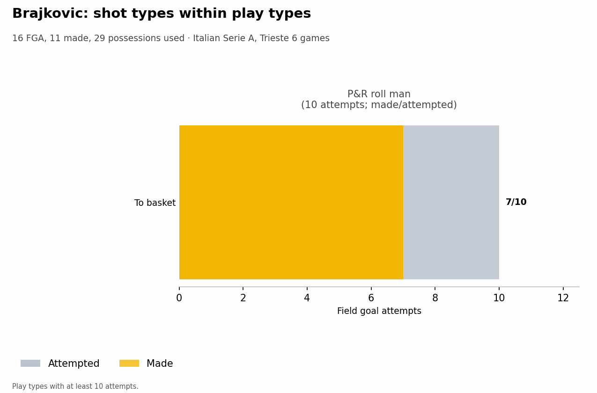
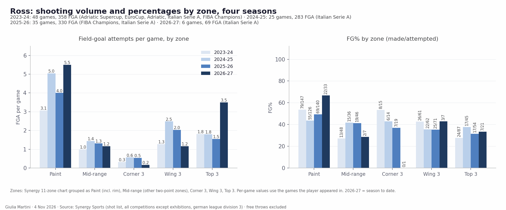
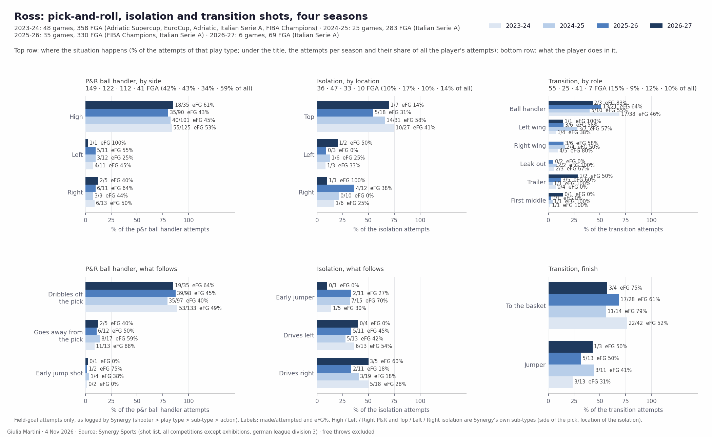
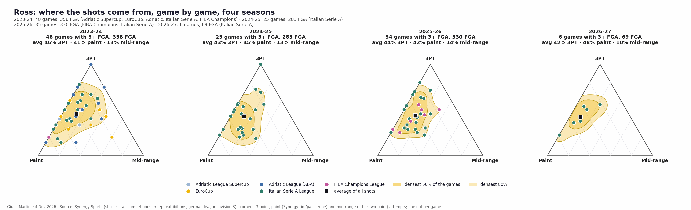

<!--
HOW TO EDIT THIS PAGE (this comment is not shown on the site)
- This file is yours: it is never overwritten. It is linked at the top of the opponent analysis of the same game (analysis.md).
- {{ pending }} is a grey box saying "This section will be filled when the game is reviewed". Replace it with your text.
- Your own plots and images: put the file in this folder (weekly/games/<date>/) and write .
- Highlight with ==text==.
- A section has a short summary ("In short") and, when there is more, a "Details" drop-down: put an HTML comment holding the word more on its own line between the two.
  Each fact lives in one section; elsewhere link to it.
THE STRUCTURE OF THESE THREE PAGES IS THE STANDARD FOR EVERY ANALYSIS; only the content changes. Rules: .claude/skills/opponent-analysis/SKILL.md
-->

# Individual tendencies: Trieste

## Key points

Based on the data only (6 LBA games, round 6 at Virtus Bologna included; Synergy pull of 3 Nov 2026 for shots, LBA box scores and play-by-play for the rest). Minutes, starters and bench are in [roster and rotation](./#roster-starting-five-and-bench); play types and assists in [offense](offense_tendencies.html).

- **Ross is the offense.** 16.5 possessions a game, 18.5 PPG, 6.8 assists, 1.8 turnovers. P&R ball handler: 55 possessions at 1.09 PPP, 18 pull-up threes off the screen (7 made), 12/20 at the basket. He takes 21 of his 29 threes from the top of the key.
- **Ross over four seasons: the same player, more of him.** ==The high pick-and-roll has been 38-56% of his possessions every year==, finished by a drive (more often to the right side of the rim) or a pull-up three; this season the three has moved to the top of the key. Season by season: [Ross: four seasons of shots](#ross-four-seasons-of-shots).
- **Jones is the second engine.** 25 transition possessions at 1.32 PPP (33 points) against 0.95 PPP for the rest of the roster combined (55 possessions, 52 points); 13 offensive rebounds, 9 blocks, 11 steals; 6/13 from the corner.
- **The wings shoot threes**: 63% of McDermott's shots are threes, 58% of Galloway's, 50% of Jones's (Ross 42%). Galloway is best from the corner (9/17), McDermott is 12/38 overall (31.6%). Both are good spot-ups (22 possessions each, 1.32 and 1.27 PPP) and poor in transition (McDermott 15 possessions at 0.60, Galloway 18 at 0.72).
- **The bigs finish near the basket**: Brajkovic 11/16 from two (no three), Candussi 15/24 from two and 5/22 from three. Roll man: Brajkovic 13 possessions at 1.31 PPP, Candussi 22 at 0.59.

<!-- more -->

Synergy, six games (Brajkovic five):

| Player | Min | Poss | PPP | eFG% | PPG | 3P | 2P | FT |
|---|---|---|---|---|---|---|---|---|
| Ross | 26.5 | 99 | 1.121 | 56.5 | 18.5 | 10/29 | 24/40 | 33/38 |
| Jones | 28.7 | 96 | 1.010 | 50.0 | 16.2 | 14/40 | 19/40 | 17/24 |
| Galloway | 31.2 | 94 | 0.989 | 50.6 | 15.5 | 16/45 | 15/32 | 15/17 |
| McDermott | 31.0 | 74 | 1.014 | 53.3 | 12.5 | 12/38 | 14/22 | 11/15 |
| Candussi | 20.0 | 61 | 0.967 | 48.9 | 9.8 | 5/22 | 15/24 | 14/20 |
| DeAngeli | 22.7 | 43 | 1.023 | 56.3 | 7.3 | 6/14 | 9/18 | 8/11 |
| Ruzzier | 20.8 | 42 | 0.786 | 37.0 | 5.5 | 2/10 | 7/17 | 13/16 |
| Brajkovic | 17.4 | 29 | 1.069 | 68.8 | 6.2 | 0/0 | 11/16 | 9/18 |

- **Ruzzier** has the lowest efficiency of the regulars but is the second ball handler: 14 P&R ball-handler possessions at 1.14 PPP, 20 assists and 7 turnovers.
- **DeAngeli** is a spot-up shooter (6 of his 14 threes made, 18 spot-up possessions at 0.89 PPP).
- The five of Candussi, Ross, McDermott, Galloway and Jones allowed 0.833 PPP in 54 defensive possessions (small sample).
- Sample warning: apart from the first five of the table nobody has used more than 60 possessions in six games.

## Shot attempts: 3PT, paint and mid-range

The shot mix drifted from threes towards the paint. The share of threes by game: 55% (Milano), 51% (Venezia), 46% (Varese), 49% (Cantù), 44% (Verona), 47% (Bologna); the three losses average 51%, the three wins 47%. Six games: a tendency, not a rule.

<!-- more -->

How the shot attempts of each game split between threes, paint and mid-range: one dot per game (green = won, red = lost), the smoothed areas hold the densest 50% and 80% of the games, the black square is the average.

### Team

{{ figure: 12_triangles_team_attempts }}

### High-volume players

{{ figure: 12_triangles_players_high_attempts }}

### Lower-volume players

{{ figure: 12_triangles_players_low_attempts }}

## Shot charts by player

Shot profile (made/attempted by location and play type) and, where a player has enough attempts, shot types within each play type. The team zone totals are in [shot selection](./#shot-selection).

<!-- more -->

{{ shot_charts }}

## Ross: four seasons of shots

==Colbey Ross==, four seasons in Synergy: 2023-24 Buducnost (Adriatic League, Adriatic Supercup, EuroCup, 23 games) then Tortona from December (LBA and FIBA Champions League, 25 games) — 48 games, 358 attempts; 2024-25 Trieste (25 LBA games, 283); 2025-26 Trieste (27 LBA and 8 Champions League games, 330); 2026-27 Trieste (6 LBA games, 69). Shot list and possession counts of the Synergy web app, exhibitions excluded. Field-goal attempts only in the shot charts; the play-type shares and PPP count every possession (turnovers and fouls included).

- **One favourite situation, every season: the ==pick-and-roll ball handler==.** 44%, 45%, 38% and 56% of his possessions (228, 174, 177, 55); ==the high pick is 80-85% of those shots==, and he dribbles off the pick on 80-89% of them. What he gets out of it has been stable for three years and better this season: 0.86, 0.82, 0.84 and now 1.09 PPP, turnover rate 25% → 14% → 22% → 11%.
- **Two finishes, half and half: the drive to the basket (48-59% of his P&R shots) and the ==pull-up three== (44%, 32%, 29%, 44%).** The pull-up three is a constant: 25/65 (38%), 13/39, 11/33, 7/18 — 33-39% every season. The drive is what moves: 38/71 (54%), 26/70 (37%), 30/66 (45%) and 12/20 so far.
- **Driving direction: ==right==.** Over all his finishes at the rim, 57-63% are on the right side of the basket in each of the three full seasons (94 of 152, 70 of 123, 85 of 135; 16 of 30 this season), and on tagged drives (isolation, spot-up, hand-off) he goes right slightly more often (25-23-18 vs 22-19-16). Finishing is better on the right side of the rim out of the pick-and-roll (28/44, 15/37, 17/40, 8/10 against 10/27, 11/33, 13/26, 4/10); on the tagged drives the ==left-hand drive scores more== (10/22, 9/19, 7/16 against 8/25, 4/23, 4/18) — this season 0/6 left, 4/6 right.
- **What has changed this season: the top of the key.** 3.5 top-of-the-key threes a game (1.8, 1.8, 1.5 before) at 7/21, the wing three cut to 1.2 a game (2.5 and 2.0 the last two seasons), the paint at 5.5 attempts a game (his high) made at 22/33. Spot-ups have gone from 12-16% of his possessions to 9%, isolations are 12%, transition 8%.

<!-- more -->

### Where the shots come from

- **Share of threes steady at 42-46%** (45.5%, 42.8%, 43.6%, 42.0% of the attempts), made at 35.6%, 37.2%, 34.0% and 34.5% (10/29). Two-point shooting: 47%, 43%, 47% and 60% (24/40) this season. eFG% by season: 50.0 → 48.6 → 48.9 → 56.5.
- **Paint: 41-48% of his attempts every season** (3.1, 5.0, 4.0, 5.5 a game), made at 54%, 44%, 49% and 67% (22/33).
- **The three has moved from the wing to the top.** Wing threes 1.3 → 2.5 → 2.0 → 1.2 a game (43%, 35%, 35%, 3/7); top-of-the-key threes 1.8 → 1.8 → 1.5 → 3.5 (28%, 38%, 31%, 33%). The corner is marginal (0.2-0.6 a game).
- **Mid-range is a tenth of his shots** (13%, 13%, 14%, 10%), 1.0-1.4 attempts a game, made at 27%, 42%, 41% and 2/7.
- Volume: 10.8, 15.4, 13.4 and 16.5 possessions a game; overall PPP 0.90, 0.88, 0.89 and 1.12 so far, turnover rate 20%, 15%, 18% and 12%.

### Play types over every possession

Share of his possessions and PPP by season (the eleven Synergy play types, possessions ending in a turnover or a foul included):

| Play type | 2023-24 | 2024-25 | 2025-26 | 2026-27 |
|---|---|---|---|---|
| P&R ball handler | 44% · 0.86 | 45% · 0.82 | 38% · 0.84 | 56% · 1.09 |
| Spot-up | 14% · 1.14 | 12% · 1.25 | 16% · 1.19 | 9% · 1.56 |
| Transition | 14% · 1.01 | 9% · 1.03 | 15% · 1.06 | 8% · 1.13 |
| Isolation | 10% · 0.77 | 16% · 0.82 | 9% · 0.63 | 12% · 0.67 |
| Hand-off | 4% · 0.68 | 4% · 0.69 | 8% · 0.68 | 2% (2 poss.) |
| Off screen | 3% · 1.00 | 2% · 1.00 | 3% · 1.33 | 3% (3 poss.) |
| Cut | 2% · 0.70 | 2% · 1.63 | 4% · 0.89 | 4% (4 poss.) |

- **Spot-ups are his most efficient play and transition the second**, every season; isolations and hand-offs the least of his main play types (0.63-0.82 and 0.68). The ranking has not changed in four years; only the shares have.
- Turnover rate by play type: P&R ball handler 25%, 14%, 22%, 11%; transition 11%, 17%, 20%, 1/8; isolation 16%, 13%, 10%, 1/12; spot-up 0-3%.
- Free throws: 24-32 free-throw attempts per 100 P&R ball-handler possessions (55, 55, 56 and 16 attempts) and 33-44 per 100 transition possessions in the three full seasons.

### The pick-and-roll in detail

- **High pick: 125 of 149, 101 of 122, 90 of 112, 35 of 41 P&R shots** (84%, 83%, 80%, 85%), eFG 53%, 45%, 43%, 61%. Side picks are rare and split evenly: left 11, 12, 11, 1; right 13, 9, 11, 5. Out of a side pick Synergy tags the direction "Side" far more often than "Baseline" (16/8, 17/4, 19/3, 2/4).
- **Dribbles off the pick on 133, 97, 98 and 35 of those shots** (89%, 80%, 88%, 85%; eFG 49%, 40%, 45%, 64%); going away from the pick is 13, 17, 12 and 5 shots (eFG 88%, 59%, 50%, 40%); the early jump shot 2, 4, 2, 1.
- **The finish: drive or pull-up three, little in between.** To the basket 71, 70, 66, 20 (48%, 57%, 59%, 49% of the P&R shots); pull-up three 65, 39, 33, 18 (44%, 32%, 29%, 44%); pull-up two 12, 13, 13, 3 (2/12, 7/13, 5/13, 2/3).
- **Pull-up threes by zone (all play types):** from the top 62, 38, 30, 19 attempts (eFG 48%, 55%, 60%, 47%), from the wing 32, 29, 37, 7 (66%, 52%, 36%, 64%); this season 19 of his 26 pull-up threes are from the top. Mid-range pull-ups: 27, 18, 21, 6 (26%, 44%, 43%, 17%).
- **Side of the floor (x coordinate of the shot, rim at the centre).** P&R drives finish on the right side of the rim 44, 37, 40 and 10 times against 27, 33, 26 and 10 on the left (62%, 53%, 61%, 50%), made at 64%, 41%, 42%, 80% on the right and 37%, 33%, 50%, 40% on the left. Pull-ups off the pick were taken evenly from the two sides in the three previous seasons (39/38, 26/26, 24/22); this season 15 of 21 come from the right side of the floor (7/15 made, 2/6 from the left).

### Isolation, spot-up, transition

- **Isolation from the top**: 27 of 36, 31 of 47, 18 of 33, 7 of 10 shots (75%, 66%, 55%, 70%), made 10/27, 14/31, 5/18, 1/7. The right side of the floor is used two to four times more than the left (6 vs 3, 10 vs 6, 12 vs 3; 1 vs 2 this season): 1/6, 0/10, 4/12 from the right; 1/3, 1/6, 0/3 from the left.
- **Isolation drives: right more often, left more productive.** Drives right 18, 19, 11, 5 (eFG 28%, 18%, 18%, 60%); drives left 13, 13, 11, 4 (54%, 42%, 45%, 0%). The early jumper is 5, 15, 11, 1 (1/5, 7/15, 2/11, 0/1). Finish of the isolation: to the basket 16, 22, 11, 5 (eFG 31%, 27%, 27%, 60%), three 10, 22, 15, 4 (45%, 61%, 20%, 0%).
- **Spot-up: a no-dribble three.** 45 of 64, 36 of 47, 55 of 69 spot-up shots are no-dribble jumpers (18/45, 16/36, 23/55), 48, 38, 60 of them threes (19/48, 16/38, 25/60); drives out of a spot-up 19, 11, 14 (left 9, 6, 5; right 7, 4, 7). This season 5 spot-up shots in 6 games (2/5).
- **Transition: the ball handler, to the basket.** As ball handler 38 of 55, 10 of 25, 21 of 41, 3 of 7 transition shots; to the basket 42, 14, 28, 4 (22/42, 11/14, 17/28, 3/4), transition threes 11, 10, 10, 2 (2/11, 3/10, 3/10, 1/2). The wings (left 4, 7, 6, 1; right 5, 4, 6, 0) and the trailer (4, 1, 5, 2) are the rest.
- **Hand-offs peaked last season** (29 shots, 8.8% of his attempts, 15 of them to the basket at 27% eFG) and are 1 shot this season; off-screen shots run to the shooter's left (7, 4, 7, 2 against 10, 2, 2, 0 to the right).

### Game by game

- The average mix has barely moved in four seasons: 46% three / 41% paint / 13% mid-range, 43 / 45 / 13, 44 / 42 / 14, and 42 / 48 / 10 this season. What changes is the spread: the 2023-24 cloud is wide (two teams, five competitions, 7.5 attempts a game), the Trieste seasons sit on the 3PT–paint edge with few mid-range games.
- This season's six games, P&R ball-handler shots per game: 6, 3, 8, 5, 10, 9 (Milano, Venezia, Varese, Cantù, Verona, Bologna); possessions used 12, 12, 22, 11, 23, 19.
- Sample warning: 2026-27 is six games and 69 attempts, the 2023-24 line mixes Buducnost (a 23-game, 7-attempts-a-game role) with Tortona, and Synergy holds 25 of Trieste's 2024-25 games. Other leagues and levels: the figures describe what he does, not how it translates.

## Energy: rim activity and pace

Two scores per player, as league percentiles (0.5 = league median): ==rim activity== and ==high pace==.

- **Ross: pace 1.00** (the top of the reference), rim activity 0.74: 43 fouls drawn in 159' (10.8 per 40'), 27 drive finishes and 13 fast-break shots plus assists; only 3 offensive rebounds and no block.
- **Jones: high on both** (rim 0.94, pace 0.92): 13 offensive rebounds, 9 blocks, 4 dunks, 11 steals and 11 drive finishes in 172'.
- **DeAngeli has the lowest pace of the roster** (0.02: 3 drive finishes in 136'), rim activity 0.45.

<!-- more -->

Built from box score and play-by-play only, shrunk towards the median for players with few minutes. ==Rim activity==: offensive rebounds, blocks, dunks and fouls drawn per 40 minutes. ==High pace==: drive finishes, fast-break shots and assists, fouls drawn, steals per 40 minutes and the share of shots taken within 8 s of the possession start. LBA, 6 games, players sorted by minutes played; the reference is every LBA player with at least 40 minutes.

{{ figure: 15_energy_indices }}

- **Brajkovic: rim activity 0.80** (3 dunks, 6 offensive rebounds, 11 fouls drawn in 87', five games), pace 0.61.
- **McDermott** is below the median on both (rim 0.42, pace 0.44; 21 fouls drawn in 186'). **Galloway** is similar (0.45, 0.34): 15 offensive rebounds but no dunk and 11 drive finishes in 187'.
- **Ruzzier** has the lowest rim activity of the regulars (0.11, no dunk and no block in 125') and a below-average pace (0.40; 13 drive finishes).
- **Candussi** is average on rim activity and low on pace (0.62, 0.27): 9 offensive rebounds, 2 drive finishes.

## Rotation by player

When each player is on the court in each quarter, in the last 6 games of the competition. The team view (who is on the court at each minute) is in [roster and rotation](./#roster-starting-five-and-bench).

<!-- more -->

One bar per quarter, the clock runs from 10:00 down to 0:00, dark green = on the court in every game at that moment, white = in none.

{{ figure: 14_player_rotation_Brajkovic }}

{{ figure: 14_player_rotation_Candussi }}

{{ figure: 14_player_rotation_Canka }}

{{ figure: 14_player_rotation_Deangeli }}

{{ figure: 14_player_rotation_Galloway }}

{{ figure: 14_player_rotation_Jones }}

{{ figure: 14_player_rotation_Mcdermott }}

{{ figure: 14_player_rotation_Paiano }}

{{ figure: 14_player_rotation_Ross }}

{{ figure: 14_player_rotation_Ruzzier }}
