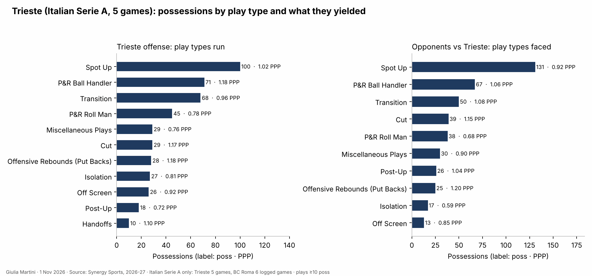
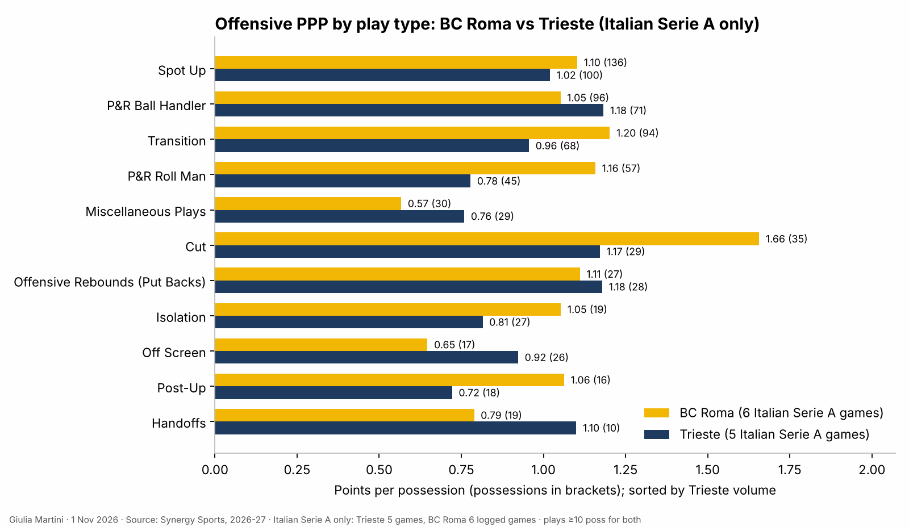
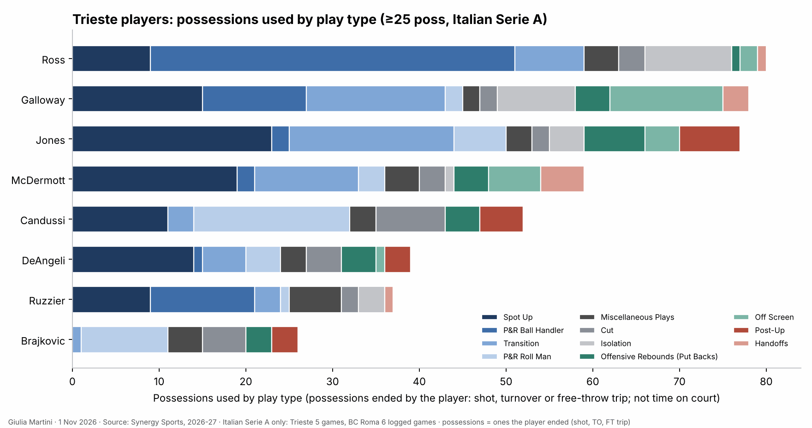

<!--
HOW TO EDIT THIS PAGE (this comment is not shown on the site)
- This file is yours: it is never overwritten. It is linked at the top of the opponent analysis of the same game (analysis.md).
- {{ pending }} is a grey box saying "This section will be filled when the game is reviewed". Replace it with your text.
- Your own plots and images: put the file in this folder (weekly/games/<date>/) and write .
- Highlight with ==text==.
THE STRUCTURE OF THESE THREE PAGES IS THE STANDARD FOR EVERY ANALYSIS; only the content changes.
-->

# Offense tendencies: Trieste

## Key points

Based on the data only (6 LBA games, round 6 at Virtus Bologna included; Synergy pull of 3 Nov 2026 for play types and shots, LBA box scores and play-by-play for assists and turnovers).

- **Efficiency in the upper half on points, middle on shooting**: 1.004 PPP (5th), 51.8% eFG (11th), 45.8% of possessions with a score (9th); 90.8 points a game (5th) on 90.3 possessions; free throws end 15.3% of possessions (4th).
- **The P&R ball handler is the offense**: 17% of possessions at 1.207 PPP (65.2% eFG). Ross has 55 of the 92 possessions (1.09 PPP); Galloway 15 (1.27) and Ruzzier 14 (1.14).
- **Spot-ups are the largest block** (22% of possessions, 1.050 PPP) with 36.7% from three (33/90). Transition (15%, 1.063 PPP; 0.956 before Bologna) improved, while roll man (0.736), isolations (0.722) and post-ups (0.789) stay below average.
- **Threes are half of the attempts** (199 of 410): 43.8% from the corner (28/64), 32.8% from the wings, 22.1% from the top (15/68). Paint attempts go in at 57.8%.
- **Ross creates for the others**: 8 assists to Jones, 7 to DeAngeli, 6 each to Brajkovic and McDermott and 5 to Candussi; Galloway's most frequent target is Candussi (5).
- **Lowest turnover rate in the LBA** (10.7% of possessions, league 14.4%); the ball handlers lose the most in absolute numbers (Ross 11, Galloway 9, McDermott 7, Ruzzier 7), and Ross has the highest rate per minute (0.069).

## Play types and sets

Main play types, pace, first options, sets after timeouts and out-of-bounds plays.

- Spot-ups are 22% of the possessions (1.050 PPP, 37.0% FG, 36.7% from three on 90 attempts). The P&R ball handler is 17% (1.207 PPP), transition 15% (1.063), roll man 10% (0.736).

- BC Roma scores more per possession than Trieste on spot-ups, transition, roll man, cuts, isolations and post-ups; Trieste is ahead on the P&R ball handler (1.207 vs 1.052), put-backs, off-screen plays and handoffs; BC Roma's cuts (1.657 PPP, 1st in the LBA on 1 Nov) are the biggest gap (Trieste 1.212).

- Ross (P&R ball handler 55, isolation 12, spot-up 9), Ruzzier (P&R ball handler 14) and Galloway (15) are the ball handlers. Jones (25 spot-up, 25 transition) and McDermott (22 spot-up, 15 transition) are the spot-up and transition players; Candussi and Brajkovic finish the roll man (22 and 13 possessions) and Candussi the cut (8).

## Assists

{{ assists }}

Ross is the passer of the five most frequent pairs (Jones 8, DeAngeli 7, Brajkovic 6, McDermott 6, Candussi 5); Galloway's most frequent pair is with Candussi (5). The wings Jones and McDermott are scorers rather than passers (1.3 and 1.0 assists a game in the LBA box score).

## Turnovers

{{ turnovers }}

Ross (11 in 159') and Ruzzier (7 in 125') have the highest turnover rates per minute (0.069 and 0.056); all four of Brajkovic's came against Verona, Ruzzier's worst game (3) was the same one. Jones loses 1.0 balls a game and Candussi 0.8. In Synergy's count Trieste turns it over on 10.7% of possessions, the lowest in the LBA, and on 10.9% of its P&R ball-handler possessions.

## Clips

{{ pending }}
