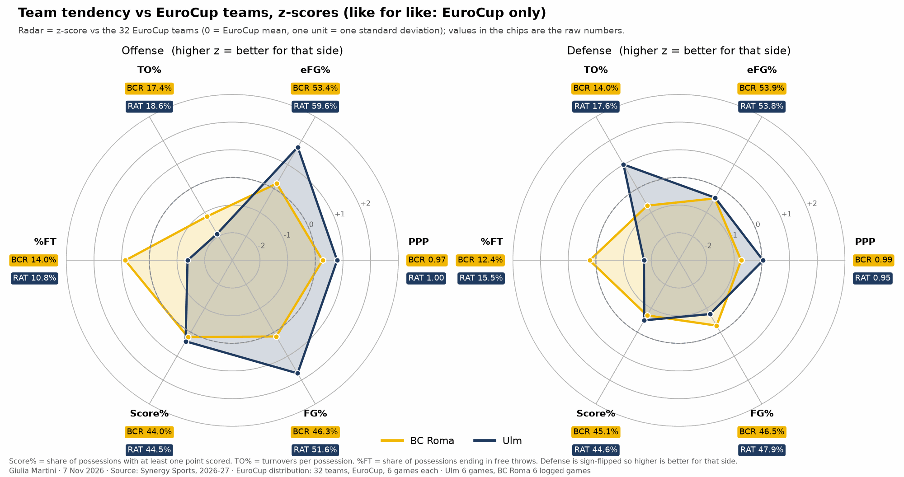
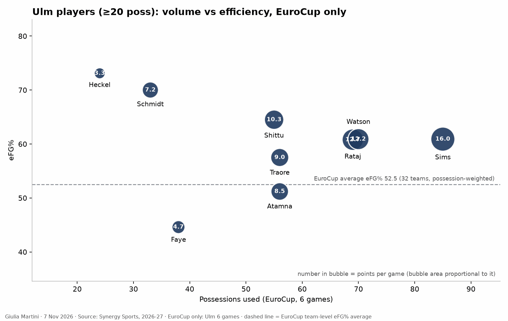

title: 
reviewed: no
generated: a5bfa71eee

<!--
HOW TO EDIT THIS PAGE (this comment is not shown on the site)
- This file is yours: it is never overwritten. Reorder, delete or add sections and text freely.
- The lines like {{ comparison }} or {{ figure: 07_key_players }} are automatic blocks: they are filled in when the site is built
  and keep refreshing when the data changes. Delete a line to remove its block, move it to move the block.
- {{ pending }} is a grey box saying "This section will be filled when the game is reviewed". Replace it with your text (or your
  plots) when you write the section; a section without text and without a box is left out of the page.
- Your own plots and images: put the file in this folder (weekly/games/<date>/) and write .
  The Synergy plots (python notebooks/synergy_scouting_plots.py data/synergy/<folder>) go here by name:
  01b_team_radar_zscore_competition_only, 02_opponent_playtypes, 03_playtype_ppp_ref_vs_opp, 06_players_playtype_mix,
  04_players_volume_efficiency, 05_player_<name>_shot_profile (one per player), 07_lineups_usage_vs_ppp,
  08_lineups_offense_vs_defense, 09_lineups_style_profile.
- Highlight with ==text==. When you are done, set "reviewed: yes" at the top of the file.
Blocks of this page: {{ header }} {{ standings }} {{ comparison }} {{ roster }} {{ assists }} {{ turnovers }} {{ lineups }} {{ pending }} and
{{ figure: name }} for any generated image (01_results_timeline, 02_starters_bench, 03_minutes, 04_scoring_sources, 05_shooting,
06_hot_spots, {{ shot_charts }} (06b: one chart per player), 07_key_players, 08_shot_distribution, 09_basic_stats, 10_major_factors, 11_starting_fives, 13_rotation_by_minute: who is on the court at each minute, with the next options).
The three pages that go deeper (individual_tendencies.md, defense_tendencies.md, offense_tendencies.md, same folder) are linked at the top of this page ({{ more_analysis }}) when they exist: shot charts are on the individual page, play types, assists and turnovers on the offense page, what the team allows on the defense page.
- Every section has a short summary ("In short") and a "Details" drop-down: put an HTML comment holding the word more on its own line between the two. Each fact lives in one section; elsewhere link to it.
THE STRUCTURE OF THIS PAGE IS THE STANDARD FOR EVERY ANALYSIS (same sections, same order, summary then Details); only the content changes. Rules: .claude/skills/opponent-analysis/SKILL.md
-->

# BC Roma vs Ratiopharm Ulm

{{ header }}

{{ more_analysis }}

## Key points

Based on the data only: EuroCup, 6 games each; Synergy pull of 7 Nov 2026 (play types, shots, lineups, ranks of the 32 EuroCup teams) and the EuroCup box scores for the rest. Ulm's 9 games in other competitions are not in the numbers.

- Ulm is ==3-3 and 4th of 8==, one place ahead of BC Roma on points; see [the table](#eurocup-so-far-results-and-standings).
- Ulm's offense ==shoots among the best in the EuroCup and loses the ball more than any team==, [compared here](#bc-roma-and-ulm-compared).
- On defense Ulm is ==1st of 32 against the P&R ball handler and 29th in transition==; see [What to expect](#what-to-expect).
- ==No fixed starting five==: only Watson and Rataj started all six games; [roster and bench](#roster-starting-five-and-bench).
- Scoring is ==paint first, then threes==, with few free throws; [shot selection](#shot-selection).
- Four players use most of the possessions: Sims, Rataj, Watson and Shittu; [key players](#key-players), details on the [individual page](individual_tendencies.html).

## EuroCup so far: results and standings

- Ulm is 3-3 (6 points, 4th), BC Roma 2-4 (4 points, 7th); Bahcesehir leads at 5-1.
- Ulm has alternated wins and losses: wins over Botevgrad, Bosna and at Lietkabelis; losses at Manresa, at PAOK and at home to Bahcesehir (82-96, 3 Nov).
- Point difference +6 (535-529) against BC Roma's -30.

<!-- more -->

{{ standings }}

{{ figure: 01_results_timeline }}

## BC Roma and Ulm compared

- Ratings (box score): Ulm offense 112.4 against 111.6, defense 110.5 against 116.2, net +1.9 against -4.7.
- Shooting: Ulm 59.4% eFG against 53.5%, on 39.5% from three against 31.0%. Synergy ranks of the 32 teams: Ulm 3rd in eFG% (59.6%) and 9th in PPP (1.004); BC Roma 14th in both (53.4%, 0.970).
- Turnovers: both teams lose the ball a lot (Ulm on 18.6% of Synergy possessions, the highest of the 32; BC Roma 17.4%, 5th highest). Ulm forces 17.6% (5th highest), BC Roma 14.0%.
- Free throws: Ulm gets to the line on 10.8% of possessions (3rd lowest) and makes 70.1%; BC Roma 14.0% and 81.7%.

<!-- more -->

{{ comparison }}

{{ figure: 09_basic_stats }}

- Rebounds: BC Roma takes more of the available offensive rebounds (33.5% against 28.0%); the defensive rebound share is level (64.5%).
- Defense by Synergy: Ulm allows 0.951 PPP (16th, rank 1 = best) and 53.8% eFG; BC Roma allows 0.995 (25th) and 53.9%.
- The turnover rate in the table (per 100 possessions of the box score) and the one above (per Synergy possession) differ in how a possession is counted.

## Roster, starting five and bench

- No fixed starting five: four different fives in six games. Watson and Rataj started all six, Traore five, Heckel and Sims four, Atamna and Faye two, Shittu one.
- Starters score 51.3 points a game and the bench 37.8 (23 to 47 in a game).
- Twelve players have played; Fischer (3 games), Schmidt and Koroma (5) have missed games.

<!-- more -->

{{ roster }}

- Fives: Atamna, Rataj, Shittu, Sims, Watson (Botevgrad); Atamna, Rataj, Sims, Traore, Watson (Manresa); Heckel, Rataj, Sims, Traore, Watson (Bosna, Lietkabelis); Faye, Heckel, Rataj, Traore, Watson (PAOK, Bahcesehir).
- Minutes: Watson 27.4, Sims 27.3, Rataj 24.2, Traore 21.7, Shittu 20.4, Atamna 19.9, Faye 17.2, Fischer 14.0 (3 games), Heckel 13.7, Schmidt 11.9 (5), Liedtke 7.6, Koroma 4.4 (5).
- Most used five-man unit: Rataj, Watson, Sims, Heckel, Traore, 60 possessions (1.083 PPP for, 0.917 allowed); with Atamna in place of Heckel 33 possessions (1.152, 1.242); Rataj, Watson, Sims, Shittu, Atamna 32 possessions (1.406, 1.147). Samples are small.

{{ figure: 02_starters_bench }}

{{ figure: 03_minutes }}

{{ figure: 11_starting_fives }}

{{ figure: 13_rotation_by_minute }}

## Shot selection

- 386 field-goal attempts in six games: 162 in the paint (42%, made 65.4%), 157 threes (41%, 39.5%), 67 from mid-range (17%, 46.3%).
- Corner threes are the best zone (18 of 40, 45.0%); wings 27 of 71 (38.0%), top 17 of 46 (37.0%).
- 107 free throws attempted, 75 made (70.1%): Sims 24 attempts, Shittu 20, Rataj 15.

<!-- more -->

- Paint: Shittu 30 attempts (21 made), Sims 22 (13), Rataj 21 (17), Traore 19 (14). All 11 of Fischer's attempts are in the paint.
- Mid-range: Rataj takes 21 of his 51 attempts there, Sims 14 and Watson 12.
- Threes: Watson 34 attempts (15 made), Sims 28 (12), Atamna 24 (8), Schmidt 18 (11), Traore 14 (4), Faye 14 (5).
- Share of threes by game: 49% (Bahcesehir), 45% (Botevgrad), 41% (Bosna, Lietkabelis), 39% (Manresa), 29% (PAOK); no link with the results (wins 41-45%, losses 29-49%).

{{ figure: 04_scoring_sources }}

{{ figure: 05_shooting }}

{{ figure: 06_hot_spots }}

## Key players

- **Sims** (16.0 PPG, 27.3'): the most possessions of the team and the most fouls drawn; scores in transition and from the line.
- **Rataj** (12.7 PPG): wing who scores from the mid-range and in post-ups, few threes.
- **Watson** (12.2 PPG, 3.7 assists): the three-point and spot-up shooter, and the main creator after Atamna.
- **Shittu** (10.3 PPG, 4.7 rebounds): rim finisher, put-backs and cuts, in 20.4' a game with one start.
- Per-player lines, shot profiles and energy indices: [individual page](individual_tendencies.html).

<!-- more -->

{{ figure: 07_key_players }}

{{ figure: 08_shot_distribution }}

{{ figure: 10_major_factors }}

## What to expect

From the numbers only (6 EuroCup games each, so tendencies, not predictions; ranks of the 32 teams from the 5 Nov leaderboards, rank 1 = best):

- **P&R ball handler.** BC Roma's best play type (107 possessions, 1.037 PPP, 3rd) meets the best defense against it (0.625 PPP allowed, 1st, 29.8% turnovers forced).
- **Transition.** Ulm's defense allows 1.390 PPP (29th) and BC Roma scores 1.176 in transition (16th); Ulm's own transition scores 1.074 against BC Roma's defense (7th).
- **Spot-ups.** Ulm's offense is 4th (1.121 PPP, 72% of the shots threes) against BC Roma's defense (19th); Ulm's defense is 26th against spot-ups and BC Roma's offense 25th.
- **Second chances.** Ulm's put-backs score 1.484 PPP (1st) and BC Roma's defense allows 1.462 (32nd).

<!-- more -->

- **Roll man and cuts.** Ulm's cuts score 1.313 PPP (72.0% eFG) against BC Roma's defense on cuts (27th, 1.472 allowed); Traore as roll man has 18 possessions at 1.278 against BC Roma's roll-man defense (28th).
- **Post-ups and isolations.** Ulm's defense is 4th against post-ups (0.625) but 26th against isolations (1.000); BC Roma's isolations score 0.917 (12th), with 25.0% turnovers.
- **Off screen.** Ulm's defense is 1st against off-screen plays (0.583, 12 possessions); BC Roma's offense is 27th there (0.600), Ulm's own off-screen offense scores 0.773.
- **Turnovers.** Both teams are in the top five for turnovers committed; see [compared](#bc-roma-and-ulm-compared).

### Metrics to check during/after the game

- BC Roma's PPP and turnovers on P&R ball-handler possessions.
- Transition possessions and points for both teams, and who finishes them for Ulm (Sims has 22 transition possessions).
- Ulm's offensive rebounds and put-back points (Shittu has 10 put-back possessions).
- Watson's and Sims's three-point attempts (34 and 28 in six games) and Rataj's mid-range attempts.
- Ulm's free-throw attempts (few so far) and BC Roma's fouls on Sims.
- Bench points (37.8 a game so far) and which five starts.

### Other checks

- Data caveat: the Synergy pull is hand-extracted from the web app and the samples are small (6 games); read the figures as descriptive. See `data/synergy/ulm_2026-11-11/README.md`.
- Ulm's other games (15 in all competitions, 9 outside the EuroCup) are not in the numbers.
- Fischer (3 games, 14 possessions) and Koroma (11 possessions) are too small a sample for any tendency.

## Clips suggested

**Sims in transition**: Bosna Q3 3:01 and Q4 0:17; Manresa Q2 0:02; PAOK Q3 6:52.

**Watson spot-up and dribble threes**: Bosna Q2 6:30 and 5:26; PAOK Q1 5:53 and Q2 1:09; Lietkabelis Q1 5:48.

**Shittu put-backs**: Manresa Q1 4:49 and Q2 7:59; Bosna Q3 1:05; Botevgrad Q2 3:42.

**Rataj mid-range jumpers**: Bahcesehir Q1 4:52; Lietkabelis Q3 6:41; PAOK Q1 6:22 and Q4 5:04.
