<!--
HOW TO EDIT THIS PAGE (this comment is not shown on the site)
- This file is yours: it is never overwritten. It is linked at the top of the opponent analysis of the same game (analysis.md).
- {{ pending }} is a grey box saying "This section will be filled when the game is reviewed". Replace it with your text.
- Your own plots and images: put the file in this folder (weekly/games/<date>/) and write .
- Highlight with ==text==.
THE STRUCTURE OF THESE THREE PAGES IS THE STANDARD FOR EVERY ANALYSIS; only the content changes.
-->

# Individual tendencies: Ulm

## Key points

- ==Sims, Rataj, Watson and Shittu== use the most possessions and score the most; see the lines in the Details below.
- ==Watson and Sims shoot the threes==, Rataj works the mid-range, Shittu the rim; see [shot attempts](#shot-attempts-3pt-paint-and-mid-range).
- ==Sims draws the most fouls==, Shittu the offensive rebounds, Atamna the steals; see [energy](#energy-rim-activity-and-pace).
- The lineup is not fixed: minutes and rotation by player are in [rotation by player](#rotation-by-player).

<!-- more -->

| Player | GP | MPG | PPG | Poss | PPP | eFG% | AST | TO | 3P made/att | FT made/att |
|---|---:|---:|---:|---:|---:|---:|---:|---:|---:|---:|
| Sims | 6 | 27.3 | 16.0 | 85 | 1.129 | 60.9 | 13 | 11 | 12/28 | 18/24 |
| Rataj | 6 | 24.2 | 12.7 | 69 | 1.101 | 60.8 | 6 | 11 | 2/9 | 14/15 |
| Watson | 6 | 27.4 | 12.2 | 70 | 1.043 | 60.9 | 22 | 12 | 15/34 | 6/9 |
| Shittu | 6 | 20.4 | 10.3 | 55 | 1.127 | 64.5 | 5 | 9 | 1/4 | 13/20 |
| Traore | 6 | 21.7 | 9.0 | 56 | 0.964 | 57.5 | 8 | 12 | 4/14 | 8/11 |
| Atamna | 6 | 19.9 | 8.5 | 56 | 0.911 | 51.2 | 19 | 9 | 8/24 | 7/9 |
| Schmidt | 5 | 11.9 | 7.2 | 33 | 1.091 | 70.0 | 5 | 8 | 11/18 | 1/1 |
| Faye | 6 | 17.2 | 4.7 | 38 | 0.737 | 44.6 | 9 | 7 | 5/14 | 3/6 |
| Heckel | 6 | 13.7 | 3.3 | 24 | 0.833 | 73.1 | 18 | 10 | 3/7 | 1/2 |
| Liedtke | 6 | 7.6 | 3.2 | 17 | 1.118 | 62.5 | 1 | 2 | 1/5 | 4/8 |
| Fischer | 3 | 14.0 | 5.3 | 14 | 1.143 | 72.7 | 3 | 2 | 0/0 | 0/2 |
| Koroma | 5 | 4.4 | 0.8 | 11 | 0.364 | 33.3 | 0 | 5 | 0/0 | 0/0 |

Source: Synergy cumulative box (EuroCup, 6 games) and the box score for minutes and points. Fischer, Koroma, Liedtke and Heckel have 24 possessions or fewer: read them as a sample of a few plays.

- Sims: transition 22 possessions (1.273 PPP), spot-ups 21 (1.048); 30 fouls drawn in 164 minutes, the most of the team.
- Rataj: 21 of his 51 attempts from the mid-range; post-ups 14 possessions at 1.429, only 2 threes made of 9.
- Watson: spot-ups 25 possessions at 1.400 PPP, P&R ball handler 17 at 0.882; 22 assists to 12 turnovers.
- Shittu: put-backs 10 possessions at 1.600, cuts 9 at 1.556; 20 free-throw attempts, 13 made.
- Traore: roll man 18 possessions at 1.278, 7 blocks in six games; stretch big who is 4 of 14 from three.
- Atamna: P&R ball handler 16 possessions at 0.750, 19 assists to 9 turnovers.
- Schmidt (5 games, 18 threes, 11 made) and Faye (0.737 PPP) come off the bench.

## Shot attempts: 3PT, paint and mid-range

- Team split is in the [shot selection](./#shot-selection) section of the analysis.
- Most paint attempts: Shittu 30 (all but 8 of his 38), Sims 22, Rataj 21, Traore 19.
- Most three-point attempts: Watson 34, Sims 28, Atamna 24; Schmidt 18 with 11 made.
- Rataj is the mid-range player (21 attempts) and almost never shoots threes.

<!-- more -->

How the shot attempts of each game split between threes, paint and mid-range: one dot per game (green = won, red = lost), the smoothed areas hold the densest 50% and 80% of the games, the black square is the average.

### Team

{{ figure: 12_triangles_team_attempts }}

### High-volume players

{{ figure: 12_triangles_players_high_attempts }}

### Lower-volume players

{{ figure: 12_triangles_players_low_attempts }}

## Shot charts by player

Shot profile (made/attempted by location and play type) and shot types within each play type. Team zone totals: link to the shot selection section of the analysis page.

<!-- more -->

{{ shot_charts }}

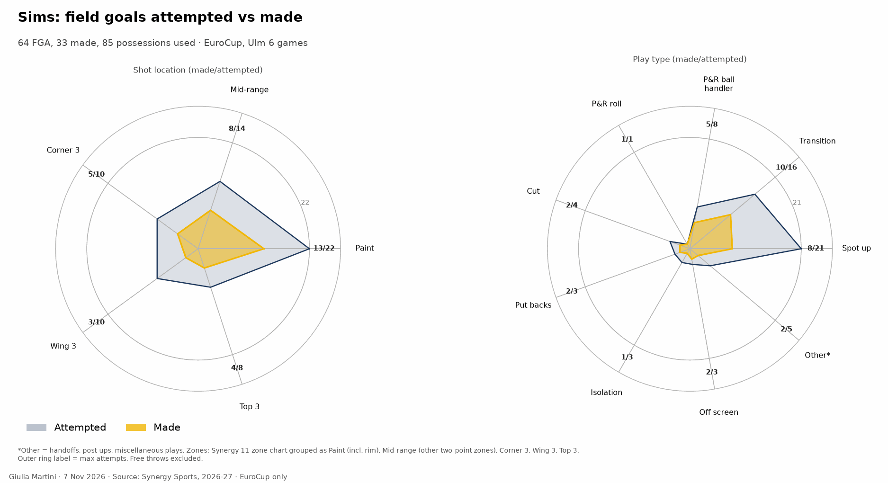
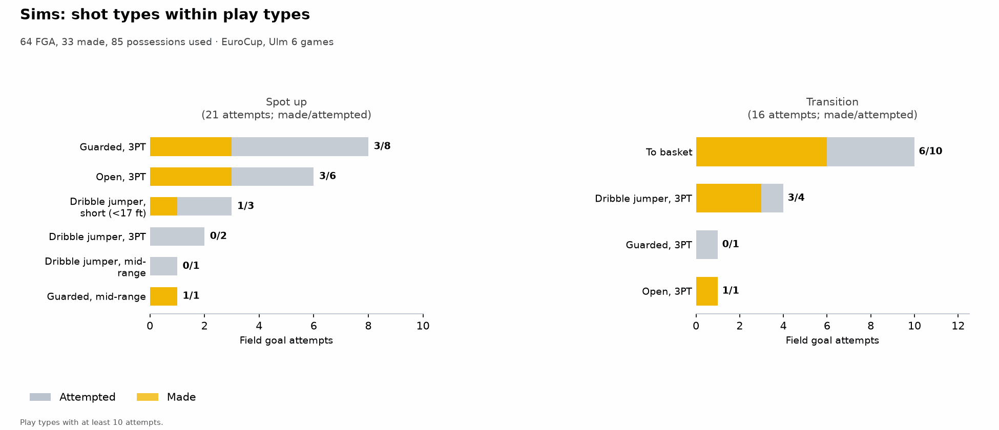

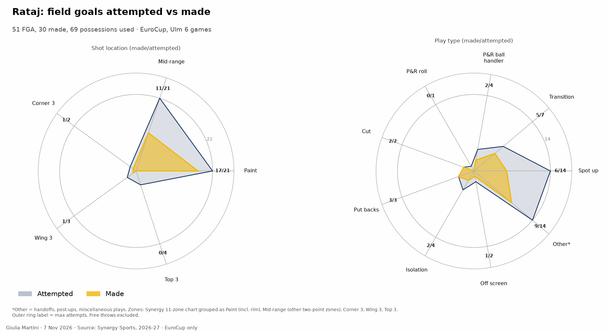
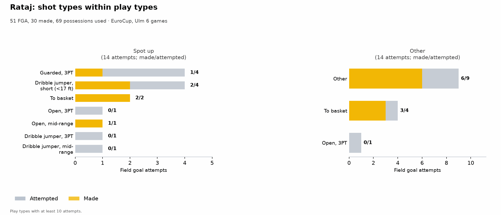

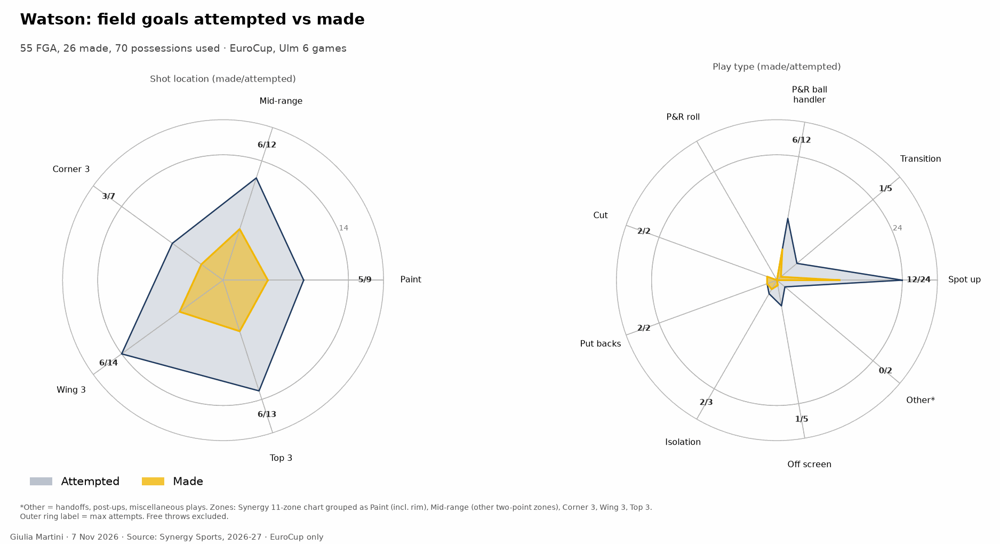
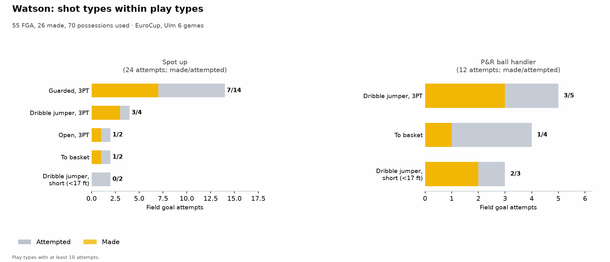

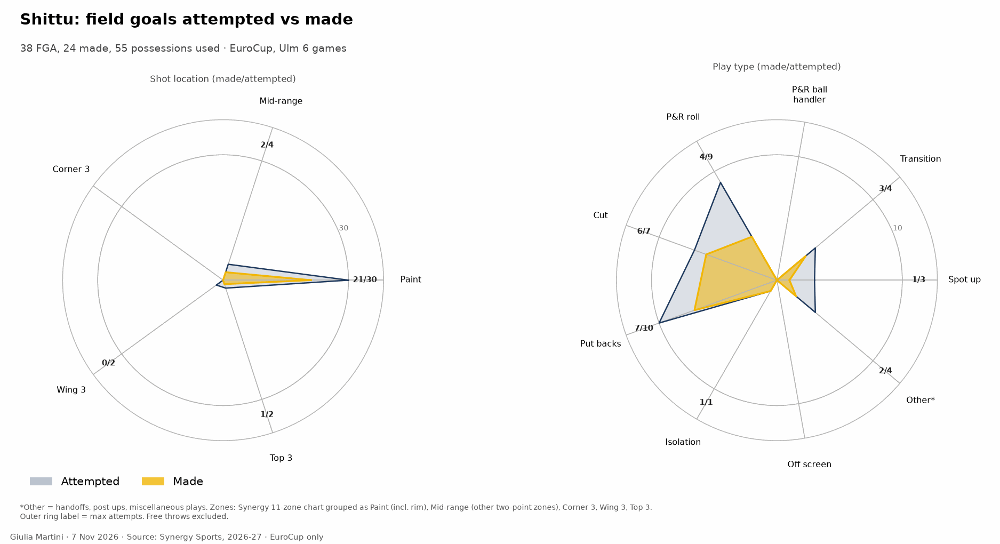
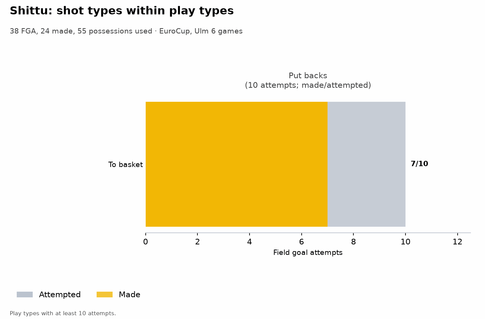

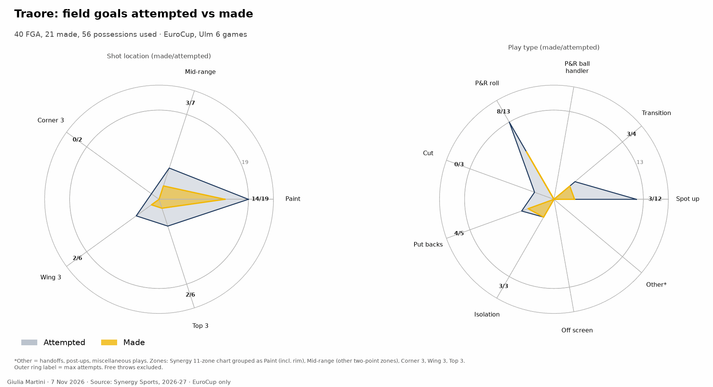
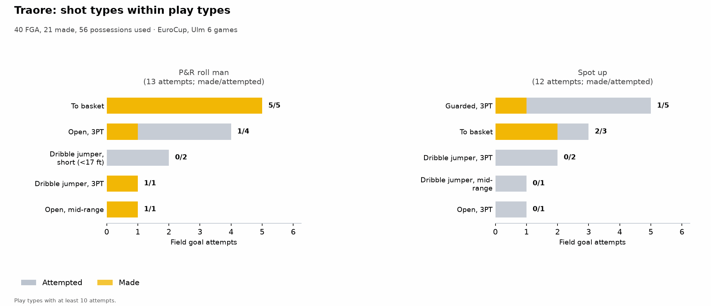

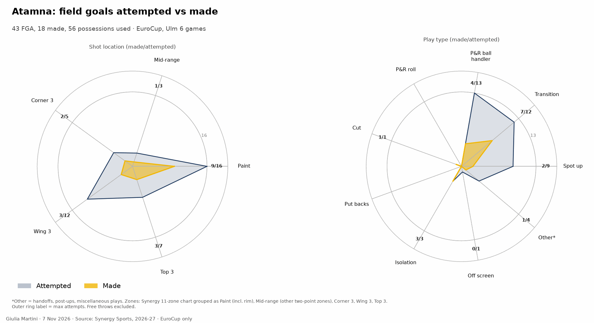
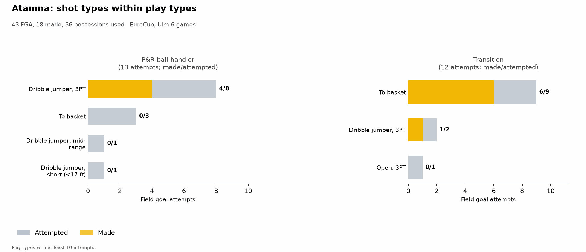

## Energy: rim activity and pace

Raw rates per 40 minutes from box score and play-by-play, EuroCup, 6 games; the figure shows the percentiles against the LBA players (see the figure note).

- Sims draws 7.3 fouls per 40 minutes (30 in 164'), the most of the team; Shittu has 3.3 offensive rebounds per 40 (10 in 123').
- Atamna has 3.7 steals per 40 (11 in 120'); Traore 2.2 blocks per 40 (7 in 130').
- Watson draws 3.7 fouls per 40 and has the lowest steal rate of the rotation (0.5 per 40).

{{ figure: 15_energy_indices }}

## Rotation by player

When each player is on the court in each quarter, in the competition, as in the analysis page's rotation by minute. One bar per quarter, the clock runs from 10:00 down to 0:00, dark green = on the court in every game at that moment, white = in none.

{{ figure: 14_player_rotation_Atamna }}

{{ figure: 14_player_rotation_Faye }}

{{ figure: 14_player_rotation_Heckel }}

{{ figure: 14_player_rotation_Liedtke }}

{{ figure: 14_player_rotation_Rataj }}

{{ figure: 14_player_rotation_Schmidt }}

{{ figure: 14_player_rotation_Shittu }}

{{ figure: 14_player_rotation_Sims }}

{{ figure: 14_player_rotation_Traore }}

{{ figure: 14_player_rotation_Watson }}
