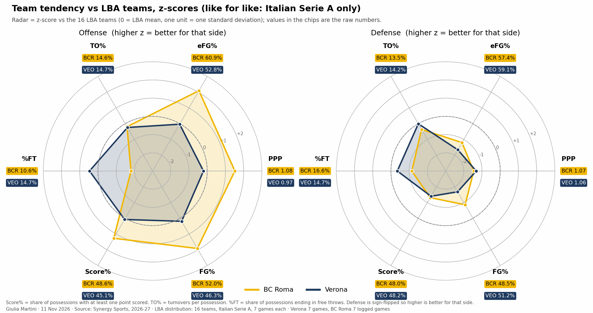
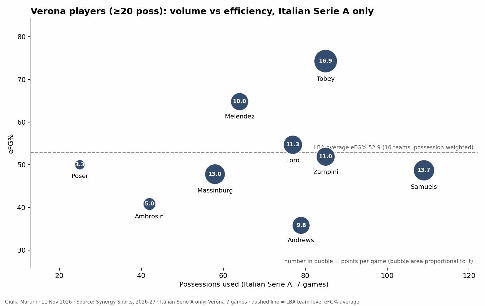

title: 
reviewed: no
generated: d95deb9427

<!--
HOW TO EDIT THIS PAGE (this comment is not shown on the site)
- This file is yours: it is never overwritten. Reorder, delete or add sections and text freely.
- The lines like {{ comparison }} or {{ figure: 07_key_players }} are automatic blocks: they are filled in when the site is built
  and keep refreshing when the data changes. Delete a line to remove its block, move it to move the block.
- {{ pending }} is a grey box saying "This section will be filled when the game is reviewed". Replace it with your text (or your
  plots) when you write the section; a section without text and without a box is left out of the page.
- Your own plots and images: put the file in this folder (weekly/games/<date>/) and write .
  The Synergy plots (python notebooks/synergy_scouting_plots.py data/synergy/<folder>) go here by name:
  01b_team_radar_zscore_competition_only, 02_opponent_playtypes, 03_playtype_ppp_ref_vs_opp, 06_players_playtype_mix,
  04_players_volume_efficiency, 05_player_<name>_shot_profile (one per player), 07_lineups_usage_vs_ppp,
  08_lineups_offense_vs_defense, 09_lineups_style_profile.
- Highlight with ==text==. When you are done, set "reviewed: yes" at the top of the file.
Blocks of this page: {{ header }} {{ standings }} {{ comparison }} {{ roster }} {{ assists }} {{ turnovers }} {{ lineups }} {{ pending }} and
{{ figure: name }} for any generated image (01_results_timeline, 02_starters_bench, 03_minutes, 04_scoring_sources, 05_shooting,
06_hot_spots, {{ shot_charts }} (06b: one chart per player), 07_key_players, 08_shot_distribution, 09_basic_stats, 10_major_factors, 11_starting_fives, 13_rotation_by_minute: who is on the court at each minute, with the next options).
The three pages that go deeper (individual_tendencies.md, defense_tendencies.md, offense_tendencies.md, same folder) are linked at the top of this page ({{ more_analysis }}) when they exist: shot charts are on the individual page, play types, assists and turnovers on the offense page, what the team allows on the defense page.
- Every section has a short summary ("In short") and a "Details" drop-down: put an HTML comment holding the word more on its own line between the two. Each fact lives in one section; elsewhere link to it.
THE STRUCTURE OF THIS PAGE IS THE STANDARD FOR EVERY ANALYSIS (same sections, same order, summary then Details); only the content changes. Rules: .claude/skills/opponent-analysis/SKILL.md
-->

# BC Roma vs Tezenis Verona

{{ header }}

{{ more_analysis }}

## Key points

Based on the data only: 7 LBA games each (Verona's loss at Virtus Bologna on 9 Nov included), Synergy pull of 11 Nov 2026, LBA box scores for the rest.

- ==Verona is 3-4 and has lost three in a row==: [standings](#lba-so-far-results-and-standings).
- ==A below-average offense and defense, but a lot of offensive rebounds and free throws==: [team comparison](#bc-roma-and-verona-compared).
- ==Tobey is the most efficient player on the team== (rolls to the rim, cuts, put-backs): [key players](#key-players).
- ==The outside shot is the weak spot==: about 30% from three in every zone: [shot selection](#shot-selection).
- ==Massinburg has not played since round 4==: [roster](#roster-starting-five-and-bench).
- Where the game is decided: [what to expect](#what-to-expect).

## LBA so far: results and standings

Verona is 10th with 3-4, BC Roma 12th with 2-5. Verona won the three games in the middle (Milano and Reggio Emilia at home, at Scafati) and lost the last three (at Trieste, Varese at home, at Virtus Bologna).

<!-- more -->

{{ standings }}

{{ figure: 01_results_timeline }}

## BC Roma and Verona compared

- Offense: BC Roma is 1st in the LBA in points per possession, Verona 10th.
- Defense: both are in the bottom four (Verona 13th, BC Roma 14th).
- Verona's strengths are second chances and free throws: it grabs about 42% of its own misses (BC Roma 32%) and goes to the line more often than BC Roma.
- Both play fast, among the four highest-paced teams of the league.

<!-- more -->

{{ comparison }}

{{ figure: 09_basic_stats }}

## Roster, starting five and bench

- Four starters are fixed: Loro, Samuels, Tobey and Andrews (Andrews from round 2). The fifth spot went to Massinburg in the first four rounds, then to Ambrosin or Zampini.
- Massinburg (28' and 13 points a game in four games) has not played since round 4.
- Zampini plays the most minutes (29' a game) whether he starts or not; Melendez is the first wing off the bench.
- The bench scores about 25 points a game.

<!-- more -->

{{ roster }}

{{ figure: 02_starters_bench }}

{{ figure: 03_minutes }}

{{ figure: 11_starting_fives }}

{{ figure: 13_rotation_by_minute }}

## Shot selection

- Verona finishes well in the paint (64%), but shoots about 30% from three, with no good zone (corner, wing and top all between 28% and 32%).
- Almost half of the shots are in the paint; mid-range shots are rare.

<!-- more -->

By zone (Synergy, 469 shots): paint 142/221, mid-range 14/45, corner threes 11/34, wing threes 33/109, top threes 17/60. Who takes which shots: [individual tendencies](individual_tendencies.html#shot-charts-by-player).

{{ figure: 04_scoring_sources }}

{{ figure: 05_shooting }}

{{ figure: 06_hot_spots }}

## Key players

Tobey is the scorer (17 points a game, the best efficiency in the team); Samuels has the most possessions but is less efficient; Loro is the main shooter; Zampini and Andrews run the ball. Lines and shot charts per player: [individual tendencies](individual_tendencies.html#key-points).

<!-- more -->

{{ figure: 07_key_players }}

{{ figure: 08_shot_distribution }}

{{ figure: 10_major_factors }}

## What to expect

From the numbers only (7 LBA games each, so tendencies, not predictions):

- **Second chances.** Verona's put-backs are the best in the LBA, BC Roma's defense on put-backs is 15th. Defensive rebounding against Tobey is the first thing to watch.
- **Tobey near the rim.** Verona's roll-man and cut possessions rank 1st and 2nd in the LBA, and Tobey takes most of them; the most frequent assist pairs are Andrews to Tobey and Zampini to Tobey.
- **BC Roma's shooting against Verona's.** BC Roma's spot-ups are 2nd in the league; Verona's are 15th.
- **Transition, both ways.** Both defenses allow a lot in the open court (Verona 14th, BC Roma 15th).

<!-- more -->

### Metrics to check during/after the game

- Verona's offensive rebounds and second-chance points; Tobey's points at the rim.
- Turnovers forced on Verona's pick-and-roll ball handlers (they lose the ball on almost a third of those possessions).
- Free throws allowed by BC Roma.
- BC Roma's three-point attempts and spot-up efficiency.

### Other checks

- The samples are small (7 games) and the Synergy figures are hand-extracted: see `data/synergy/verona_2026-11-14/README.md`. Play-type ranks are from the 11 Nov leaderboard.
- Massinburg's availability.

### Clips suggested

Game clock from the Synergy shot list (time remaining in the period).

**Tobey as roll man and on put-backs** (last three games): vs Varese Q1 7:31, Q1 6:31, Q1 5:25, Q1 4:00, Q2 2:18, Q3 7:14, Q4 5:13; at Virtus Bologna Q2 7:47, Q2 7:20, Q4 7:38; at Trieste Q1 5:24, Q2 5:11, Q2 1:15.
