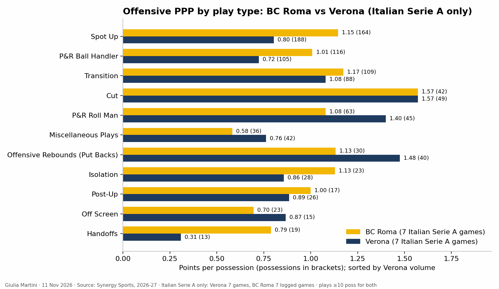

<!--
HOW TO EDIT THIS PAGE (this comment is not shown on the site)
- This file is yours: it is never overwritten. It is linked at the end of the opponent analysis of the same game (analysis.md).
- {{ pending }} is a grey box saying "This section will be filled when the game is reviewed". Replace it with your text.
- Your own plots and images: put the file in this folder (weekly/games/<date>/) and write .
- Highlight with ==text==.
THE STRUCTURE OF THESE THREE PAGES IS THE STANDARD FOR EVERY ANALYSIS; only the content changes.
-->

# Defense tendencies: Verona

## Key points

- ==Verona allows a lot in transition and on off-screen and handoff plays==: [what they allow](#what-they-allow).
- ==Opponents shoot well against Verona== (15th of 16 in effective field-goal percentage allowed): [what they allow](#what-they-allow).
- ==Isolations and put-backs are the best-defended plays in the league==: [what they allow](#what-they-allow).

## Defensive scheme

Pressure, pick-and-roll coverage, switching, zone use, transition defense.

{{ pending }}

## What they allow

- Verona is 13th in points allowed per possession and 15th in opponents' effective field-goal percentage.
- Worst in the league against pick-and-roll ball handlers, off-screen plays and handoffs; 14th in transition.
- Best in the league against isolations and put-backs.

<!-- more -->

Play-type ranks from the leaderboard of 11 Nov 2026 (7 LBA games for every team). The pick-and-roll ball handler is the play opponents run most against Verona (about 1 possession in 4).

## Clips

{{ pending }}
