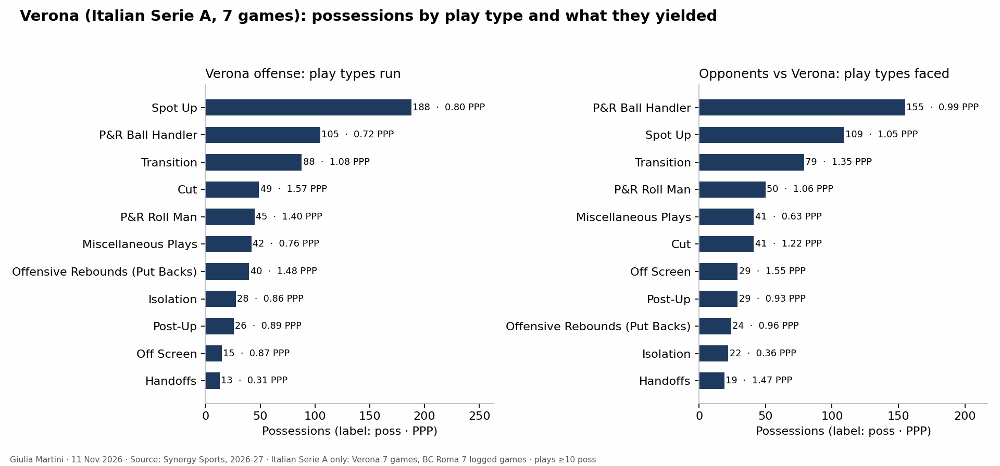
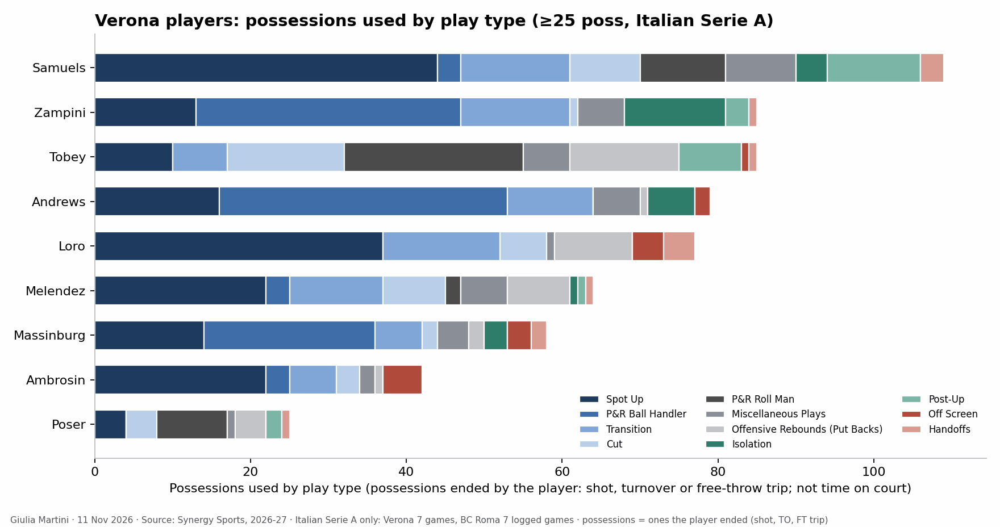

<!--
HOW TO EDIT THIS PAGE (this comment is not shown on the site)
- This file is yours: it is never overwritten. It is linked at the top of the opponent analysis of the same game (analysis.md).
- {{ pending }} is a grey box saying "This section will be filled when the game is reviewed". Replace it with your text.
- Your own plots and images: put the file in this folder (weekly/games/<date>/) and write .
- Highlight with ==text==.
- A section has a short summary ("In short") and, when there is more, a "Details" drop-down: put an HTML comment holding the word more on its own line between the two. Each fact lives in one section; elsewhere link to it.
THE STRUCTURE OF THESE THREE PAGES IS THE STANDARD FOR EVERY ANALYSIS; only the content changes. Rules: .claude/skills/opponent-analysis/SKILL.md
-->

# Offense tendencies: Verona

## Key points

- ==Spot-ups are the most common play and one of the weakest in the league==: [play types](#play-types-and-sets).
- ==The pick-and-roll ball handlers lose the ball often==: [turnovers](#turnovers).
- ==Roll man, cuts and put-backs are the efficient part==, mostly Tobey: [play types](#play-types-and-sets).
- ==Andrews and Zampini assist Tobey more than anyone else==: [assists](#assists).

## Play types and sets

- Spot-ups (about 3 possessions in 10) and pick-and-roll ball handlers (1 in 6) are the main play types; both rank 14th-15th in the LBA.
- The roll man and put-backs are 1st in the league and cuts 2nd: few possessions, but very efficient, and most of them are Tobey's.
- Transition is about 1 possession in 7, 14th in the LBA.

<!-- more -->

Play-type ranks from the leaderboard of 11 Nov 2026 (7 LBA games for every team).

## Assists

Andrews and Zampini are the passers, Tobey and Loro the finishers: the most frequent pairs are Andrews to Tobey and Zampini to Tobey.

<!-- more -->

{{ assists }}

## Turnovers

- Verona's turnover rate is around the league average overall, but almost a third of the pick-and-roll ball-handler possessions end in a turnover.
- Zampini and Samuels have the most turnovers (about 3 a game each), then Andrews.

<!-- more -->

{{ turnovers }}

## Clips

Tobey as roll man and on put-backs: see [clips suggested](./#clips-suggested).
