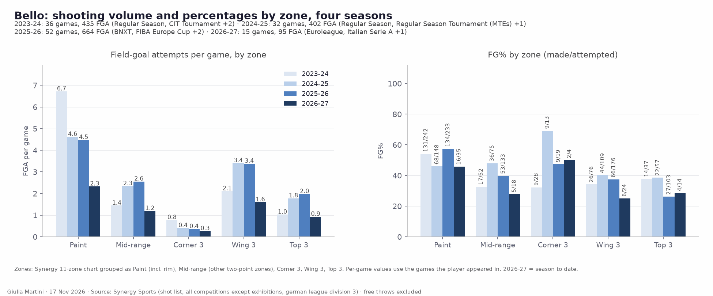
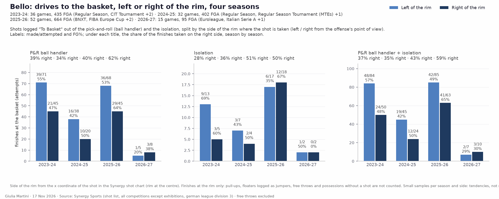
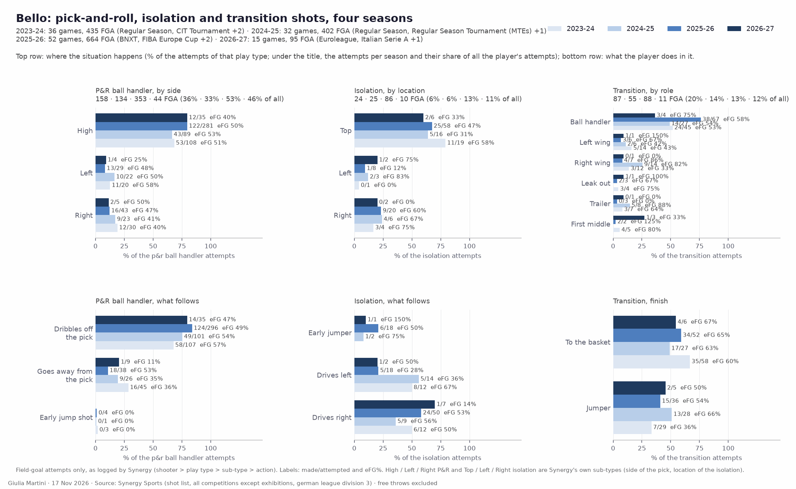
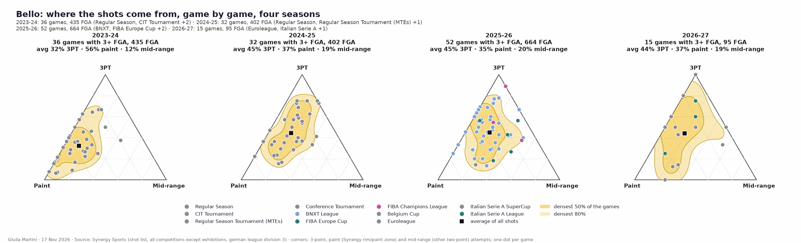

<!--
HOW TO EDIT THIS PAGE (this comment is not shown on the site)
- This file is yours: it is never overwritten. It is linked at the top of the opponent analysis of the same game (analysis.md).
- {{ pending }} is a grey box saying "This section will be filled when the game is reviewed". Replace it with your text.
- Your own plots and images: put the file in this folder (weekly/games/<date>/) and write .
- Highlight with ==text==.
THE STRUCTURE OF THESE THREE PAGES IS THE STANDARD FOR EVERY ANALYSIS; only the content changes.
-->

# Individual tendencies: Virtus Bologna

## Key points

{{ pending }}

<!-- more -->

{{ pending }}

## Shot attempts: 3PT, paint and mid-range

{{ pending }}

<!-- more -->

How the shot attempts of each game split between threes, paint and mid-range: one dot per game (green = won, red = lost), the smoothed areas hold the densest 50% and 80% of the games, the black square is the average.

### Team

{{ figure: 12_triangles_team_attempts }}

### High-volume players

{{ figure: 12_triangles_players_high_attempts }}

### Lower-volume players

{{ figure: 12_triangles_players_low_attempts }}

## Shot charts by player

Shot profile (made/attempted by location and play type) and shot types within each play type. Team zone totals: link to the shot selection section of the analysis page.

<!-- more -->

{{ shot_charts }}

## Rasheed Bello: four seasons of shots

==Rasheed Bello== arrives from Antwerp (2025-26: BNXT League, FIBA Europe Cup, Champions League; 52 games, 664 attempts) after two seasons at Purdue Fort Wayne in the US college game (2023-24 and 2024-25: 36 and 32 games, 435 and 402 attempts). This season: 15 games and 95 attempts at Virtus (Euroleague, Italian Serie A, SuperCup; exhibitions excluded). The college seasons are a different level of opposition: read them as habits, not as efficiency benchmarks.

- **He is a ==pick-and-roll ball handler==.** The P&R ball handler is 36% of his attempts at Purdue Fort Wayne in 2023-24, 33% in 2024-25, 53% at Antwerp and 46% this season; four of five of them come from a high pick, and he dribbles off it (about 80%).
- **Finishes at the rim: more on the ==left== side.** Over four seasons 60% of his finishes at the basket out of the pick-and-roll and isolation are on the left side of the rim (221 of 368; 50% made, against 54% on the right). The exception is this season (10 of 17 on the right, small sample) and, in isolation only, Antwerp (51% right).
- **Pull-up threes come from the ==right== side of the floor.** At Antwerp 105 of his 140 pick-and-roll threes came from the right side of the floor (36% made; 26% from the left); this season 11 of 17, 4 made.
- **What is new this season**: efficiency has dropped (35% from the field, eFG 41% in 95 attempts, against 51-54% before) and the volume is much lower; the shot mix is unchanged (44% threes, 37% paint).

<!-- more -->

### Where the shots come from

- The three became his main shot when he turned professional: 32% of the attempts at Purdue Fort Wayne in 2023-24, 44-45% every season since. Wing threes are 27% of the attempts since 2024-25, corner threes 3-4%.
- The paint share fell from 56% (2023-24) to 35-37%, replaced by mid-range (12% → 19-20%): he pulls up more and finishes at the rim less than in college.

### Driving direction

- **Out of the pick-and-roll the left side is the default**: 60-66% of his finishes at the rim in the first three seasons; this season 8 of 13 are on the right (small sample).
- **Isolation drives are rare and the direction has changed**: 28% right in 2023-24, 36% in 2024-25, 51% at Antwerp (17 left, 18 right); the Antwerp right-hand drive was the better one (12/18 against 6/17).
- **Efficiency depends on the season, not on the side**: left 57%, 42%, 49%; right 48%, 50%, 65%. The only stable thing is the volume on the left.
- Synergy's own "Drives Left / Drives Right" tags (all play types) say the dribble itself has moved right: 33 and 37 drives left in the two college seasons against 37 and 39 right, then 27 left against 69 right at Antwerp (5 and 12 this season). The finish is still more often on the left side of the rim.

### Pick-and-roll, isolation and transition shots

- Pick-and-roll: 80% high pick; the side picks are slightly more often on the right (43 against 29 at Antwerp). He dribbles off the pick for the shot (47-57% eFG); going away from the pick is an exception that he converts less (36% eFG in college, 53% at Antwerp on 38 shots, 1/9 this season).
- Isolation was a minor shot until Antwerp (6% of attempts, 13% at Antwerp, 11% this season), mostly from the top of the key.
- Transition: the ball handler going to the basket (60-67% eFG); 28-29 jumpers a season in college and 36 at Antwerp (54% eFG).

### Game by game

- The mix moved from paint-heavy (college) to the three-and-mid-range side from 2024-25 on.

Source and caveats: Synergy shot list and possessions (pulled 17 Nov 2026, `data/synergy/players_2026-11-17/`). Field-goal attempts only, so possessions ending in a turnover, foul or pass are not counted. Side of the rim from the shot coordinate (checked against the Drives Left / Right tags from 2024-25 on; the 2023-24 college tags are less clear-cut). Small samples per season and side.

## Rotation by player

When each player is on the court in each quarter, in the competition, as in the analysis page's rotation by minute. One bar per quarter, the clock runs from 10:00 down to 0:00, dark green = on the court in every game at that moment, white = in none.

{{ figure: 14_player_rotation_Carr }}

{{ figure: 14_player_rotation_Casarin }}

{{ figure: 14_player_rotation_Diarra }}

{{ figure: 14_player_rotation_Diouf }}

{{ figure: 14_player_rotation_Edwards }}

{{ figure: 14_player_rotation_Ferrari }}

{{ figure: 14_player_rotation_Frazier }}

{{ figure: 14_player_rotation_Hackett }}

{{ figure: 14_player_rotation_Klintman }}

{{ figure: 14_player_rotation_Moore }}
