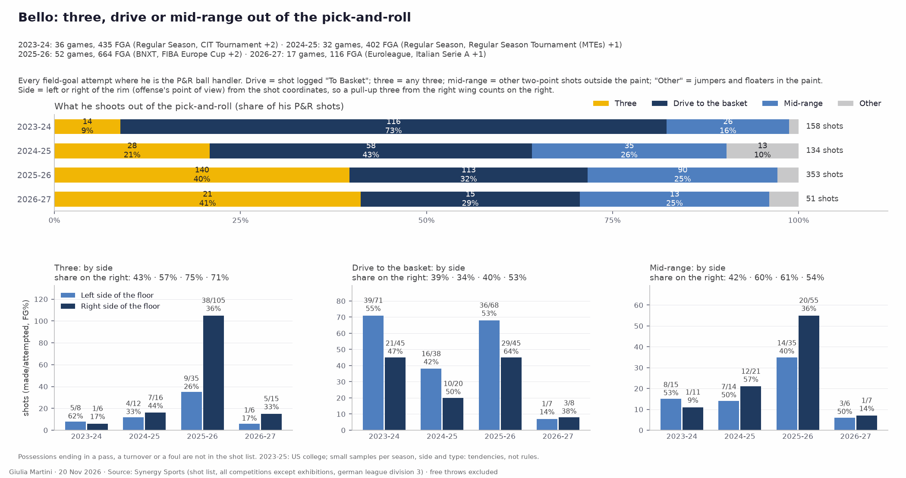

<!--
HOW TO EDIT THIS PAGE (this comment is not shown on the site)
- This file is yours: it is never overwritten. It is linked at the top of the opponent analysis of the same game (analysis.md).
- {{ pending }} is a grey box saying "This section will be filled when the game is reviewed". Replace it with your text.
- Your own plots and images: put the file in this folder (weekly/games/<date>/) and write .
- Highlight with ==text==.
THE STRUCTURE OF THESE THREE PAGES IS THE STANDARD FOR EVERY ANALYSIS; only the content changes.
-->

# Individual tendencies: Virtus Bologna

## Key points

- ==Carr, Frazier and Moore create out of the pick-and-roll==; Alston and Edwards are the spot-up shooters: [lines per player](#key-points).
- ==Diouf and Diarra score at the rim== (post-ups, rolls, cuts), neither shoots threes: [shot charts](#shot-charts-by-player).
- ==Bello is the second pick-and-roll ball handler==, with a four-season shot history: [Rasheed Bello](#rasheed-bello-four-seasons-of-shots).
- Who plays when: [rotation by player](#rotation-by-player).

<!-- more -->

Per game, LBA only (box scores; Synergy play-type mix, 8 games). Players with fewer than 5 minutes a game and Kokila (1 game) left out.

| Player | Games | Min | Pts | Ast | 2P% | 3P% | Two most frequent plays |
|---|---:|---:|---:|---:|---:|---:|---|
| Carr | 7 | 24 | 14.3 | 6.6 | 48% | 35% | P&R ball handler 37%, transition 20% |
| Frazier | 7 | 22 | 13.9 | 2.7 | 59% | 43% | P&R ball handler 39%, spot-up 16% |
| Edwards | 7 | 21 | 7.3 | 0.9 | 77% | 38% | spot-up 57%, cut 14% |
| Moore | 6 | 21 | 12.8 | 1.5 | 62% | 27% | P&R ball handler 33%, transition 25% |
| Alston | 4 | 21 | 15.0 | 1.0 | 50% | 29% | spot-up 36%, P&R ball handler 21% |
| Klintman | 6 | 20 | 10.0 | 1.8 | 67% | 50% | spot-up 26%, cut 23% |
| Bello | 3 | 20 | 7.0 | 2.3 | 40% | 27% | P&R ball handler 46%, transition 21% |
| Hackett | 8 | 19 | 4.6 | 2.1 | 47% | 50% | spot-up 30%, transition 27% |
| Diouf | 8 | 18 | 8.1 | 1.0 | 59% | - | post-up 28%, roll man 26% |
| Baldasso | 6 | 16 | 8.2 | 1.7 | 60% | 25% | spot-up 32%, P&R ball handler 24% |
| Diarra | 7 | 16 | 9.0 | 0.3 | 68% | 0% | roll man 31%, cut 19% |
| Ferrari | 8 | 16 | 6.1 | 1.5 | 55% | 40% | spot-up 30%, transition 27% |
| Casarin | 7 | 12 | 3.3 | 1.7 | 44% | 0% | transition 38%, P&R ball handler 21% |

Euroleague, 13 games (Synergy, pulled on 20 Nov 2026: possessions used and points per game, points per possession, threes made/attempted). Players with fewer than 20 possessions left out.

| Player | Games | Poss | Pts | PPP | 3P | Two most frequent plays |
|---|---:|---:|---:|---:|---:|---|
| Carr | 13 | 13.2 | 11.8 | 0.89 | 20/54 | P&R ball handler 48%, spot-up 19% |
| Alston | 13 | 11.8 | 11.6 | 0.98 | 21/60 | transition 27%, spot-up 22% |
| Moore | 13 | 11.5 | 10.6 | 0.92 | 15/46 | transition 25%, P&R ball handler 21% |
| Frazier | 13 | 11.1 | 9.3 | 0.84 | 27/85 | P&R ball handler 30%, transition 22% |
| Diarra | 13 | 9.5 | 12.0 | 1.27 | - | roll man 27%, put-back 20% |
| Bello | 13 | 8.7 | 6.9 | 0.80 | 12/38 | P&R ball handler 43%, spot-up 20% |
| Klintman | 12 | 6.5 | 6.7 | 1.03 | 10/30 | spot-up 46%, transition 18% |
| Diouf | 13 | 5.8 | 5.7 | 0.97 | - | post-up 30%, roll man 20% |
| Edwards | 13 | 5.2 | 3.8 | 0.75 | 5/27 | spot-up 34%, roll man 15% |
| Kokila | 10 | 3.6 | 4.0 | 1.11 | 3/5 | roll man 22%, spot-up 17% |
| Hackett | 11 | 2.4 | 2.8 | 1.19 | 2/9 | spot-up 38%, P&R ball handler 19% |
| Baldasso | 6 | 3.8 | 3.5 | 0.91 | 3/11 | spot-up 35%, transition 17% |

- The roles are the same as in the LBA: Carr, Frazier and Bello out of the pick-and-roll, Diouf in the post, Diarra as roll man and on put-backs.
- Diarra is the most efficient scorer in the Euroleague (1.27 points per possession, 12.0 points a game); Carr uses the most possessions in both competitions.
- Alston and Bello have played all 13 Euroleague games (4 and 3 in the LBA); Hackett uses far fewer possessions in the Euroleague.
- Who defends what: [defense tendencies](defense_tendencies.html#defensive-scheme).

## Shot attempts: 3PT, paint and mid-range

Bologna's attempts split: about 34% at the rim, 20% mid-range and 40% threes (team zones: [shot selection](./#shot-selection)).

<!-- more -->

How the shot attempts of each game split between threes, paint and mid-range: one dot per game (green = won, red = lost), the smoothed areas hold the densest 50% and 80% of the games, the black square is the average.

### Team

{{ figure: 12_triangles_team_attempts }}

### High-volume players

{{ figure: 12_triangles_players_high_attempts }}

### Lower-volume players

{{ figure: 12_triangles_players_low_attempts }}

## Shot charts by player

Shot profile (made/attempted by location and play type) and shot types within each play type. Team zone totals: link to the shot selection section of the analysis page.

<!-- more -->

{{ shot_charts }}

## Rasheed Bello: four seasons of shots

==Rasheed Bello== arrives from Antwerp (2025-26: BNXT League, FIBA Europe Cup, Champions League; 52 games, 664 attempts) after two seasons at Purdue Fort Wayne in the US college game (2023-24 and 2024-25: 36 and 32 games, 435 and 402 attempts). This season: 17 games and 116 attempts at Virtus (13 Euroleague, 3 Italian Serie A, 1 SuperCup; exhibitions excluded; the Euroleague games of 17 and 19 Nov included). The college seasons are a different level of opposition: read them as habits, not as efficiency benchmarks.

- **He is a ==pick-and-roll ball handler==.** The P&R ball handler is 36% of his attempts at Purdue Fort Wayne in 2023-24, 33% in 2024-25, 53% at Antwerp and 44% this season; about 80% of them come off a high pick, and he dribbles off it.
- **Out of the pick-and-roll he has become a ==shooter, not a driver==.** Threes were 9% of his P&R shots in 2023-24, 40% at Antwerp and 41% this season; drives to the basket went from 73% to 32% and 29%; mid-range is a quarter of the shots since 2024-25. Details: [Pick-and-roll: three, drive or mid-range](#pick-and-roll-three-drive-or-mid-range).
- **Sides: threes and mid-range from the ==right==, drives to the ==left==.** At Antwerp 75% of his P&R threes came from the right side of the floor (36% made against 26% from the left) and 61% of the mid-range shots; 60% of his drives finished on the left side of the rim. This season the small sample leans right on threes and drives.
- **What is new this season**: efficiency has dropped (35% from the field, eFG 43% in 116 attempts, against 51-54% before) and the volume is much lower; the shot mix is unchanged (47% threes, 35% paint).

<!-- more -->

### Where the shots come from

- The three became his main shot when he turned professional: 32% of the attempts at Purdue Fort Wayne in 2023-24, 44-47% every season since. Wing threes are 27-28% of the attempts since 2024-25, corner threes 3-4%.
- The paint share fell from 56% (2023-24) to 35-37%, replaced by mid-range (12% → 17-20%): he pulls up more and finishes at the rim less than in college.

### Pick-and-roll: three, drive or mid-range

Every shot he takes as the pick-and-roll ball handler, by type (top bar) and by side of the floor (three panels below: left in light blue, right in dark blue, made/attempted and FG%). A drive is a shot logged "To Basket", a three is any three, mid-range is any other two-point jump shot outside the paint.

| Shots out of the P&R | 2023-24 | 2024-25 | 2025-26 | 2026-27 |
|---|---|---|---|---|
| Three | 14 (9%) | 28 (21%) | 140 (40%) | 21 (41%) |
| Drive to the basket | 116 (73%) | 58 (43%) | 113 (32%) | 15 (29%) |
| Mid-range | 26 (16%) | 35 (26%) | 90 (25%) | 13 (25%) |
| Total (incl. paint jumpers) | 158 | 134 | 353 | 51 |

- **Threes: right side.** The share from the right was 43%, 57%, 75% and 71%. Since he turned professional he makes 36% of them from the right (43/120) and 24% from the left (10/41); at Antwerp alone 38/105 against 9/35.
- **Drives: left side at the rim.** 61%, 66%, 60% of the drives finished on the left side of the rim in the first three seasons, and he scored more often going right at Antwerp (64%, 29/45) than left (53%, 36/68). This season 8 of 15 are on the right (small sample).
- **Mid-range: slightly more from the right, and less accurate there.** Right share 42%, 60%, 61% and 54%; Antwerp 36% from the right (20/55) against 40% from the left (14/35); no clear difference this season (6 shots from the left, 7 from the right).
- **In short**: out of the screen he goes to his right for the jump shots (three and mid-range) and to his left for the finish at the rim; the sample this season (51 shots) is too small to say whether that has changed.

### Game by game

- The mix moved from paint-heavy (college) to the three-and-mid-range side from 2024-25 on.

Source and caveats: Synergy shot list and possessions (pulled 20 Nov 2026, `data/synergy/players_2026-11-20/`). Field-goal attempts only, so possessions ending in a turnover, foul or pass are not counted. Side of the rim from the shot coordinate (checked against the Drives Left / Right tags from 2024-25 on; the 2023-24 college tags are less clear-cut). Small samples per season and side.

## Rotation by player

When each player is on the court in each quarter, in the competition, as in the analysis page's rotation by minute. One bar per quarter, the clock runs from 10:00 down to 0:00, dark green = on the court in every game at that moment, white = in none.

{{ figure: 14_player_rotation_Carr }}

{{ figure: 14_player_rotation_Casarin }}

{{ figure: 14_player_rotation_Diarra }}

{{ figure: 14_player_rotation_Diouf }}

{{ figure: 14_player_rotation_Edwards }}

{{ figure: 14_player_rotation_Ferrari }}

{{ figure: 14_player_rotation_Frazier }}

{{ figure: 14_player_rotation_Hackett }}

{{ figure: 14_player_rotation_Klintman }}

{{ figure: 14_player_rotation_Moore }}
