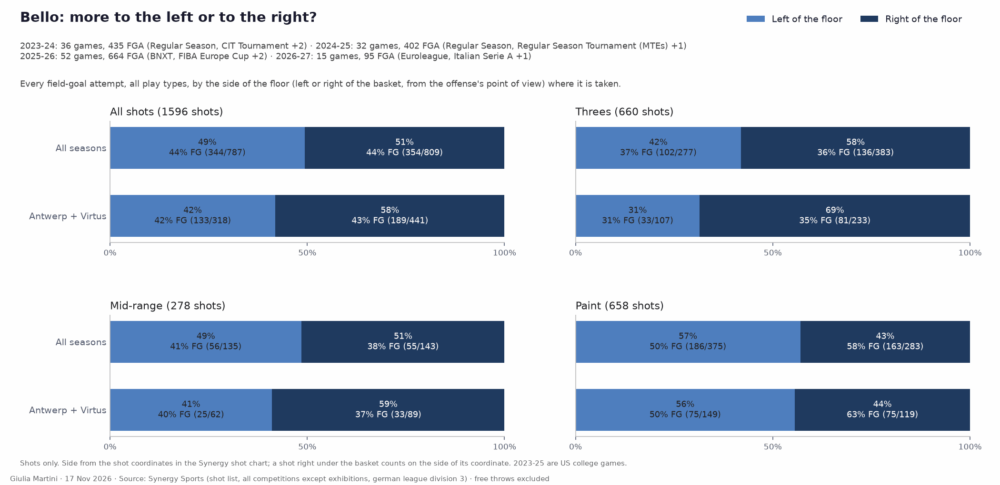
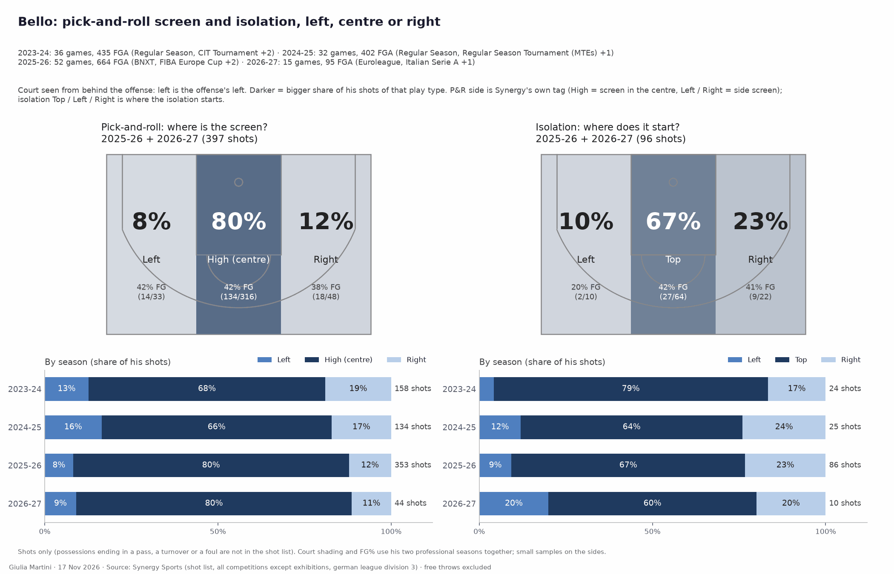

<!--
HOW TO EDIT THIS PAGE (this comment is not shown on the site)
- This file is yours: it is never overwritten. It is linked at the top of the opponent analysis of the same game (analysis.md).
- {{ pending }} is a grey box saying "This section will be filled when the game is reviewed". Replace it with your text.
- Your own plots and images: put the file in this folder (weekly/games/<date>/) and write .
- Highlight with ==text==.
THE STRUCTURE OF THESE THREE PAGES IS THE STANDARD FOR EVERY ANALYSIS; only the content changes.
-->

# Individual tendencies: Virtus Bologna

## Key points

- ==Carr, Frazier and Moore create out of the pick-and-roll==; Alston and Edwards are the spot-up shooters: [lines per player](#key-points).
- ==Diouf and Diarra score at the rim== (post-ups, rolls, cuts), neither shoots threes: [shot charts](#shot-charts-by-player).
- ==Bello is the second pick-and-roll ball handler==, with a four-season shot history: [Rasheed Bello](#rasheed-bello-four-seasons-of-shots).
- Who plays when: [rotation by player](#rotation-by-player).

<!-- more -->

Per game, LBA only (box scores; Synergy play-type mix, 8 games). Players with fewer than 5 minutes a game and Kokila (1 game) left out.

| Player | Games | Min | Pts | Ast | 2P% | 3P% | Two most frequent plays |
|---|---:|---:|---:|---:|---:|---:|---|
| Carr | 7 | 24 | 14.3 | 6.6 | 48% | 35% | P&R ball handler 37%, transition 20% |
| Frazier | 7 | 22 | 13.9 | 2.7 | 59% | 43% | P&R ball handler 39%, spot-up 16% |
| Edwards | 7 | 21 | 7.3 | 0.9 | 77% | 38% | spot-up 57%, cut 14% |
| Moore | 6 | 21 | 12.8 | 1.5 | 62% | 27% | P&R ball handler 33%, transition 25% |
| Alston | 4 | 21 | 15.0 | 1.0 | 50% | 29% | spot-up 36%, P&R ball handler 21% |
| Klintman | 6 | 20 | 10.0 | 1.8 | 67% | 50% | spot-up 26%, cut 23% |
| Bello | 3 | 20 | 7.0 | 2.3 | 40% | 27% | P&R ball handler 46%, transition 21% |
| Hackett | 8 | 19 | 4.6 | 2.1 | 47% | 50% | spot-up 30%, transition 27% |
| Diouf | 8 | 18 | 8.1 | 1.0 | 59% | - | post-up 28%, roll man 26% |
| Baldasso | 6 | 16 | 8.2 | 1.7 | 60% | 25% | spot-up 32%, P&R ball handler 24% |
| Diarra | 7 | 16 | 9.0 | 0.3 | 68% | 0% | roll man 31%, cut 19% |
| Ferrari | 8 | 16 | 6.1 | 1.5 | 55% | 40% | spot-up 30%, transition 27% |
| Casarin | 7 | 12 | 3.3 | 1.7 | 44% | 0% | transition 38%, P&R ball handler 21% |

## Shot attempts: 3PT, paint and mid-range

Bologna's attempts split: about 34% at the rim, 20% mid-range and 40% threes (team zones: [shot selection](./#shot-selection)).

<!-- more -->

How the shot attempts of each game split between threes, paint and mid-range: one dot per game (green = won, red = lost), the smoothed areas hold the densest 50% and 80% of the games, the black square is the average.

### Team

{{ figure: 12_triangles_team_attempts }}

### High-volume players

{{ figure: 12_triangles_players_high_attempts }}

### Lower-volume players

{{ figure: 12_triangles_players_low_attempts }}

## Shot charts by player

Shot profile (made/attempted by location and play type) and shot types within each play type. Team zone totals: link to the shot selection section of the analysis page.

<!-- more -->

{{ shot_charts }}

## Rasheed Bello: four seasons of shots

==Rasheed Bello== comes from Antwerp (2025-26: 52 games, 664 attempts) after two seasons at Purdue Fort Wayne in the US college game (2023-24 and 2024-25: 435 and 402 attempts); at Virtus so far 15 games and 95 attempts (exhibitions excluded). The college seasons are a different level: read them as habits, not as efficiency benchmarks.

- **A pick-and-roll ball handler**: 53% of his attempts at Antwerp, 46% this season, 80% of them off a high pick ([screen and isolation](#where-the-pick-and-roll-screen-and-the-isolation-are)).
- **A shooter more than a driver**: threes were 9% of his P&R shots in 2023-24 and are 39-40% now, drives went from 73% to 30-32% ([breakdown](#three-drive-or-mid-range-out-of-the-pick-and-roll)).
- **Jump shots from the ==right==, paint shots on the ==left==**: 69% of his threes since Antwerp come from the right of the floor, 56% of his paint shots from the left ([left or right](#left-or-right-of-the-floor)).
- **This season**: 35% from the field (eFG 41%) against 51-54% before, on much lower volume.

<!-- more -->

### Three, drive or mid-range out of the pick-and-roll

Every shot he takes as the pick-and-roll ball handler, by type (top bar) and by side of the floor (three panels below: left in light blue, right in dark blue, made/attempted and FG%). A drive is a shot logged "To Basket", a three is any three, mid-range is any other two-point jump shot outside the paint.

| Shots out of the P&R | 2023-24 | 2024-25 | 2025-26 | 2026-27 |
|---|---|---|---|---|
| Three | 14 (9%) | 28 (21%) | 140 (40%) | 17 (39%) |
| Drive to the basket | 116 (73%) | 58 (43%) | 113 (32%) | 13 (30%) |
| Mid-range | 26 (16%) | 35 (26%) | 90 (25%) | 12 (27%) |
| Total (incl. paint jumpers) | 158 | 134 | 353 | 44 |

- **Threes: right side.** The share from the right was 43%, 57%, 75% and 65%; since Antwerp he makes 36% from the right (42/116) and 24% from the left (10/41).
- **Drives: left side at the rim** (60-66% in the first three seasons), but he scored more going right at Antwerp (64%, 29/45 against 53%, 36/68). This season 8 of 13 are on the right.
- **Mid-range: slightly more from the right, and less accurate there** (Antwerp: 36% from the right, 40% from the left; no difference this season, 6 shots each side).

### Left or right of the floor

Every shot, all play types, by the side of the floor where it is taken; first bar all four seasons, second bar Antwerp and Virtus only.

| Share from the right | All seasons | Antwerp + Virtus |
|---|---|---|
| All shots | 51% | 58% |
| Threes | 58% | 69% |
| Mid-range | 51% | 59% |
| Paint | 43% | 44% |

- **Threes: clearly right.** 233 of 340 since Antwerp (69%), made 35% from the right against 31% from the left.
- **Mid-range: right since Antwerp** (59%), and a little less accurate there (37% against 40%).
- **Paint: left.** 56-57% of his paint shots are on the left, in every period, but he scores more on the right (58% against 50% over four seasons; 63% against 50% since Antwerp).
- **Overall**: balanced over four seasons (51% right), right-leaning since he turned professional (58%), because of the threes and the mid-range.

### Where the pick-and-roll screen and the isolation are

The court is seen from behind the offense, basket at the top, left is the offense's left; shading and percentages are Antwerp and Virtus together, the bars show every season.

- **Pick-and-roll: ==the high pick==.** 80% of his P&R shots come off a screen in the centre (316 of 397), 12% off a right-side screen and 8% off a left-side one (66-68% in college). He shoots about as well off the side screens (38-42%) as off the high pick (42%).
- **Isolation: ==from the top==.** Two thirds start at the top of the key (64 of 96), 23% on the right and 10% on the left (10 shots, 2 made). Isolations are 6-13% of his shots.
- This season: 80% high pick (44 shots); only 10 isolation shots, nothing to read yet.

### Game by game

The mix moved from paint-heavy (college) to the three-and-mid-range side from 2024-25 on.

Source and caveats: Synergy shot list (pulled 17 Nov 2026, `data/synergy/players_2026-11-17/`), field-goal attempts only: possessions ending in a turnover, foul or pass are not counted. Side from the shot coordinate (checked against Synergy's Drives Left / Right tags from 2024-25 on). Small samples per season and side.

## Rotation by player

When each player is on the court in each quarter, in the competition, as in the analysis page's rotation by minute. One bar per quarter, the clock runs from 10:00 down to 0:00, dark green = on the court in every game at that moment, white = in none.

{{ figure: 14_player_rotation_Carr }}

{{ figure: 14_player_rotation_Casarin }}

{{ figure: 14_player_rotation_Diarra }}

{{ figure: 14_player_rotation_Diouf }}

{{ figure: 14_player_rotation_Edwards }}

{{ figure: 14_player_rotation_Ferrari }}

{{ figure: 14_player_rotation_Frazier }}

{{ figure: 14_player_rotation_Hackett }}

{{ figure: 14_player_rotation_Klintman }}

{{ figure: 14_player_rotation_Moore }}
