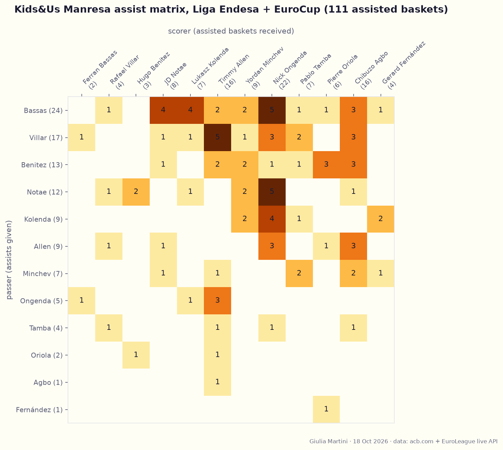
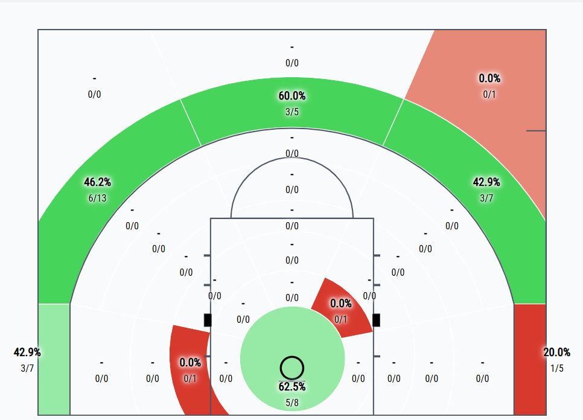
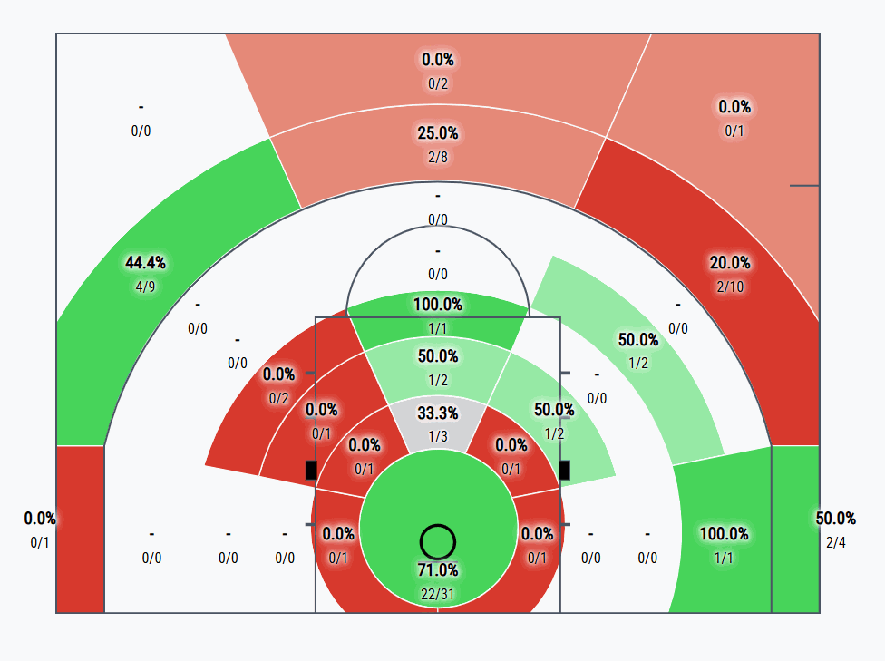
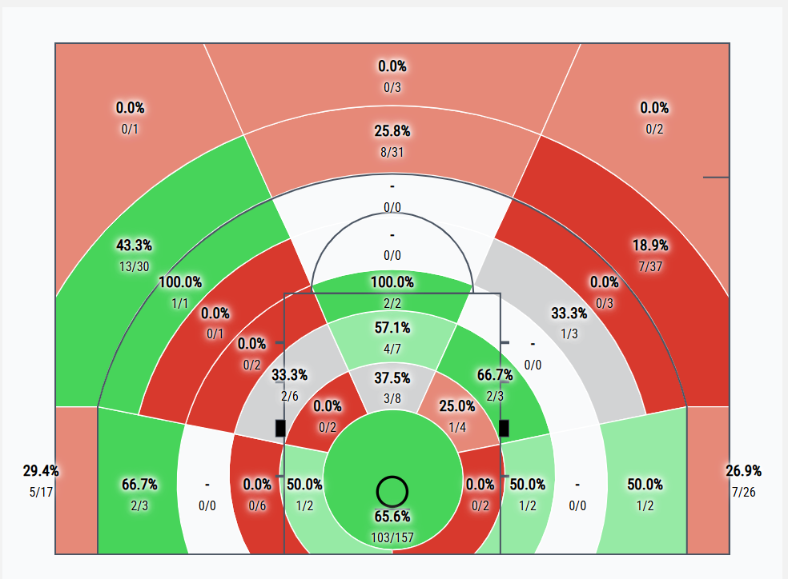

# Kids&Us Manresa scouting report (Liga Endesa + EuroCup)

Oct 18, 2026 · Author: Giulia Martini

## Tuesday's game: key points

Without Allen and Villar, Manresa lose 25.9 of their 87.0 points per game and their top scorer by PIR (20.4). They are 0-2 without Allen this season, scoring 82.0 per game against 89.0 with him.

- **Likely starters:** last game, also without both, opened with Agbo / Benitez / Minchev / Notae / Ongenda. That unit is +5 in 5.1 minutes (one game).

- **Scoring load:** Notae (13.7), Oriola (12.0, only 3 GP), Ongenda (10.1) and Agbo (9.0, 42% from 3 on 5.4 attempts per game) carry it.

- **Ball handling:** creation moves to Bassas (4.5 ast) and Benitez (4.0 ast). Bassas turns it over on 32.6% of his possessions and shoots 24% from the field (4.2 attempts per game).

- **Shot profile without Allen and Villar:** 65.6% at the rim (103/157), 25.8% from 3 at the top (8/31), 43.3% from the right wing (13/30) and 18.9% from the left wing (7/37).

- **Defence:** Manresa concede 99.1 points per game (103.0 in Liga Endesa) and are 1-6 overall.

- **Lineups:** the most-used five (+37 per 40) includes both absent players, so Tuesday's rotation has little shared history.

Based solely on the data (7 games, small sample), with no assessment of plays or tactics. Percentages on low attempt volumes are not commented.

## Roster

Manresa most likely lose their primary scorer for Tuesday: Timmy Allen (21.4 pts) and Rafael Villar are both out. Players are ordered by position (PG, SG, SF, PF, C), then by minutes per game.

| Player              | Pos | Ht (cm) | GP  | MIN  | PTS  | REB                           | AST                           | 2P% (2PA) | 3P% (3PA) | FT% (FTA)                          | PPG ACB | PPG EC |
|---------------------|-----|---------|-----|------|------|-------------------------------|-------------------------------|-----------|-----------|------------------------------------|---------|--------|
| Rafael Villar (OUT) | PG  | 191     | 6   | 19.2 | 4.5  | 1.8                           | 3.3                           | 75 (2.0) | 17 (2.0)  | 43 (1.2)                           | 7.0     | 2.0    |
| Hugo Benitez        | PG  | 192     | 4   | 19.2 | 8.2  | 1.5                           | 4.0 | 65 (5.0) | 17 (1.5)  | 50 (2.0) | 7.3     | 11.0   |
| Ferran Bassas       | PG  | 181     | 6   | 19.0 | 3.7  | 2.0                           | 4.5 | 50 (1.0) | 16 (3.2)  | 78 (1.5)                           | 1.8     | 7.5    |
| JD Notae            | SG  | 187     | 7   | 21.2 | 13.7 | 2.0                           | 2.4 | 56 (7.1) | 29 (5.0)  | 71 (2.0)                           | 13.0    | 14.7   |
| Lukasz Kolenda      | SG  | 195     | 6   | 19.1 | 8.2  | 2.2                           | 1.8                           | 53 (3.2) | 28 (3.0)  | 82 (2.8)                           | 10.3    | 6.0    |
| Chibuzo Agbo        | SF  | 200     | 7   | 20.3 | 9.0  | 2.1                           | 0.4                           | 50 (1.4) | 42 (5.4)  | 62 (1.1)                           | 10.2    | 7.3    |
| Pablo Tamba         | SF  | 200     | 7   | 13.1 | 4.7  | 2.6                           | 0.6                           | 85 (1.9) | 33 (0.9)  | 42 (1.7) | 4.5     | 5.0    |
| Timmy Allen (OUT)   | PF  | 198     | 5   | 25.7 | 21.4 | 4.2                           | 2.0                           | 59 (7.8) | 46 (4.8)  | 76 (7.4)                           | 20.5    | 22.0   |
| Yordan Minchev      | PF  | 205     | 7   | 17.5 | 5.4  | 5.6 | 1.3                           | 43 (4.0) | 23 (1.9)  | 42 (1.7) | 7.2     | 3.0    |
| Eric Vila           | PF  | 209     | 5   | 12.2 | 1.8  | 2.6                           | 0.6                           | 75 (0.8) | 0 (2.0)   | 75 (0.8)                           | 1.7     | 2.0    |
| Pierre Oriola       | C   | 208     | 3   | 19.6 | 12.0 | 6.0 | 0.7                           | 55 (6.7) | 0 (0.7)   | 70 (6.7)                           | 11.5    | 13.0   |
| Nick Ongenda        | C   | 211     | 7   | 18.8 | 10.1 | 3.6                           | 1.0                           | 58 (6.9) | – (0.0)   | 65 (3.3)                           | 10.2    | 10.0   |

**Profiles**

- **Hugo Benitez:** main creator

- **Ferran Bassas:** main creator

- **JD Notae:** volume shooter from 3 (5.0 att, 29%)

- **Chibuzo Agbo:** volume shooter from 3 (5.4 att, 42%)

- **Timmy Allen (OUT):** primary scorer; volume shooter from 3 (4.8 att, 46%); turnover-prone (2.6)

- **Pierre Oriola:** rebounder

- **Role players:** Villar (OUT), Kolenda, Tamba, Minchev, Vila, Ongenda

Height in cm from the EuroLeague roster; position from ACB role / EuroLeague roster. Per-game stats combine Liga Endesa and EuroCup. Shooting attempts per game in brackets (Synergy team box score; 2P% and 2PA computed from the Liga Endesa and EuroCup box scores); percentages on low attempt volumes are not commented. Based solely on the data, with no assessment of plays or tactics.

## Assists

Bassas is the main passer (24 assisted baskets) and Ongenda the main finisher (22 received). Villar to Allen (5) was a top combination, and both are out on Tuesday.

Passer (rows) to scorer (columns): 111 assisted baskets linked from the play-by-play, about 90% of box-score assists.

| Passer → scorer                | Assisted baskets             |
|--------------------------------|------------------------------|
| Ferran Bassas → Nick Ongenda   | 5 (transition or short roll) |
| JD Notae → Nick Ongenda        | 5                            |
| Ferran Bassas → Lukasz Kolenda | 4                            |
| Ferran Bassas → JD Notae       | 4                            |
| Benitez → Agbo                 | 3 (catch and shoot 3P)       |
| Benitez → Oriola               | 5 (transition or short roll) |

## Turnovers

Manresa average 13.9 turnovers per game, 15.0% of their possessions. Allen has the most per game (2.6, out on Tuesday); Bassas has the highest rate, 32.6% of his possessions.  
**Struggles when trapped after a P&R, or the screener defense commits.**  
Notae is also prone to turnovers.

## Lineups (work in progress)

The most-used five (Agbo / Notae / Ongenda / Villar / Allen, +37 per 40) cannot play on Tuesday.  
  
**Most used line-up without Villar and Allen (17 possessions)**

\#6 Bassas  
\#8 Tamba  
\#11 Agbo  
\#13 Notae  
\#91 Minchev  
  
Notae often as primarily ball handler, looking for a quick shot after an initial high P&R.  
  
**Other lineups without Villar and Allen (12 and 10 possessions)**

\#2 Benitez  
\#11 Agbo  
\#13 Notae  
\#14 Ongenda  
\#91 Minchev

\#4 Vila  
\#6 Bassas  
\#11 Agbo  
\#13 Notae  
\#14 Ongenda

Slower line-up in offense, set plays

## Shots analysis

### Chibuzo Agbo

Very good percentages also guarded, catch and shoot primarily

### JD Notae

Mid-range shots are mainly results from drives after P&R where he tries to get to the rim even in crowded situations.

### Team without Allen and Villar

Good percentages from 3P right wing, poor on the left.
