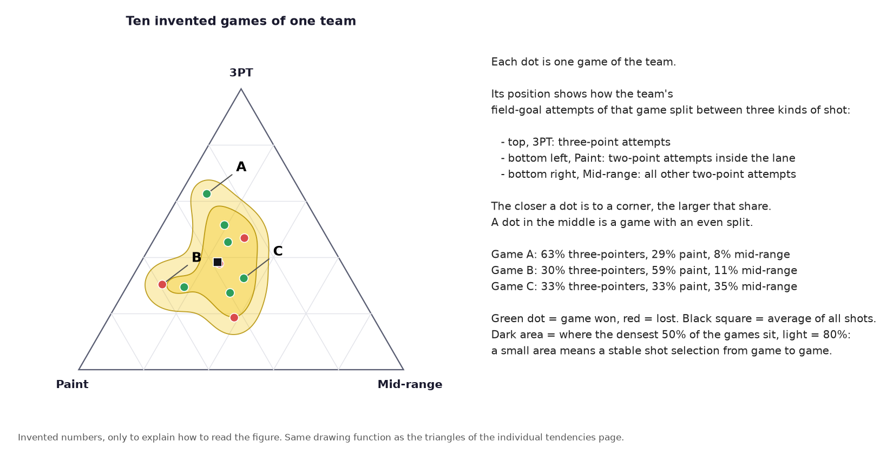
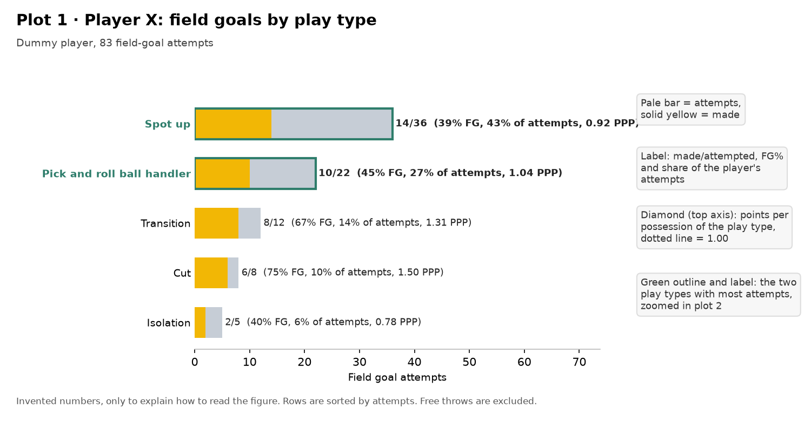
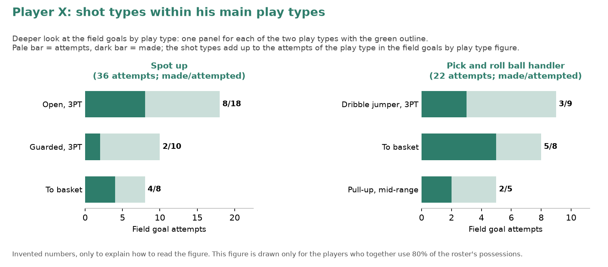
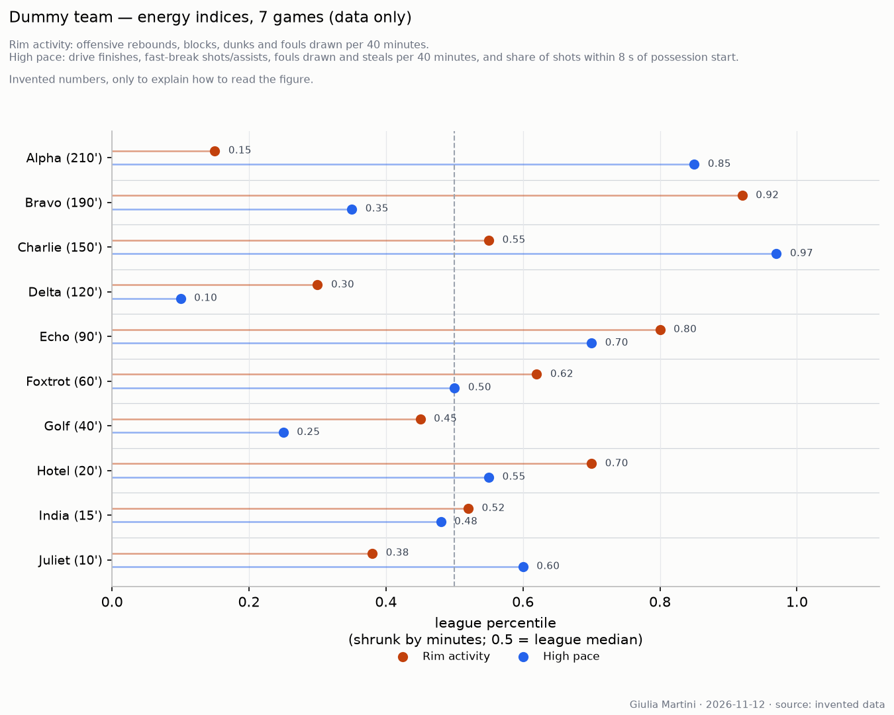
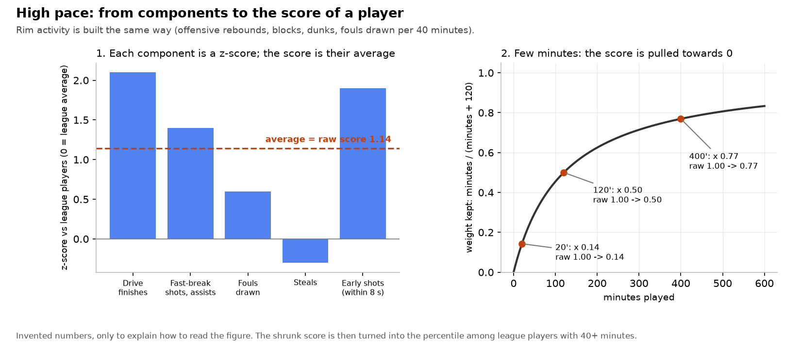

# Methodology

How the numbers on this site are produced, so that any figure can be checked and every limit is visible. Nothing here is a
judgement about plays or tactics: the pages are built from box scores and play-by-play, then reviewed and completed by hand.

## Data and sources

| What | Source | How it arrives |
|---|---|---|
| LBA games, box scores, play-by-play with shot coordinates, standings inputs | legabasket.it JSON API (not official, can change without notice) | collected every morning by a GitHub Action, only games not stored yet |
| EuroCup results of every game, club rosters, headshots | EuroLeague live API (the one wrapped by the [`euroleague-api`](https://github.com/giasemidis/euroleague_api) package) | fetched by the same daily run; not yet confirmed on real data |
| EuroCup box scores and shot zones of every EuroCup game played | EuroLeague live API (`euroleague-api` package) | file `data/eurocup_2026_raw.txt`, new games appended by the daily run (`notebooks/eurocup_fetch.py`) |
| Manresa (Liga Endesa and EuroCup) | acb.com live stats and the EuroLeague live API | `notebooks/manresa_fetch.py` |
| Player photos | league media server (picture key in the box score), EuroLeague roster endpoint | downloaded once, stored as small thumbnails |
| Positions and heights | filled in by hand | `data/roster.csv` |

## The data cut: only what was known before the game

Every pre-game page (the opponent analysis and the BC Roma snapshot) uses **only games played before the date of that game**,
in both competitions when the team plays both. A page about a game still to come is therefore regenerated whenever new games enter
the data, and a banner says so when earlier games are missing (still to be played, or played and not collected yet).
(Post-game reviews, when switched on, use the data up to and including their game; they are off by default.)

Teams that play the EuroCup (BC Roma, Maxima Roma, and any opponent present in the EuroCup file) are shown with league and EuroCup
games; the others with league games only. The tables say which competitions were included.

## Definitions

- **Possessions** = FGA − offensive rebounds + turnovers + 0.44 × FTA.
- **Offensive rating** = 100 × points / possessions; **defensive rating** = 100 × points allowed / opponent possessions;
  **net rating** = their difference.
- **Pace** = possessions per 40 minutes, the average of the team's and the opponent's possessions.
- **eFG%** = (2P made + 1.5 × 3P made) / FGA. **TS%** = points / (2 × (FGA + 0.44 × FTA)).
- **TOV%** = turnovers per 100 possessions. **OREB%** = offensive rebounds / (offensive rebounds + opponent defensive rebounds);
  **DREB%** is the mirror. **FT rate** = FTA / FGA.
- **PIR** (valutazione) is the efficiency rating published by the league in the box score, not recomputed.
- **FD** (fouls drawn) and **FM** (fouls made) are the average personal fouls a player draws and commits per game, from the box score
  (LBA `falli_sf` and `falli_c`; EuroCup fouls received and committed).
- **Per-game averages** of a player count the games in which he played at least a second.
- **Opponent eFG% and forced TOV%** are what the team allows its opponents.

## Standings

Two points per win. Teams level on points are ordered by the games among them (wins, then fewest losses, repeated for any sub-group
still level), then by overall point difference, then by points scored. Early in the season most tied teams have not met yet, so the
order inside a group is provisional and may differ from the official table.
For a EuroCup game the table is the **EuroCup group of BC Roma** as of the date of the game, computed from the EuroCup results: a
group is the set of teams connected through the full schedule, and the same ordering rules apply (the official EuroCup tie-breaks
may differ slightly). An LBA table is never shown for a EuroCup game.

## Sections of the snapshot and of the analysis

- **Form**: result of every game of both competitions, in date order.
- **Playing-time flag**: in the last game, a player is flagged if he played at least 8 minutes and either 7 minutes more or 30% more
  than his average in the earlier games he played (both competitions). A player with no earlier minutes is shown as new.
- **Roster**: per-game averages before the game; shooting as 2P%, 3P% and FT%, each with attempts per game in brackets.
- **Assist matrix**: each assist event of the LBA play-by-play is linked to the field goal it set up; the matrix shows passer (rows)
  and scorer (columns), for players involved in at least four assisted baskets. Box-score assists are used as a check (the share
  covered is printed in the title). There is no play-by-play for EuroCup games here, so the matrix is LBA only.
- **Shot zones**: shot coordinates (percent of the court) are converted to centimetres and folded onto one half court; nine zones
  (under the basket, short left and right, mid-range left, centre and right, three-point left, centre and right). FG% by zone is
  compared with all other LBA teams.
- **TS% vs PIR**: players with at least 10 minutes per game; dot size is minutes per game; one plot with LBA games only and one with
  EuroCup games only. The grey dots are other teams' players in the same competition (in the EuroCup, only the teams present in the
  file).
- **Compare two situations**: the page *Compare* puts two snapshots side by side (record and position, team numbers, roster averages) and
  shows B minus A in brackets. The figures are the ones of the snapshots, so each side uses only the data available before its game.
- **Opponent comparison**: the table puts BC Roma and the opponent side by side with the definitions above; the figures of the analysis
  (scoring sources, hot spots, key players, lineups) come from the same data cut.
- **Five-man lineups**: rebuilt from the substitutions in the play-by-play; best and worst units need a minimum of minutes together
  and are ranked by net points per 40 minutes.

## Reading the shot-selection triangles and the play-type plots

These figures are on the *Individual tendencies* page of every analysis. The pictures below use invented numbers; they are drawn
by `notebooks/methodology_figures.py` with the same functions as the real figures.

### Shot-selection triangle

How the field-goal attempts of each game split between three kinds of shot: 3-point (top corner), paint (bottom left: two-point
attempts inside the lane) and mid-range (bottom right: every other two-point attempt). One dot is one game; the closer it is to a
corner, the larger that share, and a dot in the middle is an even split. Green = game won, red = lost. The shaded areas hold the
densest 50% (dark) and 80% (light) of the games, so a small area means a stable shot selection. The black square is the average
of all the shots. Source: the league play-by-play (shot coordinates), games before the date of the analysis. Areas need three games
or more; a player needs three games with three attempts or more.

### Plot 1: field goals by play type

One figure per player, from Synergy. Each bar is a play type (spot up, pick and roll, transition, ...), sorted by attempts: the pale bar
is the attempts, the yellow bar the made field goals. The label gives made/attempted, FG% and the share of the player's attempts.
The label ends with the points per possession (PPP) of that play type: points divided by all its possessions, which end in a shot,
a turnover or free throws, so it is not the same as the FG% of the bar (*Other* pools handoffs, post-ups and miscellaneous plays).
Free throws are excluded from the bars; *Other* collects handoffs, post-ups and miscellaneous plays. The two play types with most attempts have a
green outline and a green name: they are the ones detailed in plot 2.

### Plot 2: shot types within the main play types

A deeper look at plot 1, drawn in green so the two are not confused. It exists only for the players who together use 80% of the
roster's possessions (players sorted by possessions used, added up until the share reaches 80%), and has one panel for each of the two
play types with the green outline in plot 1. Each bar is a Synergy shot type (open or guarded three, to the basket, dribble jumper,
...): pale = attempts, dark = made. The shot types of a panel add up to the attempts of that play type in plot 1.

Both plots rest on small samples (a handful of games) and on tables extracted by hand from Synergy: read them as descriptive, not as
a forecast.

## Energy indices: rim activity and high pace

Two scores per player, built from the box score and the play-by-play only (no judgement of the playing style), on the *Individual
tendencies* page under "Energy". The pictures use invented numbers; they are drawn by `notebooks/methodology_figures.py`.

- **Rim activity**: offensive rebounds, blocks, dunks and fouls drawn, each per 40 minutes.
- **High pace**: drive finishes (shots tagged "Da penetrazione" or "Tiro in corsa"), fast-break shots and assists ("contropiede"), fouls
  drawn and steals per 40 minutes, plus the share of the player's field-goal attempts taken within 8 seconds of the possession start.
  Fouls drawn count in both scores, on purpose.
- **How a score is built**: each component is turned into a z-score against all league players with at least 40 minutes (how many
  standard deviations above or below the league average, clipped at +-3); the z-scores of a score are averaged; the average is then
  multiplied by minutes / (minutes + 120), so a player with few minutes is pulled towards 0 and a lucky short stint does not top the list.
- **What the figure shows**: the percentile of the shrunk score among league players (0.5 = league median). Players are sorted by minutes
  played. For a EuroCup opponent the drives and fast-break shots come from the Synergy pull and are scaled on the LBA players.

## Page status flags

Pages are first generated automatically and then reviewed. For a game still to come, a banner at the top says *Automatic draft, not
reviewed yet* (no text written), *Work in progress* (some text), or nothing once the page file carries `reviewed: yes` (a draft is a page that is still exactly what was generated). Other banners
say which games before this one are not in the data yet.

## Limits to keep in mind

- **Small samples.** Early in the season a team has three to six games: percentages on few attempts are noise. Read tendencies, not
  conclusions.
- **Unofficial sources.** The league API is not documented and can change; stats can be corrected after the game, and a stored game
  is not re-fetched unless it is deleted and collected again.
- **EuroCup coverage.** Box scores exist only for the teams entered in the EuroCup file; home and away of those games are read from
  the order of the teams in the feed. Standings are computed here, not copied from the official table.
- **No tactical content in the automatic parts.** Plays, coverages and intentions are for the written text of each page.
